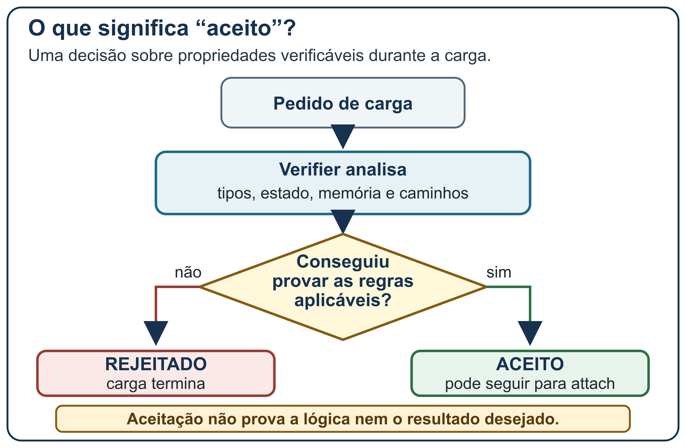

# eBPF e Cilium sem mistério
## fundamentos e laboratório guiado para iniciantes
**Autor:** Learn Cilium · **Local:** Teresina · **Ano:** 2026 · **Edição:** 0.2 de trabalho · **Público-alvo:** iniciantes em Linux, redes e Kubernetes

## Apresentação

Começamos por três perguntas: onde um comando roda, por onde uma conexão passa e que evidência ajuda a localizar uma falha? C01–C03 apresentam Linux, rede e Kubernetes. Depois, E01–E06 levam do reconhecimento do ambiente à cadeia de aplicações, observação, controle de tráfego, diagnóstico e limpeza.

**Como usar:** há dois modos para a mesma prática. No modo guiado, siga E01 a E06 na ordem. No modo de revisão, leia os requisitos dos laboratórios A, B e C e tente produzir evidências antes de consultar os passos ou as soluções. Ambos usam os gates do próprio laboratório; não dependem de kubeconfig, UID ou operação entregue por instrutor.

Os dois modos usam uma só rodada, uma namespace e o mesmo recibo. Não é preciso dominar Bash nem entender a função `record` para usar os exercícios. Depois da limpeza, as soluções interpretam o recibo já preenchido; não iniciam outra rodada. Antes de cada exercício, estude a figura e anote uma previsão. “Esperado — ILUSTRATIVO” descreve um resultado possível. “NOT_RUN — ainda não executado” marca os campos do aluno ainda vazios. As caixas “Saída real” mostram o que o laboratório imprimiu na execução de referência desta edição.

**Execução de referência:** esta edição foi executada de ponta a ponta, de E01 a E06, em 10 de novembro de 2026, em uma VM Ubuntu 24.04.5 limpa com 4 vCPU e 8 GiB de RAM; todos os exercícios passaram. As caixas “Saída real” vêm dessa execução, com os comandos e os manifests deste livro. Depois dela, o texto foi revisado para registrar as saídas e para que um erro ao carregar `lab-env` não feche o Terminal A. Run-id, UIDs, porta do API server, endereços IP, nomes de Pods e horários mudam a cada rodada; as caixas os mostram abreviados com `…` ou os marcam como variáveis. Execute os comandos na sua VM e preencha os campos NOT_RUN com a sua própria saída. Cilium stable 1.20.4 é uma referência documental; o perfil instala Cilium e Hubble 1.20.2. As saídas de rodadas anteriores, feitas em outro ambiente, foram substituídas por estas.

~~~{=latex}
\makeatletter
\LetLtxMacro\guiaPdfBookmarkOriginal\pdfbookmark
\renewcommand{\pdfbookmark}[3][0]{%
  \def\guiaBookmarkDestination{#3}%
  \def\guiaSuppressLoq{loq}%
  \def\guiaSuppressLot{lot}%
  \ifx\guiaBookmarkDestination\guiaSuppressLoq
  \else\ifx\guiaBookmarkDestination\guiaSuppressLot
  \else\guiaPdfBookmarkOriginal[#1]{#2}{#3}%
  \fi\fi}
\def\listofquadros{\@ifstar{\relax}{\relax}}
\def\listoftables{\@ifstar{\relax}{\relax}}
\makeatother
~~~

~~~{=latex}
\RecustomVerbatimEnvironment{verbatim}{Verbatim}{breaklines,breakanywhere,fontsize=\normalsize,frame=single,framesep=2mm}
~~~

~~~{=latex}
\clearpage
~~~

## Módulo 1 — C01 · Linux sem medo

### 1.1 Por que começar pelo Linux

O Linux é o sistema operacional no qual o Cilium integra boa parte de sua rede. Entender onde termina um processo e começa o kernel evita tratar cada contêiner como uma máquina independente. Neste capítulo, você vai:

- distinguir um processo, o kernel e o sistema de arquivos usado por um contêiner;
- explicar para que servem namespaces e cgroups sem supor que um contêiner tem um kernel próprio;
- localizar comandos no computador, na VM Linux e em um Pod e interpretar seu resultado.

**Pré-requisitos:** nenhum. Não é preciso abrir terminal ou ter um cluster para ler os exemplos.

### 1.2 Palavras antes do jargão

O **kernel** é o núcleo que administra CPU, memória, dispositivos e chamadas de sistema. Um **processo** é um programa em execução, com um identificador e recursos associados. Um **contêiner** organiza um ou mais processos com uma visão isolada de recursos do Linux; ele usa o kernel do sistema que o hospeda. **Namespaces** alteram a visão de recursos como processos, rede e montagem de arquivos. **Cgroups** organizam e medem recursos de grupos de processos. Esses recursos ajudam a formar contêineres, mas não transformam cada contêiner em uma máquina virtual completa. (Linux man-pages project, 2026)

Uma **máquina virtual** inclui um sistema operacional convidado e seu próprio kernel virtualizado. Um contêiner Linux comum compartilha o kernel Linux do host. Uma analogia limitada: apartamentos compartilham partes de um prédio, enquanto cada morador tem um espaço próprio. A analogia para nos limites das diferenças entre um prédio físico e as regras técnicas de namespaces, cgroups e sistema de arquivos; não descreve o mecanismo de segurança completo.

**Figura 1 – Linux separa processo, kernel, contêiner e lugar de execução**


Fonte: elaboração própria (2026), com base em (Linux man-pages project, 2026), (Kubernetes Authors, 2026) e no roteiro E01.\
Nota: é um modelo didático, não um diagrama de um cluster medido.

```{=latex}
\FloatBarrier
```

### 1.3 Terminal, shell e comandos

Um **terminal** é a interface onde você digita e lê texto. Um **shell**, como Bash, interpreta essa linha e chama programas. Uma **variável** guarda um valor durante a sessão; escrever LAB_NS=valor atribui um valor ao nome LAB_NS, e $LAB_NS pede o valor guardado. Aspas duplas mantêm junto um valor que tenha espaços e deixam variáveis serem expandidas. Aspas simples preservam o conteúdo literalmente. A barra / separa diretórios e também aparece em URLs e caminhos; seu significado depende do contexto. O escape com barra invertida muda como o shell interpreta o próximo caractere. (GNU Project, 2025)

Um **código de saída** é o número que o comando devolve ao shell: zero costuma indicar conclusão sem erro para aquele comando; valor diferente de zero indica falha segundo o próprio programa. Isso não é o mesmo que um código HTTP. Com `curl --fail-with-body`, uma resposta HTTP de erro também faz curl devolver código diferente de zero; sem a opção, curl pode terminar com código zero mesmo ao receber HTTP 502. Registre os dois sinais quando ambos existirem. (GNU Project, 2025)

A tecla **Ctrl-C** envia uma interrupção ao comando em primeiro plano daquele terminal. No exercício E03, a porta encaminhada roda em outro terminal; Ctrl-C nele encerra somente aquele encaminhamento. Não pressione Ctrl-C em um terminal que esteja aplicando ou apagando recursos.

### 1.4 Exemplo e perguntas

Leia os locais:

- HOST: computador pessoal. O kernel pode ser macOS; comandos Linux não ganham um kernel Linux por serem executados aqui.
- VM Ubuntu: ambiente próprio que tem o cliente kubectl e acessa o API server com a identidade gerada pelo perfil.
- POD: unidade Kubernetes que reúne contêineres e compartilha uma identidade de rede local entre eles.
- processo no frontend: o curl executa no contêiner, mas kubectl exec é enviado pela VM ao API server.

**Perguntas para recordar**

1. Um contêiner Linux padrão tem um kernel próprio?
2. O que namespaces e cgroups organizam?
3. Onde roda o comando depois de `kubectl exec ... --`?
4. Se curl devolveu código 22, isso informa diretamente o código HTTP exato?

**Gabarito comentado:** (1) não; um contêiner Linux comum compartilha o kernel Linux do host. (2) namespaces organizam visões de recursos; cgroups organizam e acompanham recursos de grupos de processos. (3) no contêiner e no Pod selecionados, não no shell da VM. (4) não; o código 22 sinaliza uma classe de resposta HTTP não bem-sucedida em curl, enquanto o status HTTP deve ser lido nos cabeçalhos. Um código de saída descreve o resultado reportado pelo processo, não substitui a evidência da aplicação.

**Atividade guiada — 5 minutos, sem cluster:** classifique cada ação como HOST, VM ou POD e diga se o número observado é código de saída ou status HTTP: (A) abrir um terminal no computador pessoal; (B) executar `kubectl get pods`; (C) interpretar o padrão esquemático abaixo; (D) ler o `HTTP/1.1 200` impresso por curl. Anote também qual linha atravessa o API server.

~~~text
kubectl exec ... -- curl http://api/
~~~

Os pontos representam o nome do Pod; não copie a linha como um comando pronto.

**Resultado esperado — ILUSTRATIVO:** A ocorre no HOST; B ocorre na VM e conversa com o API server; C é iniciado na VM, mas o processo curl roda no POD; D é um status HTTP, não o código de saída. Nenhum cluster é necessário para completar a classificação.

**Prática integrada C01→E01 — estimativa preliminar de 15–25 minutos, não medida:** E01 aplica o mapa HOST/VM/POD, variáveis e aspas, código de saída e a regra de parar diante de uma identidade divergente. O tempo real depende da VM e das respostas do ambiente.

**Erro comum:** executar um comando no lugar errado e interpretar a falha como problema de rede. Antes de qualquer comando, diga em voz alta: “host, VM ou Pod?”

**Resumo:** o kernel executa processos; contêineres usam mecanismos de isolamento sobre um kernel; o shell interpreta comandos; local de execução e código de saída fazem parte do diagnóstico.

**Glossário consultável**

- **Kernel:** núcleo do sistema operacional.
- **Processo:** programa em execução.
- **Contêiner:** ambiente organizado para processos.
- **Namespace Linux:** visão isolada de certos recursos do sistema.
- **Cgroup:** agrupamento e controle de recursos.
- **Terminal:** interface de texto.
- **Shell:** intérprete de comandos.
- **Variável:** nome que guarda um valor.
- **Código de saída:** resultado do comando informado ao shell.

**Leituras:** namespaces e cgroups no Linux; segurança de contêineres e contextos de segurança no Kubernetes; Bash: expansão, aspas e status de saída.

## Módulo 2 — C02 · Uma conversa pela rede

### 2.1 Seguir a ida e a volta

Uma aplicação conversa com outra usando nomes, endereços, portas e protocolos. Neste capítulo, você vai:

- diferenciar nome DNS, endereço IP, bloco CIDR e porta;
- narrar em ordem a resolução de nome, a abertura TCP e as formas de encerrar ou interromper uma conexão;
- explicar que uma resposta HTTP retorna pela conexão e que o caminho concreto depende do ambiente.

**Pré-requisitos:** reconhecer o shell, o processo e a VM Linux do C01. Não é necessário calcular sub-redes à mão.

### 2.2 Termos sem atalhos

Um **nome DNS** é um nome consultado para encontrar dados associados, como o endereço de um Service Kubernetes. **DNS** responde a uma consulta de nome; não carrega por si só o conteúdo HTTP. Um **endereço IP** identifica um destino na rede durante determinado escopo e tempo. **CIDR** escreve um endereço seguido do tamanho do prefixo de rede, por exemplo 10.20.0.0/24; /24 conta bits do prefixo, não indica uma porta. Um **pacote** transporta dados e cabeçalhos de protocolos em camadas.

Uma **porta TCP** identifica um ponto de comunicação dentro de um host de rede; não é um endereço IP. **TCP** estabelece uma conexão confiável entre extremos. **HTTP** descreve pedidos e respostas de aplicação carregados sobre uma conexão; método, caminho e status pertencem a HTTP, não ao endereço DNS. (IETF, 1987) (IETF, 2006) (IETF, 2022)

No Kubernetes, um **Service** oferece um destino lógico para Pods selecionados. O cliente usa a porta do Service; **targetPort** indica a porta dos contêineres para a qual o Service encaminha. Uma **namespace Kubernetes** agrupa nomes de muitos objetos; ela é diferente da namespace Linux do C01 e não isola sozinha todo o cluster. (Kubernetes Authors, 2026)

**SYN** participa da abertura TCP; **ACK** confirma dados ou controles recebidos; **FIN** informa que aquele lado não enviará mais dados nessa conexão; **RST** sinaliza uma interrupção. Depois de enviar FIN, o lado ainda pode receber dados enquanto o outro lado não encerra o próprio envio. RST não é uma etapa do fechamento normal, e seu efeito depende do estado TCP. (IETF, 2022)

**Figura 2 – Um nome, um endereço e uma conexão carregam informações diferentes**


Fonte: elaboração própria (2026), com base em (IETF, 1987), (IETF, 2006), (IETF, 2022) e (Kubernetes Authors, 2026).\
Nota: endereços e prefixos são ilustrativos; IPs de Pod não são universais.

```{=latex}
\FloatBarrier
```

### 2.3 Um endereço lógico não é o caminho inteiro

No laboratório, o cliente pergunta por api. O DNS do cluster pode resolver esse nome para o Service api no namespace atual. O Service representa um destino lógico estável para o cliente; a rede do cluster encaminha a conexão para um Pod elegível. O endereço IP concreto do Pod e o mecanismo que o alcança dependem do cluster e do CNI, interface pela qual componentes de rede configuram a rede dos Pods. Não calcule nem fixe IP de Pod no roteiro. (Kubernetes Authors, 2026)

O Service da API recebe na porta 80 e encaminha ao contêiner na porta 8080. A API NGINX aceita a conexão e abre outra conexão ao Service backend na porta 80; esse Service encaminha ao processo httpd do backend na porta 8080. A resposta volta pela conexão de cada trecho. “Porta 80 para 8080” descreve o mapeamento do Service deste exemplo; não declara uma regra universal do Cilium. (Kubernetes Authors, 2026)

TCP costuma começar com SYN, SYN-ACK e ACK. Esse handshake abre a conexão; não é uma confirmação de que HTTP funcionará. A aplicação ainda pode responder 404, 502 ou outro status. Uma conexão pode ser bloqueada antes de haver resposta HTTP. Em sentido contrário, uma resposta HTTP pode chegar e ainda indicar erro de aplicação. Em HTTP/1.1, conexões podem persistir; receber uma resposta HTTP não significa, por si só, que TCP foi fechado. (IETF, 2022)

No fechamento normal ilustrado, A envia FIN para encerrar seu envio; B confirma com ACK e ainda pode enviar dados. Quando B terminar, envia FIN no sentido contrário, e A confirma com ACK. Assim, cada FIN encerra o envio em uma direção. Algumas mensagens de controle podem ser combinadas; a figura separa os passos para facilitar a leitura. Um RST pode interromper a conexão em vez desse fechamento ordenado; não é o passo seguinte ao par de FINs, e a validade da interrupção depende do estado TCP. Este é um modelo didático, não uma sequência universal. (IETF, 2022)

Uma analogia limitada: DNS se parece com consultar um catálogo para obter um endereço; TCP se parece com abrir uma conversa de ida e volta; HTTP é o formato combinado para pedir e responder. A analogia ajuda a separar etapas, mas não descreve encaminhamento de pacotes, balanceamento de Service ou regras de tráfego.

**Atividade guiada — 7 minutos, sem cluster:** use o cenário fixo do laboratório e trace `frontend → api:80 → Pod api:8080 → backend:80 → Pod backend:8080`. Marque onde ocorre DNS, quais Services recebem na porta 80, quais contêineres recebem na 8080 e onde NGINX abre uma segunda conexão. Depois desenhe uma seta de resposta para cada conexão. Em duas linhas do tempo, ordene a abertura `SYN A→B`, `SYN-ACK B→A`, `ACK A→B` e o fechamento `FIN A→B`, `ACK B→A`, `FIN B→A`, `ACK A→B`. Marque qual lado ainda pode receber dados depois do primeiro FIN. Em um cartão separado, desenhe `RST A→B` e anote que ele interrompe, sem colocá-lo depois do fechamento normal.

**Resultado esperado — ILUSTRATIVO:** os nomes `api` e `backend` identificam Services; cada Service recebe na porta 80 e encaminha para a porta 8080 do Pod selecionado. O frontend abre a primeira conexão com a API; NGINX abre a segunda com backend. Cada resposta percorre sua conexão de volta. Isso é o modelo dos manifests, não uma medição do cluster.

**Prática integrada C02→E02 — estimativa preliminar de 15–25 minutos, não medida:** E02 aplica DNS, Service, portas, duas conexões TCP e resposta HTTP ao caminho dos manifests. A estimativa exclui espera extraordinária por imagem ou assistência e não é um tempo observado.

~~~{=latex}
\clearpage
~~~

**Perguntas para recordar**

1. O que /24 mede em 10.20.0.0/24?
2. DNS transporta o corpo da resposta HTTP?
3. Qual é a diferença entre porta do Service e targetPort neste laboratório?
4. SYN, SYN-ACK e ACK abrem ou fecham a conexão?
5. No fechamento normal, o que cada FIN encerra? Onde entra um RST?

**Gabarito comentado:** (1) 24 bits do prefixo da rede. (2) não; DNS responde consultas de nome e a conversa HTTP usa uma conexão posterior. (3) o cliente chama o Service na 80; o Service direciona ao contêiner na 8080. (4) abrem. (5) FIN encerra o envio de quem o envia; o outro lado confirma e ainda pode enviar até mandar seu próprio FIN. RST é uma interrupção alternativa, não uma etapa depois do fechamento normal, e depende do estado TCP. As portas e IPs devem ser lidos no contexto e não copiados como valores universais.

**Erro comum:** dizer “o DNS falhou” quando o nome resolveu, mas o Service não tem endpoint pronto. Separar consulta DNS, conexão TCP, rota até o destino e resposta HTTP produz hipóteses diferentes.

**Resumo:** DNS resolve nomes; IPs identificam destinos; CIDR descreve prefixos; TCP abre conexões, pode encerrá-las por direção com FIN ou interrompê-las com RST; HTTP troca pedidos e respostas sem determinar sozinho quando TCP fecha.

**Glossário consultável**

- **DNS:** sistema de nomes que responde a consultas.
- **Endereço IP:** endereço de rede usado para localizar um destino.
- **CIDR:** endereço acompanhado do tamanho do prefixo de rede.
- **Porta:** identificador de comunicação TCP ou UDP.
- **SYN:** controle usado na abertura TCP.
- **ACK:** confirmação de dados ou controles recebidos.
- **FIN:** encerramento do envio em uma direção.
- **RST:** interrupção TCP.
- **HTTP:** protocolo de pedidos e respostas de aplicação.
- **Status HTTP:** resultado informado pela resposta da aplicação.

**Leituras:** RFC 1034 (DNS); RFC 4632 (CIDR); RFC 9110 (HTTP Semantics); RFC 9293 (TCP); DNS e Services no Kubernetes.

## Módulo 3 — C03 · Kubernetes em tamanho pequeno

### 3.1 Objetivos e objetos que se encontram

Kubernetes descreve o estado desejado por objetos. Um **cluster** contém o plano de controle e nós que executam Pods. Um **Pod** é a unidade programada no nó; contêineres do mesmo Pod compartilham rede local. Um **Deployment** pede réplicas de Pods e as mantém. Uma **label** é uma chave e valor que identifica um objeto; um **selector** escolhe objetos que têm as labels correspondentes. Label ajuda a agrupar, não autentica uma pessoa ou workload. (Kubernetes Authors, 2026)

Um **Service** fornece um nome e destino lógico para um conjunto selecionado de Pods. Uma **EndpointSlice** registra partes dos destinos de rede associados ao Service, incluindo endereços e condições como pronto ou encerrando. Um **CNI** integra a configuração de rede dos Pods; Cilium é o CNI já instalado neste roteiro. **NetworkPolicy** declara comunicações permitidas para Pods selecionados. **ConfigMap** entrega configuração não secreta. **Probe** é uma verificação periódica de uma aplicação; readiness influencia se o Pod recebe tráfego de Service, enquanto liveness pode levar à reinicialização. (Kubernetes Authors, 2026)

**Hubble** é a camada de observabilidade de fluxos do Cilium: ela apresenta eventos disponíveis conforme instrumentação, versão e configuração. Esses eventos não mostram, por si só, todo o payload nem todo o estado do datapath. (Cilium Authors, 2026)

Ao final, você poderá:

- relacionar Node, Pod, Deployment, Service, selector e EndpointSlice;
- apontar quando a rede do Pod, a resolução DNS e o encaminhamento do Service têm papéis diferentes;
- explicar o que as probes verificam e o que uma evidência de Hubble não mostra.

**Pré-requisitos:** vocabulário dos capítulos anteriores. O cenário usa apenas três Pods e dois Services internos; não instala componentes do cluster.

**Analogia limitada:** Deployment lembra uma receita de quantas cópias manter; Service lembra um endereço de atendimento. A receita não descreve cada pacote, e o endereço lógico não é uma pessoa nem contém a aplicação.

### 3.2 Criação de Pod e escolha de endpoint

O plano de controle recebe a intenção do Deployment. Um controlador mantém o conjunto de Pods; o scheduler escolhe um nó; o agente daquele nó e o CNI preparam a interface de rede do Pod. O Deployment não escolhe uma rota HTTP, o Service não inicia um contêiner e o CNI não substitui a aplicação. (Kubernetes Authors, 2026)

**Figura 3 – Deployment, Pod, Service e EndpointSlice respondem perguntas diferentes**


Fonte: elaboração própria (2026), com base em (Kubernetes Authors, 2026) e no percurso E02.\
Nota: nomes são do laboratório, endereço de Pod e topologia permanecem dinâmicos.

```{=latex}
\FloatBarrier
```

O laboratório tem quatro papéis, mas três Deployments: frontend é um cliente curl ocioso; api é NGINX funcionando como proxy reverso; backend é BusyBox httpd servindo arquivos estáticos. “API” aqui nomeia um proxy didático, não uma API de negócio. O Service backend deve existir antes de o Deployment api iniciar: o NGINX usa o nome DNS backend em sua configuração. O Service api também recebe na porta 80 e aponta para o contêiner NGINX em 8080. (Kubernetes Authors, 2026) (NGINX Container Project, 2026)

A API tem uma rota local /ready que responde se o próprio processo NGINX está servindo. Ela não testa o backend. O backend fornece /health; a probe HTTP do Kubernetes consulta esse arquivo estático por httpd. O frontend executa sleep infinity e não é servidor; não recebe uma falsa probe HTTP que diga se a cadeia inteira está saudável. As sondagens HTTP devem ser interpretadas como uma verificação do endpoint especificado, não como teste da aplicação toda. (Kubernetes Authors, 2026)

Cada Pod usa usuário não root, seccomp RuntimeDefault, capabilities descartadas, sem escalada de privilégio, sistema de arquivos raiz somente leitura quando viável, recursos declarados e sem montagem de token de identidade do Kubernetes. O **ServiceAccount** é uma identidade atribuída a um Pod; a do exercício não recebe Role ou RoleBinding. Os contêineres NGINX e BusyBox usam volumes de configuração apenas para leitura; NGINX recebe /tmp gravável para PID e arquivos temporários exigidos por sua imagem sem abrir o resto do sistema de arquivos. A imagem NGINX unprivileged escuta em 8080. (Kubernetes Authors, 2026) (NGINX Container Project, 2026)

**Exemplo ilustrativo de encadeamento**

1. frontend consulta api dentro do mesmo namespace.
2. DNS localiza o Service api.
3. O Service encaminha a conexão à porta 8080 do Pod api.
4. O processo NGINX encaminha de verdade para http://backend:80.
5. Service backend escolhe Pod backend e encaminha para 8080.
6. BusyBox httpd devolve o arquivo; NGINX devolve corpo e cabeçalho X-Lab-Route.

Cada passo pode falhar por motivos diferentes. Status Ready do backend não prova que o Service o seleciona; um Service existente não prova que há EndpointSlice pronto; e um Pod com processo vivo não prova que a resposta da cadeia foi correta.

### 3.3 Vocabulário para ler o laboratório

Antes dos exercícios, separe palavras parecidas que apontam para coisas diferentes:

- **Namespace Kubernetes:** escopo lógico usado para agrupar muitos objetos namespaced. Não equivale a um namespace Linux nem isola sozinho todos os recursos do cluster.
- **YAML:** formato de texto para representar dados. Um arquivo pode conter um ou mais documentos YAML.
- **Manifesto:** declaração de um recurso Kubernetes. Aplicar um manifesto pede ao API server que aproxime o estado do cluster do estado declarado; não é uma receita universal de rede.
- **ServiceAccount:** identidade atribuída a um Pod dentro do cluster; não é a conta pessoal usada pelo aluno no terminal.
- **Porta do Service e targetPort:** o cliente usa a porta estável do Service; o Service encaminha ao número de porta indicado nos Pods. Neste laboratório, o mapeamento declarado é 80 para 8080.
- **Ingress na policy:** tráfego que chega ao Pod selecionado. Não confunda esse sentido de rede com um objeto Kubernetes Ingress, que não é usado neste recorte.
- **EndpointSlice:** parte da lista de destinos associados ao Service, com endereços e condições de prontidão.
- **Hubble Relay:** componente do cluster que entrega eventos de fluxo ao cliente; a saída não é captura completa nem audit log do API server. (Cilium Authors, 2026)

**Resumo C03:** o Deployment mantém Pods; o CNI prepara sua rede; labels e selectors relacionam objetos; o Service oferece um destino lógico; a EndpointSlice mostra destinos associados. Uma probe examina um endpoint indicado, e Hubble mostra apenas os campos de fluxo que a versão e a configuração disponibilizam.

**Perguntas para conferir**

1. Namespace Kubernetes e namespace Linux são a mesma coisa?
2. Qual objeto mantém o Pod desejado e qual objeto oferece o destino lógico ao cliente?
3. O que uma EndpointSlice acrescenta à leitura do Service?
4. Uma probe local ou um evento Hubble prova que toda a aplicação está saudável?

**Gabarito comentado:** (1) não; namespaces Linux e Kubernetes diferem. (2) Deployment mantém Pods; Service oferece destino lógico. (3) EndpointSlice registra destinos associados e prontidão. (4) não; uma probe ou um fluxo Hubble não prova a saúde da aplicação inteira.

**Atividade sem cluster — 8 minutos:** na Figura 3, use cores diferentes para indicar Deployment e Service e circule EndpointSlice. Trace frontend → api → backend; identifique qual objeto mantém o Pod, qual oferece o destino lógico e qual lista destinos associados.

**Resultado esperado — ILUSTRATIVO:** Deployment mantém Pods; Service nomeia e seleciona destinos; EndpointSlice os registra. A figura não comprova topologia nem estado observado do cluster.

**Erro comum:** tratar o namespace como fronteira completa de segurança ou o Service como um processo. São objetos e escopos distintos; leia cada um pelo papel que desempenha.

**Glossário consultável**

- **Cluster:** plano de controle e nós que executam Pods.
- **Deployment:** objeto que mantém o conjunto declarado de Pods.
- **Label / selector:** par chave-valor de um objeto / regra que seleciona objetos com o par.
- **Service:** nome e destino lógico para Pods selecionados.
- **CNI:** interface pela qual componentes de rede configuram a rede dos Pods.
- **Probe:** verificação periódica do endpoint configurado.
- **NetworkPolicy:** regra que seleciona Pods e descreve comunicações permitidas.
- **Hubble:** observabilidade de fluxos do Cilium.

**Leituras:** Pods, Deployments, Services, EndpointSlices, probes, NetworkPolicy e observabilidade do Hubble.

## Laboratório guiado

Os seis exercícios formam um percurso; cada etapa deixa uma evidência para a seguinte. Os laboratórios de revisão A, B e C organizam esses mesmos passos por resultados, sem criar outra rodada:

1. **E01 · Preparar e reconhecer:** conferir versão, identidade, sessão criada por `lab-session`, memória e revisão; só então criar a namespace da rodada.
2. **E02 · Ver a cadeia saudável:** criar a API proxy e comparar o pedido pelo caminho completo com o acesso direto ao backend.
3. **E03 · Observar uma janela:** correlacionar poucos pedidos manuais com fluxos Hubble; Terminal B mantém apenas o port-forward.
4. **E04 · Testar a policy:** preservar o caminho positivo pela API e reunir evidência correlacionada para o acesso direto bloqueado.
5. **E05 · Diagnosticar e restaurar:** introduzir somente o selector defeituoso previsto, comparar as evidências e restaurar o Service.
6. **E06 · Registrar e limpar:** separar recibo local de audit log do API server e remover somente a namespace cuja identidade foi reconferida.

**Responsabilidades da pessoa estudante**

- Use a sua VM, o clone do repositório e a infraestrutura criada pelo próprio perfil.
- Mantenha o recibo local e registre esperado e observado separadamente.
- Interrompa diante de divergência, consulta inconclusiva ou gate recusado.
- Não amplie o alcance de uma correção nem edite o estado privado.

**Terminais e lugares de execução**

- **Terminal A · VM Ubuntu:** mantenha aberta a mesma sessão, variáveis, atalho k e recibo de E01 a E06. Se for fechada, siga a recuperação de E01; `lab-env` não restaura UID da namespace, recibo nem funções Bash. Os blocos de exercício terminam com `exit 1` quando um guarda detecta divergência: o shell fecha de propósito, para que nada seja criado ou apagado depois dela, e a recuperação de E01 se aplica. Já o carregamento de `lab-env` usa um padrão que não fecha o terminal (ver E01.3).
- **Terminal B · VM Ubuntu:** sessão temporária para o port-forward de E03. Recarregue o mesmo `lab-env`; encerre o encaminhamento com Ctrl-C depois de E05.
- **POD · execução remota:** quando a linha usa `kubectl exec ... --`, kubectl é chamado em A, mas o comando depois de `--` roda no contêiner indicado. Não cole esses comandos no host pessoal.

> **Condição para praticar.** Use a sua própria VM Ubuntu e o clone do repositório obtido no Passo 0 de E01. O que o perfil `iniciantes` cria nessa VM está descrito abaixo e foi o que a execução de 10 de novembro de 2026 encontrou. Se uma condição ou identidade estiver desconhecida, pare antes de criar recursos; não instale nem altere Cilium, Hubble ou configuração do cluster manualmente.

- **VM:** a sua VM Ubuntu 24.04 amd64 limpa, com 4 vCPU e 8 GiB de RAM (configuração que funcionou, com 40 GiB de disco). O gate do `lab-preflight` exige `MemAvailable` de pelo menos 6656 MiB (pico estimado de 2560 MiB mais 4096 MiB) e 25 GiB (25600 MiB) livres em `/`. A RAM total é a única configuração testada, não um mínimo garantido. Kernel observado: Linux 6.8.0-147-generic.
- **Cluster e ferramentas:** contexto `kind-p010-student`, criado pelo perfil; Kubernetes servidor v1.35.0; `kubectl` v1.35.0 (Kustomize v5.7.1).
- **Cilium e Hubble:** Cilium 1.20.2, instalado pelo perfil; cliente Hubble 1.20.2, identificado por `hubble version` (o status do Hubble não informa a versão).
- **Nós e Pods:** um único nó, `p010-student-control-plane` (amd64, Debian GNU/Linux 12); os três Pods do laboratório rodam nele.
- **Conexão do cliente Hubble:** acesso plaintext pelo loopback `127.0.0.1:4245`, por um port-forward ao Relay.

Essa observação cobre uma rodada em um único nó: não demonstra tráfego entre nós, portabilidade ARM, TLS alternativo do cliente nem desempenho. Os valores do seu ambiente são os que os comandos de E01 imprimirem.

### Como preparar o primeiro exercício

Os manifests acompanham o guia em poc-k8s-fabric/k8s/p010-iniciantes/ e já estão no clone do Passo 0 de E01; não misture arquivos de versões diferentes. Eles deixam o campo namespace ausente de propósito, e os comandos usam a namespace da rodada com -n. Os três Deployments usam uma réplica cada. As imagens são referenciadas por digest; na execução de 10/11 o cluster baixou e executou as três, e os digests aparecem em E06.1.

No Terminal A, os comandos kubectl, cilium e hubble rodam na VM Linux. O API server e os agentes Cilium ficam no cluster. Um comando termina com código de saída; curl também pode imprimir um status HTTP. Registre os dois sinais quando ambos existirem. Aspas duplas preservam variáveis como "$LAB_NS" como uma unidade; aspas simples preservam texto literal. Uma barra invertida no fim da linha continua o comando na linha seguinte.

No E03, abra Terminal B apenas para o port-forward do Relay, pois uma sessão Bash nova não herda as variáveis de A. No Terminal A, uma chamada kubectl exec começa no cliente e o processo após `--` roda no contêiner frontend. Ctrl-C encerra o processo em primeiro plano do terminal atual; use-o no B para parar o encaminhamento, nunca enquanto um comando estiver aplicando ou apagando recursos.

## Laboratório A — Ambiente e cadeia HTTP

Esta revisão reúne E01–E02 para confirmar a identidade e comparar as rotas pela API e pelo backend direto, na mesma namespace e recibo.

> **Ficha A. Estado inicial: NOT_RUN**
>
> **Requisito:** identidade confirmada e dois caminhos HTTP comparados.
>
> **Evidência do aluno:** NOT_RUN; ainda não coletada. As saídas reais do livro nas etapas guiadas não preenchem esta ficha.
>
> **Decisão:** pendente até conferir status, corpo, cabeçalho e destinos.

**Apoio visual:** Figuras 4 e 5. Cada desenho aparece no exercício correspondente, antes dos comandos.

**Estado de entrada:** E01 passou pelos gates próprios e a namespace ainda não existe. Use a mesma sessão e a mesma revisão.

**Critérios de saída:** contexto, API server e UIDs conferem; ambas as rotas retornam HTTP 200 e o mesmo corpo; só a API traz o cabeçalho. Probes e EndpointSlice não provam a cadeia HTTP.

**Tarefas por resultado:**

1. **Identificar a rodada:** registre revisão, UTC, contexto, API server, UID de `kube-system` e run-id. Dado ausente ou incerto exige parada; a criação acontece somente depois dos gates e da consulta de ausência.
2. **Comprovar o caminho:** observe probes, Service e EndpointSlice; compare respostas pela API e diretas e registre status, corpo e código. Só a API deve incluir `X-Lab-Route: via-api-proxy`.

**Decisão diagnóstica:** se probe falhar ou faltar destino, compare labels, selector e EndpointSlice; Pod Ready confirma só a probe, e erro de curl não prova a causa.

**Apoio opcional:** E01.1–E01.8 e E02.1–E02.5 localizam orientações e comandos.

**Entregas e estado de saída:** registre esperado, observado e conclusão no mesmo recibo; mantenha namespace, Terminal A e variáveis para B. Não crie outro recibo, reexecute ou limpe.

## E01 — Reconhecer o ambiente e preparar a rodada

### Se o Terminal A for perdido

Um shell novo não herda as variáveis locais, o recibo nem as funções `k` e
`record`. `lab-env` recarrega somente as atribuições privadas do perfil. Não
deduza UID ou run-id, não edite `state.json` e não adote uma namespace pelo
nome. Se o Terminal B ainda mantém o port-forward, encerre-o com Ctrl-C antes
de limpar a infraestrutura.

Se E06 já terminou e confirmou que a namespace foi removida, mantenha o cluster
ativo. Em um Terminal A novo, confirme o perfil e o cluster, crie uma nova
sessão de prática e carregue as atribuições:

~~~bash
make --no-print-directory lab-status LAB=iniciantes
make --no-print-directory lab-verify LAB=iniciantes
make --no-print-directory lab-session LAB=iniciantes
lab_env="$(make --no-print-directory lab-env LAB=iniciantes)" \
  && eval "$lab_env" \
  || { echo "lab-env falhou; veja a mensagem acima"; false; }
unset lab_env
~~~

Se `lab-env` falhar, o padrão `|| { ...; false; }` imprime o aviso e devolve
erro sem fechar o Terminal A; não o troque por `exit`.

Depois, refaça E01.4 para criar um recibo novo para o `LAB_RUN_ID` novo e
redefinir as funções locais. Não repita preflight nem up sobre o cluster que
permaneceu ativo. Se `lab-session` recusar porque a namespace anterior ainda
existe, pare e use o caminho de reinício abaixo.

Se a rodada ainda não chegou à limpeza E06, ou a ausência da namespace não foi
confirmada, não tente reconstruir o UID/recibo perdido. Confira o estado
próprio, encerre somente essa infraestrutura pelos alvos guardados e confirme
que ficou `down`:

~~~bash
make --no-print-directory lab-status LAB=iniciantes
make --no-print-directory lab-down LAB=iniciantes
make --no-print-directory lab-status LAB=iniciantes
~~~

Se status, ownership ou down falhar, ou o estado continuar incerto, pare e
preserve a saída; não remova a namespace ou o cluster manualmente. Quando o
status confirmar `down`, comece uma rodada nova com todos os gates, sessão e
ambiente. Em seguida, refaça E01.4 para produzir um recibo novo:

~~~bash
make --no-print-directory lab-preflight LAB=iniciantes
make --no-print-directory lab-up LAB=iniciantes
make --no-print-directory lab-status LAB=iniciantes
make --no-print-directory lab-verify LAB=iniciantes
make --no-print-directory lab-session LAB=iniciantes
lab_env="$(make --no-print-directory lab-env LAB=iniciantes)" \
  && eval "$lab_env" \
  || { echo "lab-env falhou; veja a mensagem acima"; false; }
unset lab_env
~~~

`lab-down` valida novamente a identidade antes de limpar; uma falha de consulta
ou de ownership não é prova de ausência. O novo percurso E01 começa pelas
verificações e cria outra namespace somente depois de sua identidade e
ausência terem sido confirmadas.

### Antes de começar

**Objetivo:** preparar uma execução própria, confirmar a identidade do cluster e dos arquivos e só então criar a namespace isolada da rodada.

**Pré-requisitos:** VM Ubuntu 24.04 amd64 própria e limpa, conta não-root com sudo, acesso à Internet e o clone do repositório obtido no Passo 0, que traz este livro, os manifests, os Makefiles e automation/student-lab da mesma árvore. Os alvos públicos preparam Ansible Core 2.19.3 em venv privada e as ferramentas pinadas do perfil; não instale outra versão de Ansible por fora. Execute lab-env somente depois de lab-up, lab-status e lab-verify concluírem com rc=0. O livro não pede kubeconfig, senha, UID ou confirmação de outra pessoa.

### Cenário e figura

**Figura 4 – E01 confere identidade e condições prévias antes de criar a namespace**


Fonte: elaboração própria (2026), com base em (Kubernetes Authors, 2026) e no processo de admissão definido para este laboratório.
Nota: as condições são verificações prévias; a figura não registra nem certifica um ambiente executado.

```{=latex}
\FloatBarrier
```

### Preveja antes de executar

Antes de continuar, anote: quais identidades diferenciam a infraestrutura da rodada? O que fazer quando uma consulta falha ou encontra colisão?

**Registre sua previsão antes dos comandos:**

```{=latex}
\noindent\rule{\textwidth}{0.35pt}\par\vspace{0.55cm}
\noindent\rule{\textwidth}{0.35pt}
```

### Passos

**Fase 0 — Obtenha a cópia do repositório**

**Passo 0 · Terminal A · VM Ubuntu — Instale git e make e clone o repositório**

Parta de uma VM Ubuntu 24.04 amd64 limpa, com uma conta não-root com sudo e acesso à Internet. O repositório é público e já traz este livro, os manifests, os Makefiles e `automation/student-lab` da mesma árvore. Instale somente `git` e `make` e clone a branch desta edição:

~~~bash
sudo apt-get update && sudo apt-get install -y git make
git clone --branch docs/p010-s001-20261028 https://github.com/reinaldosaraiva/learn-cilium.git
cd learn-cilium
pwd
test -f Makefile && test -f poc-k8s-fabric/Makefile
~~~

Na rodada de 10/11/2026, `pwd` imprimiu `/home/aluno/learn-cilium` (o início do caminho depende do seu usuário) e os dois `test` não imprimiram nada, que é o resultado esperado. Se `git` e `make` já estiverem instalados, o apt informa `is already the newest version` e não altera nada.

A cópia precisa ser um clone Git: `lab-env` lê o `HEAD` com `git rev-parse` e falha em uma árvore sem `.git`, como a obtida de um arquivo TAR ou ZIP. O campo de revisão do recibo registra esse `HEAD`; se você alterar arquivos do clone, registre também os hashes efetivos (E01.7). Rode todos os comandos seguintes na raiz do clone, no Terminal A.

**Fase 1 — Prepare e verifique o laboratório próprio**

**E01.1 · Terminal A · VM Ubuntu — Confira os arquivos da revisão**

Na raiz do clone, confira a árvore, registre o `HEAD` e os hashes do livro e dos manifests. O hash identifica os bytes de cada arquivo; o `HEAD` sozinho não mostra alterações locais:

~~~bash
pwd
test -f Makefile && test -f poc-k8s-fabric/Makefile
test -d poc-k8s-fabric/automation/student-lab
git rev-parse HEAD
sha256sum poc-k8s-fabric/docs/ebpf-cilium-iniciantes.md
find poc-k8s-fabric/k8s/p010-iniciantes -maxdepth 1 -type f -print
sha256sum poc-k8s-fabric/k8s/p010-iniciantes/*.yaml
~~~

**E01.2 · Terminal A · VM Ubuntu — Passe os gates e inicie o perfil**

O preflight recusa capacidade insuficiente, erro de consulta e colisões antes de criar recursos. Não contorne a recusa nem limpe recursos por nome. Depois de `up`, consulte o estado e valide-o:

~~~bash
make --no-print-directory lab-preflight LAB=iniciantes
make --no-print-directory lab-up LAB=iniciantes
make --no-print-directory lab-status LAB=iniciantes
make --no-print-directory lab-verify LAB=iniciantes
~~~

A rodada de referência (10/11/2026) usou uma VM limpa com 4 vCPU, 8 GiB de RAM e 40 GiB de disco, e o `lab-up` levou 4 min 20 s. O perfil configura 4 CPUs e 25 GiB de disco, recomenda 8 GiB de RAM e estima o pico de memória em 2560 MiB; o gate exige `MemAvailable` de 6656 MiB (2560 MiB mais 4096 MiB). A RAM total é a única configuração testada, não um mínimo garantido.
Uma falha ou status inconclusivo encerra o exercício; preserve a saída para
diagnóstico e não edite o estado privado. Se o preflight informar que o state já está up, pare: use lab-status e lab-verify para identificar o estado próprio; não repita preflight sobre a infraestrutura ativa. Só encerre com lab-down quando a identidade for sua e confira down antes de iniciar uma nova subida.

**E01.3 · Terminal A · VM Ubuntu — Crie a sessão e carregue o ambiente**

`lab-session` cria a identidade da prática (o run-id), mas não cria a namespace.
O stdout de `lab-env` contém atribuições para este shell; execute na raiz da
cópia, sem `make -w`, e carregue somente a saída do alvo:

~~~bash
make --no-print-directory lab-session LAB=iniciantes
lab_env="$(make --no-print-directory lab-env LAB=iniciantes)" \
  && eval "$lab_env" \
  || { echo "lab-env falhou; veja a mensagem acima"; false; }
unset lab_env
~~~

Se `lab-env` falhar, o padrão `|| { ...; false; }` imprime o aviso e devolve erro
sem fechar o seu terminal; leia a mensagem acima dele e não o troque por `exit`,
que encerraria o Terminal A.

Mantenha o Terminal A aberto até E06. A revisão do guia é o `HEAD`; registre
também os hashes efetivos. Não imprima nem copie o conteúdo do kubeconfig.

**Fase 2 — Prepare o Terminal A e o recibo local**

```{=latex}
\markboth{E01.4 · Terminal A · Preparação local}{E01.4 · Terminal A · Preparação local}
```

**E01.4 · Terminal A · VM Ubuntu — Defina os atalhos e prepare o recibo**

~~~{=latex}
\hypertarget{p010-e01-4-preparacao}{}
~~~

Faça esta preparação uma vez na mesma sessão Bash que seguirá até E06. O apêndice verifica as atribuições locais de `lab-env`, cria um recibo privado e define atalhos explícitos. Não chama o API server nem cria a namespace. Abra o apêndice, execute o bloco completo e volte pelo link de retorno.

O atalho **k** chama kubectl com kubeconfig/contexto do perfil. A função **record** registra rótulo, saída e código de retorno. Se faltar uma atribuição, surgir erro ou a saída for incerta, pare e mantenha o estado para `lab-status`/`lab-down`. E01.5–E01.8 seguem em ordem; a namespace só é criada depois das verificações de identidade e ausência.

O bloco do apêndice não imprime nada quando tudo passa: sem saída significa sucesso. O próprio apêndice traz um comando de confirmação, com a saída real da rodada de referência.

~~~{=latex}
\hyperlink{p010-preparacao-terminal-a}{Abrir o Apêndice A — preparação do Terminal A}
~~~

```{=latex}
\markboth{E01 — Reconhecer o ambiente e preparar a rodada}{E01 — Reconhecer o ambiente e preparar a rodada}
```

**Fase 3 — Confira identidade, capacidade e estado inicial**

**E01.5 · Terminal A · VM Linux — Confira cliente, servidor e identidade**

Compare a versão do cliente/servidor, o contexto, o endpoint e o UID de `kube-system` com os valores que o perfil retornou. O UID é identidade observada nesta rodada, não um identificador universal. Registre as observações e pare em qualquer erro:

~~~bash
RECORD_STEP='E01.5'
record 'kubectl version' k version || exit 1
actual_context="$(k config view --minify \
  -o jsonpath='{.contexts[0].name}')" || exit 1
actual_server="$(k config view --minify \
  -o jsonpath='{.clusters[0].cluster.server}')" || exit 1
actual_cluster_uid="$(k get namespace kube-system \
  -o jsonpath='{.metadata.uid}')" || exit 1
printf 'Contexto observado: %s\nAPI server observado: %s\n' \
  "$actual_context" "$actual_server" \
  | tee -a "$LAB_RECEIPT" || exit 1
printf 'UID kube-system observado: %s\n' \
  "$actual_cluster_uid" \
  | tee -a "$LAB_RECEIPT" || exit 1
if [[ "$actual_context" != "$LAB_CONTEXT" ||
      "$actual_server" != "$LAB_API_SERVER" ||
      "$actual_cluster_uid" != "$LAB_CLUSTER_UID" ]]; then
  printf 'Identidade divergente; pare e preserve o estado.\n' \
    >&2
  printf 'Identidade divergente; criação não autorizada.\n' \
    >> "$LAB_RECEIPT"
  exit 1
fi
  printf 'Contexto, API server e UID conferidos.\n' \
  | tee -a "$LAB_RECEIPT" || exit 1
~~~

**E01.6 · Terminal A · VM Linux — Confira memória e namespace ausente**

O preflight já aplicou o gate de capacidade. Registre `MemAvailable` como observação e confira que a namespace da nova sessão não aparece. Uma falha de conexão interrompe a sequência; não a interprete como namespace ausente:

~~~bash
RECORD_STEP='E01.6'
record 'MemAvailable' awk '
  /^MemAvailable:/ {
    print $2 " KiB disponíveis"
    found = 1
  }
  END { if (!found) exit 1 }
' /proc/meminfo || exit 1
existing_namespaces="$(k get namespaces \
  -o jsonpath='{range .items[*]}{.metadata.name}{"\n"}{end}')" \
  || exit 1
if printf '%s\n' "$existing_namespaces" | grep -Fxq -- "$LAB_NS"; then
  printf 'Namespace já existe; não a adote. Escolha outro run-id.\n' \
    >&2
  printf 'Namespace pré-existente; criação não tentada.\n' \
    >> "$LAB_RECEIPT"
  exit 1
fi
printf 'Namespace ausente antes da criação.\n' \
  | tee -a "$LAB_RECEIPT" || exit 1
~~~

**Fase 4 — Registre as verificações e crie a namespace**

**E01.7 · Terminal A · VM Linux — Registre verificação e hashes**

O `lab-verify` consultou as condições implementadas para o perfil próprio. Isso não prova ausência de toda policy externa nem valida outro contexto. Registre revisão, UTC e hashes dos arquivos realmente usados antes de criar a namespace:

~~~bash
RECORD_STEP='E01.7'
printf 'Revisão=%s UTC=' "$LAB_GUIDE_REVISION" \
  | tee -a "$LAB_RECEIPT" || exit 1
date -u +%Y-%m-%dT%H:%M:%SZ \
  | tee -a "$LAB_RECEIPT" || exit 1
record 'hashes do guia e manifests' \
  sha256sum "$LAB_GUIDE_REL" "$LAB_DIR_REL"/*.yaml || exit 1
~~~

**E01.8 · Terminal A · VM Linux — Crie a namespace após as verificações**

Depois de as verificações passarem, crie a namespace com um documento YAML enviado pela entrada padrão. `create -f` cria somente um objeto novo e devolve o UID. Se já existir ou a criação falhar, o comando retorna erro e interrompe o shell; não tente `apply` nem outro contexto:

~~~bash
create_label='kubectl create -f - -o jsonpath={.metadata.uid}'
printf '\n## guia=%s | passo=E01.8 | %s\n' \
  "$LAB_GUIDE_REVISION" "$create_label" \
  | tee -a "$LAB_RECEIPT"
create_header_status=("${PIPESTATUS[@]}")
if (( create_header_status[0] != 0 ||
      create_header_status[1] != 0 )); then
  printf 'Recibo não confirmou criação; namespace não criada.\n' \
    >&2
  exit 1
fi
if LAB_NS_UID="$(k create -f - \
  -o jsonpath='{.metadata.uid}' <<EOF
apiVersion: v1
kind: Namespace
metadata:
  name: ${LAB_NS}
  labels:
    lab.learn-cilium.org/run-id: "${LAB_RUN_ID}"
EOF
)"; then
  :
else
  create_rc=$?
  printf 'Namespace create falhou; exit_code=%s. Pare.\n' \
    "$create_rc" | tee -a "$LAB_RECEIPT" || exit 1
  exit "$create_rc"
fi
if [[ -z "$LAB_NS_UID" ]]; then
  printf 'A criação não devolveu UID; pare e preserve o estado.\n' \
    >&2
  exit 1
fi
printf 'namespace=%s uid=%s run-id=%s exit_code=0\n' \
  "$LAB_NS" "$LAB_NS_UID" "$LAB_RUN_ID" \
  | tee -a "$LAB_RECEIPT" || exit 1
~~~

Os valores LAB_NS e LAB_RUN_ID foram limitados a caracteres seguros no passo 4 para que o shell os possa inserir no YAML. Registre a revisão, UTC e UID retornado. O recibo foi criado antes da primeira chamada ao API server e permanece local com permissão restrita.

### Confira e registre

**Esperado — ILUSTRATIVO:** os gates próprios passam; identidade consultada confere; a namespace desta rodada ainda não existe; a criação retorna UID e label de run-id.

~~~{=latex}
\clearpage
~~~

**Saída real — execução de E01 em 10/11/2026 (18:04–18:05Z, VM Ubuntu 24.04.5 limpa; todos os passos com exit_code=0; valores que variam a cada rodada aparecem abreviados com …):**

~~~text
E01.1 — git rev-parse HEAD
292a65611b3aecb7a0ad8f632917e1aadd9176b5

E01.5 — kubectl version
Client Version: v1.35.0
Kustomize Version: v5.7.1
Server Version: v1.35.0
exit_code=0
Contexto observado: kind-p010-student
API server observado: https://127.0.0.1:36165
UID kube-system observado: 0b4d096c-…
Contexto, API server e UID conferidos.

E01.6 — MemAvailable
6675300 KiB disponíveis
exit_code=0
Namespace ausente antes da criação.

E01.8 — kubectl create -f - -o jsonpath={.metadata.uid}
namespace=p010-aluno-20261110-5f41… uid=237a889b-… run-id=20261110-5f41… exit_code=0
~~~

**Leia:** o contexto `kind-p010-student` e o API server em `127.0.0.1` são os do cluster que o perfil criou na sua VM. A porta do API server (aqui, 36165), o UID de `kube-system`, o `HEAD` e a memória variam de uma rodada para outra. O formato da namespace é `p010-aluno-<run-id>`, e o run-id começa com a data da sessão; os identificadores completos têm mais caracteres e aparecem abreviados com …. O gate de 6656 MiB vale antes do `lab-up`; depois que o cluster sobe, a memória disponível cai (aqui, 6675300 KiB, cerca de 6519 MiB), e isso é esperado.

~~~{=latex}
\clearpage
~~~

**Saída real — passo E01.7, rótulo `hashes do guia e manifests` (18:05:08Z; exit_code=0; sete hashes de manifests omitidos):**

~~~text
Revisão=292a65611b3a UTC=2026-11-10T18:05:08Z
4b44cf102080997d6f78fbb3c1cecc6b737c0ff25e577774b4d05dbb409993ec  poc-k8s-fabric/docs/ebpf-cilium-iniciantes.md
ae3a66d72b8d5a46bb341ba1c081017fbf0391d36732cc6c46e2713ce0b52e45  poc-k8s-fabric/k8s/p010-iniciantes/00-config.yaml
[sete hashes de manifests restantes omitidos]
~~~

O hash do livro muda a cada edição do arquivo e o `HEAD` muda a cada commit; por isso o seu valor será outro. Os hashes dos manifests só mudam se um YAML mudar: para esta edição, `00-config.yaml` deve imprimir o hash acima. A lista completa fica no recibo (rótulo `hashes do guia e manifests`).

**Anotação do aluno — NOT_RUN (preencher somente na própria prática)**

- Revisão do guia e hashes: \hrulefill
- Hora UTC e versão da VM: \hrulefill
- Contexto, API server e UID kube-system: \hrulefill
- MemAvailable observado: \hrulefill
- Saída de `lab-preflight` e `lab-verify`: \hrulefill
- Namespace, run-id e UID criados: \hrulefill
- Código de saída de cada etapa: \hrulefill
- Diagnóstico ou condição ainda não confirmada: \hrulefill

### Interprete

Uma identidade consistente reduz o risco de atuar no cluster errado; os gates de capacidade e ownership limitam a execução; a namespace nova delimita objetos namespaced. Esses sinais não provam ausência de toda política externa.

### Se falhar

Qualquer divergência de contexto, API server, UID, consulta, namespace existente ou erro de conexão encerra E01 sem criar a namespace. Preserve o recibo e use `lab-status`/`lab-down` somente para a identidade própria. Não troque para um contexto padrão, complete instalação manual nem reutilize namespace.

### Critério para seguir

As condições prévias foram confirmadas; a identidade explícita conferiu; a namespace não existia antes e foi criada com run-id; UID e hashes ficaram registrados sem material secreto.

### Gabarito para conferir depois

A checagem de endpoint e UID identifica o cluster; namespace e run-id, a rodada. A sessão criada por `lab-session` e as policies reduzem interferência; a linha de base indica o que preservar. Namespace não isola políticas globais.

**Próxima etapa:** mantenha Terminal A, contexto, namespace, run-id, UID e recibo. Siga E02 nesta rodada; Lab A termina ao comparar os dois pedidos. Não crie outra namespace nem limpe a atual.

## E02 — Acompanhar uma requisição saudável

### Antes de começar

**Objetivo:** criar a cadeia frontend → Service api → NGINX proxy → Service backend → BusyBox httpd e comparar a resposta pela API com o acesso direto ao backend.

**Pré-requisitos:** E01 concluído, namespace e UID preservados, mesma revisão do guia/manifests e lab-verify aprovado. O Service backend deve existir antes de o processo NGINX da API iniciar, pois a configuração do proxy usa o nome DNS backend.

### Cenário e figura

O frontend é cliente; o Pod api executa o proxy; o backend serve a página. O mesmo frontend também pode chamar o Service backend diretamente, caminho que deixa de ser permitido em E04.

**Figura 5 – E02 compara o caminho pelo proxy com o acesso direto**


Fonte: elaboração própria (2026), com base em (Kubernetes Authors, 2026), (BusyBox Authors, 2026) e (NGINX Container Project, 2026).
Nota: objetos e portas vêm dos manifests; endereços e tráfego não foram observados.

```{=latex}
\FloatBarrier
```

### Preveja antes de executar

Desenhe duas linhas: frontend → api → backend e frontend → backend. Qual delas passa pelo proxy e qual deve incluir o cabeçalho X-Lab-Route? Escreva também o status HTTP esperado antes de aplicar a policy.

**Registre sua previsão antes dos comandos:**

```{=latex}
\noindent\rule{\textwidth}{0.35pt}\par\vspace{0.55cm}
\noindent\rule{\textwidth}{0.35pt}\par\vspace{0.55cm}
\noindent\rule{\textwidth}{0.35pt}
```

### Passos

**E02.1 · Terminal A · VM Linux — Confira a revisão dos manifests**

Confira que os hashes dos YAML correspondem à revisão desta cópia. Hash identifica bytes daquele arquivo, não confirma que foi aplicado ou baixado no cluster:

~~~bash
RECORD_STEP='E02.1'
record 'E02 hashes dos manifests' \
  sha256sum "$LAB_DIR_REL"/*.yaml || exit 1
~~~

**E02.2 · Terminal A · VM Linux — Prepare configuração e ServiceAccount**

Crie a ServiceAccount sem permissões adicionais e as ConfigMaps. Elas guardam a página de resposta, health check e configuração do NGINX. O token automático fica desabilitado no manifesto:

~~~bash
RECORD_STEP='E02.2'
record 'E02 aplicar ConfigMaps e ServiceAccount' \
  k apply -n "$LAB_NS" -f "$LAB_DIR/00-config.yaml" \
  || exit 1
record 'E02 ServiceAccount' \
  k -n "$LAB_NS" get serviceaccount lab-workload || exit 1
record 'E02 ConfigMaps' \
  k -n "$LAB_NS" get configmaps || exit 1
~~~

**Saída real — rótulos `E02 aplicar ConfigMaps e ServiceAccount`, `E02 ServiceAccount` e `E02 ConfigMaps` (10/11/2026; exit_code=0 em todos):**

~~~text
serviceaccount/lab-workload created
configmap/backend-content created
configmap/api-nginx-config created
NAME           AGE
lab-workload   0s
NAME               DATA   AGE
api-nginx-config   1      0s
backend-content    2      0s
kube-root-ca.crt   1      12s
~~~

**Leia:** `kube-root-ca.crt` não é do laboratório: o Kubernetes cria esse ConfigMap, com o certificado público da CA do cluster, em toda namespace nova. Por isso a lista tem três itens e não dois. A coluna AGE varia.

```{=latex}
\clearpage
```

**E02.3 · Terminal A · VM Linux — Crie o backend antes do proxy**

Crie o Service e o Deployment do backend nessa ordem. Execute cada caixa no mesmo Terminal A; confira a saída antes de seguir. A probe /health mede a prontidão local do Pod.

**Ação 1 — Criar o Service backend**

~~~bash
RECORD_STEP='E02.3'
record 'E02 criar Service backend antes do NGINX' \
  k apply -n "$LAB_NS" \
  -f "$LAB_DIR/10-backend-service.yaml" || exit 1
~~~

**Saída real — rótulo `E02 criar Service backend antes do NGINX` (10/11/2026; exit_code=0):**

~~~text
service/backend created
~~~

**Leia:** a resposta do apply informa o resultado da solicitação ao API server. Ela não diz se o Pod backend está pronto.

**Ação 2 — Criar o Deployment backend**

~~~bash
record 'E02 criar Deployment backend' \
  k apply -n "$LAB_NS" \
  -f "$LAB_DIR/11-backend-deployment.yaml" || exit 1
~~~

**Saída real — rótulo `E02 criar Deployment backend` (10/11/2026; exit_code=0):**

~~~text
deployment.apps/backend created
~~~

**Leia:** o Deployment descreve o Pod a manter. A saída de apply, sozinha, não confirma que a probe passou.

**Ação 3 — Aguardar a probe do backend**

~~~bash
record 'E02 aguardar probe backend' \
  k -n "$LAB_NS" rollout status deployment/backend \
  --timeout=90s || exit 1
~~~

**Saída real — rótulo `E02 aguardar probe backend` (10/11/2026; exit_code=0):**

~~~text
Waiting for deployment "backend" rollout to finish: 0 of 1 updated replicas are available...
deployment "backend" successfully rolled out
~~~

**Leia:** confira se o comando terminou com código zero dentro do limite. Esse resultado fala da prontidão declarada para o Deployment, não do caminho HTTP completo.

**Ação 4 — Inspecionar o Service backend**

~~~bash
record 'E02 Service backend' \
  k -n "$LAB_NS" get service backend || exit 1
~~~

**Saída real — rótulo `E02 Service backend` (10/11/2026; exit_code=0):**

~~~text
NAME      TYPE        CLUSTER-IP      EXTERNAL-IP   PORT(S)   AGE
backend   ClusterIP   10.103.211.31   <none>        80/TCP    9s
~~~

**Leia:** confira o nome e a porta do Service. O `CLUSTER-IP` e a coluna AGE variam de uma rodada para outra; o que se repete é o tipo `ClusterIP` e a porta `80/TCP`. No passo seguinte, a EndpointSlice mostra o destino selecionado e a porta do Pod; o Service é o endereço lógico usado pelos clientes.

**Ação 5 — Inspecionar os destinos do Service**

~~~bash
record 'E02 EndpointSlice backend' \
  k -n "$LAB_NS" get endpointslice \
  -l kubernetes.io/service-name=backend || exit 1
~~~

**Saída real — rótulo `E02 EndpointSlice backend` (10/11/2026; exit_code=0):**

~~~text
NAME            ADDRESSTYPE   PORTS   ENDPOINTS    AGE
backend-rq9b2   IPv4          8080    10.244.0.8   10s
~~~

**Leia:** confira os endereços e as condições dos destinos, se listados. O sufixo do nome (`rq9b2`), o IP do Pod (`10.244.0.8`) e a AGE variam por rodada; a porta `8080` é a do contêiner. A EndpointSlice mostra a seleção associada ao Service; não é uma resposta HTTP.

~~~{=latex}
\clearpage
~~~

**E02.4 · Terminal A · VM Linux — Crie o Service e proxy da API**

Crie primeiro o Service api e depois o Deployment NGINX. O NGINX carrega o nome DNS backend; aguarde sua probe local /ready antes de enviar pedidos.

**Ação 1 — Criar o Service api**

~~~bash
RECORD_STEP='E02.4'
record 'E02 criar Service api' \
  k apply -n "$LAB_NS" -f "$LAB_DIR/20-api-service.yaml" \
  || exit 1
~~~

**Saída real — rótulo `E02 criar Service api` (10/11/2026; exit_code=0):**

~~~text
service/api created
~~~

**Leia:** a saída registra a aceitação do objeto Service; a prontidão da API depende do Deployment e da probe seguintes.

**Ação 2 — Criar o Deployment api**

~~~bash
record 'E02 criar Deployment api' \
  k apply -n "$LAB_NS" -f "$LAB_DIR/21-api-deployment.yaml" \
  || exit 1
~~~

**Saída real — rótulo `E02 criar Deployment api` (10/11/2026; exit_code=0):**

~~~text
deployment.apps/api created
~~~

**Leia:** confira o resultado do apply. Ele não substitui a verificação de prontidão.

**Ação 3 — Aguardar a probe local da API**

~~~bash
record 'E02 aguardar probe local da API' \
  k -n "$LAB_NS" rollout status deployment/api \
  --timeout=90s || exit 1
~~~

**Saída real — rótulo `E02 aguardar probe local da API` (10/11/2026; exit_code=0):**

~~~text
Waiting for deployment "api" rollout to finish: 0 of 1 updated replicas are available...
deployment "api" successfully rolled out
~~~

**Leia:** a probe /ready verifica a condição local configurada para o Pod api. Ela ainda não prova que o frontend chega ao backend pela API.

~~~{=latex}
\clearpage
~~~

**E02.5 · Terminal A · VM Linux e POD via exec — Inicie o cliente e faça dois pedidos**

Inicie por último o frontend ocioso. Ele executa sleep infinity, não serve HTTP nem gera tráfego sozinho. Faça somente as duas chamadas manuais, na ordem, e registre status HTTP e código curl quando ambos existirem.

**Ação 1 — Iniciar o frontend**

~~~bash
RECORD_STEP='E02.5'
record 'E02 criar Deployment frontend' \
  k apply -n "$LAB_NS" -f "$LAB_DIR/30-frontend-deployment.yaml" \
  || exit 1
~~~

**Saída real — rótulo `E02 criar Deployment frontend` (10/11/2026; exit_code=0):**

~~~text
deployment.apps/frontend created
~~~

**Leia:** a saída do apply registra a solicitação do Deployment. O frontend é um cliente ocioso; sua criação não gera os pedidos de teste.

**Ação 2 — Aguardar a prontidão do frontend**

~~~bash
record 'E02 aguardar frontend ocioso' \
  k -n "$LAB_NS" rollout status deployment/frontend \
  --timeout=90s || exit 1
~~~

**Saída real — rótulo `E02 aguardar frontend ocioso` (10/11/2026; exit_code=0):**

~~~text
Waiting for deployment "frontend" rollout to finish: 0 of 1 updated replicas are available...
deployment "frontend" successfully rolled out
~~~

**Leia:** confira o código de retorno e o estado informado. Esta etapa prepara o cliente, mas não testa a API.

\clearpage

**Ação 3 — Marcar a hora UTC antes do pedido pela API**

~~~bash
record 'E02 UTC antes do pedido API' \
  date -u +%Y-%m-%dT%H:%M:%SZ || exit 1
~~~

**Saída real — rótulo `E02 UTC antes do pedido API` (10/11/2026; exit_code=0):**

~~~text
2026-11-10T18:05:47Z
~~~

**Leia:** use o horário para localizar a tentativa correspondente no recibo e, depois, em Hubble.

**Ação 4 — Fazer o pedido pela API**

A parte depois de -- roda dentro do contêiner frontend. curl imprime cabeçalhos e corpo; --fail-with-body também pode devolver código não zero quando recebe uma resposta HTTP de erro.

~~~bash
if record 'E02 curl via API' \
  k exec -n "$LAB_NS" deploy/frontend -- \
  curl --fail-with-body -sS --connect-timeout 3 \
    --max-time 5 -D - http://api/; then
  rc_api=0
else
  rc_api=$?
  if (( RECORD_LOG_FAILED )); then
    printf 'Recibo falhou; pare antes do próximo pedido.\n' >&2
    exit 1
  fi
fi
printf 'E02 curl via API rc=%s\n' "$rc_api" \
  | tee -a "$LAB_RECEIPT" || exit 1
~~~

~~~{=latex}
\clearpage
~~~

**Saída real — rótulo `E02 curl via API` (10/11/2026, 18:05:49Z; exit_code=0):**

~~~text
HTTP/1.1 200 OK
Server: nginx/1.30.6
Date: Tue, 10 Nov 2026 18:05:49 GMT
Content-Type: text/html
Content-Length: 137
Connection: keep-alive
Accept-Ranges: bytes
Last-Modified: Tue, 10 Nov 2026 18:05:24 GMT
ETag: "6af35ce4-89"
X-Lab-Route: via-api-proxy

<!doctype html>
<html lang="pt-BR">
<meta charset="utf-8">
<title>Backend didático</title>
<body>resposta-served-backend</body>
</html>
E02 curl via API rc=0
~~~

**Leia:** compare status HTTP, cabeçalho, corpo e código curl; são evidências distintas. Este pedido pela API trouxe o cabeçalho `X-Lab-Route` que o proxy acrescenta, além do `Server: nginx/1.30.6`. Datas e ETag variam.

**Ação 5 — Marcar a hora UTC antes do pedido direto**

~~~bash
record 'E02 UTC antes do pedido direto' \
  date -u +%Y-%m-%dT%H:%M:%SZ || exit 1
~~~

**Saída real — rótulo `E02 UTC antes do pedido direto` (10/11/2026; exit_code=0):**

~~~text
2026-11-10T18:05:51Z
~~~

**Leia:** esse horário distingue o pedido direto do pedido anterior no recibo.

**Ação 6 — Fazer o pedido direto ao backend**

~~~bash
if record 'E02 curl direto ao backend' \
  k exec -n "$LAB_NS" deploy/frontend -- \
  curl --fail-with-body -sS --connect-timeout 3 \
    --max-time 5 -D - http://backend/; then
  rc_direct=0
else
  rc_direct=$?
  if (( RECORD_LOG_FAILED )); then
    printf 'Recibo falhou; pare antes do próximo pedido.\n' >&2
    exit 1
  fi
fi
printf 'E02 curl direto rc=%s\n' "$rc_direct" \
  | tee -a "$LAB_RECEIPT" || exit 1
~~~

~~~{=latex}
\clearpage
~~~

**Saída real — rótulo `E02 curl direto ao backend` (10/11/2026, 18:05:53Z; exit_code=0):**

~~~text
HTTP/1.1 200 OK
Date: Tue, 10 Nov 2026 18:05:53 GMT
Connection: close
Content-type: text/html
Accept-Ranges: bytes
Last-Modified: Tue, 10 Nov 2026 18:05:24 GMT
ETag: "6af35ce4-89"
Content-Length: 137

<!doctype html>
<html lang="pt-BR">
<meta charset="utf-8">
<title>Backend didático</title>
<body>resposta-served-backend</body>
</html>
E02 curl direto rc=0
~~~

**Leia:** a resposta direta teve o mesmo status e corpo, mas sem `X-Lab-Route` e sem o cabeçalho `Server` do NGINX (quem respondeu foi o BusyBox httpd). Compare esses campos com a resposta pela API; código curl e status HTTP não são intercambiáveis.

### Confira e registre

**Esperado — ILUSTRATIVO:** o primeiro pedido deve exibir HTTP 200, mensagem curta do backend e cabeçalho X-Lab-Route: via-api-proxy; o segundo deve exibir HTTP 200 e a mesma mensagem, sem esse cabeçalho. As saídas reais acima vêm da rodada de 10/11; os campos abaixo continuam reservados ao aluno.

**Anotação do aluno — NOT_RUN (preencher somente na própria prática)**

- UTC e revisão/hash dos manifests: \hrulefill
- Versão cliente/servidor: \hrulefill
- Pod backend e probe /health: \hrulefill
- Service e EndpointSlice backend: \hrulefill
- Pod api e probe /ready: \hrulefill
- Resposta pela API — status, cabeçalho, corpo e código: \hrulefill
- Resposta direta — status, corpo e código: \hrulefill
- Diagnóstico apoiado pelos resultados: \hrulefill

### Interprete

A diferença de cabeçalho identifica o trecho que passou pelo proxy; a resposta direta mostra que o frontend alcança o Service backend antes da policy. Um Pod Ready comprova apenas sua probe local. Uma resposta ponta a ponta reúne mais evidências do que uma lista de Pods, mas ainda não testa policy ou Hubble.

### Se falhar

Se a probe backend falhar, confira ConfigMap, volume, porta e eventos do Pod antes de avançar. Se backend estiver pronto mas o EndpointSlice estiver vazio, compare labels e selector. Se a API não ficar Ready, confirme que o Service backend existia antes do NGINX e examine logs da API. Se o comando curl retornar HTTP 502, registre cabeçalho, código curl e horário; não atribua causa sem evidência. Não execute curl no contêiner NGINX nem reinicie recursos protegidos.

### Critério para seguir

Os dois pedidos retornam HTTP 200 e o conteúdo do backend; apenas a resposta pela API inclui o cabeçalho do proxy; os Pods API e backend passam probes locais; Service backend precedeu a inicialização do NGINX.

### Gabarito para conferir depois

O frontend é cliente, não servidor. DNS localiza um Service, o Service seleciona destinos e NGINX abre um segundo trecho HTTP para backend. O header X-Lab-Route é adicionado pela configuração da API, logo a chamada direta não o contém. Probes não verificam a cadeia inteira.


### Próxima etapa

Após E02, mantenha namespace, Terminal A, variáveis e recibo. Confira os dois
resultados da ficha A; siga E03 e E04 na mesma rodada, sem recriar a cadeia.

## Laboratório B — Hubble e policies

Esta revisão reúne E03–E04 para correlacionar pedidos e fluxos e comparar a rota pela API com o acesso direto sob policy.

> **Ficha B. Estado inicial: NOT_RUN**
>
> **Requisito:** Hubble no modo declarado; duas rotas correlacionadas.
>
> **Evidência do aluno:** NOT_RUN; ainda não coletada. As saídas reais do livro nas etapas guiadas não preenchem esta ficha.
>
> **Decisão:** pendente por UTC, origem/destino e verdict.

**Apoio visual:** Figuras 6 e 7. Cada desenho aparece no exercício correspondente, antes dos comandos.

**Estado de entrada:** E02 e A usam a mesma namespace, Terminal A e recibo. O perfil verifica Relay e as dependências implementadas; isso não habilita componentes nem certifica policy global. Não altere Cilium.

**Critérios de saída:** Hubble no modo confirmado; UTC/filtro/identidades registrados; API 200 com cabeçalho; tentativa direta sem resposta, correlacionada ao backend/verdict. L7 ausente é neutro se desativado; timeout sem correlação é inconclusivo.

**Tarefas por resultado:**

1. **Estabelecer a observação:** recapture o ambiente no Terminal B, confira o modo loopback e mantenha o port-forward próprio; sem fallback.
2. **Correlacionar:** registre UTC, filtro, namespace, origem/destino, protocolo, verdict e campos ausentes.
3. **Comparar:** preserve a API positiva e a contraprova direta; explique a diferença pelo evento recente do backend.

**Apoio opcional:** E03.1–E03.6/E04.1–E04.5 descrevem os passos detalhados.

**Entregas e decisão diagnóstica:** anote versões CLI/Relay, modo sem segredo, janela, fluxos e HTTP no mesmo recibo. Diferencie saída de fluxo ausente; falha do Relay/timeout não prova bloqueio. Sem correlação, marque inconclusivo; não altere recursos nem policies.

**Saída para C:** mantenha policies, namespace, Terminal A, recibo e port-forward.

## E03 — Observar uma janela curta com Hubble

### Antes de começar

**Objetivo:** correlacionar alguns fluxos recentes com a namespace do laboratório e distinguir telemetria de fluxo de uma captura completa ou do audit log do API server.

**Pré-requisitos:** E02 concluído e `lab-verify` aprovado. O perfil iniciante usa o port-forward local em `127.0.0.1:4245` e declara `HUBBLE_MODE=loopback-plaintext`; não habilite Hubble, instale charts ou altere o Relay. Se o bind ou o modo divergirem, pare.

### Cenário e figura

Terminal A anota horário e gera pedidos. Terminal B mantém somente o port-forward temporário. A consulta mostra os eventos disponibilizados pelo Hubble, não o conteúdo integral dos pacotes.

**Figura 6 – E03 limita a observação ao namespace e à janela do exercício**


Fonte: elaboração própria (2026), com base em (Cilium Authors, 2026).
Nota: Hubble é telemetria de fluxo; campos e retenção dependem da versão e configuração instaladas. Abra primeiro o port-forward no Terminal B; a figura não é um resultado executado.

```{=latex}
\FloatBarrier
```

### Preveja antes de executar

Se a consulta Hubble não mostrar um pedido, que explicações existem além de “não houve tráfego”? Anote duas hipóteses e que campo ajudaria a distingui-las.

**Registre sua previsão antes dos comandos:**

```{=latex}
\noindent\rule{\textwidth}{0.35pt}\par\vspace{0.55cm}
\noindent\rule{\textwidth}{0.35pt}\par\vspace{0.55cm}
\noindent\rule{\textwidth}{0.35pt}
```

~~~{=latex}
\clearpage
~~~

### Passos

**E03.1 · Terminal B · VM Ubuntu — Recapture o mesmo ambiente**

Mantenha o Terminal A aberto. Terminal B é outro shell e não herda exports. Abra-o na raiz da mesma cópia e carregue atribuições do estado existente; não execute `lab-session` outra vez:

~~~bash
pwd
test -f Makefile && test -f poc-k8s-fabric/Makefile
lab_env="$(make --no-print-directory lab-env LAB=iniciantes)" \
  && eval "$lab_env" \
  || { echo "lab-env falhou; veja a mensagem acima"; false; }
unset lab_env
if [[ ! -r "$LAB_KUBECONFIG" || "$HUBBLE_MODE" != loopback-plaintext ||
      "$HUBBLE_SERVER" != 127.0.0.1:4245 ]]; then
  printf 'Ambiente ou modo divergente; pare e preserve o estado.\n' >&2
  exit 1
fi
~~~

**E03.2 · Terminal B · VM Linux — Inicie apenas o port-forward**

Inicie somente o port-forward ao Relay existente. Ele deve escutar em loopback, não em interfaces externas. Não instale nem ative componentes:

~~~bash
kubectl --kubeconfig "$LAB_KUBECONFIG" --context "$LAB_CONTEXT" \
  -n "$LAB_CILIUM_NS" port-forward svc/hubble-relay 4245:80 \
  --address 127.0.0.1
~~~

**Saída real — Terminal B, ao iniciar o port-forward (10/11/2026):**

~~~text
Forwarding from 127.0.0.1:4245 -> 4245
Handling connection for 4245
~~~

**Leia:** a primeira linha confirma o bind em loopback. Cada `Handling connection for 4245` aparece quando um comando `hubble` do Terminal A usa o encaminhamento. O processo não termina: deixe-o em primeiro plano.

**E03.3 · Terminal B · VM Linux — Mantenha o encaminhamento em primeiro plano**

Deixe o processo em primeiro plano no Terminal B. A saída deve anunciar `127.0.0.1:4245`; se houver erro ou outro endereço, pare. Mantenha o encaminhamento até concluir E05 e então use Ctrl-C.

```{=latex}
\clearpage
```

**E03.3a · Terminal A · VM Ubuntu — Confirme o modo do perfil**

O Terminal A recebeu endpoint e modo em lab-env. Confirme os valores sem substituí-los:

~~~bash
RECORD_STEP='E03.3'
if [[ "$HUBBLE_SERVER" != 127.0.0.1:4245 ||
      "$HUBBLE_MODE" != loopback-plaintext ]]; then
  printf 'Modo ou endpoint divergente; pare.\n' >&2
  exit 1
fi
HUBBLE_CONNECTION_ARGS=()
record 'E03 modo Hubble do perfil' \
  printf 'HUBBLE_MODE=%s SERVER=%s\n' \
  "$HUBBLE_MODE" "$HUBBLE_SERVER" || exit 1
~~~

**E03.3b · Terminal A · VM Ubuntu — Confirme a saúde do Relay**

~~~bash
record 'E03 status Hubble pelo endpoint loopback' \
  hubble status --server "$HUBBLE_SERVER" || exit 1
~~~

~~~{=latex}
\clearpage
~~~

**Saída real — rótulos `E03 modo Hubble do perfil` e `E03 status Hubble pelo endpoint loopback` (10/11/2026; exit_code=0):**

~~~text
HUBBLE_MODE=loopback-plaintext SERVER=127.0.0.1:4245
Healthcheck (via 127.0.0.1:4245): Ok
Current/Max Flows: 3,247/4,095 (79.29%)
Flows/s: 12.43
Connected Nodes: 1/1
~~~

**Leia:** a consulta confirmou a saúde do Relay e 1 de 1 nó conectado, porque o perfil tem um só nó. `Current/Max Flows` mostra quanto do buffer de fluxos está ocupado e `Flows/s` a taxa recente; esses dois números mudam a cada consulta. O status não informa a versão do cliente nem a do Relay.

**E03.4 · Terminal A · VM Linux e POD via exec — Gere poucos pedidos**

Gere poucos requests novos no terminal A, sem loop. record guarda a saída e o código de cada pedido, mesmo se um status HTTP provocar curl não zero:

~~~bash
RECORD_STEP='E03.4'
record 'E03 UTC antes do pedido API' \
  date -u +%Y-%m-%dT%H:%M:%SZ || exit 1
if record 'E03 request via API' \
  k exec -n "$LAB_NS" deploy/frontend -- \
  curl --fail-with-body -sS --connect-timeout 3 \
    --max-time 5 -D - http://api/; then
  rc_api=0
else
  rc_api=$?
  if (( RECORD_LOG_FAILED )); then
    printf 'Recibo falhou; pare antes do próximo pedido.\n' >&2
    exit 1
  fi
fi
printf 'E03 request via API rc=%s\n' "$rc_api" \
  | tee -a "$LAB_RECEIPT" || exit 1
record 'E03 UTC antes do pedido direto' \
  date -u +%Y-%m-%dT%H:%M:%SZ || exit 1
if record 'E03 request direto antes de E04' \
  k exec -n "$LAB_NS" deploy/frontend -- \
  curl --fail-with-body -sS --connect-timeout 3 \
    --max-time 5 -D - http://backend/; then
  rc_direct=0
else
  rc_direct=$?
  if (( RECORD_LOG_FAILED )); then
    printf 'Recibo falhou; pare antes do próximo pedido.\n' >&2
    exit 1
  fi
fi
printf 'E03 request direto rc=%s\n' "$rc_direct" \
  | tee -a "$LAB_RECEIPT" || exit 1
~~~

**Saída real — records `E03 request via API` e `E03 request direto antes de E04` (10/11/2026, 18:06:32–18:06:33Z; ambos exit_code=0; cabeçalhos intermediários omitidos):**

~~~text
2026-11-10T18:06:32Z
HTTP/1.1 200 OK
Server: nginx/1.30.6
[...]
X-Lab-Route: via-api-proxy

<!doctype html>
[...]
<body>resposta-served-backend</body>
</html>
E03 request via API rc=0
2026-11-10T18:06:33Z
HTTP/1.1 200 OK
Date: Tue, 10 Nov 2026 18:06:33 GMT
Connection: close
[...]
<body>resposta-served-backend</body>
</html>
E03 request direto rc=0
~~~

**Leia:** a API e o acesso direto retornaram o mesmo conteúdo; o cabeçalho identifica o trecho que passou pelo proxy.

**E03.5 · Terminal A · VM Linux — Consulte a janela curta de Hubble**

Consulte somente a namespace e uma janela curta, passando explicitamente o mesmo endpoint e os parâmetros do modo declarado usados no teste de status. Mantenha o terminal B aberto para os exercícios de policy e troubleshooting:

~~~bash
RECORD_STEP='E03.5'
record 'E03 Hubble flows no modo do E03' \
  hubble observe --server "$HUBBLE_SERVER" \
  "${HUBBLE_CONNECTION_ARGS[@]}" --namespace "$LAB_NS" \
  --since 2m || exit 1
~~~

~~~{=latex}
\clearpage
~~~

**Saída real — rótulo `E03 Hubble flows no modo do E03` (janela de 2 min após os pedidos de 18:06:33Z; exit_code=0; trecho de 366 linhas):**

~~~text
Nov 10 18:06:33.252: NS/frontend-55747b74f9-9bmc2:41316 (ID:92133) -> NS/api-c6676f5d4-h5w94:8080 (ID:101809) to-endpoint FORWARDED (TCP Flags: SYN)
Nov 10 18:06:33.252: NS/api-c6676f5d4-h5w94:43680 (ID:101809) -> NS/backend-56674bb69-lm5tw:8080 (ID:77296) to-endpoint FORWARDED (TCP Flags: SYN)
Nov 10 18:06:33.650: NS/frontend-55747b74f9-9bmc2:46740 (ID:92133) -> NS/backend-56674bb69-lm5tw:8080 (ID:77296) to-endpoint FORWARDED (TCP Flags: SYN)
~~~

Aqui `NS` abrevia a namespace da rodada, `p010-aluno-<run-id>`. O trecho reduz a saída às três aberturas TCP correlacionadas com os pedidos de E03.4. A consulta completa devolveu 366 linhas nesta rodada, porque dois minutos de Hubble incluem DNS do frontend para o coredns, probes do kubelet com origem `(host)`, eventos `pre-xlate-fwd TRACED` do Service, os demais segmentos de cada conexão (SYN/ACK, PSH, FIN) e também os pedidos de E02 (18:05:49 e 18:05:53). Não procure os três SYN lendo a saída inteira: filtre. Um filtro opcional, que não faz parte do recibo, mantém só as aberturas TCP e descarta as probes:

~~~bash
hubble observe --server "$HUBBLE_SERVER" \
  "${HUBBLE_CONNECTION_ARGS[@]}" --namespace "$LAB_NS" \
  --since 2m | grep -F 'TCP Flags: SYN)' | grep -vF '(host)'
~~~

Aplicado à saída desta rodada, o filtro deixa seis linhas: as três acima (E03) e as três de E02. Não apareceu campo HTTP/L7. O modo `loopback-plaintext` descreve a conexão do cliente `hubble` pelo encaminhamento local `127.0.0.1:4245`. `FORWARDED` descreve o verdict de fluxo observado, não substitui os status HTTP.

**E03.6 · Terminal A · VM Linux — Registre os campos da consulta**

Registre intervalo UTC, filtro, origem/destino, protocolo, verdict e campos ausentes. record salva o retorno de cada comando. Ctrl-C, somente no terminal B, encerra o encaminhamento depois de E05 ou ao concluir E05.

### Confira e registre

**Esperado — ILUSTRATIVO:** `hubble status` conecta no modo declarado e confirma a saúde. Podem surgir fluxos recentes entre frontend e api e entre api e backend; antes da policy, também pode surgir frontend e backend direto. Hubble pode mostrar FORWARDED ou um verdict equivalente e detalhes L7 se estiverem habilitados. A saída exata, nome do processo e metadados variam.

**Anotação do aluno — NOT_RUN (preencher somente na própria prática)**

- Versão do cliente Hubble e fonte independente para versão do Relay: \hrulefill
- Modo loopback declarado pelo perfil, sem segredo: \hrulefill
- Namespace Cilium e endereço local anunciado: \hrulefill
- UTC inicial/final, filtro e janela: \hrulefill
- Origem, destino, protocolo e verdict: \hrulefill
- Pedido correlacionado e código de saída: \hrulefill
- Campos ausentes e limitações: \hrulefill
- Diagnóstico ou resultado inconclusivo: \hrulefill

### Interprete

A janela ajuda a correlacionar um request recente ao fluxo de rede e à decisão observada. Fluxo permitido não prova sucesso HTTP; fluxo descartado sem endereço/tempo correlacionados não prova que foi aquele request; falta de registro pode decorrer de filtro, retenção, configuração ou intervalo.

### Se falhar

Erro de conexão significa que o acesso ao Relay não foi estabelecido, não que o tráfego parou. Não altere o modo nem use fallback; pare o port-forward no Terminal B com Ctrl-C e registre o erro. Se o status do modo loopback falhar, não consulte fluxos. Se a consulta não mostrar fluxo, confirme namespace e relógio; no máximo, gere um pedido único adicional do próprio roteiro. Se seguir ausente, preserve NOT_RUN ou inconclusivo. Não habilite observabilidade nem altere Cilium.

### Critério para seguir

CLI conectou no modo loopback declarado pelo perfil; poucos requests foram marcados; a saída da janela filtrada foi correlacionada com tempo, namespace, origem/destino e verdict; ou a ausência de dados foi registrada como inconclusiva.

### Gabarito para conferir depois

Hubble mostra eventos de fluxo produzidos pela instrumentação e pela configuração disponíveis. O Relay não substitui captura integral nem audit log de objetos Kubernetes. Timestamp e identidade ajudam correlação; ausência de fluxo sozinho não prova ausência de tráfego.


### Próxima etapa

Terminal B permanece aberto somente com o port-forward. E04 preserva o pedido via API e testa uma conexão direta nova; encerre B depois de E05.

## E04 — Aplicar a policy de ingresso e preservar a cadeia

### Antes de começar

**Objetivo:** permitir somente frontend→api e api→backend por TCP/8080 na entrada dos Pods api e backend, mantendo o caminho pelo proxy e bloqueando o acesso direto do frontend ao backend.

**Pré-requisitos:** E02 saudável e registrada; E03 passou hubble status no endpoint loopback do perfil; Cilium já configurado; arquivo 40-policies-ingress.yaml conferido. O exercício não altera egress, política global ou namespace.

### Cenário e figura

O pedido pela API deve continuar saudável. O pedido direto do frontend ao backend é a contraprova negativa; timeout isolado não explica por que a tentativa falhou.

**Figura 7 – E04 permite dois trechos e bloqueia o atalho direto**


Fonte: elaboração própria (2026), com base em (Kubernetes Authors, 2026), (Cilium Authors, 2026) e nos manifests E04.
Nota: linha sólida/tracejada e rótulos preservam a distinção sem depender de cor.

```{=latex}
\FloatBarrier
```

### Preveja antes de executar

Qual caminho deve continuar saudável depois de aplicar a policy? Que evidência além de um timeout seria necessária para atribuir a falha direta à policy?

**Registre sua previsão antes dos comandos:**

```{=latex}
\noindent\rule{\textwidth}{0.35pt}\par\vspace{0.55cm}
\noindent\rule{\textwidth}{0.35pt}\par\vspace{0.55cm}
\noindent\rule{\textwidth}{0.35pt}
```

### Passos

**E04.1 · Terminal A · VM Linux — Confirme a linha de base**

Confirme E02: a cadeia pela API deve estar saudável e o acesso direto ainda deve funcionar antes da policy. Se não houver linha de base, resolva E02 ou pare.

**E04.2 · Terminal A · VM Linux — Leia e aplique as policies**

Cada policy seleciona um destino pela label app e contém somente ingresso. O número 8080 é a porta do contêiner selecionado, não a porta 80 do Service:

~~~bash
RECORD_STEP='E04.2'
record 'E04 ler manifest de policy' \
  sed -n '1,220p' "$LAB_DIR/40-policies-ingress.yaml" \
  || exit 1
record 'E04 aplicar policies de ingresso' \
  k apply -n "$LAB_NS" -f "$LAB_DIR/40-policies-ingress.yaml" \
  || exit 1
record 'E04 policies presentes' \
  k -n "$LAB_NS" get networkpolicy || exit 1
~~~

~~~{=latex}
\clearpage
~~~

**Saída real — rótulos `E04 aplicar policies de ingresso` e `E04 policies presentes` (10/11/2026; exit_code=0):**

~~~text
networkpolicy.networking.k8s.io/allow-frontend-to-api created
networkpolicy.networking.k8s.io/allow-api-to-backend created
NAME                    POD-SELECTOR   AGE
allow-api-to-backend    app=backend    0s
allow-frontend-to-api   app=api        0s
~~~

**Leia:** as duas policies foram criadas e selecionam os Pods `api` e `backend`, respectivamente.

**E04.3 · Terminal A · VM Linux e POD via exec — Teste o caminho positivo**

Abra uma conexão nova para a cadeia positiva pela API. Leia status HTTP e o cabeçalho do proxy:

~~~bash
RECORD_STEP='E04.3'
record 'E04 UTC antes do pedido API' \
  date -u +%Y-%m-%dT%H:%M:%SZ || exit 1
if record 'E04 curl positivo via API' \
  k exec -n "$LAB_NS" deploy/frontend -- \
  curl --fail-with-body -sS --connect-timeout 3 \
    --max-time 5 -D - http://api/; then
  rc_api=0
else
  rc_api=$?
  if (( RECORD_LOG_FAILED )); then
    printf 'Recibo falhou; pare antes do próximo pedido.\n' >&2
    exit 1
  fi
fi
printf 'E04 curl via API rc=%s\n' "$rc_api" \
  | tee -a "$LAB_RECEIPT" || exit 1
~~~

~~~{=latex}
\clearpage
~~~

**Saída real — rótulo `E04 curl positivo via API` (10/11/2026, 18:06:51Z; exit_code=0; cabeçalhos intermediários omitidos):**

~~~text
2026-11-10T18:06:51Z
HTTP/1.1 200 OK
Server: nginx/1.30.6
[...]
X-Lab-Route: via-api-proxy

<!doctype html>
[...]
<body>resposta-served-backend</body>
</html>
E04 curl via API rc=0
~~~

**Leia:** a chamada positiva preservou a resposta pela API após aplicar as policies.

**E04.4 · Terminal A · VM Linux e POD via exec — Teste o caminho direto**

Abra uma conexão nova para o teste direto. Um único request limitado em cinco segundos é suficiente; não faça loop:

~~~bash
RECORD_STEP='E04.4'
record 'E04 UTC antes do pedido direto' \
  date -u +%Y-%m-%dT%H:%M:%SZ || exit 1
if record 'E04 curl negativo direto ao backend' \
  k exec -n "$LAB_NS" deploy/frontend -- \
  curl --fail-with-body -sS --connect-timeout 3 \
    --max-time 5 -D - http://backend/; then
  rc_direct=0
else
  rc_direct=$?
  if (( RECORD_LOG_FAILED )); then
    printf 'Recibo falhou; pare antes do próximo pedido.\n' >&2
    exit 1
  fi
fi
printf 'E04 curl direto rc=%s\n' "$rc_direct" \
  | tee -a "$LAB_RECEIPT" || exit 1
~~~

~~~{=latex}
\clearpage
~~~

**Saída real — rótulo `E04 curl negativo direto ao backend` (pedido em 18:06:53Z; exit_code=28):**

~~~text
2026-11-10T18:06:53Z
curl: (28) Connection timed out after 3001 milliseconds
command terminated with exit code 28
E04 curl direto rc=28
~~~

**Leia:** `28` é o código de saída do curl. Nenhum status HTTP foi recebido, então este resultado não identifica, sozinho, a causa do timeout.

**E04.5 · Terminal A · VM Linux — Registre resultado e evidência Hubble**

Anote horário, saída curl, status HTTP se houve resposta e destino. Em seguida examine a janela curta de Hubble e as policies efetivamente presentes:

~~~bash
RECORD_STEP='E04.5'
record 'E04 Hubble flows no modo do E03' \
  hubble observe --server "$HUBBLE_SERVER" \
  "${HUBBLE_CONNECTION_ARGS[@]}" --namespace "$LAB_NS" \
  --since 2m || exit 1
record 'E04 objetos e labels do lab' \
  k -n "$LAB_NS" get \
  pods,services,endpointslices,networkpolicy \
  --show-labels || exit 1
~~~

**Saída real — rótulo `E04 Hubble flows no modo do E03` (janela consultada após o teste; evento em 18:06:54.049; exit_code=0; trecho de 538 linhas):**

~~~text
Nov 10 18:06:54.049: NS/frontend-55747b74f9-9bmc2:39850 (ID:92133) <> NS/backend-56674bb69-lm5tw:8080 (ID:77296) policy-verdict:none INGRESS DENIED (TCP Flags: SYN)
Nov 10 18:06:54.049: NS/frontend-55747b74f9-9bmc2:39850 (ID:92133) <> NS/backend-56674bb69-lm5tw:8080 (ID:77296) Policy denied DROPPED (TCP Flags: SYN)
~~~

`NS` abrevia a namespace da rodada. O evento corresponde ao SYN do frontend para o backend na tentativa direta, com a mesma porta de origem (39850) do pedido de 18:06:53Z. Repetições em 18:06:55.052 e 18:06:56.076, uma por segundo, são retransmissões desse SYN e foram omitidas. A janela completa tem 538 linhas; para ir direto ao veredito, acrescente `| grep -E 'DENIED|DROPPED'` ao `hubble observe`. Outros fluxos da janela não são usados como prova.

~~~{=latex}
\clearpage
~~~

**Saída real — rótulo `E04 objetos e labels do lab` (10/11/2026; exit_code=0; Services e EndpointSlices omitidos):**

~~~text
NAME                            READY   STATUS    RESTARTS   AGE   LABELS
pod/api-c6676f5d4-h5w94         1/1     Running   0          85s   app=api,pod-template-hash=c6676f5d4
pod/backend-56674bb69-lm5tw     1/1     Running   0          96s   app=backend,pod-template-hash=56674bb69
pod/frontend-55747b74f9-9bmc2   1/1     Running   0          79s   app=frontend,pod-template-hash=55747b74f9
[...]
NAME                                                    POD-SELECTOR   AGE   LABELS
networkpolicy.networking.k8s.io/allow-api-to-backend    app=backend    11s   <none>
networkpolicy.networking.k8s.io/allow-frontend-to-api   app=api        11s   <none>
~~~

Os três Pods estão prontos, com as labels que as policies selecionam; os sufixos dos nomes e a coluna AGE variam por rodada.

### Confira e registre

**Esperado — ILUSTRATIVO:** a cadeia via API segue com HTTP 200. O acesso direto tende a não receber HTTP; o código curl pode indicar timeout ou outro erro de conexão. Correlacione a tentativa recente, o destino backend e um fluxo DROPPED / Policy denied. Policies do Kubernetes aplicáveis ao mesmo sentido são aditivas, e respostas de conexões permitidas podem retornar; outras policies ou restrições globais podem influir. (Kubernetes Authors, 2026) (Cilium Authors, 2026)

**Anotação do aluno — NOT_RUN (preencher somente na própria prática)**

- UTC e namespace: \hrulefill
- Policy e revisão do manifesto: \hrulefill
- Via API — status, cabeçalho, corpo e código: \hrulefill
- Direto — status se houve, corpo e código: \hrulefill
- Hubble — origem, destino, verdict e horário: \hrulefill
- Condições externas não verificadas pelo perfil: \hrulefill
- Diagnóstico apoiado por evidência correlacionada: \hrulefill

### Interprete

O Service seleciona o destino; a policy restringe quais Pods podem iniciar a conexão para aquele destino. HTTP 200 pela API verifica o caminho positivo. A falha do curl só demonstra que aquela tentativa não recebeu a resposta esperada; sem evento correlacionado, a causa é inconclusiva. Hubble não substitui o status HTTP da aplicação.

### Se falhar

Se o caminho via API também falhar, confira selectors, labels e ambas permissões; egress ficou fora deste recorte, mas regras globais podem afetar. Se a tentativa direta falhar sem evento correlacionado, não declare bloqueio por policy. Se ela ainda funciona, confirme que o CNI aplica policy aos Pods e que os selectors correspondem. Não remova policies amplas para testar.

### Critério para seguir

Uma chamada nova pela API permanece saudável e o acesso direto falha com evidência recente correlacionada ao backend e verdict de policy, sem mudança de egress ou política global.

### Gabarito para conferir depois

api aceita ingresso de frontend na porta 8080; backend aceita ingresso de api na 8080. O tráfego de resposta pertence a essas conexões permitidas. Frontend não é selecionado pelas duas policies, e nenhuma delas isola egress.


### Próxima etapa

As duas policies permanecem aplicadas. Mantenha Terminal A e o port-forward próprio de B para o laboratório C, que reúne os requisitos de E05 e E06. A falha continua limitada ao selector previsto; a limpeza de E06 permanece guardada por identidade.

## Laboratório C — Diagnóstico e limpeza

Esta revisão reúne E05–E06 para diagnosticar o selector, restaurar somente o Service e encerrar a mesma rodada com limpeza própria.

> **Ficha C. Estado inicial: NOT_RUN**
>
> **Requisito:** distinguir saúde do Pod de seleção do destino, restaurar o Service e confirmar a remoção da namespace própria.
>
> **Evidência do aluno:** NOT_RUN; ainda não coletada. As saídas reais do livro nas etapas guiadas não preenchem esta ficha.
>
> **Decisão:** pendente até conferir restauração, controles finais e ausência.

**Apoio visual:** Figuras 8 e 9. Cada desenho aparece no exercício correspondente, antes dos comandos.

**Estado de entrada:** cadeia positiva e contraprovas de E04 registradas; policies, namespace, contexto, Terminal A e recibo preservados. Pare se identidade ou baseline divergir.

**Critérios de saída:** relacione Pod Ready/labels/selector/destino; restaure só o Service saudável; confirme API 200 e acesso direto bloqueado. Na limpeza, confirme identidade, namespace ausente e port-forward parado.

**Tarefas por resultado:**

1. **Diagnosticar:** relacione Pod Ready, selector/labels, EndpointSlice e erro da API; use só o selector defeituoso previsto, sem contornar policy.
2. **Restaurar:** recupere apenas o Service saudável; confira EndpointSlice, API positiva e acesso direto ainda bloqueado.
3. **Encerrar a rodada:** registre esperado/observado, reconfirme contexto/API/UID/run-id, remova só a namespace própria e pare o port-forward após confirmar ausência.

**Apoio opcional:** E05.1–E05.5/E06.1–E06.5 localizam as verificações; a limpeza de E06 é guardada por identidade. Não repita a rodada.

**Entregas, diagnóstico e estado de saída:** guarde falha, comparação e restauração no mesmo recibo (não é audit log). Se a identidade faltar/divergir ou uma mutação for interrompida, preserve o erro e não prossiga. Ao concluir, confirme namespace própria ausente, port-forward parado e recibo preservado; as soluções não reabrem a rodada.

## E05 — Diagnosticar e restaurar um selector incorreto

### Antes de começar

**Objetivo:** introduzir uma falha controlada no selector do Service backend e mostrar por que um Pod Ready pode deixar de ser destino do Service.

**Pré-requisitos:** baseline E02 registrada; policies de E04 continuam aplicadas e a cadeia positiva funciona; arquivo defeituoso pertence à mesma revisão. Não faça esta falha em namespace ou cluster compartilhado.

### Cenário e figura

O selector errado muda somente quais Pods o Service encontra. O Pod pode continuar Ready, mesmo quando a API não tem destino backend selecionado.

**Figura 8 – E05 separa a saúde do Pod da seleção pelo Service**


Fonte: elaboração própria (2026), com base em (Kubernetes Authors, 2026) e no exercício E05.
Nota: a árvore orienta a evidência; status HTTP isolado não identifica a causa.

```{=latex}
\FloatBarrier
```

### Preveja antes de executar

Se o Pod backend continuar Ready, mas o Service não encontrar label correspondente, o que você espera ver na EndpointSlice? Anote uma hipótese sobre a resposta da API sem escolher um status HTTP único.

**Registre sua previsão antes dos comandos:**

```{=latex}
\noindent\rule{\textwidth}{0.35pt}\par\vspace{0.55cm}
\noindent\rule{\textwidth}{0.35pt}\par\vspace{0.55cm}
\noindent\rule{\textwidth}{0.35pt}
```

### Passos

**E05.1 · Terminal A · VM Linux — Confirme a linha de base sem repetir o pedido**

Use como linha de base o pedido via API já registrado em E04; confirme que foi saudável e que o backend está Ready. Não gere outro pedido só para repetir o registro. Se a linha de base já falhava, não introduza outra falha.

**E05.2 · Terminal A · VM Linux — Aplique somente o selector defeituoso**

Esse arquivo muda somente o selector; não altera Pod, Deployment nem policies:

~~~bash
RECORD_STEP='E05.2'
record 'E05 aplicar selector defeituoso' \
  k apply -n "$LAB_NS" \
  -f "$LAB_DIR/41-backend-service-defeito.yaml" || exit 1
~~~

**E05.3 · Terminal A · VM Linux — Compare Pod, selector e destinos**

Compare labels do Pod e selector do Service. Leia também os endpoints e readiness:

~~~bash
RECORD_STEP='E05.3'
record 'E05 Pod labels' \
  k -n "$LAB_NS" get pods -l app=backend --show-labels || exit 1
record 'E05 Service selector' \
  k -n "$LAB_NS" get service backend -o yaml || exit 1
record 'E05 EndpointSlice' \
  k -n "$LAB_NS" get endpointslice \
  -l kubernetes.io/service-name=backend -o yaml || exit 1
record 'E05 readiness backend' \
  k -n "$LAB_NS" rollout status deployment/backend \
  --timeout=30s || exit 1
~~~

**Saída real — records `E05 Pod labels`, `E05 Service selector`, `E05 EndpointSlice` e `E05 readiness backend` (10/11/2026, etapa E05.3; trechos; cada comando exit_code=0):**

~~~text
NAME                      READY   STATUS    RESTARTS   AGE    LABELS
backend-56674bb69-lm5tw   1/1     Running   0          105s   app=backend,pod-template-hash=56674bb69
[...]
spec:
  clusterIP: 10.103.211.31
  [...]
  selector:
    app: backend-ausente
[...]
- addressType: IPv4
  endpoints: null
  [...]
    name: backend-rq9b2
  [...]
  ports: null
deployment "backend" successfully rolled out
~~~

**Leia:** o Pod manteve a probe e a label `app=backend`, enquanto o Service buscou `app=backend-ausente`; a EndpointSlice ficou sem destinos (`endpoints: null`). Isso separa prontidão do Pod de seleção do Service. O ClusterIP e o sufixo `rq9b2` variam por rodada.

**E05.4 · Terminal A · VM Linux e POD via exec — Registre a falha pelo proxy**

Faça uma chamada pela API e registre o código de saída e o status HTTP, se houver resposta. Depois da tentativa, consulte os logs recentes da API para que a coleta inclua o pedido defeituoso. Não tente corrigir a falha usando acesso direto: E04 continua selecionando o Pod backend e bloqueando esse atalho:

~~~bash
RECORD_STEP='E05.4'
record 'E05 UTC antes do pedido com defeito' \
  date -u +%Y-%m-%dT%H:%M:%SZ || exit 1
if record 'E05 request API com selector defeituoso' \
  k exec -n "$LAB_NS" deploy/frontend -- \
  curl --fail-with-body -sS --connect-timeout 3 \
    --max-time 5 -D - http://api/; then
  rc_fault=0
else
  rc_fault=$?
  if (( RECORD_LOG_FAILED )); then
    printf 'Recibo falhou; pare antes do próximo pedido.\n' >&2
    exit 1
  fi
fi
printf 'E05 request com defeito rc=%s\n' "$rc_fault" \
  | tee -a "$LAB_RECEIPT" || exit 1
record 'E05 logs API após tentativa com defeito' \
  k -n "$LAB_NS" logs deployment/api --since=2m || exit 1
~~~

**Saída real — record `E05 request API com selector defeituoso` e logs da API após a tentativa (curl às 18:07:11Z, exit_code=22; logs com exit_code=0; probes `/ready` omitidas):**

~~~text
2026-11-10T18:07:11Z
HTTP/1.1 502 Bad Gateway
Server: nginx/1.30.6
Date: Tue, 10 Nov 2026 18:07:11 GMT
Content-Type: text/html
Content-Length: 157
Connection: keep-alive
X-Lab-Route: via-api-proxy

<html>
<head><title>502 Bad Gateway</title></head>
<body>
<center><h1>502 Bad Gateway</h1></center>
<hr><center>nginx/1.30.6</center>
</body>
</html>
curl: (22) The requested URL returned error: 502
command terminated with exit code 22
E05 request com defeito rc=22
[...]
2026/11/10 18:07:11 [error] 27#27: *35 connect() to 10.103.211.31:80 failed (113: Host is unreachable) while connecting to upstream, client: 10.244.0.209, server: _, request: "GET / HTTP/1.1", upstream: "http://10.103.211.31:80/", host: "api"
10.244.0.209 - - [10/Nov/2026:18:07:11 +0000] "GET / HTTP/1.1" 502 157 "-" "curl/8.23.0"
~~~

**Leia:** com o selector defeituoso, a chamada pela API recebeu uma resposta HTTP, `502 Bad Gateway`, gerada pelo NGINX da API (`Server: nginx` e `X-Lab-Route`). Por isso o `curl --fail-with-body` imprimiu o corpo e terminou com `rc=22`, e não com `rc=28` de timeout. No log da API, `connect() to 10.103.211.31:80 failed (113: Host is unreachable)` mostra que o NGINX não conseguiu abrir a conexão com o Service `backend` (ClusterIP `10.103.211.31`), e a linha de acesso registra `502 157`. Isso é compatível com o Service sem destino de E05.3, mas só a EndpointSlice vazia confirma a causa; o erro isolado não confirma. IPs e horários variam por rodada.

~~~{=latex}
\clearpage
~~~

**E05.5 · Terminal A · VM Linux e POD via exec — Restaure só o Service e refaça os controles**

Restaure somente o Service saudável e repita os dois controles. Depois deles, faça uma nova consulta Hubble no modo declarado em E03. Compare a janela consultada com os horários registrados em E05.5; não conte eventos anteriores à restauração como confirmação. Não reaplique tudo e não reinicie Deployment:

~~~bash
RECORD_STEP='E05.5'
record 'E05 restaurar Service saudável' \
  k apply -n "$LAB_NS" \
  -f "$LAB_DIR/10-backend-service.yaml" || exit 1
record 'E05 verificar Service restaurado' \
  k -n "$LAB_NS" get service backend -o yaml || exit 1
record 'E05 verificar EndpointSlice restaurado' \
  k -n "$LAB_NS" get endpointslice \
  -l kubernetes.io/service-name=backend || exit 1
record 'E05 UTC antes do pedido API restaurado' \
  date -u +%Y-%m-%dT%H:%M:%SZ || exit 1
if record 'E05 request API após restauração' \
  k exec -n "$LAB_NS" deploy/frontend -- \
  curl --fail-with-body -sS --connect-timeout 3 \
    --max-time 5 -D - http://api/; then
  rc_api=0
else
  rc_api=$?
  if (( RECORD_LOG_FAILED )); then
    printf 'Recibo falhou; pare antes do próximo pedido.\n' >&2
    exit 1
  fi
fi
printf 'E05 request API restaurado rc=%s\n' "$rc_api" \
  | tee -a "$LAB_RECEIPT" || exit 1
record 'E05 UTC antes do pedido direto' \
  date -u +%Y-%m-%dT%H:%M:%SZ || exit 1
if record 'E05 request direto sob policy' \
  k exec -n "$LAB_NS" deploy/frontend -- \
  curl --fail-with-body -sS --connect-timeout 3 \
    --max-time 5 -D - http://backend/; then
  rc_direct=0
else
  rc_direct=$?
  if (( RECORD_LOG_FAILED )); then
    printf 'Recibo falhou; pare antes do próximo pedido.\n' >&2
    exit 1
  fi
fi
printf 'E05 request direto rc=%s\n' "$rc_direct" \
  | tee -a "$LAB_RECEIPT" || exit 1
record 'E05 Hubble após restauração e controle direto' \
  hubble observe --server "$HUBBLE_SERVER" \
  "${HUBBLE_CONNECTION_ARGS[@]}" --namespace "$LAB_NS" \
  --since 2m || exit 1
~~~

**Saída real — controles de E05.5 (10/11/2026, 18:07:14–18:07:15Z; request direto exit_code=28; demais comandos exit_code=0; trechos):**

~~~text
service/backend configured
[...]
  clusterIP: 10.103.211.31
  [...]
  selector:
    app: backend
backend-rq9b2   IPv4          8080    10.244.0.8   112s
2026-11-10T18:07:14Z
HTTP/1.1 200 OK
[...]
X-Lab-Route: via-api-proxy
[...]
E05 request API restaurado rc=0
2026-11-10T18:07:15Z
curl: (28) Connection timed out after 3001 milliseconds
command terminated with exit code 28
E05 request direto rc=28
Nov 10 18:07:15.650: NS/frontend-55747b74f9-9bmc2:48604 (ID:92133) <> NS/backend-56674bb69-lm5tw:8080 (ID:77296) policy-verdict:none INGRESS DENIED (TCP Flags: SYN)
Nov 10 18:07:15.650: NS/frontend-55747b74f9-9bmc2:48604 (ID:92133) <> NS/backend-56674bb69-lm5tw:8080 (ID:77296) Policy denied DROPPED (TCP Flags: SYN)
~~~

**Leia:** o ClusterIP não mudou com a restauração; só o selector voltou a `app=backend`, e a EndpointSlice voltou a listar o Pod. A API respondeu 200 e o pedido direto terminou em `rc=28` após 3001 ms, sem status HTTP. A contraprova é o SYN de `frontend:48604` para `backend:8080` às 18:07:15.650, logo depois do pedido direto. A janela de dois minutos também contém os `DENIED` de E04 (18:06:54 a 18:06:56): não os conte como confirmação desta etapa. Uma linha ICMP de `world` para `api` com `Policy denied DROPPED` pode aparecer ou não conforme a rodada; ela é outro evento e não é a contraprova (na rodada de 10/11 não apareceu). A janela completa teve 674 linhas, e `NS` abrevia a namespace da rodada.

### Confira e registre

**Esperado — ILUSTRATIVO:** o Pod backend permanece Ready; sem correspondência de label, o Service perde destino correspondente e a chamada via API pode falhar. Depois da restauração, o EndpointSlice volta a refletir o Pod pronto, a chamada via API retorna HTTP 200 e a chamada direta continua bloqueada pela policy. Uma consulta Hubble executada depois dos dois controles pode mostrar os eventos recentes; compare os horários com as chamadas de E05.5 e não use eventos anteriores à restauração como confirmação. EndpointSlices são gerados a partir dos Pods que correspondem ao selector do Service. (Kubernetes Authors, 2026)

**Anotação do aluno — NOT_RUN (preencher somente na própria prática)**

- UTC da linha de base e da tentativa: \hrulefill
- Labels do Pod e selector antes/depois: \hrulefill
- Destinos e condição na EndpointSlice: \hrulefill
- Readiness do backend: \hrulefill
- Falha via API — status se houve e código: \hrulefill
- Logs da API após a tentativa — trecho e limites: \hrulefill
- Service restaurado e EndpointSlice: \hrulefill
- API restaurada — status, cabeçalho e código: \hrulefill
- Acesso direto pós-policy — status se houve e código: \hrulefill
- Hubble após os controles — horário, origem, destino e verdict correlacionados: \hrulefill
- Diagnóstico ou hipótese não confirmada: \hrulefill

### Interprete

Readiness é uma pergunta local sobre a probe do Pod; selector e EndpointSlice descrevem a seleção feita pelo Service. Um processo saudável pode estar sem destino associado. A restauração de um único objeto testa se a hipótese explica a falha sem remover as policies. A consulta Hubble é feita depois das chamadas restauradas, mas sua janela de dois minutos pode incluir eventos anteriores: correlacione os horários de E05.5 com origem, destino e verdict. Hubble não substitui o status HTTP nem o código curl.

### Se falhar

Se a probe backend falhar, pare: não é apenas uma falha de selector. Se a EndpointSlice ainda tiver destino, compare label, selector, Service e condição do endpoint. Se a chamada não falhar, preserve essa observação e registre o erro e pare; pode existir outro Service ou resolução diferente. Se a restauração não devolver o destino, confira somente o YAML saudável e a probe do Pod, registre o resultado como inconclusivo e encerre a prática sem ampliar a limpeza.

Se a sessão for interrompida depois de uma mutação, não retome com base no estado parcial. Preserve a saída, o erro e o recibo e pare e preserve o estado. Antes de qualquer restauração, reconfira nos registros originais o contexto, o API server, os UIDs do cluster e da namespace e o run-id. Se qualquer identidade estiver ausente, divergente ou desconhecida, não altere o ambiente. Com a identidade confirmada, siga somente a restauração do Service saudável e os controles previstos em E05.5. Não use trap automático, retomada por suposição, rollout restart, remoção ampla ou force.

### Critério para seguir

A sequência Pod Ready → selector não corresponde → nenhum destino pronto → chamada via API falha é observável; restaurar somente o Service recupera o caminho permitido e mantém o acesso direto negado.

### Gabarito para conferir depois

Um Deployment mantém o Pod, mas o Service escolhe por labels. EndpointSlice expõe destinos que o control plane associou ao Service. O selector errado interrompe a seleção lógica sem exigir editar ou matar o Pod. A resposta HTTP específica depende da implementação e não prova sozinha a causa.


### Próxima etapa

O Service saudável e as policies permanecem; Terminal A conserva a identidade e o recibo. E06 confere a trilha escrita e, depois de reconfirmar UID e run-id, limpa a namespace própria.

## E06 — Auditar a evidência e limpar somente a própria namespace

### Antes de começar

**Objetivo:** produzir um recibo local mínimo que distingue intenção, observação e conclusão, e remover somente a namespace desta rodada após confirmar UID e run-id.

**Pré-requisitos:** registros E01–E05; terminal A mantém o mesmo contexto, namespace, run-id e UID; todas as políticas e objetos do laboratório foram inventariados; use os gates próprios antes da limpeza. Se a sessão do shell foi perdida ou a identidade não confere, não execute cleanup.

### Cenário e figura

O recibo local registra o que o participante anotou. O audit log do API server é produzido por configuração administrativa e não é coletado por este exercício.

**Figura 9 – E06 mantém o recibo local separado do audit log do control plane**


Fonte: elaboração própria (2026), com base em (Kubernetes Authors, 2026) e no processo de evidência E06.
Nota: o exercício não habilita, altera ou coleta audit log do control plane.

```{=latex}
\FloatBarrier
```

### Preveja antes de executar

Qual informação permite distinguir esperado de observado? Um recibo escrito localmente prova, sozinho, que o API server manteve um audit log?

**Registre sua previsão antes dos comandos:**

```{=latex}
\noindent\rule{\textwidth}{0.35pt}\par\vspace{0.55cm}
\noindent\rule{\textwidth}{0.35pt}\par\vspace{0.55cm}
\noindent\rule{\textwidth}{0.35pt}
```

### Passos

**E06.1 · Terminal A · VM Linux — Confira e complete o recibo local**

E01 criou o arquivo local receipt.md antes da primeira chamada ao API server, com permissões restritas. Confira que o mesmo arquivo está presente; não crie um segundo recibo. Os comandos record acrescentam revisão do guia, exercício e passo, rótulo, saída e código de saída. Leia a sequência assim: use a revisão guia para abrir a versão exata, o passo para localizar o exercício e o rótulo para encontrar a chamada record no bloco de comandos; então compare essa invocação com a saída e o código registrados. record não grava os argumentos expandidos, que podem conter caminhos locais, portanto o recibo, sozinho, não prova a lista exata de argumentos. O modo 700 restringe a leitura no sistema de arquivos, mas não prova autoria nem fornece custódia imutável:

~~~bash
RECORD_STEP='E06.1'
if [[ ! -f "$LAB_RECEIPT" || ! -d "$LAB_RECEIPT_DIR" ]]; then
  printf 'Recibo E01 ausente; pare e preserve o estado.\n' >&2
  exit 1
fi
record 'E06 hora UTC' date -u +%Y-%m-%dT%H:%M:%SZ || exit 1
record 'E06 versão Kubernetes' k version || exit 1
record 'E06 hashes do guia e manifests' \
  sha256sum "$LAB_GUIDE_REL" "$LAB_DIR_REL"/*.yaml || exit 1
record 'E06 inventário final com labels' \
  k -n "$LAB_NS" get \
  pods,services,endpointslices,networkpolicy --show-labels || exit 1
pod_columns='custom-columns=NAME:.metadata.name,'
pod_columns+='IMAGE:.spec.containers[*].image,'
pod_columns+='IMAGE_ID:.status.containerStatuses[*].imageID,'
pod_columns+='NODE:.spec.nodeName'
node_columns='custom-columns=NAME:.metadata.name,'
node_columns+='ARCH:.status.nodeInfo.architecture,'
node_columns+='OS:.status.nodeInfo.osImage'
if ! record 'E06 imageIDs e nós dos Pods' \
  k -n "$LAB_NS" get pods -o "$pod_columns"; then
  if (( RECORD_LOG_FAILED )); then
    printf 'Recibo falhou; pare antes de continuar.\n' >&2
    exit 1
  fi
  printf 'ImageIDs não coletados; marque NOT_RUN e explique.\n' \
    | tee -a "$LAB_RECEIPT" || exit 1
fi
if ! record 'E06 arquitetura e SO dos nós' \
  k get nodes -o "$node_columns"; then
  if (( RECORD_LOG_FAILED )); then
    printf 'Recibo falhou; pare antes de continuar.\n' >&2
    exit 1
  fi
  printf 'Arquitetura não coletada; marque NOT_RUN e explique.\n' \
    | tee -a "$LAB_RECEIPT" || exit 1
fi
~~~

**Saída real — records `E06 imageIDs e nós dos Pods` e `E06 arquitetura e SO dos nós` (10/11/2026, 18:07:36Z; ambos exit_code=0; coluna IMAGE omitida):**

~~~text
NAME                        IMAGE_ID                                                                                                   NODE
api-c6676f5d4-h5w94         ghcr.io/nginx/nginx-unprivileged@sha256:2daef144b574804198caccc4041819fa1801ecd5df2252a39646bfa2b1ff3bea   p010-student-control-plane
backend-56674bb69-lm5tw     docker.io/library/busybox@sha256:bdf57e528e45e4433820e045b29b4597825a1c9e38353532d90a01445013f82e          p010-student-control-plane
frontend-55747b74f9-9bmc2   docker.io/curlimages/curl@sha256:3fb7e13e5d179a845c97d78204f3f1064d1907037f26a3ebf91710571151fd93          p010-student-control-plane
NAME                         ARCH    OS
p010-student-control-plane   amd64   Debian GNU/Linux 12 (bookworm)
~~~

Os três Pods rodam no mesmo nó, o único do perfil. Esta execução não demonstra tráfego entre nós nem portabilidade ARM. O hash do livro coletado em E06.1 é o do arquivo executado; o do seu clone será outro se o livro tiver mudado.

**E06.2 · Terminal A · VM Linux — Separe esperado, observado e conclusão**

E01 registra as versões do kubectl. O `hubble status` do E03 confirmou a saúde e os nós conectados, mas não informou a versão do cliente Hubble nem a do Relay. Para identificar o cliente, execute `hubble version` separadamente; não deduza sua versão a partir do status:

~~~bash
hubble version
~~~

**Saída real — captura explícita do cliente Hubble; não vem de `hubble status` (10/11/2026):**

~~~text
hubble v1.20.2@HEAD-90adec1 compiled with go1.27.1 on linux/amd64
~~~

Para cada observação, mantenha rótulo da etapa, UTC, código de saída, status HTTP se houver, valor esperado, saída observada e conclusão limitada. Registre NOT_RUN (ainda não executado) ou inconclusivo quando uma verificação não ocorreu. Não copie kubeconfig, token, certificados, chaves, Secrets ou caminhos pessoais para uma cópia compartilhada do recibo.

**E06.3 · Terminal A · VM Linux — Reconfirme as identidades antes de limpar**

Antes de apagar, compare mais uma vez o API server e UID kube-system com o recibo, depois compare o UID e a label run-id atuais com os valores da sessão. Os testes encerram o shell com erro em qualquer divergência:

~~~bash
actual_context="$(k config view --minify \
  -o jsonpath='{.contexts[0].name}')" || exit 1
actual_server="$(k config view --minify \
  -o jsonpath='{.clusters[0].cluster.server}')" || exit 1
actual_cluster_uid="$(k get namespace kube-system \
  -o jsonpath='{.metadata.uid}')" || exit 1
actual_ns_uid="$(k get namespace "$LAB_NS" \
  -o jsonpath='{.metadata.uid}')" || exit 1
actual_run_id="$(k get namespace "$LAB_NS" \
  -o jsonpath='{.metadata.labels.lab\.learn-cilium\.org/run-id}')" \
  || exit 1
if [[ "$actual_context" != "$LAB_CONTEXT" ||
      "$actual_server" != "$LAB_API_SERVER" ||
      "$actual_cluster_uid" != "$LAB_CLUSTER_UID" ||
      "$actual_ns_uid" != "$LAB_NS_UID" ||
      "$actual_run_id" != "$LAB_RUN_ID" ]]; then
  printf 'Identidade divergente; não apague. Preserve o estado.\n' >&2
  exit 1
fi
~~~

Quando as cinco identidades conferem, este bloco não imprime nada: sem saída significa que passou, e foi o que se viu em 10/11/2026. Se alguma divergir, ele imprime `Identidade divergente; não apague. Preserve o estado.` e encerra o shell, o que impede o `delete` do passo seguinte; reabra o Terminal A e siga “Se o Terminal A for perdido”, sem apagar nada.

**E06.4 · Terminal A · VM Linux — Limpe somente a namespace confirmada**

Se todos os valores conferirem, peça ao Kubernetes para apagar somente a namespace nominal. Não use `--force`, finalizers, delete all, selector amplo ou política global:

~~~bash
RECORD_STEP='E06.4'
record 'E06 UTC antes do cleanup' \
  date -u +%Y-%m-%dT%H:%M:%SZ || exit 1
record 'E06 solicitar delete sem espera implícita' \
  k delete namespace "$LAB_NS" --wait=false || exit 1
record 'E06 aguardar remoção limitada a 120s' \
  k wait --for=delete "namespace/$LAB_NS" \
  --timeout=120s || exit 1
remaining_namespaces="$(k get namespaces -o name)" || exit 1
printf 'E06 conferência final de namespace exit_code=0\n' \
  | tee -a "$LAB_RECEIPT" || exit 1
if printf '%s\n' "$remaining_namespaces" \
  | grep -Fxq -- "namespace/$LAB_NS"; then
  printf 'Namespace ainda aparece; não force remoção.\n' >&2
  exit 1
fi
printf 'Namespace própria ausente após o wait.\n' \
  | tee -a "$LAB_RECEIPT" || exit 1
~~~

**Saída real — E06 cleanup em 10/11/2026, a partir de 18:08:21Z (exit_code=0 em todos; identidade da namespace abreviada):**

~~~text
2026-11-10T18:08:21Z
namespace "p010-aluno-20261110-5f41…" deleted
namespace/p010-aluno-20261110-5f41… condition met
E06 conferência final de namespace exit_code=0
Namespace própria ausente após o wait.
~~~

Depois de confirmar a ausência, o port-forward do Terminal B foi encerrado com Ctrl-C.

**E06.5 · Terminal A · VM Linux — Registre o resultado da limpeza**

Anote hora e código de saída. Se houver timeout, pare e registre a falha; não force finalizers. O wait confirma a remoção observável do objeto namespace, não auditoria imutável nem exclusão de cópias do recibo local.

**E06.6 · Terminal A · VM Ubuntu — Repita com segurança ou encerre**

Escolha uma das duas opções. Para outra prática no mesmo cluster, mantenha a infraestrutura ativa e crie nova sessão somente depois de confirmar que a namespace anterior foi removida. Para encerrar o laboratório, pare o port-forward e execute `lab-down`; uma prática posterior começa por `lab-preflight` e `lab-up`, antes de `lab-session`.

Depois de registrar a remoção da namespace, mantenha a conferência por identidade. Se uma consulta falhar, a identidade divergir ou a limpeza ficar parcial, pare e preserve o estado; não tente remover objetos por nome.

**Opção A — manter o cluster para outra rodada**

Antes de criar outra sessão, conclua a rodada no **recibo antigo**. Esta opção só se aplica depois de E06.5 confirmar a remoção da namespace e de `lab-status`/`lab-verify` confirmarem que a infraestrutura permanece `up` e saudável. Em E06.6, registre a decisão e a hora no recibo atual antes de chamar `lab-session`:

~~~bash
RECORD_STEP='E06.6'
record 'E06.6 opção A · namespace removida, infraestrutura mantida' \
  date -u +%Y-%m-%dT%H:%M:%SZ \
  && make --no-print-directory lab-status LAB=iniciantes \
  && make --no-print-directory lab-verify LAB=iniciantes \
  && make --no-print-directory lab-session LAB=iniciantes \
  && lab_env="$(make --no-print-directory lab-env LAB=iniciantes)" \
  && eval "$lab_env" \
  || { echo "opção A falhou; veja a mensagem acima"; false; }
unset lab_env
~~~

A nova sessão cria um `LAB_RUN_ID`. Volte ao E01.4 e execute a preparação do Apêndice A para criar um **recibo novo** para esse identificador e redefinir `k`/`record`. Depois siga E01.5–E01.8: confira identidade do cluster, confirme a ausência da namespace nova e só então crie-a. Não reutilize o UID, recibo ou funções da rodada encerrada. Como o cluster permaneceu ativo, não execute `lab-preflight` nem `lab-up`. Se `lab-session`, status, verify ou a consulta de ausência falhar, pare e preserve o estado.

**Opção B — encerrar a infraestrutura**

Pare o port-forward no Terminal B com Ctrl-C. No Terminal A, confira o estado, encerre somente os recursos cuja identidade própria foi validada e confira novamente:

~~~bash
make --no-print-directory lab-status LAB=iniciantes
make --no-print-directory lab-down LAB=iniciantes
make --no-print-directory lab-status LAB=iniciantes
~~~

Cada `make` imprime o log completo do Ansible, com centenas de linhas; o que interessa está no bloco JSON de status e na linha `PLAY RECAP` ao fim. Na rodada de 10/11/2026 (identificadores abreviados):

~~~text
# lab-status, antes de descer
        "phase": "verified",
        "profile": "iniciantes",
        "run_id": "20261110-554975f6…",
        "session_id": "20261110-5f41…",
        "session_namespace": "p010-aluno-20261110-5f41…",
        "status": "up",
localhost : ok=53   changed=0    unreachable=0    failed=0    skipped=26   rescued=0    ignored=0

# lab-down
localhost : ok=66   changed=4    unreachable=0    failed=0    skipped=29   rescued=0    ignored=0

# lab-status, depois de descer
        "profile": "iniciantes",
        "run_id": "20261110-554975f6…",
        "status": "down"
localhost : ok=23   changed=0    unreachable=0    failed=0    skipped=20   rescued=0    ignored=0
~~~

`"status": "down"` no último `lab-status` é a prova de que o laboratório foi encerrado; confira também `failed=0` em cada `PLAY RECAP`. O `run_id` é o da infraestrutura e difere do `session_id`, que dá nome à namespace da prática.

Registre UTC, códigos de saída e o resultado da opção escolhida no recibo. Depois da opção B, uma nova prática exige `lab-preflight`, `lab-up`, `lab-status` e `lab-verify` antes de `lab-session`. `lab-down` não substitui a reconferência de UID/run-id feita antes de remover a namespace.

### Confira e registre

**Esperado — ILUSTRATIVO:** o recibo contém a trilha pretendida e observada sem credenciais; os guardas comparam contexto, endpoint, UIDs e run-id; a namespace própria desaparece após o pedido de remoção. Na opção A, status e verify confirmam o cluster ativo antes da próxima sessão. Na opção B, `lab-status` confirma o estado final após `lab-down`. Nada neste exercício prova que o API server tinha audit habilitado.

**Anotação do aluno — NOT_RUN (preencher somente na própria prática)**

- Revisão e hashes do guia/manifests: \hrulefill
- UTC, versões e identidade conferida: \hrulefill
- Etapas, comandos e códigos de saída: \hrulefill
- Esperado e observado, em campos separados: \hrulefill
- Limitações e dados ainda não executados: \hrulefill
- UID e run-id antes da limpeza: \hrulefill
- Pedido, wait e UTC final: \hrulefill
- Namespace própria ausente: \hrulefill
- Diagnóstico, limitações e lacunas: \hrulefill

### Interprete

O recibo local é uma nota produzida pelo participante; ele ajuda outra pessoa a seguir o raciocínio se seus limites e lacunas forem explícitos. Audit log Kubernetes é registro do API server e depende de configuração e política do cluster. Uma coisa não substitui a outra. UID e run-id tornam a limpeza mais estreita, mas não autorizam remover qualquer recurso fora da namespace própria.

### Se falhar

Se a identidade, UID ou label divergir, não apague e preserve o estado e pare. Se o wait exceder o tempo, não force nem remova finalizers. Se não conseguir confirmar ausência, registre resultado inconclusivo. Se o recibo contiver credencial, não o distribua; peça orientação para tratamento seguro.

### Critério de conclusão

O recibo local separa esperado de observado, contém hashes, horários, versões, etapas, códigos e limitações sem segredo. A namespace só foi apagada após reconferir contexto, cluster, UID e run-id; o wait e a lista final confirmaram ausência. A infraestrutura ou permaneceu ativa, validada por status/verify, ou foi encerrada por `lab-down` e conferida por novo `lab-status`.

**Perguntas para revisar o percurso**

1. Qual a diferença entre readiness de um Pod e a existência de um destino pronto no EndpointSlice?
2. Por que o Service backend deve preceder a inicialização do NGINX da API neste cenário?
3. O que um erro curl prova, e que evidência adicional ajuda a atribuí-lo à policy?
4. Um recibo local de comandos é um audit log do API server?

### Gabarito para conferir depois

Log local registra o que o participante escolheu anotar; audit log do API server registra eventos conforme a configuração administrativa. O comando de limpeza atua somente sobre a namespace confirmada e espera sua remoção normal. Sem confirmação da configuração de auditoria do control plane, não se pode afirmar que eventos de API foram retidos.

**Respostas da revisão:** (1) readiness é a resposta à probe configurada no Pod; a EndpointSlice contém destinos associados ao selector do Service. (2) a configuração NGINX consulta o nome DNS backend no início; o Service cria esse nome estável antes do Pod proxy iniciar. (3) o erro prova que a tentativa não recebeu a resposta esperada; timestamp, destino e verdict correlacionados ajudam a investigar a causa. (4) não; audit log é produzido pelo API server segundo configuração administrativa, recibo é uma nota local.

### Erro comum

Chamar todo erro de rede de “policy drop” ou limpar recursos sem confirmar identidade. Colete a próxima evidência que separa hipóteses; não aumente o alcance de uma correção para fazer o sintoma desaparecer.

### Resumo

O caminho tem várias camadas: processo, DNS, Service, EndpointSlice, proxy, Pod e policy. Cada ferramenta responde uma pergunta limitada. Uma chamada positiva, uma tentativa negativa correlacionada, a restauração estreita e uma limpeza guardada completam a trilha.

### Glossário consultável

- **Deployment:** mantém Pods declarados.
- **Service:** nome e seleção lógica de destinos.
- **EndpointSlice:** lista parcial de destinos associados ao Service.
- **Label / selector:** chave-valor que identifica / regra que seleciona objetos.
- **ConfigMap:** configuração não secreta.
- **Probe:** verificação local de aplicação.
- **NetworkPolicy:** regra de tráfego para Pods selecionados.
- **Hubble:** observabilidade de fluxos do Cilium.
- **Audit log:** eventos do API server conforme a política do cluster.

### Leituras

Probes, Services, DNS, EndpointSlices, NetworkPolicy, segurança de Pods e auditoria no Kubernetes; Hubble e troubleshooting no Cilium.

### Próxima etapa

Para concluir a leitura desta rodada, confira o recibo e leia as soluções comentadas A, B e C como interpretação das evidências reunidas. Essa leitura não repete os passos nem abre outra namespace. Para executar outra rodada, siga a Opção A de E06.6: comece novamente em E01.4 com recibo novo e continue por E01.5–E01.8. Se uma observação não ocorreu, mantenha NOT_RUN ou inconclusivo; consultar apoio não é reprovação.

~~~{=latex}
\clearpage
~~~

## Soluções comentadas A, B e C

Esta seção interpreta o recibo da única rodada. Não acrescenta comandos nem preenche observações ausentes; mantenha NOT_RUN ou inconclusivo quando faltar evidência.

### Solução A: Comprovar a cadeia

Em E01.5/E01.7, revisão, UTC, contexto, API server, UIDs e run-id identificam a rodada. Não crie a namespace quando um valor estiver ausente ou divergente.

E02.3–E02.5 comparam probes, Service, EndpointSlice e rotas. HTTP 200 com o mesmo corpo indica respostas saudáveis naquele momento; só a API traz `X-Lab-Route: via-api-proxy`. Divergências pedem o diagnóstico de E02; a lista de Pods não prova a cadeia.

### Solução B: Observar e restringir

E03.3a/b registram o modo do Relay; E03.4 marca pedidos; E03.5/3.6 registram fluxo filtrado, identidades, protocolo e verdict. UTC e identidade fazem a correlação. Campo L7 ausente é neutro se não habilitado; sem fluxo correlacionável, a conclusão é inconclusiva.

E04.3–E04.5 contrastam API positiva e acesso direto. Evento recente para backend com verdict de policy sustenta a hipótese; timeout só indica falta de resposta. Sem tempo ou identidade suficientes, não infira enforcement pelo erro do cliente.

### Solução C: Diagnosticar e encerrar

E05.3 relaciona prontidão do Pod, selector/labels e EndpointSlice. Pod Ready sem destino é compatível com falha de seleção, mas erro da API não prova a causa. E05.5 restaura só o Service saudável; confira EndpointSlice, API e acesso direto sob as policies de E04.

E06.1–E06.5 seguem a limpeza própria guardada. Reconfirme contexto, API server, UIDs e run-id antes de limpar; identidade desconhecida bloqueia mutação. O wait confirma ausência observável, não audit log. Pare o port-forward próprio e interprete o recibo sem reabrir a rodada.

~~~{=latex}
\clearpage
~~~

## Prévia: como eBPF responde a eventos

Esta prévia acompanha um programa eBPF — um programa restrito que o kernel Linux pode carregar — do pedido de carga até um evento. O kernel é o núcleo do Linux; hook é um ponto previsto de ligação, e evento é a ocorrência que chega àquele contexto. Espaço de usuário é a área fora do kernel onde processos executam; ali, o agente do Cilium configura componentes, enquanto o programa ligado ao hook atua no contexto do kernel. O caminho exato depende do tipo de programa e da configuração.

Vocabulário de configuração: YAML é um formato textual para dados. No Kubernetes, label (rótulo) é um par chave/valor de metadados que ajuda a identificar e selecionar objetos, mas não autentica; no exemplo ilustrativo `app: api`, `app` é a chave e `api` é o valor (Kubernetes Authors, 2026). Um manifesto Kubernetes é um documento declarativo que descreve um recurso; policy (política de tráfego) é uma regra declarada para controlar comunicações (Cilium Authors, 2026). Nas citações autor-data, 2026 é o ano de consulta quando a página não informa o ano de publicação; `[s.d.]` nas referências conserva essa ausência sem inventar data.

As figuras são modelos didáticos originais. O fragmento YAML e os nomes `frontend`, `api` e `backend` são exemplos ilustrativos; não descrevem um cluster observado. A documentação stable do Cilium consultada em 28 de outubro de 2026 indicava 1.20.4; isso é referência documental, não versão instalada ou executada.

### Um programa eBPF encontra seu evento

#### O que você vai aprender

Ao final, você poderá:

- explicar com palavras simples o que é um hook e onde um programa eBPF se conecta;
- ordenar solicitação de carga, verificação, aceitação ou rejeição, attach e execução por evento;
- distinguir o que a aprovação do verifier indica daquilo que ela não prova, e separar o agente Cilium do datapath.

**Pré-requisito:** nenhum cluster ou terminal. Leia a sequência como um modelo conceitual; ela não é uma receita de instalação.

#### Palavras antes do jargão

**Quadro 1 – Vocabulário em uma frase**

| Termo | Definição curta e limite |
|---|---|
| Kernel / eBPF | O kernel é o núcleo do Linux; eBPF carrega programas restritos que respondem a certos eventos. |
| Hook / evento | Hook é um ponto previsto de ligação; evento é a ocorrência que chega a esse contexto. |
| Verifier / mapa | Verifier analisa propriedades de segurança na carga; mapa guarda valores associados a chaves. |
| Attach / JIT | Attach liga um programa aceito ao hook; JIT compila para instruções nativas quando aplicável. |
| Agente / datapath | O agente Cilium configura componentes; o datapath processa tráfego. Cada um tem um papel diferente. |

Fonte: Elaboração própria (2026), com base em (eBPF Foundation, 2026), (Linux Kernel Documentation, 2026) e (Cilium Authors, 2026).

#### Um ponto de ligação, dois papéis

A analogia do hook como ponto de conexão ajuda a localizar o attach; ele não é um guarda geral, e contexto e resultado variam por tipo.

**Figura 10 – O agente configura; o programa atua no hook**


Fonte: Elaboração própria (2026), com base em (Cilium Authors, 2026), (eBPF Foundation, 2026) e (Kubernetes Authors, 2026).

```{=latex}
\FloatBarrier
```

Leitura da Figura 10: agente configura; no kernel, evento → hook → programa → ação por tipo. O fragmento YAML `metadata: {labels: {app: api}}` é ilustrativo, não manifesto nem policy aplicada; label não autentica. (Kubernetes Authors, 2026).

#### Da solicitação ao evento

No modelo temporal, um loader em espaço de usuário solicita a carga ao kernel. O verifier do kernel analisa o programa; se rejeita, a tentativa termina. Se aceita, o kernel pode compilar com JIT quando aplicável. Então o loader solicita attach, o kernel associa o programa ao hook e um evento compatível chega ao hook, onde o programa executa no contexto do kernel. Esta é uma sequência didática, pois os mecanismos de carga e attach variam por tipo de programa. (eBPF Foundation, 2026; Linux Kernel Documentation, 2026; Cilium Authors, 2026)

No caminho rejeitado, a tentativa termina; no caminho aceito, JIT permanece condicional e o loader pede attach ao kernel.

**Figura 11 – Sequência temporal: loader, kernel e hook**


Fonte: Elaboração própria (2026), com base em (eBPF Foundation, 2026) e (Linux Kernel Documentation, 2026).

```{=latex}
\FloatBarrier
```


#### Aceito ou rejeitado: o alcance do verifier

O verifier analisa tipos, estado, acessos à memória e caminhos. Se não prova as condições aplicáveis, rejeita a carga. Se aceita, o programa passou nessas verificações; isso não confirma a intenção lógica. (Linux Kernel Documentation, 2026).

**Tabela 1 – Verificações e limites da conclusão**

| O verifier analisa | Isso ajuda a estabelecer | Continua sem prova |
|---|---|---|
| Tipos e estado | uso compatível dos valores acompanhados | que a regra de negócio é a desejada |
| Acessos à memória | respeito aos limites verificados | que um serviço respondeu corretamente |
| Caminhos do programa | que os caminhos analisados atendem às restrições | que o tráfego terá o resultado esperado |

Fonte: Elaboração própria (2026), com base em (Linux Kernel Documentation, 2026).

Leitura do fluxo: se as propriedades não são provadas, a carga é rejeitada; se são, o programa pode seguir para attach, sem validar a lógica desejada.

**Figura 12 – Decisão do verifier e limite da conclusão**



Fonte: Elaboração própria (2026), com base em (Linux Kernel Documentation, 2026).

```{=latex}
\FloatBarrier
```

~~~{=latex}
\clearpage
~~~

#### Pratique e confira

**Exercício conceitual (15 minutos).** Ordene: (B) solicitar carga, (D) verifier, (F) aceitar/rejeitar, (A) attach, (C) evento e (E) execução. Identifique qual etapa aparece como condicional e em que ponto da sequência ocorre; não execute comandos.

**Gabarito comentado:** B → D → F; rejeitado, termina. Aceito: a etapa JIT aparece depois da aceitação e antes do attach, quando aplicável; então vêm attach, evento e execução (A → C → E). Isso não prova que a lógica é correta.

**Perguntas para recordar e transferir:** (1) Hook e evento são iguais? (2) O que o verifier analisa? (3) O que a aceitação não prova? (4) Como diferem agente e datapath?

**Erro comum:** “O verifier aceitou, então a policy está correta.” A conclusão não decorre da verificação: uma análise de segurança de execução não valida, por si só, a intenção lógica ou o comportamento completo da aplicação.

**Resumo:** o agente configura componentes; o kernel verifica a carga; attach conecta programa e hook; um evento compatível pode executar o programa; aceitar não prova a lógica.

## Apêndice A – Preparar o Terminal A e registrar a rodada

~~~{=latex}
\hypertarget{p010-preparacao-terminal-a}{}
~~~

Este é o bloco indicado em E01.4. Execute-o uma vez no Terminal A, depois de carregar o ambiente com `lab-session` e `lab-env`; mantenha a sessão até E06. O bloco confere os valores do perfil, cria o recibo local privado e define atalhos explícitos. Não cria a namespace. Se algo falhar ou estiver incerto, pare e preserve o estado.

Depois de executar o bloco inteiro no Terminal A, retorne ao roteiro pelo link abaixo. Em uma cópia sem navegação, pesquise o título E01.4 no leitor de PDF ou use o marcador da página:

~~~{=latex}
\hyperlink{p010-e01-4-preparacao}{Voltar ao passo E01.4}
~~~

~~~bash
for name in \
  LAB_KUBECONFIG LAB_CONTEXT LAB_API_SERVER LAB_CLUSTER_UID \
  LAB_CILIUM_NS LAB_NS LAB_RUN_ID LAB_GUIDE_REVISION LAB_DIR \
  LAB_GUIDE LAB_DIR_REL LAB_GUIDE_REL; do
  if [[ -z "${!name:-}" ]]; then
    printf 'Falta atribuição do perfil %s; pare e preserve o estado.\n' \
      "$name" >&2
    exit 1
  fi
done
if [[ "$LAB_KUBECONFIG" != /* ]]; then
  printf 'LAB_KUBECONFIG deve ser um caminho absoluto.\n' >&2
  exit 1
fi
if [[ ! "$LAB_GUIDE_REVISION" =~ ^[A-Za-z0-9._/-]+$ ]]; then
  printf 'Revisão do guia deve ser tag ou commit sem espaços.\n' >&2
  exit 1
fi
if [[ ! "$LAB_NS" =~ ^p010-[a-z0-9]([-a-z0-9]{0,56}[a-z0-9])?$ ||
      ! "$LAB_RUN_ID" =~ ^[a-z0-9]([-a-z0-9]{0,61}[a-z0-9])?$ ]]; then
  printf 'LAB_NS ou LAB_RUN_ID não atende ao formato combinado.\n' \
    >&2
  exit 1
fi
if [[ ! -r "$LAB_KUBECONFIG" || ! -d "$LAB_DIR" ||
      ! -r "$LAB_GUIDE" || ! -d "$LAB_DIR_REL" ||
      ! -r "$LAB_GUIDE_REL" ]]; then
  printf 'Kubeconfig, guia ou diretório não está acessível.\n' \
    >&2
  exit 1
fi
k() {
  kubectl --kubeconfig "$LAB_KUBECONFIG" \
    --context "$LAB_CONTEXT" "$@"
}
umask 077
LAB_RECEIPT_DIR="$HOME/lab-receipts/$LAB_RUN_ID"
if [[ -e "$LAB_RECEIPT_DIR" ]]; then
  printf 'Recibo para este run-id já existe; não sobrescreva. Pare.\n' \
    >&2
  exit 1
fi
mkdir -m 700 -p "$LAB_RECEIPT_DIR" || exit 1
LAB_RECEIPT="$LAB_RECEIPT_DIR/receipt.md"
cat > "$LAB_RECEIPT" <<EOF || exit 1
# Recibo local do laboratório

Revisão do guia: $LAB_GUIDE_REVISION
Início UTC: $(date -u +%Y-%m-%dT%H:%M:%SZ)
VM Linux: $(uname -srm)
Contexto esperado: $LAB_CONTEXT
API server esperado: $LAB_API_SERVER
UID kube-system esperado: $LAB_CLUSTER_UID
Namespace/run-id: $LAB_NS / $LAB_RUN_ID
Modo Hubble: loopback-plaintext, limitado ao port-forward em 127.0.0.1

Não incluir kubeconfig, token, certificado, chave, Secret ou dado
pessoal. Resultados vazios são NOT_RUN, nunca suposições. O modo 0700/0600
limita leitura local; não prova confidencialidade global nem autoria imutável.

E01 — gates, versão, memória e criação
Esperado:
Observado:
Códigos de saída:
UID namespace criado:

E02 — cadeia e probes locais
Esperado:
Observado:
Códigos de saída:

E03 — janela Hubble em port-forward loopback
Esperado:
Observado:
Códigos de saída:

E04 — policy e contraprovas
Esperado:
Observado:
Códigos de saída:

E05 — selector e restauração
Esperado:
Observado:
Códigos de saída:

E06 — hashes, versões, imageID, arquitetura e cleanup
Esperado:
Observado:
Códigos de saída:
ImageIDs e arquitetura: preencher após a sua execução
Resultado do cleanup:
EOF
if [[ ! -f "$LAB_RECEIPT" ]]; then
  printf 'Recibo local ausente; pare antes de consultar o cluster.\n' \
    >&2
  exit 1
fi
record() {
  local label="$1"
  local command_rc
  local -a header_status
  local -a output_status
  local -a result_status
  shift
  RECORD_LOG_FAILED=0
  RECORD_COMMAND_RC=0
  if [[ -z "${LAB_GUIDE_REVISION:-}" ||
        -z "${RECORD_STEP:-}" ]]; then
    RECORD_LOG_FAILED=1
    printf 'Falta revisão ou passo para identificar o comando.\n' >&2
    return 125
  fi
  printf '\n## guia=%s | passo=%s | %s\n' \
    "$LAB_GUIDE_REVISION" "$RECORD_STEP" "$label" \
    | tee -a "$LAB_RECEIPT"
  header_status=("${PIPESTATUS[@]}")
  if (( header_status[0] != 0 || header_status[1] != 0 )); then
    RECORD_LOG_FAILED=1
    return 125
  fi
  "$@" 2>&1 | redact_receipt_output | tee -a "$LAB_RECEIPT"
  output_status=("${PIPESTATUS[@]}")
  command_rc=${output_status[0]}
  RECORD_COMMAND_RC="$command_rc"
  if (( output_status[1] != 0 || output_status[2] != 0 )); then
    RECORD_LOG_FAILED=1
    return 125
  fi
  printf 'exit_code=%s\n' "$command_rc" | tee -a "$LAB_RECEIPT"
  result_status=("${PIPESTATUS[@]}")
  if (( result_status[0] != 0 || result_status[1] != 0 )); then
    RECORD_LOG_FAILED=1
    return 125
  fi
  return "$command_rc"
}
redact_receipt_output() {
  local line
  local path
  while IFS= read -r line || [[ -n "$line" ]]; do
    for path in \
      "${LAB_KUBECONFIG:-}" \
      "${HUBBLE_TLS_CA_CERT_FILES:-}" \
      "${HUBBLE_TLS_CLIENT_CERT_FILE:-}" \
      "${HUBBLE_TLS_CLIENT_KEY_FILE:-}"; do
      if [[ -n "$path" ]]; then
        line=${line//"$path"/'[caminho local omitido]'}
      fi
    done
    printf '%s\n' "$line"
  done
}
~~~

O bloco acima não imprime nada quando tudo passa: na rodada de 10/11/2026 ele terminou em silêncio, e silêncio significa sucesso; qualquer falha imprime uma mensagem e encerra o shell. Para confirmar que o recibo e os atalhos existem, rode:

~~~bash
printf '%s\n' "$LAB_RECEIPT"
declare -F k record
ls -l "$LAB_RECEIPT"
~~~

Saída real da rodada de 10/11/2026 (o caminho e o tamanho variam):

~~~text
/home/aluno/lab-receipts/20261110-5f41…/receipt.md
k
record
-rw------- 1 aluno aluno 1303 Nov 10 18:04 /home/aluno/lab-receipts/20261110-5f41…/receipt.md
~~~

As permissões `-rw-------` confirmam que o recibo é privado.

**Origem das saídas reais.**

As caixas “Saída real” deste livro vêm de uma execução de E01 a E06 em 10/11/2026, em uma VM Ubuntu 24.04.5 limpa (4 vCPU, 8 GiB de RAM), com os manifests deste clone e com `lab-up`, `lab-verify`, `lab-session` e `lab-down` do perfil `iniciantes`. Foram abreviadas ou reduzidas a trechos, e cada abreviação vem indicada. Run-id, UIDs, porta do API server, endereços IP, nomes de Pods, horários e contadores do Hubble mudam a cada rodada: compare a forma da saída, não o valor. Na sua prática, o recibo que `record` grava é a sua evidência; siga a revisão e os rótulos que ele registrar.

## Referências

BusyBox Authors. HTTP server applet (`httpd`) no manual BusyBox. [s.d.]. Acesso em: 28 out. 2026. Disponível em: [BusyBox manual](https://busybox.net/BusyBox.html).

Cilium Authors. Documentação stable 1.20.4: troubleshooting, Hubble Relay, TLS, Network Policy e observabilidade. [s.d.]. Acesso em: 28 out. 2026. Disponível em: [troubleshooting](https://docs.cilium.io/en/stable/operations/troubleshooting/), [Hubble setup](https://docs.cilium.io/en/stable/observability/hubble/setup/), [Hubble TLS](https://docs.cilium.io/en/stable/observability/hubble/configuration/tls/), [network policy](https://docs.cilium.io/en/stable/security/policy/).

eBPF Foundation. What is eBPF? [s.d.]. Acesso em: 28 out. 2026. Disponível em: [ebpf.io/what-is-ebpf](https://ebpf.io/what-is-ebpf/).

GNU Project. Bash Reference Manual, versão 5.3. 2025. Disponível em: [quoting](https://www.gnu.org/software/bash/manual/html_node/Quoting.html), [shell parameters](https://www.gnu.org/software/bash/manual/html_node/Shell-Parameters.html), [exit status](https://www.gnu.org/software/bash/manual/html_node/Exit-Status.html). Acesso em: 28 out. 2026.

IETF. RFC 1034: Domain Names — Concepts and Facilities. 1987. Disponível em: [RFC 1034](https://www.rfc-editor.org/rfc/rfc1034). Acesso em: 28 out. 2026.

IETF. RFC 4632: Classless Inter-domain Routing (CIDR). 2006. Disponível em: [RFC 4632](https://www.rfc-editor.org/rfc/rfc4632). Acesso em: 28 out. 2026.

IETF. RFC 9110: HTTP Semantics; RFC 9293: Transmission Control Protocol (TCP). 2022. Disponível em: [RFC 9110](https://www.rfc-editor.org/rfc/rfc9110) e [RFC 9293](https://www.rfc-editor.org/rfc/rfc9293). Acesso em: 28 out. 2026.

Kubernetes Authors. Documentação: labels/selectors, Pods, Services, DNS, EndpointSlices, probes, NetworkPolicy, segurança de Pods e audit logging. [s.d.]. Acesso em: 28 out. 2026. Disponível em: [labels](https://kubernetes.io/docs/concepts/overview/working-with-objects/labels/), [Pods](https://kubernetes.io/docs/concepts/workloads/pods/), [Services](https://kubernetes.io/docs/concepts/services-networking/service/), [DNS](https://kubernetes.io/docs/concepts/services-networking/dns-pod-service/), [EndpointSlices](https://kubernetes.io/docs/concepts/services-networking/endpoint-slices/), [probes](https://kubernetes.io/docs/concepts/workloads/pods/probes/), [NetworkPolicy](https://kubernetes.io/docs/concepts/services-networking/network-policies/), [security context](https://kubernetes.io/docs/tasks/configure-pod-container/security-context/) e [audit logging](https://kubernetes.io/docs/tasks/debug/debug-cluster/audit/).

Linux Kernel Documentation. BPF verifier e BPF maps. [s.d.]. Acesso em: 28 out. 2026. Disponível em: [BPF verifier](https://docs.kernel.org/bpf/verifier.html) e [BPF maps](https://docs.kernel.org/bpf/maps.html).

Linux man-pages project. namespaces(7) e cgroups(7). [s.d.]. Acesso em: 28 out. 2026. Disponível em: [namespaces](https://man7.org/linux/man-pages/man7/namespaces.7.html) e [cgroups](https://man7.org/linux/man-pages/man7/cgroups.7.html).

NGINX Container Project. NGINX unprivileged container: uso e diretórios graváveis. [s.d.]. Acesso em: 28 out. 2026. Disponível em: [README](https://github.com/nginx/docker-nginx-unprivileged/blob/main/README.md).
