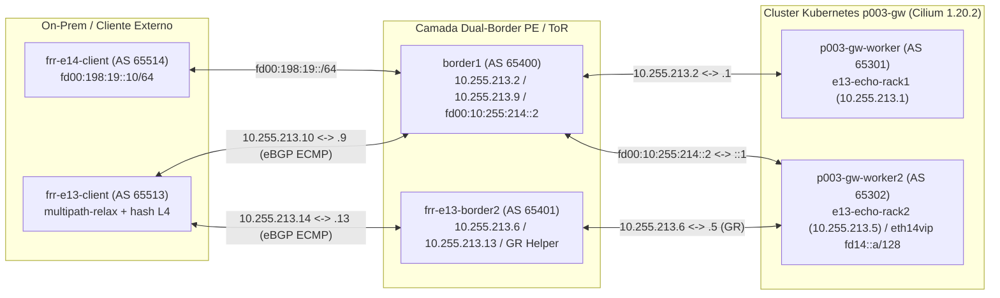

# Dossiê 13 — Redundância Dual-Border, Failover Controlado com/sem Graceful Restart (`E13`) e Sessão eBGP IPv6 Nativa Fim a Fim (`E14`)

> **Sessão:** `P005-S003` (Onda 3 — Braço A) · **Status:** **PROVED (`PASS`)** · **Cluster:** `p003-gw` (`Cilium v1.20.2`, `FRR 8.4.1`)

---

## 1. Visão Geral e Objetivos Arquiteturais

Este dossiê consolida os estudos **`E13`** (Redundância em Dois Borders `border1` / `frr-e13-border2`, ECMP Norte-Sul e Failover Controlado com e sem BGP Graceful Restart RFC 4724) e **`E14`** (Sessão eBGP IPv6 Nativa `fd00:10:255:214::/64` vs Sessão IPv4 com `ipv6/unicast` MP-BGP e VIP IPv6 `fd14::a/128` fim a fim).

### Artefatos Reprodutíveis (`lab-as-code`)
- **E13 (Dual-Border + Failover + Graceful Restart):**
  - Manifesto: [`poc-k8s-fabric/studies/p005/arm-a-ebgp/manifests/05-e13-dual-border-failover.yaml`](../../studies/p005/arm-a-ebgp/manifests/05-e13-dual-border-failover.yaml)
  - Script: [`poc-k8s-fabric/studies/p005/arm-a-ebgp/e13-bgp-dual-border-failover.sh`](../../studies/p005/arm-a-ebgp/e13-bgp-dual-border-failover.sh)
- **E14 (eBGP IPv6 Nativo + VIP `fd14::a/128` Fim a Fim):**
  - Manifesto: [`poc-k8s-fabric/studies/p005/arm-a-ebgp/manifests/06-e14-ipv6-e2e-vip.yaml`](../../studies/p005/arm-a-ebgp/manifests/06-e14-ipv6-e2e-vip.yaml)
  - Script: [`poc-k8s-fabric/studies/p005/arm-a-ebgp/e14-bgp-ipv6-e2e-vip.sh`](../../studies/p005/arm-a-ebgp/e14-bgp-ipv6-e2e-vip.sh)

---

## 2. Estudo `E13` — Redundância Dual-Border, Failover de Border e Restart do Agente Cilium (`GR=true` vs `GR=false`)

### 2.1 Desenho Experimental
1. **Célula 1 (Dual-Border ECMP + Failover Administrativo de Border):**
   - `p003-gw-worker` (`AS 65301`, `10.255.213.1/30`) pareia com `clab-p003-gw-fabric-border1` (`AS 65400`, `10.255.213.2/30`), que por sua vez pareia com `clab-p003-gw-fabric-frr-e13-client` (`AS 65513`) no enlace `10.255.213.9/30 <-> 10.255.213.10/30`.
   - `p003-gw-worker2` (`AS 65302`, `10.255.213.5/30`) pareia com `clab-p003-gw-fabric-frr-e13-border2` (`AS 65401`, `10.255.213.6/30`), que por sua vez pareia com `clab-p003-gw-fabric-frr-e13-client` (`AS 65513`) no enlace `10.255.213.13/30 <-> 10.255.213.14/30`.
   - Ambos os borders anunciam a VIP anycast `10.202.255.193/32` (`Service/e13-vip-svc`) para `clab-p003-gw-fabric-frr-e13-client` (`AS 65513`, com `bgp bestpath as-path multipath-relax` e `net.ipv4.fib_multipath_hash_policy=1`).
   - Um gerador de carga TCP/HTTP contínuo dispara probes a cada `100 ms` enquanto `border1` executa `neighbor 10.255.213.10 shutdown` e posterior `no neighbor 10.255.213.10 shutdown`.
2. **Célula 2 (Restart do Control Plane `cilium-agent` em Caminho Único com `GR=true` vs `GR=false`):**
   - Isolado o caminho único por `p003-gw-worker2 <-> frr-e13-border2` (com `bgp graceful-restart` e `bgp graceful-restart preserve-fw-state` no FRR Helper):
     - **Subcélula 2A (`gracefulRestart.enabled: true`, `restartTimeSeconds: 30`):** O pod `cilium-agent` em `p003-gw-worker2` é reiniciado (`kubectl delete pod --force --grace-period=0`). Os mapas eBPF no kernel permanecem pinados em `/sys/fs/bpf` e o `frr-e13-border2` retém a rota marcada como `(stale)`.
     - **Subcélula 2B (`gracefulRestart.enabled: false` — Controle Negativo):** O mesmo restart do `cilium-agent` sem a capability RFC 4724 faz o `frr-e13-border2` expurgar imediatamente `10.202.255.193/32` da RIB/FIB assim que a sessão TCP `:179` fecha.

### 2.2 Resultados Empíricos (`02-e13-dual-border-failover.txt`)

| Célula | Cenário Avaliado | Estado na RIB / FIB Externa (`frr-e13-client` / `border2`) | Distribuição por Rack | Probes Contínuos (`100 ms`) | `max_gap_ms` | Veredito |
|---|---|---|---|---|---|---|
| **Célula 1 (Pré-Shutdown)** | Dual-Border ECMP (`border1` AS 65400 + `border2` AS 65401) | `nhid 16 proto bgp` via `10.255.213.9` (`weight 1`) e `10.255.213.13` (`weight 1`) | `rack1=12/30`, `rack2=18/30` | — | — | **PASS** |
| **Célula 1 (Durante Shutdown)** | `neighbor 10.255.213.10 shutdown` em `border1` | `nhid 12 via 10.255.213.13 dev e13ceb2` (convergência imediata p/ `border2`) | `rack1=0/20`, `rack2=20/20` | `total=71, ok=71, fail=0` | **`115 ms`** *(0 perdas)* | **PASS** |
| **Célula 1 (Pós-No-Shutdown)** | Restauração de `border1` | `nhid 16` ECMP de 2 vias restaurado | `rack1=13/30`, `rack2=17/30` | (incluído no ciclo de 71 probes) | **`115 ms`** | **PASS** |
| **Subcélula 2A (`GR=true`)** | Delete do `cilium-agent` em `p003-gw-worker2` (`restartTimeSeconds: 30`) | `65302, (stale)` em `border2` (`Time until Graceful Restart stale route deleted: 26`); FIB intacta | `rack2=139/139` | `total=139, ok=139, fail=0` | **`117 ms`** *(zero outage)* | **PASS** |
| **Subcélula 2B (`GR=false`)** | Delete do `cilium-agent` sem Graceful Restart *(Controle Negativo)* | `% Network not in table` imediato em `border2`; FIB vazia no cliente | `rack2=60/138` (`78` falhas) | `total=138, ok=60, fail=78` | **`8879 ms`** (`8,88 s` de indisponibilidade) | **PASS** |

> **Conclusão Técnica (`E13`):** Como o datapath eBPF do Cilium permanece carregado no kernel Linux durante o restart do `cilium-agent`, habilitar `gracefulRestart.enabled: true` no `CiliumBGPPeerConfig` aliado a `bgp graceful-restart preserve-fw-state` no ToR/PE reduz a janela de indisponibilidade de **`8,88 s` (`78` pacotes perdidos)** para **`0 ms` de perda (`139/139` respostas HTTP `200 OK`)**.

---

## 3. Estudo `E14` — Sessão eBGP IPv6 Dedicada (`fd00:10:255:214::/64`) e VIP IPv6 `fd14::a/128` Fim a Fim

### 3.1 Desenho Experimental e Resolução da Limitação `P002-S001`
Na sessão histórica `P002-S001`, observou-se que anunciar a família `ipv6/unicast` sobre uma sessão TCP BGP **IPv4** (`10.x.x.x`) faz o GoBGP embutido no Cilium preencher o atributo `MP_REACH_NLRI` com um next-hop **IPv4-mapped IPv6** (`::ffff:10.x.x.x`), que não instala rota IPv6 nativa utilizável no FRR sem configuração explícita de RFC 8950 / Extended Next-Hop.

O estudo `E14` contrasta diretamente os dois modelos em `p003-gw-worker2` (`AS 65302`) pareado com `border1` (`AS 65400`) e `frr-e14-client` (`AS 65514`), utilizando `advertisementType: "Interface"` (`eth14vip` com `fd14::a/128`) em `CiliumBGPAdvertisement`:
1. **Célula 1 (Baseline `P002-S001` — `ipv6/unicast` sobre Sessão TCP IPv4 `10.255.214.1 <-> 10.255.214.2`):** Demonstra o next-hop `::ffff:10.255.214.1` (`::ffff:aff:d601`) na RIB IPv6 do `border1`.
2. **Célula 2 (Positivo — Sessão eBGP IPv6 Nativa `fd00:10:255:214::1 <-> fd00:10:255:214::2`):** Pareamento TCP/179 puramente IPv6, propagando `fd14::a/128` com next-hop IPv6 nativo até `frr-e14-client` (`fd00:198:19::10`) e servindo tráfego HTTP IPv6 (`http://[fd14::a]:8080/hostname`).
3. **Célula 3 (Controle Negativo — Withdraw e Reconvergência):** Remoção do endereço/label retira `fd14::a/128` em `< 2 s` e bloqueia `5/5` conexões; a restauração reconverge `5/5` respostas HTTP `200`.

### 3.2 Resultados Empíricos (`03-e14-ipv6-e2e-vip.txt`)

| Célula | Transporte da Sessão BGP | `MpReach(ipv6-unicast)` / Next-Hop no `border1` | FIB IPv6 em `frr-e14-client` (`AS 65514`) | Tráfego `http://[fd14::a]:8080/hostname` | Veredito |
|---|---|---|---|---|---|
| **Célula 1 (Baseline `P002-S001`)** | TCP IPv4 (`10.255.214.1 <-> 10.255.214.2`) | `Nexthop: ::ffff:10.255.214.1` (`::ffff:aff:d601` em `vtysh`) | Não propagado / next-hop IPv4-mapped incompatível | — *(controle de plano de controle)* | **PASS** |
| **Célula 2 (Positivo Nativo)** | TCP IPv6 (`fd00:10:255:214::1 <-> fd00:10:255:214::2`) | `fd00:10:255:214::1` (`AS_PATH 65302`, `valid, external, best`) | `fd14::a nhid 9 via fe80::2860:77ff:fe1a:c96 dev e14c1 proto bgp metric 20` (`AS_PATH 65400 65302`) | **`30/30` HTTP `200 OK` (`e14-echo`)** | **PASS** |
| **Célula 3 (Negativo + Restore)** | Retirada do anúncio BGP de `fd14::a/128` -> Restauração | `% Network not in table` em `2 s` -> Restaurado | Rota removida da FIB -> Reinstalada | **`5/5` bloqueados** no withdraw -> **`5/5` HTTP `200 OK`** após restore | **PASS** |
