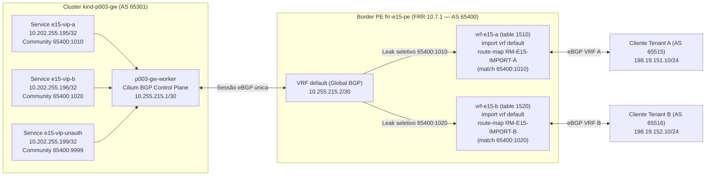

# Estudos E15, E16 e E18 — VRF por Tenant via BGP Community, 3 Modos de Retorno PE/CE (`CiliumEgressGatewayPolicy`) e Camada Física/Enlace (MTU 9000 Jumbo, QinQ `802.1ad` e MACsec `802.1AE` vs WireGuard)

> **Sessão:** `P005-S004` (Onda 4 — Braço A)
> **Status:** **PROVEN** (executado ao vivo na `vm-cilium` sobre `kind-p003-gw` + `clab-p003-gw-fabric`, com canário `k01` `10/10` intocado e invariante `R6=0`)
> **Artefatos Reprodutíveis:**
> - [`poc-k8s-fabric/studies/p005/arm-a-ebgp/e15-bgp-vrf-per-tenant-community.sh`](../../studies/p005/arm-a-ebgp/e15-bgp-vrf-per-tenant-community.sh)
> - [`poc-k8s-fabric/studies/p005/arm-a-ebgp/manifests/07-e15-vrf-per-tenant.yaml`](../../studies/p005/arm-a-ebgp/manifests/07-e15-vrf-per-tenant.yaml)
> - [`poc-k8s-fabric/studies/p005/arm-a-ebgp/e16-pe-ce-return-paths-egress-gw.sh`](../../studies/p005/arm-a-ebgp/e16-pe-ce-return-paths-egress-gw.sh)
> - [`poc-k8s-fabric/studies/p005/arm-a-ebgp/manifests/08-e16-return-paths-egress-gw.yaml`](../../studies/p005/arm-a-ebgp/manifests/08-e16-return-paths-egress-gw.yaml)
> - [`poc-k8s-fabric/studies/p005/arm-a-ebgp/e18-l2-mtu9000-qinq-macsec-wg.sh`](../../studies/p005/arm-a-ebgp/e18-l2-mtu9000-qinq-macsec-wg.sh)
> **Evidências Privadas:**
> - `poc-k8s-fabric/evidence/P005/S004/02-e15-vrf-per-tenant-live.txt`
> - `poc-k8s-fabric/evidence/P005/S004/03-e16-pe-ce-return-paths-live.txt`
> - `poc-k8s-fabric/evidence/P005/S004/04-e18-l2-mtu9000-qinq-macsec-live.txt`

---

## 1. Sumário Executivo e Motivação Arquitetural

Esta frente fecha o **Braço A (Conexão Dedicada eBGP — `E09–E19`)** do plano `P005`, respondendo a três questões críticas de arquitetura de borda e interconexão Direct Connect / Cloud Interconnect em clusters Kubernetes gerenciados por **Cilium 1.20.2**:

1. **`E15` (Isolamento de VRF por Tenant no Border via BGP Standard Community):** Como um cluster Kubernetes compartilhado (onde o Cilium BGP Control Plane v2 anuncia Services `LoadBalancer` em uma única sessão eBGP na tabela global) pode entregar isolamento estrito de tabela de roteamento (`VRF-lite`) no roteador de borda (`PE`) sem exigir uma sessão BGP física por tenant a partir de cada nó?
2. **`E16` (Desenho de Terminação PE/CE, Assimetria da FIB e 3 Modos de Retorno):** Como o GoBGP embutido no `cilium-agent` **não injeta rotas recebidas na FIB do kernel Linux (`R6=0`)**, qual é o desenho de retorno correto para:
   - **Modo 1:** Clientes externos acessando VIPs `LoadBalancer` com rota estática de retorno no nó gateway (`R6=0`);
   - **Modo 2:** Clientes externos anunciando prefixos dinâmicos via BGP quando o nó executa um daemon FRR auxiliar co-implantado com `prefix-list` estrita;
   - **Modo 3:** Pods iniciando conexões *outbound* para redes on-prem com IP de origem determinístico via `CiliumEgressGatewayPolicy` (`cilium.io/v2`) sob firewall/ACL de borda.
3. **`E18` (Camada Física e de Enlace — MTU 9000 Jumbo Frames, QinQ `802.1ad` e MACsec `802.1AE` vs Cilium WireGuard):** Como o plano de controle eBGP e o datapath de saída se comportam sobre enlaces dedicados com:
   - **MTU 9000 Jumbo Frames** e descoberta de Path MTU (`ICMP Frag Needed`, Tipo 3 Código 4);
   - **Dupla tag VLAN QinQ IEEE 802.1ad** (`S-TAG 0x88a8` + `C-TAG 0x8100`);
   - **Criptografia de enlace IEEE 802.1AE MACsec (`gcm-aes-128`, `ethertype 0x88e5`)** comparada arquiteturalmente com o **WireGuard L3 node-to-node** nativo do Cilium.

---

## 2. Estudo `E15` — VRF por Tenant no Border via BGP Community (`65400:1010` vs `65400:1020`)

### 2.1 Topologia e Desenho de Roteamento

No manifesto [`07-e15-vrf-per-tenant.yaml`](../../studies/p005/arm-a-ebgp/manifests/07-e15-vrf-per-tenant.yaml), três objetos `CiliumBGPAdvertisement` selecionam Services por label `e15-tenant` e anexam Standard Communities distintas:
- `e15-adv-tenant-a`: seleciona `e15-tenant: tenant-a` (`10.202.255.195/32`) -> `communities.standard: ["65400:1010"]`;
- `e15-adv-tenant-b`: seleciona `e15-tenant: tenant-b` (`10.202.255.196/32`) -> `communities.standard: ["65400:1020"]`;
- `e15-adv-unauth`: seleciona `e15-tenant: unauth` (`10.202.255.199/32`) -> `communities.standard: ["65400:9999"]`.

No PE (`frr-e15-pe`), o recurso de **Dynamic VRF Route Leaking** do FRR (`import vrf default` + `import vrf route-map`) importa da VRF `default` para cada VRF de cliente apenas os prefixos que casam com a `community-list` daquele tenant.

### 2.2 Resultados Medidos ao Vivo (`02-e15-vrf-per-tenant-live.txt`)

| Célula | Caso de Teste | Esperado | Observado (`vm-cilium`) | Veredito |
|---|---|---|---|---|
| **Célula 1** | RIB Global (`vrf default`) em `frr-e15-pe` | Recebe os 3 `/32` com communities `65400:1010`, `65400:1020` e `65400:9999` | `10.202.255.195/32` (`65400:1010`), `10.202.255.196/32` (`65400:1020`) e `10.202.255.199/32` (`65400:9999`) via `10.255.215.1` (`AS 65301`) | **PASS** |
| **Célula 1** | RIB/FIB de `vrf-e15-a` (`table 1510`) e `vrf-e15-b` (`table 1520`) | `vrf-e15-a` importa somente `.195/32`; `vrf-e15-b` importa somente `.196/32`; `.199/32` ausente de ambas | `vrf-e15-a`: `10.202.255.195 nhid 24 via 10.255.215.1 dev e15pe0 proto bgp`; `vrf-e15-b`: `10.202.255.196 nhid 24 via 10.255.215.1 dev e15pe0 proto bgp` | **PASS** |
| **Célula 2 (Positivo)** | Tráfego HTTP intra-tenant (`Client A -> VIP A` e `Client B -> VIP B`) | `30/30` HTTP `200` por tenant | `cell2_intra_tenant_a_http: 30/30 (e15-echo-a)` e `cell2_intra_tenant_b_http: 30/30 (e15-echo-b)` | **PASS** |
| **Célula 3A (Negativo)** | Tentativa Cross-Tenant (`Client A -> VIP B`, `Client B -> VIP A`, inclusive forçando rota default em `Client A`) | `0/5` em todas as direções (`unreachable default metric 4278198272` na VRF) | `cell3a_cross_vrf_a_to_vip_b: 0/5`, `cell3a_cross_vrf_b_to_vip_a: 0/5`, `cell3a_forced_default_route_a_to_vip_b: 0/5` | **PASS** |
| **Célula 3B (Negativo)** | Isolamento L3 direto `Client A (198.19.151.10) -> Client B (198.19.152.10)` | `0/5` | `cell3b_client_a_to_client_b_ping: 0/5` | **PASS** |
| **Célula 3C (Negativo)** | VIP com community não autorizada (`10.202.255.199/32`, `65400:9999`) | Rejeitada nos route-maps das duas VRFs (`0/5`) | `cell3c_unauth_vip_from_a: 0/5 \| from_b: 0/5` | **PASS** |

---

## 3. Estudo `E16` — Desenho de Terminação PE/CE, 3 Modos de Retorno e `CiliumEgressGatewayPolicy`

### 3.1 O Dilema Arquitetural da FIB no Cilium BGP Control Plane (`R6=0`)

O GoBGP embarcado no `cilium-agent` é um speaker BGP de plano de controle voltado à **publicação** de VIPs e PodCIDRs. Mesmo quando o peer externo envia rotas (e `cilium bgp peers` mostra `Received > 0`), o `cilium-agent` **não programa essas rotas na FIB do kernel Linux**. Isso preserva o invariante `R6=0` (nenhuma rota `proto bgp` na tabela `main`), mas cria um desafio imediato de roteamento de retorno quando clientes on-prem fora da sub-rede local acessam o cluster ou quando pods precisam sair para redes on-prem com IP fixo auditável.

O estudo `E16` compara e prova ao vivo os **três padrões arquiteturais de retorno**:

```mermaid
flowchart TB
  subgraph M1["Modo 1 — Inbound VIP-Only + Rota Estática de Retorno (R6=0)"]
    C1["Cliente Externo\n198.19.16.10/24"] -->|"1. SYN dst=10.202.255.197"| PE1["PE AS 65400\n10.255.216.2"]
    PE1 -->|"2. Encaminha VIP"| W_M1["Nó Gateway (eth16 10.255.216.1)\nSem rota BGP no kernel (R6=0)\nip route 198.19.16.0/24 via 10.255.216.2"]
    W_M1 -->|"3. SYN-ACK retorna pela rota estática"| PE1
  end

  subgraph M2["Modo 2 — Retorno Dinâmico via FRR Auxiliar no Nó (zebra proto bgp)"]
    C2["Sub-rede Dinâmica do Cliente\n198.19.116.10/24"] -->|"1. Anuncia 198.19.116.0/24"| PE2["PE AS 65400"]
    PE2 -->|"2. eBGP para FRR do Nó (10.255.216.3)"| FRR_NODE["FRR 10.7.1 no Nó (AS 65316)\nprefix-list E16-CUST-ONLY (RM-E16-IN)\nInstala 198.19.116.0/24 proto bgp"]
  end

  subgraph M3["Modo 3 — Outbound Determinístico via CiliumEgressGatewayPolicy"]
    P_AUTH["Pod Autorizado (e16-egress-client)\negress-authorized=true"] -->|"SNAT BPF 10.255.216.10"| ACL["PE Firewall/ACL\npermit ip src 10.255.216.10/32"]
    P_UNAUTH["Pod Comum (e16-unmatched-client)\negress-authorized=false"] -->|"Masquerade padrão 10.255.216.1"| ACL_DROP["PE Firewall/ACL\ndrop src != 10.255.216.10"]
  end
```

### 3.2 Descoberta Técnica Crítica no Cilium `1.20.2`

Durante a execução de `E16`, documentou-se uma restrição de configuração importante do `cilium-agent` `1.20.2`:
- As flags `enable-ipv4-egress-gateway: "true"` e `enable-masquerade-to-route-source: "true"` no `ConfigMap/cilium-config` são **mutuamente exclusivas** (o `cilium-agent` recusa a inicialização se ambas estiverem habilitadas simultaneamente).
- Com `enable-bpf-masquerade: "true"`, `devices: "eth+"` e `enable-ipv4-egress-gateway: "true"`, o masquerade BPF do Cilium já seleciona automaticamente o IP primário da interface de saída (`10.255.216.1` em `eth16`) para pods fora da política, enquanto aplica o `egressIP` dedicado (`10.255.216.10/32` em `eth16`) exclusivamente aos pods selecionados pela `CiliumEgressGatewayPolicy` (`app: e16-egress-client, egress-authorized: "true"`).

### 3.3 Resultados Medidos ao Vivo (`03-e16-pe-ce-return-paths-live.txt`)

| Célula / Modo | Cenário Testado | Esperado | Observado (`vm-cilium`) | Veredito |
|---|---|---|---|---|
| **Célula 1 (Modo 1 — Negativo)** | VIP `10.202.255.197/32` anunciada pelo Cilium, mas **sem** rota de retorno para `198.19.16.0/24` no nó | Blackhole assimétrico (`0/3` HTTP) com `proto_bgp=0` | `cell1_mode1_neg_without_return_route: 0/3` (`Rotas proto bgp no kernel: 0`) | **PASS** |
| **Célula 1 (Modo 1 — Positivo)** | Adição de rota estática sumarizada `198.19.16.0/24 via 10.255.216.2 dev eth16` no nó gateway | `30/30` HTTP `200` mantendo `R6=0` | `cell1_mode1_pos_static_return_http: 30/30 (e16-vip-backend)` | **PASS** |
| **Célula 2 (Modo 2 — Negativo)** | Cliente acessa a VIP a partir de sub-rede nova `198.19.116.10/24` antes do speaker FRR auxiliar | `0/3` HTTP | `cell2_mode2_neg_before_node_frr: 0/3` | **PASS** |
| **Célula 2 (Modo 2 — Positivo)** | Speaker FRR `10.7.1` no nó (`frr-e16-node`, `AS 65316`, `10.255.216.3`) com `E16-CUST-ONLY` (`RM-E16-IN`) importa `198.19.116.0/24` | Rota `proto bgp` instalada via `zebra`, `30/30` HTTP `200`, e `R6=0` restaurado ao parar o container | `198.19.116.0/24 nhid 79 via 10.255.216.2 dev eth16 metric 20`, `30/30` HTTP `200`, pós-stop `proto_bgp=0` | **PASS** |
| **Célula 3 (Modo 3 — Egress GW)** | Mapa BPF `cilium-dbg bpf egress list` e requisições outbound de `e16-egress-client` vs `e16-unmatched-client` | Mapa BPF registra `10.245.2.60 -> 198.19.16.0/24 -> 10.255.216.10`; `30/30` com `client_ip=10.255.216.10`; pod comum sai com `10.255.216.1`; sob ACL no PE: `10/10` autorizado vs `0/5` bloqueado | `30/30 com client_ip=10.255.216.10`, `unmatched client_ip=10.255.216.1`, com ACL no PE: `authorized=10/10`, `unmatched=0/5` | **PASS** |

---

## 4. Estudo `E18` — Camada Física/Enlace: MTU 9000 Jumbo, QinQ `802.1ad` e MACsec `802.1AE` vs WireGuard

### 4.1 Arquitetura dos Três Ensaios de Enlace (`e18-l2-mtu9000-qinq-macsec-wg.sh`)

1. **Célula 1 — MTU 9000 Jumbo Frames e Descoberta de PMTU:**
   - Os enlaces `e18w0 <-> e18pe0` (`10.255.218.0/30`) e `e18c0 <-> e18c1` (`10.255.218.4/30`) são configurados com `mtu 9000`.
   - O cliente externo (`10.255.218.6`) dispara `30` pings `DF=1` (`-M do -s 8972`, totalizando `9000 B` IPv4 / `9014 B` Ethernet) contra a VIP `10.202.255.198/32`.
   - Em seguida, reduz-se o MTU de `e18pe0` para `1500`: o PE gera imediatamente `ICMP 10.202.255.198 unreachable - need to frag (mtu 1500)` (Tipo 3, Código 4) e o kernel do cliente atualiza o cache PMTU, bloqueando envios `DF=1` de `8972 B` (`0/5`).
2. **Célula 2 — Dupla Tag VLAN QinQ IEEE 802.1ad (`S-TAG 100` + `C-TAG 200`):**
   - Desativa-se o offload de VLAN em `veth` (`ethtool -K rxvlan off txvlan off`) para tornar os cabeçalhos `802.1ad` visíveis na captura e cria-se a pilha `e18w0.100` (`proto 802.1ad id 100`) -> `e18w0.100.200` (`proto 802.1Q id 200`, `10.255.218.9/30`) pareada com `e18pe0.100.200` (`10.255.218.10/30`).
   - O Cilium estabelece sessão eBGP sobre a subinterface duplamente tagueada; a captura `tcpdump -e` comprova no fio:
     `ethertype 802.1Q-QinQ (0x88a8), length 106: vlan 100, p 0, ethertype 802.1Q (0x8100), vlan 200, p 0, ethertype IPv4 (0x0800)`.
   - No controle negativo, uma subinterface no PE com `C-TAG 201` (`e18pe0.100.201`, `10.255.218.14/30`) não alcança o worker em `C-TAG 200` (`10.255.218.13` em `e18w0.100.200`, `0/5`).
3. **Célula 3 — Criptografia L2 IEEE 802.1AE MACsec (`gcm-aes-128`) vs Cilium WireGuard L3:**
   - Cria-se `macsec0` (`cipher gcm-aes-128 icvlen 16 encrypt on validate strict`) sobre `e18w0` (`10.255.218.17/30`) e `e18pe0` (`10.255.218.18/30`) com Secure Channels (`TXSC`/`RXSC`) simétricos.
   - O Cilium estabelece sessão eBGP (`AS 65301 <-> AS 65400`) **dentro do canal MACsec**. Na interface subjacente (`e18pe0`), `100%` dos quadros possuem `ethertype 802.1AE MACsec (0x88e5)` com payload totalmente cifrado (`flags ECI`), ocultando tanto o TCP/179 do BGP quanto o tráfego de dados.
   - No controle negativo, a troca para uma SA de transmissão com chave SAK divergente (`tx sa 1`) resulta em `0/5` pings e incremento imediato de descartes criptográficos no receptor (`InPktsNotValid`).

### 4.2 Comparativo Arquitetural: MACsec `802.1AE` (L2) vs Cilium WireGuard (L3)

| Dimensão | IEEE 802.1AE MACsec (`ip macsec`, L2 Hop-by-Hop) | Cilium WireGuard (`enable-wireguard: true`, L3 Node-to-Node) |
|---|---|---|
| **Camada OSI e Ethertype / Porta** | Camada 2 (`ethertype 0x88e5`, ICV `16 B`, overhead total `32 B` com SCI) | Camada 3/4 (`UDP/51871` no Cilium, `ChaCha20-Poly1305`, overhead `60–80 B`) |
| **Escopo de Proteção** | **Enlace ponto a ponto (Hop-by-Hop)** entre o nó K8s e o switch/PE da operadora (protege inclusive ARP/ND, LLDP e a sessão **eBGP TCP/179** com o border) | **Pod-to-Pod / Node-to-Node L3** dentro do cluster Kubernetes (não cifra o peering eBGP com roteadores externos que não rodam o agente Cilium) |
| **Offload em Hardware (NIC)** | Amplamente suportado em NICs Data Center (ConnectX-6/7, Intel E810) em *line-rate* `25/100/400 GbE` | Geralmente processado em CPU (kernel WireGuard), com ganhos via GSO/GRO mas sem offload ASIC universal em switches ToR |
| **Recomendação de Uso Conjunto** | Usar **MACsec `802.1AE`** na interconexão física/VLAN dedicada (`Direct Connect` / `Cross-Connect` Nó <-> PE) e **WireGuard** para tráfego L3 leste-oeste entre nós do cluster sobre fabric não confiável | Complementares — nunca substitutos diretos na borda PE/CE |

### 4.3 Resultados Medidos ao Vivo (`04-e18-l2-mtu9000-qinq-macsec-live.txt`)

| Célula | Cenário Testado | Esperado | Observado (`vm-cilium`) | Veredito |
|---|---|---|---|---|
| **Célula 1 (Positivo — MTU 9000)** | `30` pings `DF=1` (`8972 B` payload / `9000 B` IPv4 / `9014 B` Ethernet) de `10.255.218.6` para VIP `10.202.255.198` | `30/30` (`0% loss`), `tcpdump` mostrando `length 9014` | `30 received, 0% packet loss`, RTT `0.043/0.065/0.080 ms`, `tcpdump`: `ethertype IPv4 (0x0800), length 9014: ... ICMP echo request/reply, length 8980` | **PASS** |
| **Célula 1 (Negativo — PMTU 1500)** | Redução de `e18pe0` para `mtu 1500` + `5` pings `DF=1` de `8972 B` | `0/5` (`+5 errors`, `message too long, mtu=1500`) + captura de `ICMP need to frag (mtu 1500)` | `5 transmitted, 0 received, +5 errors`, `tcpdump`: `ICMP 10.202.255.198 unreachable - need to frag (mtu 1500)` | **PASS** |
| **Célula 2 (Positivo — QinQ `802.1ad`)** | Sessão eBGP e `10` pings sobre `e18w0.100.200 <-> e18pe0.100.200` (`S-TAG 100` `0x88a8` + `C-TAG 200` `0x8100`) | BGP `Established` (`PfxRcd=1`), `10/10` pings e captura `0x88a8` + `0x8100` | `10.255.218.9 State/PfxRcd=1`, `10/10` pings (`0.043/0.057/0.065 ms`), `tcpdump -e`: `ethertype 802.1Q-QinQ (0x88a8), length 106: vlan 100 ... ethertype 802.1Q (0x8100), vlan 200` | **PASS** |
| **Célula 2 (Negativo — C-TAG Mismatch)** | Ping a partir de `e18pe0.100.201` (`C-TAG 201`, `10.255.218.14/30`) contra worker em `C-TAG 200` (`10.255.218.13`) | `0/5` | `cell2_qinq_ctag_mismatch_ping: 0/5` | **PASS** |
| **Célula 3 (Positivo — MACsec `802.1AE`)** | Sessão eBGP e `10` pings sobre `macsec0` (`gcm-aes-128`, `encrypt on`, `validate strict`) | BGP `Established` (`10.255.218.17`, `PfxRcd=1`), `10/10` pings, `ethertype 0x88e5` com payload cifrado (`flags ECI`) e `OutPktsEncrypted`/`InPktsOK > 0` | `10.255.218.17 State/PfxRcd=1`, `10/10` pings (`0.057/0.074/0.091 ms`), `OutPktsEncrypted=40`, `InPktsOK=43` (`InOctetsDecrypted=3169`), `0` pacotes TCP/179 ou ICMP em claro | **PASS** |
| **Célula 3 (Negativo — SAK Divergente)** | Chave SAK divergente em `TX SA 1` (`encodingsa 1` com chave `03...` vs `RX SA 1` com chave `04...`) | `0/5` pings e incremento imediato de `InPktsNotValid` no receptor | `cell3_macsec_wrong_sak_ping: 0/5`, `InPktsNotValid` subiu de `0` para `15` | **PASS** |

---

## 5. Rollback, Higiene e Invariantes (`R1`, `R3`, `R6`)

Ao término de cada script (`E15`, `E16` e `E18`), o `trap cleanup EXIT` restaura integralmente:
- `CiliumBGPClusterConfig/rack1` para o baseline do `p003-gw` (`localASN: 65301 -> leaf1 (peerASN: 65201, peerAddress: 10.30.1.1)`), removendo `CiliumBGPPeerConfig`, `CiliumBGPAdvertisement`, `CiliumEgressGatewayPolicy`, `Services` e `Deployments` transitórios;
- `ConfigMap/cilium-config` no `p003-gw` (desativando `enable-ipv4-egress-gateway` após o `E16`);
- Interfaces `veth`, subinterfaces VLAN/QinQ (`802.1ad`/`802.1Q`), dispositivos `macsec0` e containers FRR efêmeros (`frr-e15-*`, `frr-e16-*`, `frr-e18-*`);
- Invariante `R6=0` (`0` rotas `proto bgp` na tabela `main` dos nós Kubernetes) e canário `k01` (`10/10` HTTP `200`).
