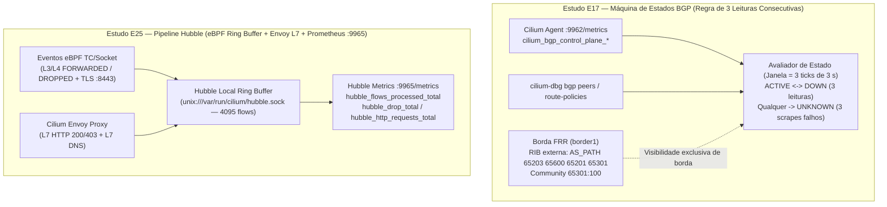

# Estudo 17 + 25 (Onda 3 — Braço B) — Observabilidade Contínua BGP (`ACTIVE`/`DOWN`/`UNKNOWN` por 3 Leituras) e Microsserviços com Hubble (`L3/L4`, `L7 HTTP/DNS`, `TLS` e Prometheus)

> **Sessão:** `P005-S003` (Onda 3 Paralela — Braço B)  
> **Veredito:** **PASS** (25/10/2026)  
> **Scripts reproduzíveis:** [`e17-e25-bgp-hubble-observability.sh`](../../studies/p005/arm-b-datapath/e17-e25-bgp-hubble-observability.sh) e [`04-e17-e25-observability.yaml`](../../studies/p005/arm-b-datapath/manifests/04-e17-e25-observability.yaml)  
> **Evidências brutas (privadas):** `poc-k8s-fabric/evidence/P005/S003/04-e17-e25-observability.txt` e `05-post-verify-s003.txt`

---

## 1. Contexto e Objetivo Unificado (`E17` + `E25`)

Na arquitetura de conexão dedicada e microsserviços sobre Cilium `1.20.2`, dois planos complementares de observabilidade operam no mesmo nó Kubernetes:

1. **Estudo `E17` — Observabilidade Contínua de Sessão BGP e Estado Derivado (`ACTIVE`, `DOWN`, `UNKNOWN`):**
   - **Requisito RNF04:** Monitorar continuamente a sessão BGP de conexão dedicada e derivar o estado operacional da conexão (`ACTIVE`, `DOWN`, `UNKNOWN`) exigindo **3 leituras consecutivas** (`streak = 3`) para evitar falsos alarmes sob flaps curtos de rede, distinguindo explicitamente **queda real de sessão BGP (`DOWN`)** de **indisponibilidade do coletor/scraper (`UNKNOWN`)**, e delimitando o que só o roteador de borda (`border1` / PE) enxerga (`AS_PATH` completo, communities recebidas e tabela de roteamento externa).
2. **Estudo `E25` — Observabilidade de Microsserviços com Hubble (`L3/L4`, `L7 HTTP/DNS`, `TLS` e Prometheus):**
   - Demonstrar a visibilidade fim a fim de fluxos L3/L4 (`FORWARDED` vs `DROPPED` por `CiliumNetworkPolicy` + filtro norte-sul `--from-ip 198.19.0.0/24` com `externalTrafficPolicy: Local`), a visibilidade L7 HTTP (`200 OK` vs `403 Forbidden`) e DNS (`matchPattern: "*"`) via proxy Envoy eBPF, a fronteira criptográfica TLS (`:8443` com metadados L3/L4 e identidade Cilium visíveis, mas payload L7 opaco sem vazamento de URL), e a correlação com métricas Prometheus (`:9962` e `:9965`) mais a resiliência do ring buffer local (`unix:///var/run/cilium/hubble.sock`) quando o coletor central/Relay (`:4245`) está indisponível.



---

## 2. Metodologia e Topologia Experimental

O estudo foi executado no cluster `p003-gw` (`Cilium 1.20.2`, `kubeProxyReplacement=false`) em 7 células sequenciais automatizadas por [`e17-e25-bgp-hubble-observability.sh`](../../studies/p005/arm-b-datapath/e17-e25-bgp-hubble-observability.sh):

- **Habilitação de Telemetria (Fase 1):**
  - Agente Cilium configurado com `prometheus.enabled=true` (`:9962`), `hubble.enabled=true`, `hubble.listenAddress=":4244"`, socket local `unix:///var/run/cilium/hubble.sock` e endpoint Prometheus do Hubble (`:9965`) com `hubble.metrics.enabled={dns:query;ignoreAAAA,drop,tcp,flow,icmp,http,port-distribution}`.
  - Timers de `CiliumBGPPeerConfig/fabric-peer` ajustados temporariamente para `keepAliveTimeSeconds=1` / `holdTimeSeconds=3` (`gracefulRestart.enabled=false`) para transições determinísticas de sessão durante as Células 1 a 3.
- **Workloads de Observabilidade (`namespace: e17-e25-obs`):**
  - `obs-backend` (`10.245.2.16`, identidade Cilium `133676`): Pod multi-container executando `agnhost:2.47 netexec` em **HTTP claro (`:8080`)** e `network-multitool` (`openssl s_server`) em **HTTPS TLS autoassinado (`:8443`)**, exposto externamente via `Service/obs-backend-vip` (`LoadBalancer` VIP `10.202.255.190/32`, `externalTrafficPolicy: Local` para preservar o IP de origem norte-sul `198.19.0.10`).
  - `obs-client-allowed` (`10.245.2.131`, identidade `139262`) e `obs-client-denied` (`10.245.2.149`, identidade `177591`) agendados em `p003-gw-worker`.

---

## 3. Resultados Experimentais — Estudo `E17` (Células 1 a 3)

### 3.1 Célula 1 — Flap BGP Curto (`< 3` Leituras de `3 s`): Amortecimento sem Falso `DOWN`

Um bloqueio transitório (`iptables REJECT --reject-with tcp-reset` por `~2 s`) foi injetado na sessão eBGP entre `p003-gw-worker2` (`10.30.2.2`, `AS 65302`) e `leaf2` (`10.30.2.1`, `AS 65202`), gerando **apenas 2 leituras consecutivas com `sess=0`** antes da reconvergência:

| Tick (`t`) | Scrape HTTP `:9962` | `session_state` (`sess`) | Prefixos Anunciados (`adv`) | Prefixos Recebidos (`rcv`) | Contadores (`down_streak` / `up_streak`) | Estado Derivado (`RNF04`) |
|---|---|---|---|---|---|---|
| `t = 533 ms` (tick 1) | `1` (`200 OK`) | `1` (`Established`) | `2` | `0` | `down=0/3`, `up=4` | **`ACTIVE`** |
| `t = 4152 ms` (tick 2 — flap) | `1` (`200 OK`) | `0` (`Down`) | `0` | `0` | `down=1/3`, `up=0` | **`ACTIVE`** *(amortecido)* |
| `t = 7716 ms` (tick 3 — flap) | `1` (`200 OK`) | `0` (`Down`) | `0` | `0` | `down=2/3`, `up=0` | **`ACTIVE`** *(amortecido)* |
| `t = 11262 ms` (tick 4 — rec.) | `1` (`200 OK`) | `1` (`Established`) | `2` | `0` | `down=0/3`, `up=1` | **`ACTIVE`** |
| `t = 14802 ms` (tick 5) | `1` (`200 OK`) | `1` (`Established`) | `2` | `21` | `down=0/3`, `up=2` | **`ACTIVE`** |
| `t = 18350 ms` (tick 6) | `1` (`200 OK`) | `1` (`Established`) | `2` | `21` | `down=0/3`, `up=3` | **`ACTIVE`** |

- **Conclusão C1:** Com `max_down_streak = 2/3`, a máquina de estados amorteceu a oscilação transitória (`false_down = 0`), mantendo o estado derivado **`ACTIVE`**.

### 3.2 Célula 2 — Flap BGP Médio (`>= 3` Leituras): Transição Determinística `ACTIVE -> DOWN -> ACTIVE`

O bloqueio TCP `:179` foi mantido por 4 ciclos de leitura (`~12 s`) e então removido:

| Tick (`t`) | `session_state` (`sess`) | Prefixos (`adv` / `rcv`) | Contadores (`down_streak` / `up_streak`) | Estado Derivado (`RNF04`) | Evento |
|---|---|---|---|---|---|
| `t = 537 ms` (tick 1) | `0` | `0 / 0` | `down=1/3`, `up=0/3` | `ACTIVE` | Início da queda |
| `t = 4064 ms` (tick 2) | `0` | `0 / 0` | `down=2/3`, `up=0/3` | `ACTIVE` | 2ª leitura `0` |
| **`t = 7596 ms` (tick 3)** | **`0`** | **`0 / 0`** | **`down=3/3`, `up=0/3`** | **`DOWN`** | **Transição `ACTIVE -> DOWN` (`7596 ms`)** |
| `t = 11123 ms` (tick 4) | `0` | `0 / 0` | `down=4/3`, `up=0/3` | `DOWN` | Queda sustentada |
| `t = 14747 ms` (tick 5) | `0` | `0 / 0` | `down=5/3`, `up=0/3` | `DOWN` | Desbloqueio aplicado |
| `t = 18275 ms` (tick 6) | `1` | `2 / 0` | `down=0/3`, `up=1/3` | `DOWN` *(aguardando 3)* | 1ª leitura saudável |
| `t = 21824 ms` (tick 7) | `1` | `2 / 21` | `down=0/3`, `up=2/3` | `DOWN` *(aguardando 3)* | 2ª leitura saudável |
| **`t = 25376 ms` (tick 8)** | **`1`** | **`2 / 21`** | **`down=0/3`, `up=3/3`** | **`ACTIVE`** | **Transição `DOWN -> ACTIVE` (`11166 ms` pós-desbloqueio)** |

### 3.3 Célula 3 — Distinção `DOWN` vs `UNKNOWN` e Fronteira Cilium vs Borda FRR (`border1`)

1. **Indisponibilidade do Scraper (`UNKNOWN`):** Ao apontar o coletor para uma porta inacessível (`127.0.0.1:19962`), o avaliador registrou `unreach_streak = 1/3 -> 2/3 -> 3/3` e transicionou deterministicamente de `ACTIVE` para **`UNKNOWN`** no tick 3 — impedindo que uma falha de rede/autenticação do Prometheus seja confundida com queda da sessão BGP (`DOWN`, onde a sessão continuava `Established` no datapath).
2. **Fronteira de Visibilidade Cilium vs PE (`border1`):**
   - O Cilium (`:9962` e `cilium-dbg bgp`) expõe apenas o estado local da sessão (`SessionState`, contadores agregados de prefixos anunciados/recebidos e timers).
   - Somente a RIB do roteador de borda (`clab-p003-gw-fabric-border1`) revela como o prefixo chegou através do fabric Clos e quais atributos BGP foram preservados fim a fim:
     ```text
     BGP routing table entry for 10.245.2.0/24, version 766
     Paths: (1 available, best #1, table default)
       65203 65600 65201 65301
         10.254.0.0 from 10.254.0.0 (10.1.1.3)
           Origin IGP, valid, external, best (First path received)
           Community: 65301:100
     ```

---

## 4. Resultados Experimentais — Estudo `E25` (Células 4 a 7)

### 4.1 Síntese Quantitativa (`Células 4 a 7`)

| Célula | Cenário Avaliado | Esperado (Positivo + Negativo) | Observado ao Vivo (`vm-cilium`) | Veredito |
|---|---|---|---|---|
| **C4 (`L3/L4` + Norte-Sul)** | `obs-client-allowed` (`200`) vs `obs-client-denied` (`DROPPED`) + cliente externo `198.19.0.10` via VIP BGP (`10.202.255.190`) | `allowed=10/10`, `denied=0/5`, `ext=10/10`; Hubble registra `FORWARDED`, `DROPPED` (`POLICY_DENIED`) e `--from-ip 198.19.0.0/24` | `allowed=10/10`, `denied=0/5`, `ext_client=10/10`; `hubble_forwarded=302`, `hubble_dropped_policy=10`, `hubble_from_ip_198_19=120` | **PASS** |
| **C5 (`L7 HTTP` + `L7 DNS`)** | `CiliumNetworkPolicy` L7 HTTP (`GET /hostname -> 200`, `GET /denied -> 403`) + L7 DNS (`matchPattern: "*"`) | `curl_200=10/10`, `curl_403=5/5`; Hubble `--type l7` captura URLs, status codes e queries DNS | `curl_200=10/10`, `curl_403=5/5`; `hubble_l7_200=10`, `hubble_l7_403=5`, `hubble_l7_dns=20` | **PASS** |
| **C6 (`TLS :8443` vs `HTTP :8080`)** | `10` requisições `https://obs-backend:8443/secret-tls-path` sem terminação TLS no Cilium | `https_200=10/10`, fluxos L4 `:8443` visíveis (`FORWARDED`), **`0` vazamentos** da string `secret-tls-path` no Hubble | `https_200=10/10`, `hubble_8443_l4_flows=92`, **`hubble_8443_l7_cleartext_leak=0`** | **PASS** |
| **C7 (`Prometheus` + Ring Buffer)** | Correlação `:9962` (`cilium_*`) + `:9965` (`hubble_*`) e falha do Relay (`:4245` down) vs socket local | Contadores `> 0` em `:9962` e `:9965`; `hubble status` falha em `:4245`, mas `unix:///var/run/cilium/hubble.sock` segue `Ok` | `cilium_forward=36067043`, `cilium_drop_policy=7618`, `cilium_policy_l7=100`; `hubble_flows=2836`, `hubble_drop=65`, `hubble_http=15`, `hubble_dns=8`; ring buffer local `Ok` (`3015/4095 flows`, `30.13 flows/s`) | **PASS** |

### 4.2 Lições Operacionais Descobertas na Prática (`Cilium 1.20.2` / `Hubble v1.17+`)

1. **Preservação do IP de Origem Norte-Sul (`externalTrafficPolicy: Local`):** Sem `externalTrafficPolicy: Local` no `Service` LoadBalancer anunciado via BGP, o SNAT de nó mascara o IP do cliente externo (`198.19.0.10`), impedindo que `fromCIDR: [198.19.0.0/24]` na `CiliumNetworkPolicy` e `hubble observe --from-ip 198.19.0.0/24` identifiquem o fluxo norte-sul no pod de destino.
2. **Intercepção L7 DNS com `kubeProxyReplacement=false`:** Quando `kube-proxy` realiza o DNAT de `10.96.0.10:53` para o Pod IP do CoreDNS antes ou depois do hook `bpf_lxc`, a `CiliumNetworkPolicy` de egress L7 DNS deve incluir `toEntities: [cluster, world]` na regra de porta `53` para garantir que o proxy DNS do Cilium intercepte tanto o ClusterIP quanto o Pod IP do CoreDNS.
3. **Filtro CLI e Serialização Proto3 JSON no Hubble v1.17+:** A flag `--from-cidr` foi unificada em `--from-ip <CIDR>` no Hubble CLI moderno, e o output `-o json` (`jsonpb`) serializa a porta TCP como `"destination_port":8443` dentro do objeto `"TCP"`.

---

## 5. Verificação de Rollback e Invariantes (`R1`, `R3`, `R6`)

Ao término da Célula 7, o script executou rollback completo para o baseline `values-p003.yaml`:
- **Canário `k01` (`R1`):** `uid=635e7274-5597-40c7-9de5-b1fbe3d68b22` (`10/10` HTTP `200`).
- **Invariante de Kernel BGP (`R6`):** `0` rotas `proto bgp` nos 3 nós do `p003-gw`.
- **Orçamento de Memória (`R3`):** `MemAvailable = 4163 MiB >= 4096 MiB`.
