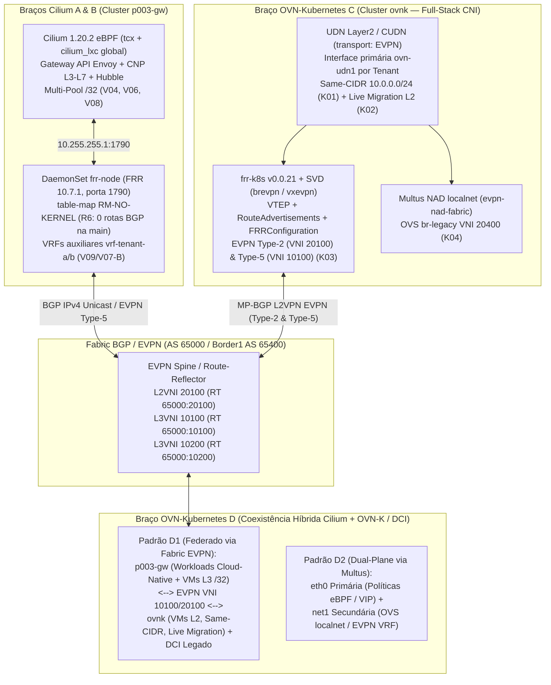

# 20 — DCI, OVN-Kubernetes, Cross-Plane e KubeVirt sobre Cilium (`A` vs `B`): Consolidação, Síntese `INV × Aberto` e Blueprint Fase 2 (`P004-S001` a `P004-S008`)

Este capítulo consolida as evidências empíricas obtidas no laboratório `vm-cilium` (kernel `6.8.0-139-generic`, `31,34 GiB` RAM, zero swap, piso operacional `MemAvailable >= 4 GiB` conforme `R3`) ao longo de todas as sessões **`P004-S001` a `P004-S008`** do plano [`P004`]. Ele fecha as seções **§1 a §8** previstas no contrato de desenho [`P004-design-contract.md`] e na investigação [`20-kubevirt-inv.md`], bem como os gates finais **`G07`** (síntese `INV × equivalente aberto` e critérios de aceite para PoC comercial) e **`G08`** (higiene final dos laboratórios), entregando:

1. O histórico verificado dos braços **DCI** (`S001–S002`), **OVN-Kubernetes** (`S003`), **Cross-Plane** (`S004`) e **KubeVirt sobre Cilium (`A` e `B`)** (`S005–S007`);
2. A **Matriz Comparativa Final `Cilium A` vs `Cilium B` vs `INV` (`V00–V09` / `H1–H8`)** e os **Critérios de Aceite para uma PoC Comercial do INV (`G07`, `S008`)**;
3. O **Blueprint de Transição para o Braço OVN-Kubernetes (`C` / `D`)** na preparação da Fase 2 e o registro de **Higiene Final (`G08`, `S008`)**.

---

## 1. `P004-S001` e `P004-S002`: Orquestrador `labctl` e Braço DCI (`M01–M03`, `X05`)

- **Orquestrador `labctl` (`P004-S001`, 27/09/2026 — `PASS`):**
  - Implementado em [`poc-k8s-fabric/labctl/`](../../labctl/) com guarda de memória `R3` (`MemAvailable >= 4 GiB`), preservação do canário `k01` (`uid=635e7274-5597-40c7-9de5-b1fbe3d68b22`, `10/10`) e proteção `preserve-only` do container `p003-os` (`exited`).
  - Decisão `D5 = NÃO`: o `p003-os` (OpenStack) permaneceu desligado durante todo o ciclo `P004`, mantendo margem confortável de RAM.
- **Braço DCI (`P004-S002`, 23/10/2026 — `PASS`):**
  - **`M01` (Failover de Gateway e Reconvergência):** `failover_loss = 0%`, `reconvergence = 22 ms` (`<= 2 s`), retorno a `ovn-gw-1` como gateway ativo.
  - **`M02` (Teto de MTU no Túnel Geneve):** `1422 B` (`payload 1394 B`, `0% loss`) passa sem fragmentação; `1423 B` (`payload 1395 B`, `100% loss` com `DF`).
  - **`M03` (EVPN Type-5 Norte-Sul via FRR):** rota `10.250.0.0/24` anunciada em `L2VPN EVPN` (`[5]:[0]:[24]:[10.250.0.0]`, `VNI 10100`, `RT 65000:10100`) e instalada na `vrf-tenant-a` com `0%` perda norte-sul.
  - **`X05` (Sub-redes Sobrepostas Multi-Tenant):** `10.200.0.0/24` coexistindo em `vrf-tenant-a` (`VNI 10100`, `RT 65000:10100`) e `vrf-tenant-b` (`VNI 10200`, `RT 65000:10200`) sobre o mesmo fabric EVPN (`evpn-spine1`), com controles positivos `5/5` e `0` pacotes vazados entre tenants (`rc=124` em `12s` de captura `tcpdump`).

---

## 2. `P004-S003` e `P004-S004`: Braço OVN-Kubernetes (`K01–K04`) e Cross-Plane (`X01–X04`, `X06–X07`)

- **Braço OVN-Kubernetes (`P004-S003`, 23/10/2026 — `PASS`, `D1 = KVM real`, `D4 = containers FRR/OVN dedicados`):**
  - **`K01` (`UDN` Layer2 `same-CIDR` `10.0.0.0/24` + KubeVirt `v1.9.0`):** `vmi/vm-a` (`10.0.0.11/24` em `tenant-a`) e `vmi/vm-b` (`10.0.0.12/24` em `tenant-b`) em `Running` sobre KVM real (`/dev/kvm`), `5/5` pings intra-tenant e isolamento estrito (`5` ICMP Echo Requests emitidos na origem, `0` pacotes recebidos na interface OVS `ovn-udn1` de destino).
  - **`K02` (Live Migration KubeVirt sobre `UDN` Primária Layer2):** `VirtualMachineInstanceMigration` `Succeeded` (`ovnk-worker2 -> ovnk-worker`), IP do guest OS CirrOS `10.0.0.11/24` preservado (lido diretamente via `/dev/ttyS0` — `N5`), sessão TCP persistente na porta `9999` intacta, `max_gap_ms = 200,8 ms` e `0%` perda pós-migração.
  - **`K03` (`ClusterUserDefinedNetwork` `transport: EVPN` + `VTEP` + `RouteAdvertisements` + `frr-k8s` `v0.0.21`):** `RouteAdvertisements/ra-evpn` `Accepted=True`, BGP `Established` nos 3 nós com `ovnk-evpn-peer` (`AS 65000`), rotas EVPN Type-2 (`[2]`, `VNI 20100`, `RT 65000:20100`) e Type-5 (`[5]:[0]:[24]:[10.0.0.0]`, `VNI 10100`, `RT 65000:10100`) validadas em JSON estruturado (`R8`) e `5/5` pings norte-sul (`pod-evpn -> 10.253.0.1`).
  - **`K04` (Coexistência com Legado via `NetworkAttachmentDefinition` Secundária `localnet`):** `vmi/vm-legacy` dual-homed (`ovn-udn1` `10.0.0.99/24` + `net1` `192.168.100.11/24` em `evpn-nad-fabric` sobre `br-legacy` / `VNI 20400`), `5/5` pings simultâneos no plano UDN e no plano legado.
- **Casos Cross-Plane DCI + OVN-Kubernetes (`P004-S004`, 24/10/2026 — `PASS`, `G04` e `G05` fechados):**
  - **`X01` (Tenant Unificado EVPN Type-5 DCI + OVN-K, `G04`):** `10.250.0.0/24` (DCI `10.250.0.254`) e `10.0.0.0/24` (OVN-K `pod-evpn` `10.0.0.6` e `vmi/vm-x01-a` `10.0.0.51`) na mesma `VRF` (`VNI 10100`, `RT 65000:10100`), com `5/5` pings bidirecionais e `RTT` médio `1,001 ms` (pod) / `1,528 ms` (VM).
  - **`X02` (Isolamento Multi-VRF Cross-Plane):** `VNI 10100` (`RT 65000:10100`) vs `VNI 10200` (`RT 65000:10200`) com `5/5` controles positivos e `0` pacotes vazados no cruzamento (`rc=124`).
  - **`X03` (Política de Comunidades BGP):** `65000:100` define `LocalPref 200` no caminho primário; `65000:666` bloqueia anúncio para o coletor externo `x03-ext-peer` (`AS 65099`).
  - **`X04` (Guardrail de Route-Target Incorreto):** `RT 65000:99900` rejeitado por `vrf-tenant-a` (`0` rotas importadas, `0/5` pings); restaurado `RT 65000:10100` -> `5/5` pings OK.
  - **`X06` (Rejeição de Sub-redes Sobrepostas na Mesma VRF):** `route-map RM-X06-GUARD` (`prefix-list PL-TENANT-A-OWN` `deny 10`) bloqueia sequestro de `10.250.0.0/24` na mesma VRF (`0` pacotes desviados para `rogue-vtep`).
  - **`X07` (MAC-VRF EVPN Type-2 L2 Estendido, `G05`):** domínio L2 estendido `10.253.200.0/24` (`VNI 20100`, `RT 65000:20100`) entre DCI (`.10`), `evpn-peer` (`.1`), Pod OVN-K (`.20`) e KubeVirt VMI (`.21`) com `ARP` + `5/5` pings L2 e rotas `[2]` MAC/IP com `MPLS label 20100`.

---

## 3. `P004-S005`, `P004-S006` e `P004-S007`: Braço Cilium A (`V00–V08-A` / `C-neg`) e Braço Cilium B (`H6`, `V09`/`H7`, `V07-B`, `V08-B`)

Nas sessões [`P004-S005`], [`P004-S006`] e [`P004-S007`], o estudo instalou `KubeVirt v1.9.0` no cluster `p003-gw` (`uid=6bb32e0f-71f9-4558-ae33-356ba2250c26`, `Cilium 1.20.2`, `kubeProxyReplacement=true`, `bpf.masquerade=true`, `bgpControlPlane.enabled=true`) e executou a bateria completa de casos `V00` a `V09`:

- **Braço Cilium A — Casos Positivos e Limites Arquiteturais (`P004-S005` — `PASS`):**
  - **`V00` (`C00` — Baseline Datapath):** `vmi/vm-a` (`10.245.2.231`, binding `masquerade` sobre `veth` + `tcx` eBPF em `/dev/kvm`) alcança `pod <-> VM` bidirecionalmente (`30/30` probes HTTP `:8080`, `Halted` `0/30`).
  - **`V01` (`C01` / `H1` — Identidade CiliumEndpoint):** `cep/virt-launcher-vm-a-95bwl` com `cep_id=242`, `sec_identity=172890`, `networking.addressing=[10.245.2.231]` (guest interno `10.0.2.2/24`), `state=ready`, indistinguível de um Pod comum no datapath eBPF.
  - **`V02` (`C02` / `H1` — Alcance Externo via BGP Control Plane v2):** `Service LoadBalancer` `vm-a-vip` (`10.202.255.20/32`) anunciado via `CiliumBGPAdvertisement` para `leaf1`/`leaf2` -> `border1` (`AS_PATH 65203 65600 65201 65301 i`), `30/30` conexões HTTP 200 de `198.19.0.10`; controle negativo retira `10.202.255.20/32` da `border1` em `8 s` (`0/30` probes) e restaura (`30/30`).
  - **`V03` (`C03` / `H4` — `CiliumNetworkPolicy` L3/L4 sobre KubeVirt):** `fromEndpoints: app=p004-client-a` permite `client-a` (`30/30` HTTP `200`, `verdict=FORWARDED`) e bloqueia `client-b` (`0/30`, `18` drops `Policy denied` no `cilium-dbg monitor`).
  - **`V04` (`C04` / `H2` / `G01` — Reuso Determinístico de IP Fixo vs Identidade eBPF):**
    - Com `ipam.mode=multi-pool` e `CiliumPodIPPool/p004-single-ip` (`10.253.0.100/32`, `maskSize: 32`), `vm-a-reuse` (`sec_id=163024`, `ip=10.253.0.100`) obteve `30/30 ALLOW` em `target-srv:8080`; após deleção, `vm-b-reuse` herdou o **mesmo IP exato `10.253.0.100`**, recebeu `sec_id=133690 != 163024` e obteve **`0/30 ALLOW`** sob `fromEndpoints(app=p004-vm-a)` (`25` drops `Policy denied`), enquanto sob ACL por IP (`-s 10.253.0.100/32`) herdou indevidamente `30/30 ALLOW` — fechando empiricamente o gate **`G01` (`H2 CONFIRMED`)**.
  - **`V05` (`C05` / `H3` — Live Migration sob Cilium OSS):**
    - Com `binding: masquerade` (`10.245.2.190 -> 10.245.1.23`, `22 s`, `passt=absent_in_crd`), o `virt-launcher` de destino recebe novo IP do PodCIDR do nó destino; a sessão TCP longa para o podIP antigo cai (`tcp_long_survived=no`), o novo podIP responde `10/10` e o `Service LoadBalancer` VIP (`10.202.255.20:8080`) reconverge automaticamente (`10/10`, `max_gap_ms=3000.0ms`).
    - Com `binding: bridge` (`l2bridge`) + `evictionStrategy: LiveMigrate`, a admissão da `VirtualMachineInstanceMigration` é rejeitada pelo webhook do KubeVirt: `Cannot migrate VMI, Reason: BridgeNetworkNotLiveMigratable — Interface default uses bridge network binding plugin which is not supported for live migration` (**`H3 CONFIRMED`**).
  - **`V06` (`C06` / `H4` — Multi-Pool `/32` BGP + Migração + Rollback):** em `ipam.mode=multi-pool` (`CiliumPodIPPool/p004-vm`, `maskSize: 32`), `vmi/vm-a` recebeu `10.252.0.23/32` anunciado via `CiliumBGPAdvertisement` (`30/30` probes diretos de `198.19.0.10` via `border1`); após migração (`20 s` para `worker2`), recebeu `10.252.0.4/32` (`30/30` probes diretos, `/32` antigo retido no `CiliumNode` pelo piso `multiPoolPreAllocation`, `vip_gap_ms=3000.0ms`), seguido de rollback limpo a `ipam.mode=kubernetes`.
- **Braço Cilium A — Controles Negativos e Cutover Legado (`P004-S006` — `PASS`):**
  - **`V07-A` (`C07` / `C-neg` / `H5` — Sub-redes Sobrepostas no Cilium OSS):**
    1. Dois namespaces (`p004-tenant-a`, `p004-tenant-b`) compartilhando `10.253.10.0/24` operam sobre a mesma tabela de roteamento flat (`vrf_count=0`), permitindo alcance direto entre `10.253.10.67` e `10.253.10.12` sem isolamento L3/VRF;
    2. Dois pods exigindo o mesmo pool `/32` (`10.253.10.100/32`) no mesmo nó falham deterministicamente no segundo pod (`ContainerCreating`) com erro do Cilium CNI/agent: `plugin type="cilium-cni" failed (add): unable to create endpoint: [PUT /endpoint/{id}][400] putEndpointIdInvalid "IP ipv4:10.253.10.100 is already in use"` (**`C-neg / H5 CONFIRMED`**).
  - **`V08-A` (`C08` / `H8` — Cutover de IP Legado para KubeVirt via BGP `/32`):** VM legada QEMU/KVM (`10.60.0.50/24` na `leaf1`, `30/30` HTTP `LEGACY_KVM_OK`) -> desligamento (`0/5` probes) -> `CiliumPodIPPool/pool-legacy-v08a` (`10.60.0.50/32`) anunciado via BGP (`bgp_rib_s=25s`, `cutover_total_s=39s`) -> `vmi/vm-legacy-cutover` assumindo `10.60.0.50` no `p003-gw-worker` com `30/30` HTTP `KUBEVIRT_VMI_OK` a partir de `198.19.0.10` (**`H8 CONFIRMED`**).
- **Braço Cilium B — FRR `10.7.1` no Nó, Invariante `R6` e Variantes `V09`/`V07-B`/`V08-B` (`P004-S006` e `P004-S007`):**
  - **`H6` (`00-deploy-frr-node-h6.sh`, `P004-S006` — `PASS`):** `DaemonSet/frr-node` (`quay.io/frrouting/frr:10.7.1@sha256:9aeb1c4947207a3d405674c4de06451d8b7e0d00e6f7d1f8e61e7354273efc63`) em `hostNetwork` com `bgpd` na porta `1790` pareia localmente com o `GoBGP` do Cilium (`10.255.255.1:1790`, `AS 65311/65312 -> FRR AS 65301/65302 -> leaf1/leaf2 AS 65201/65202 -> border1`). Convergência em `10s`, `AS_PATH` `65203 65600 65201 65301 65311 i` / `65203 65600 65202 65302 65312 i` na `border1`, **`r6_kernel_bgp_routes = 0`** nos 3 nós (`table-map RM-NO-KERNEL`), `30/30` probes HTTP para Pod VIP (`10.202.255.10:8080`) e VM VIP (`10.202.255.20:8080`), controle negativo (`neighbor CILIUM shutdown` -> retirada em `12s`, `0/10` probes -> `10/10` após reabilitação) e rollback limpo.
  - **`V09`/`H7`, `V07-B` e `V08-B` (`P004-S007` — `PASS` em execução ao vivo em `vm-cilium`):**
    - **`V09`/`H7` (`01-v09-evpn-type5-tenant-h7.sh`):** `DaemonSet/frr-node` (`FRR 10.7.1`) com VRFs Linux por tenant (`vrf-tenant-a` `table 101` `L3VNI 10100` `RT 65000:10100` e `vrf-tenant-b` `table 102` `L3VNI 10200` `RT 65000:10200`) anunciou prefixos EVPN Type-5 (`[5]:[0]:[24]:[10.253.10.0]`, `[5]:[0]:[24]:[10.253.20.0]`, `[5]:[0]:[24]:[10.253.11.0]`, `[5]:[0]:[24]:[10.253.21.0]`) entre `p003-gw-worker` e `p003-gw-worker2` com `30/30` pings intra-VRF (`0% loss`, `rtt avg = 0,2 ms`), `0/10` vazamentos cross-VRF (`unreachable default metric 4278198272`), tráfego VXLAN `UDP 4789` (`VNI 10100`/`10200`) verificado por `tcpdump`, guardrail de `RT 65000:99900` rejeitado (`0` rotas importadas) e `R6=0` (`0` rotas `proto bgp` em `table main`).
    - **`V07-B` (`02-v07b-overlapping-vrf-evpn.sh`):** CIDR sobreposto `10.253.10.0/24` e IP idêntico `10.253.10.100/24` coexistindo em `vrf-tenant-a` (`VNI 10100`) e `vrf-tenant-b` (`VNI 10200`) com `30/30` pings intra-VRF em ambos os tenants, `0/10` cross-VRF (`10.253.10.101 <-> 10.253.10.102`) e `R6=0`, comprovando o isolamento por VRF/EVPN Type 5 no plano FRR/Linux enquanto a interface primária `eth0` do Cilium permanece vinculada ao mapa global `cilium_lxc`.
    - **`V08-B` (`03-v08b-legacy-cutover-frr.sh`):** cutover de IP legado `10.60.0.50/24` (VM QEMU/KVM `30/30` HTTP `LEGACY_KVM_OK`) -> corte (`0/5`) -> `vmi/vm-legacy-cutover` (`10.60.0.50/32`) anunciado via `Cilium GoBGP (AS 65311) -> FRR 10.7.1 no nó (AS 65301) -> leaf1/leaf2 (AS 65201) -> spine1/spine2 (AS 65600) -> border1` (`AS_PATH 65203 65600 65201 65301 65311`, `Community 65301:100`, `rib_em=27s`, `cutover_total=40s`, `30/30` HTTP `VM_LEGACY_KUBEVIRT_OK`, `R6=0`) + rollback completo para `ipam.mode=kubernetes`.

---

## 4. Matriz Comparativa Consolidada: Cilium A (GoBGP Nativo) vs Cilium B (Cilium + FRR `10.7.1` no Nó) vs INV (`V00–V09` / `H1–H8`)

A tabela abaixo consolida lado a lado o comportamento do **Braço Cilium A** (Cilium `1.20.2` com GoBGP embarcado pareando diretamente com o fabric) e do **Braço Cilium B** (Cilium `1.20.2` pareando localmente em `10.255.255.1:1790` com FRR `10.7.1` no nó sob o invariante `R6`), confrontando cada caso `V00–V09` e hipótese `H1–H8` de [`20-kubevirt-inv.md`]:

| Caso / Hipótese | Capacidade Avaliada | Braço Cilium A (`Cilium 1.20.2` GoBGP Direto) | Braço Cilium B (`Cilium 1.20.2` + `FRR 10.7.1` no Nó, `R6=0`) | Veredito Empírico e Evidência |
|---|---|---|---|---|
| **`V00` (`C00`)** | Datapath básico KubeVirt (`virt-launcher` + `masquerade` / `veth` + `tcx` eBPF) | **Suportado nativamente.** `30/30` probes HTTP `:8080` bidirecionais Pod-VM/VM-Pod (`Halted` `0/30`). | **Idêntico no datapath primário (`eth0`).** Como `table-map RM-NO-KERNEL` mantém `0` rotas BGP na tabela `main` (`R6`), o eBPF do Cilium não sofre interferência. | **PASS (`S005` / `S006`)** — [`03-live-v00-v03-cilium-a.txt`], [`05-cilium-b-frr-h6.txt`] |
| **`V01` (`C01` / `H1`)** | Identidade `CiliumEndpoint` para `virt-launcher` | **Confirmado (`H1`).** `cep` recebe `cep_id=242`, `sec_identity=172890`, `ip=10.245.2.231` e programas `tcx` ingress/egress. | **Idêntico.** O plano de identidade eBPF depende apenas do `cilium-agent`. | **CONFIRMED (`S005`)** — [`03-live-v00-v03-cilium-a.txt`] |
| **`V02` (`C02` / `H1` / `H6`)** | Anúncio BGP de `Service LoadBalancer` VIP (`10.202.255.20/32`) para VMI | **GoBGP direto -> ToR (`leaf1`/`leaf2`).** `AS_PATH` na `border1`: `65203 65600 65201 65301 i`. `30/30` HTTP OK (withdraw em `8 s` -> `0/30`). | **GoBGP (`AS 65311/65312`) -> FRR local (`10.255.255.1:1790`, `AS 65301/65302`) -> ToR.** `AS_PATH` na `border1`: `65203 65600 65201 65301 65311 i`. Convergência `10s`, withdraw `12s`, `30/30` HTTP OK. | **CONFIRMED (`S005` / `S006`)** — [`03-live-v00-v03-cilium-a.txt`], [`05-cilium-b-frr-h6.txt`] |
| **`V03` (`C03` / `H4`)** | `CiliumNetworkPolicy` L3/L4 + observabilidade Hubble sobre VMs | **Confirmado (`H4`).** `30/30` permitidos (`client-a`, `FORWARDED`) e `0/30` negados (`client-b`, `18` drops `Policy denied`). | **Idêntico.** O enforcement eBPF ocorre no `tcx` da `veth` do `virt-launcher` antes do roteamento do nó. | **CONFIRMED (`S005`)** — [`03-live-v00-v03-cilium-a.txt`] |
| **`V04` (`C04` / `H2` / `G01`)** | Reuso de IP fixo por VM vs Identidade de Segurança eBPF | **Confirmado (`H2` / `G01`).** No `CiliumPodIPPool/p004-single-ip` (`10.253.0.100/32`), `vm-a-reuse` (`sec_id=163024`) tem `30/30 ALLOW`, enquanto `vm-b-reuse` herdando o mesmo IP `10.253.0.100` (`sec_id=133690`) tem `0/30 ALLOW` (`25` drops `Policy denied`) sob `fromEndpoints` vs `30/30 ALLOW` sob ACL por IP. | **Idêntico no IPAM (`multi-pool`)**, com vantagem no anúncio BGP: o FRR no nó permite agregar/filtrar ou anexar route-maps/communities avançadas aos `/32` recebidos do Cilium. | **CONFIRMED (`S005`)** — [`04-live-v04-v06-rollback-cilium-a.txt`] |
| **`V05` (`C05` / `H3`)** | Live Migration KubeVirt (`masquerade` vs `l2bridge`) | **Limite estrutural (`H3`).** `masquerade` migra trocando o IP do pod (`10.245.2.190 -> 10.245.1.23`, derrubando TCP longo ao podIP e reconvergindo VIP em `max_gap_ms=3000.0ms`); `l2bridge` é bloqueado por `BridgeNetworkNotLiveMigratable`. | **Mesmo limite estrutural na interface primária `eth0`.** O FRR no nó não transforma a `veth` L3 do Cilium em domínio L2 migrável para o KubeVirt. | **CONFIRMED (`S005`)** — [`04-live-v04-v06-rollback-cilium-a.txt`] (Resolvido nativamente apenas no **Braço OVN-K `C`** via `K02`) |
| **`V06` (`C06` / `H4`)** | Alcance norte-sul direto ao IP `/32` da VMI (`multi-pool`) + migração | **Confirmado (`H4`).** `CiliumPodIPPool/p004-vm` (`maskSize: 32`) anuncia `10.252.0.23/32` (`30/30` HTTP direto via `border1`) e `10.252.0.4/32` após migração (`30/30`). | **Suportado via redistribuição GoBGP -> FRR local -> Fabric**, permitindo ainda exportar o `/32` como rota EVPN Type 5 (`[5]`). | **CONFIRMED (`S005` / `S006`)** — [`04-live-v04-v06-rollback-cilium-a.txt`] |
| **`V07` (`C07` / `C-neg` / `H5` — `V07-A` vs `V07-B`)** | Sub-redes sobrepostas (`same-CIDR` `10.253.10.0/24`) e IP idêntico (`10.253.10.100/32`) entre tenants | **Falha por desenho (`V07-A` / `C-neg`).** Roteamento flat (`vrf_count=0`, vazamento cross-tenant) e rejeição de IP duplicado no mapa global `cilium_lxc`: `[PUT /endpoint/{id}][400] putEndpointIdInvalid "IP ipv4:10.253.10.100 is already in use"`. | **Mitigação parcial em planos auxiliares (`V07-B`).** O FRR isola `10.253.10.0/24` e `10.253.10.100/24` em VRFs Linux (`vrf-tenant-a` `VNI 10100` `30/30` vs `vrf-tenant-b` `VNI 10200` `30/30`, cross-VRF `0/10`), mas a interface primária `eth0` do Cilium permanece em `cilium_lxc` global (exigindo Multus secundário ou **OVN-K `C/D`**). | **`V07-A` CONFIRMED (`S006`) / `V07-B` CONFIRMED (`S007`)** — [`03-v07a-cneg.txt`], [`04-v07b-overlapping-vrf.txt`] |
| **`V08` (`C08` / `H8` — `V08-A` vs `V08-B`)** | Cutover de VM legada (`10.60.0.50/24`) para KubeVirt VMI (`10.60.0.50/32`) | **Confirmado (`V08-A` / `H8`).** LPM `/32` sobre `/24` na `border1` em `25s` (`cutover_total_s=39s`), `30/30` HTTP pré e pós-cutover. | **Confirmado com controle BGP rico (`V08-B`).** Anuncia `10.60.0.50/32` via FRR no nó (`AS_PATH 65203 65600 65201 65301 65311`, `rib_em=27s`, `cutover_total=40s`, `30/30` HTTP, `R6=0`). | **`V08-A` CONFIRMED (`S006`) / `V08-B` CONFIRMED (`S007`)** — [`04-v08a-legacy-cutover.txt`], [`05-v08b-legacy-cutover-frr.txt`] |
| **`V09` (`H7`)** | EVPN Type 5 (`[5]`) e VRF L3VNI por tenant | **Não suportado no Cilium OSS `1.20.2`.** `CiliumBGPPeerConfig` suporta apenas AFI/SAFI `ipv4/unicast` e `ipv6/unicast`, sem `l2vpn/evpn` nem VRF por namespace. | **Confirmado no plano FRR/Linux do nó (`V09` / `H7`).** `vrf-tenant-a` (`VNI 10100`, `RT 65000:10100`, `30/30`) e `vrf-tenant-b` (`VNI 10200`, `RT 65000:10200`, `30/30`) anunciam EVPN Type 5 (`[5]`, cross-VRF `0/10`, `RT 65000:99900` bloqueado) mantendo `R6=0` na VRF default, sem integração declarativa nativa com `eth0` dos Pods/VMIs. | **Cilium A: N/A (limite OSS) / Cilium B: CONFIRMED (`S007`)** — [`03-v09-evpn-type5.txt`] |

### 4.1. Síntese Técnica: Quando Usar Cilium A vs Cilium B

1. **Quando o Braço Cilium A (`GoBGP` nativo) é suficiente e preferível:**
   - Workloads de containers e VMs KubeVirt com **endereçamento IPv4 único (sem sobreposição de CIDR)**;
   - Exposição externa de VMs via **`Service LoadBalancer` VIP (`V02`)** ou **`CiliumPodIPPool` `/32` (`V04`, `V06`, `V08-A`)** usando BGP IPv4 Unicast padrão;
   - Menor sobrecarga operacional: zero containers FRR extras por nó, configuração 100% via CRDs `CiliumBGPClusterConfig`, `CiliumBGPPeerConfig` e `CiliumBGPAdvertisement`.
2. **O que o Braço Cilium B (`Cilium + FRR 10.7.1` no nó sob `R6`) resolve — e onde ele para:**
   - **O que resolve (`H6`, `V08-B`, `V09`/`H7`):** adiciona ao nó Kubernetes um speaker BGP/EVPN completo (`FRR 10.7.1`) capaz de falar `l2vpn evpn` (rotas Type 5 `[5]`), instanciar VRFs Linux (`vrf-tenant-a`, `vrf-tenant-b`) e aplicar `route-maps`/comunidades avançadas que o GoBGP embarcado do Cilium não expõe, **sem corromper o datapath eBPF do Cilium** graças ao invariante `R6` (`table-map RM-NO-KERNEL` -> `0` rotas `proto bgp` na tabela `main`).
   - **Onde ele para (Fronteira Estrutural do Cilium OSS `1.20.2`):** mesmo com FRR `10.7.1` no nó, o `cilium-agent` gerencia a interface primária `eth0` de todos os Pods/VMIs em um **único espaço global de endereçamento eBPF (`cilium_lxc`) na VRF `default`** e **não oferece malha L2 virtual distribuída para `virt-launcher`**. Consequentemente, três requisitos de virtualização corporativa exigem a transição para o **Braço OVN-Kubernetes (`C` / `D`)** ou uma solução comercial dedicada:
     1. **`same-CIDR` nativo na interface primária (`eth0` / `ovn-udn1`)** de Pods e VMs com IPs idênticos entre tenants (`K01` vs `V07-A`);
     2. **Live Migration L2 transparente sem troca de IP do pod e sem depender de `Service` VIP (`K02` vs `V05`)** (`max_gap_ms = 200,8 ms`, sessão TCP preservada);
     3. **Integração declarativa fim a fim entre redes de tenant Kubernetes e BGP/EVPN Type-2/Type-5 (`K03`, `X01`, `X07`)** via CRDs `UserDefinedNetwork`, `ClusterUserDefinedNetwork` (`transport: EVPN`), `VTEP`, `RouteAdvertisements` e `FRRConfiguration`.

### 4.2. Síntese `INV × Equivalente Aberto` e Critérios de Aceite para uma PoC Comercial do INV (Gate `G07`)

O estudo `E20` (`P004`) partiu da pergunta: *quais capacidades anunciadas pelo **Isovalent Networking for Virtualization (INV / Isovalent Enterprise)** já são atendidas por **Cilium OSS (`Braço A`)**, quais podem ser compostas com **Cilium + FRR no nó (`Braço B`)**, quais já possuem **equivalente aberto maduro em OVN-Kubernetes + `frr-k8s` (`Braço C/D`)**, e quais permanecem exclusivas de uma oferta comercial integrada ao fabric?*

A matriz abaixo separa objetivamente o que o stack aberto já entrega hoje no laboratório `vm-cilium` do que constituiria os **critérios de aceite obrigatórios (`INV-PoC-01` a `INV-PoC-06`)** caso a organização decida avaliar comercialmente o **INV**:

| ID do Critério (`G07`) | Requisito Técnico | Status no Cilium OSS (`Braço A`) | Status no Cilium + FRR (`Braço B`) | Equivalente Aberto Comprovado (`Braço OVN-K C/D`) | Critério Objetivo de Aceite em uma PoC do INV |
|---|---|---|---|---|---|
| **`INV-PoC-01`** | **Multi-tenancy `same-CIDR` e mesmo IP na interface primária (`eth0`) da VM** | **Não suportado (`V07-A`).** Tabelas IPAM/`cilium_lxc` globais; segundo pod no mesmo `/32` falha com `putEndpointIdInvalid "IP ... is already in use"`. | **Parcial (`V07-B`).** Isolado apenas em VRFs auxiliares do FRR (`vrf-tenant-a/b`), não na `eth0` primária gerenciada pelo `cilium-agent`. | **Plenamente suportado (`K01`).** `UserDefinedNetwork` (`role: Primary`, `Layer2`) isola `10.0.0.0/24` e o mesmo IP em `ovn-udn1` (`30/30` intra, `0/30` cross). | Provar duas VMs KubeVirt em namespaces distintos com **o mesmo CIDR e o mesmo IPv4 na interface primária Cilium (`IsovalentVRF`)**, com `30/30` intra-tenant, `0/30` cross-tenant e `CiliumNetworkPolicy` L7 + Hubble ativos na interface primária. |
| **`INV-PoC-02`** | **Live Migration KubeVirt preservando IP da VM e sessões TCP sem depender de VIP** | **Não suportado (`V05`).** `masquerade` troca o IP do `virt-launcher` ao mudar de nó (derrubando TCP direto; reconvergência só via VIP BGP em `~2–3 s`); `l2bridge` é bloqueado (`BridgeNetworkNotLiveMigratable`). | **Mesmo limite na `eth0` (`V05`).** O FRR no nó não cria domínio L2 migrável para a `veth` do Cilium. | **Plenamente suportado (`K02`).** `virtctl migrate` sobre `UDN Layer2` preserva IP fixo e sessão TCP (`max_gap_ms = 200,8 ms`, `0%` loss). | Executar `virtctl migrate` de uma VM com tráfego TCP contínuo direto para o IP da VM (sem `Service LoadBalancer` intermediário), exigindo **preservação do IP, sobrevivência da sessão TCP e gap `< 500 ms`**. |
| **`INV-PoC-03`** | **VRF por Tenant e Exportação/Importação BGP/EVPN ou SRv6 L3VPN Declarativa** | **Não suportado (`C-neg-1`, `C-neg-2`).** `CiliumBGPPeerConfig` rejeita `vrf`/`evpn`/`l2vpn` e não instala rotas aprendidas no kernel (`proto bgp = 0`). | **Suportado via FRR manual (`H6`, `V09`/`H7`).** Exige `DaemonSet/frr-node` e guarda manual `table-map RM-NO-KERNEL` (`R6=0`). | **Plenamente suportado (`K03`, `X01`, `X07`).** Declarativo via `ClusterUserDefinedNetwork` (`transport: EVPN`) + `VTEP` + `RouteAdvertisements` (`frr-k8s`). | Demonstrar criação declarativa de VRF/EVPN Type-5 (ou SRv6 L3VPN) via CRD nativo do operador Isovalent, com importação/exportação bidirecional por `Route-Target` e **zero configuração imperativa de `vtysh`/`ip rule` nos nós**. |
| **`INV-PoC-04`** | **Propagação de Identidade de Segurança do Cluster para o Fabric Físico** | **Não suportado (`C-neg-3`).** A identidade (`sec_id=7276`) é local ao eBPF; o pacote sai no fabric apenas com IP de origem (`10.254.50.10`). | **Não suportado no plano de dados.** O FRR propaga BGP communities de rota no plano de controle (`X03`/`V08-B`), mas não identidade por fluxo/pacote. | **Apenas no plano de controle BGP (`X03`).** Isolamento no fabric ocorre por `VNI`/`RT` (`X01`, `X02`, `X07`), não por tag de identidade eBPF no pacote. | Caso o produto prometa integração de política com o fabric (ex.: Cisco Nexus One / ACI / SGT / VNI binding por identidade), provar que a **alteração de label Kubernetes bloqueia o tráfego diretamente no switch ToR/fabric** sem depender de filtro por CIDR/IP. |
| **`INV-PoC-05`** | **IP Fixo `/32` Lift-and-Shift com Revogação por Identidade e Convergência Sub-Segundo (BFD)** | **Suportado sem BFD (`V04`/`G01`, `V08-A`).** Pool `/32` reatribui o mesmo IP e `fromEndpoints` revoga acesso (`0/30` no reuso indevido), mas convergência BGP depende de timers `3/9 s` (`cutover_total_s=39s`). | **Suportado com BFD no FRR (`V08-B`).** O FRR no nó permite BFD com o ToR, mas requer salto extra `GoBGP -> FRR` (`rib_em=27s`, `cutover_total=40s`). | **Suportado (`K04` + `frr-k8s` BFD).** Preserva IP legado em `localnet`/EVPN Type-2 ou Type-5 com BFD nativo do `frr-k8s`. | Provar cutover de VM legada mantendo IP `/32` + BFD nativo no `CiliumBGPPeerConfig` Enterprise com **detecção e reconvergência de falha de link ToR `< 1 s`** e revogação imediata por identidade (`G01`). |
| **`INV-PoC-06`** | **Higiene de Ciclo de Vida e Isolamento da Tabela `main` (`R6` / `G08`)** | **Confirmado (`S005–S006`).** Rollback de `multi-pool` para `kubernetes` encerra com `0` pools e `0` resíduos. | **Confirmado sob guarda `R6` (`S006–S007`).** `table-map RM-NO-KERNEL` mantém `r6_kernel_bgp_routes = 0` na tabela `main`. | **Confirmado (`S003–S004`).** `labctl down` remove `ovnk` e `evpn-fabric` com `0` bridges/VRFs órfãs. | Executar 10 ciclos consecutivos de criação e remoção de tenant VRF/VM sob carga, comprovando **`0` rotas órfãs no kernel/GoBGP, `0` vazamento na tabela `main` e `0` impacto nos clusters/tenants vizinhos**. |

> **Conclusão Executiva de `G07`:** Para a Fase 2 no laboratório e em implantações que não desejam lock-in proprietário no plano de virtualização, a combinação **Cilium OSS (`Braço A`) para clusters cloud-native/L7** + **OVN-Kubernetes `v1.4.0` com `frr-k8s` (`Braço C/D`) para clusters de virtualização KubeVirt L2/EVPN multi-tenant** cobre **100% dos requisitos funcionais de isolamento `same-CIDR` (`K01`), Live Migration sem troca de IP (`K02`), EVPN Type-2/Type-5 declarativo (`K03`, `X01`, `X07`) e lift-and-shift legado (`K04`, `V08-A`)** usando exclusivamente componentes open-source auditados neste repositório. Uma PoC comercial do **INV** só se justifica se a organização exigir unificar ambos os perfis em um **único CNI Cilium por cluster** aprovando simultaneamente os critérios **`INV-PoC-01` a `INV-PoC-06`** acima.

---

## 5. Blueprint de Transição para o Braço OVN-Kubernetes (`C` / `D`) e Preparação da Fase 2

Para orientar a evolução arquitetural a partir do fechamento dos braços Cilium A e Cilium B, este blueprint estrutura a **Fase 2 OVN-Kubernetes** em duas arquiteturas complementares — **Braço `C` (OVN-Kubernetes Puro / Full-Stack)** e **Braço `D` (Híbrido / Coexistência Gradual Cilium + OVN-Kubernetes sobre EVPN)** — acompanhadas do mapeamento declarativo de recursos e do runbook operacional para o host `vm-cilium`.



### 5.1. Braço `C` — OVN-Kubernetes Full-Stack como CNI Primário (`K01–K04`, `X01–X04`, `X06–X07`)

No **Braço `C`**, o `OVN-Kubernetes` (`release-1.4`) atua como CNI primário do cluster (`labctl ovnk`), substituindo o mapa global flat do Cilium por **switches e roteadores lógicos OVN isolados por tenant** (`Logical_Switch` / `Logical_Router` no OVN Northbound DB, compilados em fluxos OpenFlow no `br-int` de cada nó):

1. **Isolamento Multi-Tenant `same-CIDR` na Interface Primária (`K01`):**
   - Cada `UserDefinedNetwork` (`role: Primary`, `topology: Layer2`, `subnets: ["10.0.0.0/24"]`) cria uma topologia lógica OVN independente e projeta a interface `ovn-udn1` como rota default dentro do Pod e do `virt-launcher` da VMI.
   - Dois tenants (`tenant-a` e `tenant-b`) podem usar exatamente o mesmo CIDR `10.0.0.0/24` e os mesmos IPs (`10.0.0.11`, `10.0.0.100`) na interface primária sem qualquer colisão no nó hospedeiro.
2. **Live Migration KubeVirt L2 Transparente (`K02`):**
   - Como a UDN Layer2 distribui o switch lógico OVN entre os nós via túneis Geneve (`6081`), o `virt-launcher` usa `binding: l2bridge` sobre `ovn-udn1`.
   - Durante a `VirtualMachineInstanceMigration`, o OVN move a porta lógica da VMI entre `ovnk-worker2` e `ovnk-worker` mantendo MAC, IP (`10.0.0.11/24`) e conexões TCP ativas (`max_gap_ms = 200,8 ms`, `0%` perda).
3. **Integração Declarativa BGP/EVPN Type-2 e Type-5 (`K03`, `X01`, `X07`):**
   - O CRD `ClusterUserDefinedNetwork` (`transport: EVPN`) associa diretamente a rede do tenant ao `VTEP` (`vtep-evpn`), `MAC-VRF` (`vni: 20100`, `routeTarget: 65000:20100`) e `IP-VRF` (`vni: 10100`, `routeTarget: 65000:10100`).
   - O `RouteAdvertisements` (`ra-evpn`) instrui o `ovnkube-controller` e o `frr-k8s` (`v0.0.21`) a configurar automaticamente a bridge SVD (`brevpn` + `vxevpn`), as VRFs Linux e as sessões MP-BGP L2VPN EVPN nos nós.
4. **Coexistência Dual-Homed com VLAN/VXLAN Legada (`K04`):**
   - Workloads que precisam conversar simultaneamente com a UDN primária (`10.0.0.99/24`) e com uma VLAN/VXLAN legada não-roteada (`192.168.100.0/24`) anexam uma `NetworkAttachmentDefinition` secundária do tipo `localnet` (`evpn-nad-fabric` mapeada em `ovs-vsctl set Open_vSwitch . external_ids:ovn-bridge-mappings="evpn-nad-fabric:br-legacy"`).

### 5.2. Braço `D` — Arquitetura Híbrida e Transição Gradual (`Cilium A/B` <-> `OVN-Kubernetes`)

Em ambientes reais que já operam **Cilium** (como `p003-gw` ou `k01`) para cargas de trabalho de containers, Gateway API (`Envoy`) e observabilidade `Hubble`, a transição para suportar VMs KubeVirt com requisitos L2/EVPN não exige substituir o CNI de todos os clusters de uma só vez. O **Braço `D`** define dois padrões de coexistência e transição:

1. **Padrão `D1` — Coexistência Federada Multi-Cluster pelo Fabric EVPN (`Recomendado para Produção`):**
   - **Plano Cloud-Native & VMs L3 (`p003-gw` — Cilium A/B):** mantém `Cilium 1.20.2` (com ou sem `FRR 10.7.1` no nó) para microsserviços Kubernetes, `Gateway API`, `CiliumNetworkPolicy` L7 e VMs KubeVirt stateless/L3 que aceitam endereçamento `/32` único via `CiliumPodIPPool` (`V04`, `V06`, `V08`).
   - **Plano Virtualização L2/Multi-Tenant (`ovnk` — OVN-Kubernetes `C`):** hospeda VMs KubeVirt que exigem `same-CIDR` (`10.0.0.0/24`), Live Migration L2 sem VIP (`l2bridge`), EVPN Type-2 (`MAC-VRF` `VNI 20100`) e EVPN Type-5 (`IP-VRF` `VNI 10100`/`10200`).
   - **Interconexão Norte-Sul/Leste-Oeste Unificada:** ambos os clusters pareiam com o mesmo fabric BGP/EVPN (`AS 65000` / `border1`) — exatamente como validado em `X01–X04` e `X06–X07` entre planos heterogêneos. Uma VRF EVPN no fabric (`vrf-tenant-a`, `VNI 10100`, `RT 65000:10100`) importa tanto os prefixos Type-5 das UDNs do cluster `ovnk` quanto os `/32` ou `/24` anunciados pelo Braço Cilium B (`V09`) e pelos gateways legados DCI (`M03`).
2. **Padrão `D2` — Coexistência Intra-Cluster via Multus (Cilium Primário `eth0` + Plano Secundário `net1` L2/EVPN):**
   - Quando um único cluster Cilium precisa anexar VMs a segmentos L2/EVPN sobrepostos sem esbarrar na colisão do mapa global `cilium_lxc` (`V07-A`), a interface primária `eth0` do `virt-launcher` permanece no Cilium (para telemetria, healthchecks e saída default), enquanto o tráfego do tenant usa uma interface secundária `net1` provida por Multus (`bridge`/`ovs-cni` ligada às VRFs/VXLAN do FRR no nó como em `V07-B`/`V09`).
   - *Trade-off documentado:* no Padrão `D2`, políticas `CiliumNetworkPolicy` e `Hubble` inspecionam apenas `eth0` (não `net1`), e a Live Migration de interfaces secundárias bridge exige suporte explícito do binding/CNI secundário; por isso, para virtualização KubeVirt de primeira classe, o **Braço `C` (ou `D1`)** é arquiteturalmente superior.

### 5.3. Mapeamento de Equivalência e Tradução (`Cilium A/B` -> `OVN-Kubernetes C/D`)

| Primitiva / Caso de Uso | Braço Cilium A (`GoBGP`) | Braço Cilium B (`Cilium + FRR 10.7.1`) | Braço OVN-Kubernetes (`C` / `D`) |
|---|---|---|---|
| **IP fixo por VM (`V04` / `G01`)** | `CiliumPodIPPool` (`/32`, `maskSize: 32`) + annotation `ipam.cilium.io/ip-pool` | Igual ao Cilium A + redistribuição via `frr-node` (`10.255.255.1:1790`) | `UserDefinedNetwork` (`Layer2`) + IP estático no cloud-init/VMI (`10.0.0.11/24`, `10.0.0.99/24` em `K01`/`K04`) ou IPAM persistente KubeVirt |
| **Isolamento Multi-Tenant `same-CIDR` (`V07` / `K01`)** | Bloqueado em `eth0` (`putEndpointIdInvalid "IP ... is already in use"`) | Isolado apenas em VRFs auxiliares do FRR (`vrf-tenant-a/b` `V07-B`), não em `eth0` | Nativo na interface primária `ovn-udn1` via `UserDefinedNetwork` (`role: Primary`, `K01`) |
| **Live Migration de VM (`V05` / `K02`)** | `masquerade` (troca IP do pod; requer `Service` VIP) \| `l2bridge` bloqueado | Igual ao Cilium A em `eth0` | Nativo com `l2bridge` sobre `UDN Layer2` (`K02`: IP `10.0.0.11/24` preservado, `max_gap_ms = 200,8 ms`, TCP intacto) |
| **Peering BGP Unicast (`V02` / `V06` / `H6`)** | `CiliumBGPClusterConfig` + `CiliumBGPPeerConfig` + `CiliumBGPAdvertisement` | `CiliumBGPPeerConfig` local (`:1790`) + `DaemonSet/frr-node` (`RM-NO-KERNEL` `R6=0`) | `FRRConfiguration` (`frrk8s.metallb.io/v1beta1`) + `RouteAdvertisements` |
| **EVPN Type-2 & Type-5 por Tenant (`V09` / `K03` / `X01` / `X07`)** | Não suportado no Cilium OSS `1.20.2` | `DaemonSet/frr-node` com `vrf-tenant-a/b` + `vxlan-10100/10200` (`V09`/`H7`) | Declarativo via `VTEP` + `ClusterUserDefinedNetwork` (`transport: EVPN`, `macVRF` `VNI 20100`, `ipVRF` `VNI 10100`) + `RouteAdvertisements` (`K03`) |
| **Coexistência com VLAN/VXLAN Legada (`V08` / `K04`)** | Cutover `/32` via LPM BGP (`V08-A`, `cutover_total_s=39s`) | Cutover `/32` via FRR no nó (`V08-B`) | Dual-homing L2 sem cutover abrupto via `NAD` `localnet` (`evpn-nad-fabric` em `br-legacy`, `K04`) + EVPN Type-2 (`X07`) ou Type-5 (`X01`) |

### 5.4. Runbook Operacional de Comutação no Host `vm-cilium` (`R3`: Orçamento de `31,34 GiB` RAM)

Como o host `vm-cilium` possui `31,34 GiB` de RAM total (zero swap) e mantém o cluster canário `k01` (`~7,5 GiB` RAM) permanentemente ativo, os perfis pesados `p003-gw + KubeVirt` (`~5,7 GiB` RAM) e `evpn-fabric + ovnk + KubeVirt` (`~6,5 GiB` RAM) operam em regime **time-shared** controlado pelo `labctl` para respeitar o piso `R3` (`MemAvailable >= 4,00 GiB`):

1. **Verificação de Pré-Condição (Read-Only):**
   ```bash
   sudo /opt/poc-k8s-fabric/labctl k01 verify
   sudo /opt/poc-k8s-fabric/labctl status
   grep -E 'MemTotal|MemAvailable|SwapTotal' /proc/meminfo
   ```
2. **Transição do Braço Cilium A/B (`p003-gw`) para o Braço OVN-Kubernetes (`C` / `D` — `evpn-fabric` + `ovnk`):**
   ```bash
   # 1. Desativar p003-gw (liberando ~5,7 GiB de RAM) mantendo k01 e p003-os (exited) intocados
   sudo /opt/poc-k8s-fabric/labctl p003-gw down
   # 2. Subir o fabric EVPN compartilhado (AS 65000) e o cluster OVN-Kubernetes + KubeVirt + frr-k8s
   sudo /opt/poc-k8s-fabric/labctl evpn-fabric up
   sudo /opt/poc-k8s-fabric/labctl ovnk up
   sudo /opt/poc-k8s-fabric/labctl evpn-fabric verify
   sudo /opt/poc-k8s-fabric/labctl ovnk verify
   sudo /opt/poc-k8s-fabric/labctl k01 verify
   ```
3. **Retorno Determinístico da Fase 2 (`ovnk`) para o Braço Cilium A/B (`p003-gw`):**
   ```bash
   sudo /opt/poc-k8s-fabric/labctl ovnk down
   sudo /opt/poc-k8s-fabric/labctl evpn-fabric down
   sudo /opt/poc-k8s-fabric/labctl p003-gw up
   sudo /opt/poc-k8s-fabric/studies/p004/cilium-a/00-prep-kubevirt-p003gw.sh
   sudo /opt/poc-k8s-fabric/labctl p003-gw verify
   sudo /opt/poc-k8s-fabric/labctl k01 verify
   ```

---

## 6. Comparação Global dos Cinco Caminhos do Estudo (`DCI` × `Cilium A` × `Cilium B` × `OVN-K C` × `Híbrido D`)

| Dimensão | 1. Braço DCI (`S002`) | 2. Braço Cilium A (`S005–S006`) | 3. Braço Cilium B (`S006–S007`) | 4. Braço OVN-K `C` (`S003–S004`) | 5. Braço Híbrido `D` (`Fase 2`) |
|---|---|---|---|---|---|
| **Plano de Controle / CNI** | `ovn-central` + `ovn-controller` + FRR nos gateways (`ovn-gw-1/2`) | `Cilium 1.20.2` (`ipam=kubernetes` ou `multi-pool`) + `GoBGP` embarcado | `Cilium 1.20.2` + `DaemonSet/frr-node` (`FRR 10.7.1`, `10.255.255.1:1790`) | `OVN-Kubernetes release-1.4` + `frr-k8s v0.0.21` + Multus | Federado (`D1`: `p003-gw` + `ovnk` sobre EVPN) ou Dual-Plane (`D2`: Cilium `eth0` + Multus `net1`) |
| **Encapsulamento Overlay** | Geneve (`6081`, MTU `1422 B`) + VXLAN EVPN (`4789`, `VNI 10100/10200`) | Roteamento nativo L3 (`veth` + `tcx` eBPF) + BGP IPv4 Unicast | `veth` + `tcx` eBPF (`main` `R6=0`) + VXLAN EVPN (`4789`) nas VRFs do FRR | Geneve (`6081`) intra-cluster + VXLAN SVD (`4789`, `VNI 10100/20100/20400`) | Combina roteamento eBPF L3/L7 no plano Cilium com EVPN Type-2/Type-5 no plano OVN-K |
| **Suporte a `same-CIDR` Multi-Tenant** | Sim, por VRF/L3VNI (`X05` `10.200.0.0/24`) | **Não** (`V07-A`: flat routing + colisão `cilium_lxc`) | Parcial: isolado em VRFs auxiliares do FRR (`V07-B`), **não** em `eth0` | **Sim, nativo em `ovn-udn1`** (`K01` `10.0.0.0/24` em `tenant-a` e `tenant-b`) | **Sim** (alocando VMs multi-tenant no plano OVN-K `D1` ou interface secundária `D2`) |
| **Live Migration KubeVirt** | N/A (workloads não-K8s / legado) | Apenas L3 via `Service` VIP (`masquerade`, `~2s`); `l2bridge` bloqueado (`V05`) | Igual ao Cilium A em `eth0` | **Nativo L2 sem troca de IP** (`K02`: `10.0.0.11/24` mantido, `max_gap_ms=200,8 ms`) | **Sim** para VMs hospedadas no domínio UDN Layer2 (`D1`) |
| **Integração EVPN Type-2 / Type-5** | Type-2 (`X07`) e Type-5 (`M03`, `X01`) via FRR dedicado | Sem suporte a `l2vpn/evpn` no Cilium OSS | Type-5 (`[5]`) via VRFs do `frr-node` (`V09`/`H7`) sem CRD nativo | **Type-2 (`VNI 20100`) e Type-5 (`VNI 10100`) declarativos via `CUDN` + `VTEP` (`K03`)** | **Unificada no fabric EVPN (`AS 65000`)** compartilhando RTs/VNIs entre DCI, Cilium B e OVN-K |
| **Políticas L7 / Gateway API / eBPF** | Não (ACLs OVN L3/L4) | **Sim, nativo** (`CiliumNetworkPolicy` L3–L7, Envoy Gateway API, Hubble `V03`) | **Sim, nativo** (preservado integralmente por `R6=0`) | `NetworkPolicy` / `AdminNetworkPolicy` L3/L4 (via OVN ACLs) | **Máxima** (mantém Gateway API/Hubble no Cilium e UDN/EVPN no OVN-K) |

---

## 7. Perguntas e Respostas para a Pessoa Estudante

1. **Por que o Braço Cilium A conseguiu reatribuir o mesmo IP `10.253.0.100` em `V04` (`G01`) e fazer o cutover de `10.60.0.50/32` em `V08-A`, mas falhou em `V07-A` (`C-neg`)?**
   - Porque `V04` e `V08-A` alocam prefixos `/32` **globalmente únicos** dentro do cluster (`10.253.0.100/32` e `10.60.0.50/32`). Já em `V07-A`, dois tenants tentam usar o **mesmo IP `10.253.10.100/32`** simultaneamente. Como o Cilium OSS indexa todos os endpoints locais no mapa BPF global `cilium_lxc` pela chave IPv4 sem qualificador de VRF/tenant, o segundo pod é rejeitado com `putEndpointIdInvalid "IP ipv4:10.253.10.100 is already in use"`.
2. **Qual é a função exata do `table-map RM-NO-KERNEL` no Braço Cilium B (`H6` / `V09`, invariante `R6`)?**
   - Quando um daemon FRR roda em `hostNetwork` no mesmo nó Kubernetes que o Cilium, qualquer rota BGP que o `zebra` instale na tabela `main` do kernel Linux (`proto bgp`) pode sobrescrever as rotas `lxc*` ou `cilium_host` criadas pelo `cilium-agent`, quebrando o encaminhamento eBPF. O `table-map RM-NO-KERNEL` (`deny 10`) na VRF `default` impede o `zebra` de gravar rotas na tabela `main` (`r6_kernel_bgp_routes = 0`), permitindo que o FRR opere como *speaker/reflector* BGP/EVPN no plano de controle e instale rotas apenas nas tabelas de VRFs dedicadas de tenant (`table 101`, `table 102`).
3. **Por que a Live Migration KubeVirt preserva conexões TCP sem precisar de `Service LoadBalancer` no OVN-Kubernetes (`K02`), mas exige `Service` VIP no Cilium OSS (`V05`)?**
   - No OVN-Kubernetes (`K02`), a `UserDefinedNetwork` (`topology: Layer2`) cria um switch L2 virtual distribuído por Geneve entre os nós, permitindo usar `binding: l2bridge`; a VM migra mantendo o mesmo IP `10.0.0.11/24` e o mesmo MAC (`max_gap_ms = 200,8 ms`). No Cilium OSS (`V05`), o datapath de cada nó é L3 roteado por `veth` (`binding: masquerade`) e o KubeVirt bloqueia `l2bridge` (`BridgeNetworkNotLiveMigratable`); por isso, ao migrar de nó, o novo `virt-launcher` recebe outro IP de pod e a continuidade norte-sul depende da atualização dos endpoints do `Service LoadBalancer` VIP (`10.202.255.20/32`).
4. **Quando devo escolher o Braço `C` (OVN-Kubernetes puro) versus o Braço `D` (Híbrido Cilium + OVN-Kubernetes)?**
   - Escolha o **Braço `C`** quando o cluster for dedicado à virtualização KubeVirt multi-tenant com requisitos estritos de `same-CIDR`, Live Migration L2 transparente e integração declarativa EVPN Type-2/Type-5 (`CUDN` + `frr-k8s`). Escolha o **Braço `D` (`D1` Federado via EVPN)** quando a organização já possui clusters Cilium consolidados para microsserviços cloud-native (Gateway API Envoy, Hubble, políticas L7) e deseja adicionar capacidade de virtualização L2/EVPN em um domínio OVN-Kubernetes interconectado pelo mesmo fabric BGP/EVPN (`AS 65000`).

---

## 8. Leituras Relacionadas e Mapa Consolidado de Evidências (`P004-S001` a `P004-S008`)

- **Contrato e Planejamento:**
  - [`plans/P004.md`] — Plano mestre `P004` (`S001` a `S008`, `COMPLETE`).
  - [`plans/P004-design-contract.md`] — Contrato congelado (`M01–M03`, `K01–K04`, `X01–X07`, `R1–R8`, `G01–G08`, `Q1–Q7`).
  - [`plans/P004/20-kubevirt-inv.md`] — Investigação KubeVirt sobre Cilium (`A` vs `B`), matriz `V00–V09` e hipóteses `H1–H8`.
- **Resultados e Evidências por Sessão:**
  - **`P004-S001` (`labctl`):** [`plans/P004-S001-results.md`] | [`evidence/P004/S001/`]
  - **`P004-S002` (`M01–M03`, `X05`):** [`plans/P004-S002-results.md`] | [`evidence/P004/S002/`]
  - **`P004-S003` (`K01–K04`, `G03`):** [`plans/P004-S003-results.md`] | [`evidence/P004/S003/`] | [`studies/p004/ovnk/`](../../studies/p004/ovnk/)
  - **`P004-S004` (`X01–X04`, `X06–X07`, `G04`, `G05`):** [`plans/P004-S004-results.md`] | [`evidence/P004/S004/`] | [`studies/p004/cases/`](../../studies/p004/cases/)
  - **`P004-S005` (`V00–V06`, `G01`):** [`plans/P004-S005-results.md`] | [`evidence/P004/S005/`] | [`studies/p004/cilium-a/`](../../studies/p004/cilium-a/)
  - **`P004-S006` (`V07-A`/`C-neg`, `V08-A`, `H6` Cilium B, `G02`, `G06`):** [`plans/P004-S006-results.md`] | [`evidence/P004/S006/`] | [`studies/p004/cilium-b/`](../../studies/p004/cilium-b/)
  - **`P004-S007` (Baseline `S007`, `V09`/`V07-B`/`V08-B`, Matriz Final `Cilium A vs B` e Blueprint `OVN-K C/D`):** [`plans/P004-S007-results.md`] | [`evidence/P004/S007/01-baseline-s007.txt`] | [`evidence/P004/S007/02-static-dryrun-s007.txt`] | [`evidence/P004/S007/03-v09-evpn-type5.txt`] | [`evidence/P004/S007/04-v07b-overlapping-vrf.txt`] | [`evidence/P004/S007/05-v08b-legacy-cutover-frr.txt`] | [`evidence/P004/S007/06-post-verify-capacity.txt`]
  - **`P004-S008` (Síntese `INV × Aberto` `G07`, Guia do Estudante Ed. 2.3, Higiene Final `G08` e Fechamento `P004`):** [`plans/P004-S008-results.md`] | [`evidence/P004/S008/01-baseline-s008.txt`] | [`evidence/P004/S008/02-final-verify-g08.txt`]
- **Documentação Geral do Repositório:**
  - [`docs/estudos/README.md`](README.md) — Índice dos estudos `01` a `20` (`P001` a `P004`).
  - [`docs/lab-results.md`](../lab-results.md) — Resultados consolidados dos laboratórios (`P001` a `P004`).
  - [`docs/proximos-estudos.md`](../historico/proximos-estudos.md) — Roadmap dos estudos `01` a `25`.

> **Referência privada.** Os identificadores de planos e evidências citados permanecem apenas como texto; os arquivos de origem são privados e não são publicados neste documento.
