# 22 — XLB: Balanceamento L7 eBPF na Camada de Sockets (`sockmap` / `bpf_sock_ops` / `sk_msg`) vs SocketLB L4 vs Envoy L7 (`E22`)

> **Sessão:** `P005-S002` (Onda 2 — Braço B: Datapath eBPF e Balanceamento L7)  
> **Ambiente:** `vm-cilium` (`p003-gw`, Cilium `1.20.2`, Kernel Linux `6.8.0-139-generic`, `CONFIG_BPF_SYSCALL=y`, `CONFIG_SOCK_CGROUP_DATA=y`)  
> **Script Automatizado:** [`studies/p005/arm-b-datapath/e22-xlb-ebpf-socket-lb-vs-envoy.sh`](../../studies/p005/arm-b-datapath/e22-xlb-ebpf-socket-lb-vs-envoy.sh)  
> **Manifests Declarativos:** [`studies/p005/arm-b-datapath/manifests/03-e22-xlb-vs-envoy.yaml`](../../studies/p005/arm-b-datapath/manifests/03-e22-xlb-vs-envoy.yaml)  
> **Evidências Privadas:** `evidence/P005/S002/05-e22-xlb-socket-lb-vs-envoy.txt` e `06-post-verify-s002.txt`

---

## 1. Contexto e Pergunta de Engenharia

No Cilium `1.20.2`, o balanceamento de Serviços Kubernetes (`ClusterIP`/`LoadBalancer`) e a inspeção L7 operam tradicionalmente em duas camadas distintas:

1. **Cilium eBPF SocketLB L4 (`bpf_sock_addr` em `connect()`/`sendmsg()`):** intercepta a chamada de sistema no cgroup v2 do cliente (ou do host, quando `bpf-lb-sock-hostns-only=true`) e reescreve o endereço de destino do `Service VIP` (`10.112.78.178:8080`) diretamente para o `PodIP:Port` de um backend selecionado. O tráfego subsequente flui ponta a ponta entre os sockets TCP sem NAT por pacote, mas **sem visibilidade do payload HTTP L7** e ainda atravessando a pilha TCP/IP local a cada `sendmsg()`.
2. **Cilium Envoy L7 Proxy (`CiliumNetworkPolicy` com regras `rules.http` ou Gateway API):** redireciona o fluxo para o proxy Envoy user-space (embutido/coordenado pelo `cilium-agent`), que termina a conexão TCP do cliente, faz o parsing completo de HTTP/1.1, HTTP/2 ou gRPC, aplica políticas por método/URI/header e abre uma segunda conexão TCP para o backend. O custo é a dupla travessia da pilha TCP/IP, trocas de contexto kernel↔userspace e cópia de buffers de socket.
3. **Arquitetura estilo XLB (`BPF_MAP_TYPE_SOCKHASH` + `BPF_PROG_TYPE_SOCK_OPS` + `BPF_PROG_TYPE_SK_MSG`):** combina o registro automático de sockets TCP estabelecidos (`BPF_SOCK_OPS_ACTIVE_ESTABLISHED_CB` e `BPF_SOCK_OPS_PASSIVE_ESTABLISHED_CB`) em um mapa `SOCKHASH` com um programa `sk_msg` (`BPF_SK_MSG_VERDICT`) anexado ao próprio mapa. A cada `sendmsg()` da aplicação:
   - O programa `sk_msg` inspeciona os primeiros bytes do payload L7 diretamente no buffer do kernel (`bpf_msg_pull_data`);
   - Se a política L7 in-kernel negar a requisição (ex.: `GET /deny`), o `sk_msg` retorna `SK_DROP` imediatamente na syscall `sendmsg()`, sem jamais gerar pacote TCP;
   - Se permitida, `bpf_msg_redirect_hash(..., BPF_F_INGRESS)` transfere o buffer diretamente para a fila de recepção (`sk_receive_queue`) do socket par no mesmo nó, contornando a pilha TCP/IP e reduzindo interrupções de software (`NET_RX`).

Este estudo (`E22`) compara quantitativamente as **três arquiteturas** sobre o mesmo par de pods co-localizados em `p003-gw-worker`, com controles negativos para cada camada.

---

## 2. Metodologia e Desenho Experimental

Todos os ensaios foram executados pelo script idempotente [`e22-xlb-ebpf-socket-lb-vs-envoy.sh`](../../studies/p005/arm-b-datapath/e22-xlb-ebpf-socket-lb-vs-envoy.sh) no namespace `e22-xlb-test`, com `e22-client` (`role: trusted`), `e22-untrusted` (`role: untrusted`) e 2 réplicas de `e22-backend` (`agnhost:2.47 netexec --http-port=8080`) fixados em `p003-gw-worker` (`Service e22-svc` `ClusterIP=10.112.78.178:8080 -> 8080`):

- **Célula 1 (`Cilium Envoy L7 Proxy`):**
  - Mantém `bpf-lb-sock-hostns-only=true` (para que conexões originadas em netns de pods passem pelo filtro `tcx` e pelo redirecionamento L7 do Cilium) e aplica a `CiliumNetworkPolicy` `e22-l7-http` permitindo apenas `GET /hostname` e `GET /echo` a partir de `role: trusted`.
  - Executa `100` requisições HTTP sequenciais medindo `avg_ms`, `p50_ms`, `p95_ms`, `rps`, variação de `NET_RX` softirqs em `/proc/softirqs` e o cabeçalho `server: envoy`.
- **Célula 2 (`Cilium eBPF SocketLB L4`):**
  - Remove a policy L7 e reconfigura o Cilium com `socketLB.enabled=true` e `socketLB.hostNamespaceOnly=false` (`bpf-lb-sock-hostns-only=false`), ativando a tradução de `connect()` por `bpf_sock_addr` diretamente dentro dos namespaces de pods.
  - Executa a mesma bateria de `100` requisições HTTP.
- **Célula 3 (`XLB-style eBPF Sockmap + sk_msg L7`):**
  - Compila com `clang -O2 -g -target bpf` e carrega no kernel de `p003-gw-worker` (via `bpftool` em `/sys/fs/bpf/xlb_test`) um par de programas BPF autocontidos (`xlb_sockmap.c`):
    - `xlb_sockops_prog` (`section("sockops")`): intercepta conexões TCP envolvendo a porta `8080`, grava a quádrupla `(local_ip4, remote_ip4, local_port, remote_port)` em `xlb_sock_hash` (`BPF_MAP_TYPE_SOCKHASH`) e incrementa o contador de telemetria `xlb_stats[0]` (`sockops_established`).
    - `xlb_sk_msg_prog` (`section("sk_msg")`): intercepta cada `sendmsg()`, executa `bpf_msg_pull_data(msg, 0, 9, 0)` para inspecionar o prefixo HTTP L7; se encontrar `GET /deny`, incrementa `xlb_stats[2]` (`sk_msg_l7_denied`) e retorna `SK_DROP`; caso contrário, executa `bpf_msg_redirect_hash(msg, &xlb_sock_hash, &key, BPF_F_INGRESS)` e incrementa `xlb_stats[1]` (`sk_msg_redirected`).
  - Executa a bateria de `100` requisições HTTP em `GET /hostname` e, em seguida, o controle negativo L7 in-kernel `GET /deny`.
- **Célula 4 (Controles Negativos L4/L7 e Zero Backends):**
  - **4A (Envoy L7 URI proibida):** `e22-client` requisita `GET /deny` sob a `CiliumNetworkPolicy` L7 `e22-l7-http` -> Envoy retorna HTTP `403 Access denied`.
  - **4B (Pod não autorizado `e22-untrusted`):** `e22-untrusted` (`role: untrusted`) tenta conectar ao `e22-svc:8080` -> bloqueado em L3/L4 pelo BPF datapath (`curl_rc=28` timeout).
  - **4C (`sk_msg` L7 in-kernel drop):** `e22-client` envia `GET /deny` -> bloqueado na syscall `sendmsg()` com `SK_DROP` (`curl_rc=55` `CURLE_SEND_ERROR`, `sk_msg_l7_denied=1`).
  - **4D (0 réplicas backend no mapa BPF LB):** escala `deploy/e22-backend` para `0` réplicas -> `SocketLB` recusa imediatamente no `connect()` (`curl_rc=7` `ECONNREFUSED`).

```mermaid
flowchart TD
    subgraph C1["Célula 1: Cilium Envoy L7 Proxy (Userspace)"]
        P1["e22-client\nconnect(VIP:8080)"] -->|"tcx redirect"| ENV["Cilium Envoy Proxy\n(HTTP Parser + Policy)"]
        ENV -->|"2ª conexão TCP"| B1["e22-backend:8080"]
    end
    subgraph C2["Célula 2: Cilium eBPF SocketLB L4 (Kernel connect)"]
        P2["e22-client\nconnect(VIP:8080)"] -->|"bpf_sock_addr\nreescreve p/ PodIP:8080"| TCP2["Pilha TCP/IP + veth"]
        TCP2 --> B2["e22-backend:8080"]
    end
    subgraph C3["Célula 3: XLB eBPF Sockmap + sk_msg L7 (In-Kernel)"]
        P3["e22-client\nsendmsg(GET /hostname)"] -->|"xlb_sk_msg_prog (sk_msg)\nL7 check + bpf_msg_redirect_hash"| SH[("xlb_sock_hash\nBPF_MAP_TYPE_SOCKHASH")]
        SH -->|"BPF_F_INGRESS\n(bypass TCP/IP)"| B3["e22-backend:8080\nsk_receive_queue"]
    end
```

---

## 3. Resultados Empíricos Observados (`vm-cilium`)

### 3.1 Matriz Comparativa de Desempenho (`100` Requisições HTTP / `p003-gw-worker`)

| Arquitetura | Latência Média (`avg_ms`) | Mediana (`p50_ms`) | P95 (`p95_ms`) | Throughput (`req/s`) | Delta `NET_RX` Softirqs | Inspeção L7 / Cabeçalho |
|---|---|---|---|---|---|---|
| **1. Cilium Envoy L7 Proxy** (`CiliumNetworkPolicy` HTTP) | `1,014 ms` | `0,931 ms` | `1,418 ms` | `985,9 req/s` | `+1.692` | Completa HTTP/1.1–2 (`server: envoy`) |
| **2. Cilium eBPF SocketLB L4** (`bpf-lb-sock-hostns-only=false`) | **`0,392 ms`** (`-61,3%`) | **`0,383 ms`** (`-58,9%`) | **`0,465 ms`** (`-67,2%`) | **`2.550,9 req/s`** (`+158,7%`) | `+1.309` (`-22,6%`) | Somente L4 (`connect()` rewrite) |
| **3. XLB eBPF Sockmap + `sk_msg` L7** (`SOCKHASH` + `BPF_F_INGRESS`) | **`0,413 ms`** (`-59,3%`) | **`0,402 ms`** (`-56,8%`) | **`0,493 ms`** (`-65,2%`) | **`2.418,9 req/s`** (`+145,4%`) | **`+1.220`** (**`-27,9%` vs Envoy / `-6,8%` vs SocketLB**) | Prefixo L7 in-kernel (`bpf_msg_pull_data`) + bypass TCP/IP |

### 3.2 Telemetria dos Mapas BPF `XLB` (`xlb_stats`)

- **`sockops_established` (`xlb_stats[0]`):** `109` operações `BPF_SOCK_OPS_*_ESTABLISHED_CB` registradas no `xlb_sock_hash`.
- **`sk_msg_redirected` (`xlb_stats[1]`):** `160` chamadas `bpf_msg_redirect_hash(..., BPF_F_INGRESS)` concluídas com `SK_PASS` ao longo da bateria de benchmark (`100` requisições HTTP) e dos probes nos sockets registrados em `xlb_sock_hash`.
- **`sk_msg_l7_denied` (`xlb_stats[2]`):** `1` requisição proibida (`GET /deny`) interceptada e descartada com `SK_DROP` antes de sair do socket do cliente.

### 3.3 Controles Negativos Validados

| Controle Negativo | Mecanismo de Bloqueio | Esperado | Observado (`05-e22-xlb-socket-lb-vs-envoy.txt`) | Status |
|---|---|---|---|---|
| **4A — Envoy L7 URI negada (`GET /deny`)** | `CiliumNetworkPolicy` L7 `e22-l7-http` (`rules.http` permite apenas `/hostname` e `/echo`) | HTTP `403` | `neg_deny_http=403` (`Access denied`) | **PASS** |
| **4B — Cliente não autorizado (`e22-untrusted`)** | Filtro BPF L3/L4 (`fromEndpoints: role=trusted`) | Timeout / Drop (`rc != 0`) | `neg_untrusted_rc=28` (`Connection timed out`) | **PASS** |
| **4C — XLB `sk_msg` L7 in-kernel (`GET /deny`)** | `BPF_PROG_TYPE_SK_MSG` (`xlb_sk_msg_prog`) inspeciona os 9 primeiros bytes e retorna `SK_DROP` | Erro imediato em `sendmsg()` (`curl_rc=55`) | `sk_msg_l7_denied=1`, `neg_skmsg_rc=55` (`Failed sending HTTP request`) | **PASS** |
| **4D — `0` Réplicas Backend no Service** | Mapa BPF LB sem backends ativos no `SocketLB` | Recusa imediata (`curl_rc=7`) | `c4_neg_zero_backend_rc=7` (`Failed to connect to port 8080`) | **PASS** |

---

## 4. Limitações Estruturais e Trade-offs Arquiteturais (`XLB eBPF` vs `Envoy L7`)

1. **Interação entre `bpf-lb-sock-hostns-only` e Políticas L7 do Cilium:**
   - Quando `bpf-lb-sock-hostns-only=false`, o `bpf_sock_addr` reescreve o `ClusterIP` para o `PodIP` já na chamada `connect()` dentro do namespace do pod. Embora isso reduza a latência média em **`61,3%`** (`1,014 ms -> 0,392 ms`), em determinadas topologias de encadeamento CNI ou sidecars pode contornar interceptações que dependem do endereço original do Service na interface `veth`/`netkit`. Por isso o laboratório `p003-gw` mantém `bpf-lb-sock-hostns-only=true` como baseline para os estudos de Gateway API e `CiliumNetworkPolicy` L7.
2. **Escopo do `sockmap` / `sk_msg` (`BPF_F_INGRESS`) vs Envoy L7:**
   - O redirecionamento `BPF_MAP_TYPE_SOCKHASH` + `bpf_msg_redirect_hash` opera sobre sockets residentes **no mesmo kernel** (comunicação local pod-a-pod ou pod-a-proxy no mesmo nó), reduzindo o consumo de `NET_RX` softirqs em **`27,9%`** em relação ao Envoy (`1.692 -> 1.220`) e adicionando apenas **`21 µs`** sobre o `SocketLB L4` puro (`0,392 ms -> 0,413 ms`) para inspecionar o payload HTTP in-kernel.
   - Em contrapartida, o verificador eBPF impõe limites estritos de complexidade: o parsing in-kernel em `sk_msg` é ideal para cabeçalhos fixos, prefixos de método/URI, framing binário ou aceleramento de sockets locais, mas **não substitui o Envoy** quando são necessários terminação TLS/mTLS, reescrita complexa de cabeçalhos, retries HTTP/2, descompressão ou `ext_authz` assíncrono.

---

## 5. Rollback e Pós-Verificação (`06-post-verify-s002.txt`)

Ao término do script (`trap cleanup EXIT`), os programas BPF `xlb_sockops_prog` e `xlb_sk_msg_prog` e o diretório `/sys/fs/bpf/xlb_test` foram integralmente removidos, o namespace `e22-xlb-test` foi deletado e o Cilium foi restaurado ao baseline (`bpf-lb-sock-hostns-only=true`, `ds/cilium` `3/3` Ready), com:
- `k01_uid = 635e7274-5597-40c7-9de5-b1fbe3d68b22` (`labctl k01 verify OK`, `10/10` HTTP `200`);
- `p003_gw_uid = 6bb32e0f-71f9-4558-ae33-356ba2250c26` (`labctl p003-gw verify OK`, `30/30` HTTP, `10/10` TCP, `10/10` UDP);
- `R6 = 0` rotas `proto bgp` na tabela `main` dos 3 nós Kubernetes;
- `MemAvailable = 4,33 GiB >= 4,00 GiB` (invariante `R3`).
