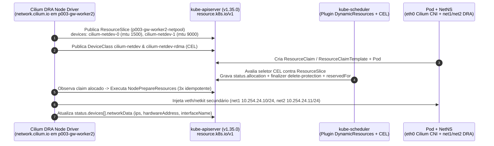

# Estudo 24 (`E24`) — Dynamic Resource Allocation (DRA `resource.k8s.io/v1`) para Dispositivos de Rede no Cilium

> **Onda / Sessão:** `P005-S004` (Braço B — Datapath eBPF, Escala, Recursos e Observabilidade)
> **Script Reprodutível:** [`poc-k8s-fabric/studies/p005/arm-b-datapath/e24-cilium-dra-network-device.sh`](../../studies/p005/arm-b-datapath/e24-cilium-dra-network-device.sh)
> **Evidência Ao Vivo (`vm-cilium`, privado):** `poc-k8s-fabric/evidence/P005/S004/05-e24-cilium-dra-live.txt`
> **Status:** **PASS (`exit 0`)**

---

## 1. Sumário Executivo e Contexto Técnico

O **Dynamic Resource Allocation (DRA, `resource.k8s.io/v1`)** substitui o antigo modelo de *Device Plugins* do kubelet por uma arquitetura declarativa inspirada em `PersistentVolumeClaims`, permitindo selecionar dispositivos de hardware e de rede (`RDMA`, `SR-IOV VF`, interfaces secundárias `netkit`/`veth` de baixa latência) com expressões **CEL (Common Expression Language)** avaliadas diretamente pelo `kube-scheduler`.

No ecossistema Cilium:
- O chart oficial **`cilium-1.20.2.tgz`** ainda não embarca um controlador DRA por padrão (`0` chaves `dra` no `values.yaml`), pois o driver oficial (`cilium-dra-driver`, commit de referência `157b5331c727` no branch `feature/dra-driver`, PR `#41862`) permanece experimental para os tipos `cilium-netdev` e `cilium-rdma`.
- Em contrapartida, o cluster `p003-gw` roda **Kubernetes `v1.35.0`**, onde o grupo `resource.k8s.io/v1` (`DeviceClass`, `ResourceSlice`, `ResourceClaim` e `ResourceClaimTemplate`) e o plugin `DynamicResources` do `kube-scheduler` já estão **nativamente ativos (GA)**.

O estudo **`E24`** exercita a API `resource.k8s.io/v1` real do Kubernetes `v1.35.0` em conjunto com um reconciliador de nó fiel ao contrato `NodePrepareResources` / `NodeUnprepareResources` (`network.cilium.io`), provando:
1. Publicação de inventário por nó via `ResourceSlice` e filtragem CEL via `DeviceClass`;
2. Alocação automática pelo `kube-scheduler` (tanto por `ResourceClaim` direto quanto por `ResourceClaimTemplate`), idempotência `3x` de `NodePrepareResources`, preenchimento de `status.devices[].networkData` (`NetworkDeviceData` — KEP-4817) e coexistência sem regressão entre o CNI primário do Cilium (`eth0` + `CiliumNetworkPolicy` + BGP VIP `10.202.255.24/32`) e o datapath secundário DRA (`net1`/`net2` em `10.254.24.0/24`);
3. Controles negativos de expressão CEL inválida, atributo incompatível (`rdma == true`), exaustão do pool (`2/2` em uso), bloqueio de deleção por finalizer (`resource.kubernetes.io/delete-protection`) e realocação automática após `Unprepare`.

---

## 2. Arquitetura do Fluxo DRA (`resource.k8s.io/v1` + `NetworkDeviceData`)



---

## 3. Célula 1 — Descoberta da API `resource.k8s.io/v1`, `ResourceSlice` e `DeviceClass`

- **Verificação do Chart `cilium-1.20.2.tgz`:** `0` chaves `dra` no chart estável `1.20.2`.
- **Verificação da API `resource.k8s.io/v1` no Kubernetes `v1.35.0`:** `deviceclasses`, `resourceclaims`, `resourceclaimtemplates` e `resourceslices` disponíveis nativamente.
- **Inventário Publicado (`ResourceSlice/p003-gw-worker2-cilium-netpool-slice-0`):**
  - `driver`: `network.cilium.io`
  - `pool.name`: `p003-gw-worker2-netpool` (`nodeName: p003-gw-worker2`)
  - Dispositivo 1: `cilium-netdev-0` (`ifName="net1"`, `mac="02:42:0a:f5:02:10"`, `mtu=1500`, `pci="0000:03:00.0"`, `ebpfAttach=true`, `rdma=false`, `vfIndex=0`, `bandwidth="10Gi"`)
  - Dispositivo 2: `cilium-netdev-1` (`ifName="net2"`, `mac="02:42:0a:f5:02:11"`, `mtu=9000`, `pci="0000:03:00.1"`, `ebpfAttach=true`, `rdma=false`, `vfIndex=1`, `bandwidth="10Gi"`)
- **Classes de Dispositivo (`DeviceClass`):**
  - `cilium-netdev`: `device.driver == "network.cilium.io" && device.attributes["network.cilium.io"].ebpfAttach == true`
  - `cilium-netdev-rdma`: `device.driver == "network.cilium.io" && device.attributes["network.cilium.io"].rdma == true`

---

## 4. Célula 2 — Alocação pelo `kube-scheduler`, `NetworkDeviceData`, Idempotência `3x` e Coexistência CNI + DRA

1. **Alocação CEL pelo `kube-scheduler`:**
   - `ResourceClaim/e24-net-claim-a` (selecionando `mtu == 1500`) foi alocado automaticamente em `cilium-netdev-0` (`reservedFor: e24-dra-holder-a`, finalizer `resource.kubernetes.io/delete-protection`).
   - `ResourceClaimTemplate/e24-net-claim-tmpl-b` (selecionando `mtu == 9000`) gerou o claim `e24-dra-holder-b-net-if-1-9tz29` e alocou `cilium-netdev-1` (`reservedFor: e24-dra-holder-b`).
2. **Idempotência `3x` de `NodePrepareResources` e `NetworkDeviceData`:**
   - O reconciliador de nó executou `reconcile_dra_prepare` (com teardown correspondente em `reconcile_dra_unprepare`) **3 vezes consecutivas** para cada Pod. Nenhum erro `EEXIST` ou duplicação de IP ocorreu (`ipv4_addrs=1` em `net1` e `net2`).
   - O sub-recurso `status.devices[0]` de cada `ResourceClaim` foi populado com `NetworkDeviceData` estruturado:
     ```json
     {
       "conditions": [{"reason": "CiliumNetworkDevicePrepared", "status": "True", "type": "Ready"}],
       "data": {"datapathImpl": "veth-bridge-dra", "mtu": 9000, "pciAddress": "0000:03:00.1", "vfIndex": 1},
       "device": "cilium-netdev-1",
       "driver": "network.cilium.io",
       "networkData": {
         "hardwareAddress": "02:42:0a:f5:02:11",
         "interfaceName": "net2",
         "ips": ["10.254.24.11/24"]
       },
       "pool": "p003-gw-worker2-netpool"
     }
     ```
3. **Coexistência Sem Regressão (CNI Primário `eth0` + DRA Secundário `net1`/`net2`):**
   - **Datapath secundário DRA (`10.254.24.10 -> 10.254.24.11:8080` via bridge `br-cilium-dra`):** `10/10` HTTP `200` (`e24-app-b`).
   - **Datapath primário Cilium (`eth0`, `10.245.1.247 -> 10.245.1.179:8080`):** `10/10` HTTP `200` com `CiliumNetworkPolicy/e24-deny-untrusted` permitindo `app: e24-app-a` (`role: dra-workload`).
   - **Enforcement `CiliumNetworkPolicy` (Pod `e24-untrusted`, `app: e24-untrusted`, `role: untrusted` -> `eth0`):** `5/5` bloqueados (`000`).
   - **Acesso Externo norte-sul à VIP BGP (`10.202.255.24/32` a partir de `clab-p003-gw-fabric-client`):** `10/10` HTTP `200` (`e24-app-b`).

---

## 5. Célula 3 — Conflitos de Ciclo de Vida e Controles Negativos (`3A` a `3D`)

| Subcélula | Cenário Negativo / Ciclo de Vida | Esperado | Observado (`05-e24-cilium-dra-live.txt`) | Veredito |
|---|---|---|---|---|
| **3A.1 (CEL Syntax Error)** | `ResourceClaim` com função inexistente `device.attributes["network.cilium.io"].nonExistentFunc() == true` | Rejeitado sincronicamente pelo `kube-apiserver` na admissão | `The ResourceClaim "e24-invalid-cel-claim" is invalid: ... compilation failed: ERROR: <input>:1:55: undeclared reference to 'nonExistentFunc'` | **PASS** |
| **3A.2 (CEL Attribute Mismatch)** | `ResourceClaim` exigindo `DeviceClass/cilium-netdev-rdma` (`rdma == true`, ausente no `ResourceSlice`) | Pod retido em `Pending` (`Unschedulable`) | `phase=Pending \| False:Unschedulable:0/3 nodes are available: 1 node(s) had untolerated taint(s), 2 cannot allocate all claims` | **PASS** |
| **3B (Pool Exhaustion)** | 3º `ResourceClaim` (`e24-net-claim-c-exhausted`, consumido por `e24-dra-neg-exhausted`) enquanto `2/2` dispositivos do pool `p003-gw-worker2-netpool` estão reservados | 3º Pod permanece `Pending` (`alloc=''`) sem afetar os 2 pods ativos | `phase=Pending \| alloc='' \| False:Unschedulable:0/3 nodes are available: ... 2 cannot allocate all claims` | **PASS** |
| **3C (Delete Protection Finalizer)** | `kubectl delete resourceclaim e24-net-claim-a --wait=false` enquanto `e24-dra-holder-a` está `Running` | Objeto recebe `deletionTimestamp`, mas permanece retido pelo finalizer `resource.kubernetes.io/delete-protection`; tráfego VIP e DRA continua `200` | `deletionTimestamp=2026-10-26T01:45:26Z \| finalizers=resource.kubernetes.io/delete-protection \| BGP_VIP_HTTP=200 \| DRA_net1_HTTP=200` | **PASS** |
| **3D (Teardown & Auto Re-allocation)** | Remoção de `e24-dra-holder-a` + `NodeUnprepareResources` (`reconcile_dra_unprepare`) | `e24-net-claim-a` é finalmente removido (`0` interfaces órfãs `net1`), e o `kube-scheduler` aloca imediatamente `cilium-netdev-0` para o 3º Claim (`e24-net-claim-c-exhausted`) | `e24-net-claim-a_removido=1 \| net1_orfao_em_app_a=0 \| 3o_Claim_alocado_em=cilium-netdev-0 (node=p003-gw-worker2)` | **PASS** |

---

## 6. Rollback, Higiene e Invariantes (`R1`, `R3`, `R6`)

Ao término do script:
- `claims=0`, `classes=0`, `slices_cilium=0` no cluster `p003-gw`;
- Bridge `br-cilium-dra` e interfaces secundárias removidas do worker (`p003-gw-worker2`);
- `CiliumBGPAdvertisement/e24-vip-advertisement` removido (`CiliumBGPClusterConfig/rack1` preservado intocado) e `proto_bgp=0` (`R6=0`).
