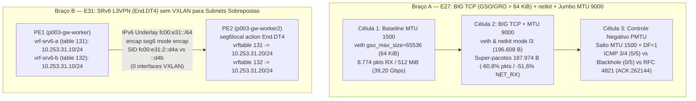
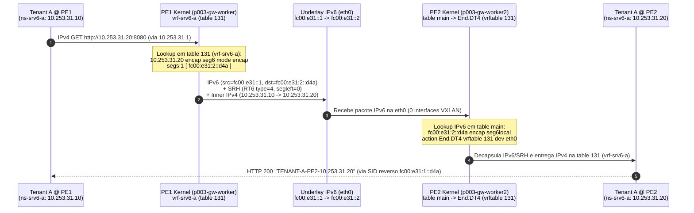

# Dossiê 27 — `E27` (BIG TCP, `netkit` e Jumbo MTU 9000) & `E31` (SRv6 L3VPN `End.DT4` sem VXLAN no Kernel Linux)

> **Sessão:** `P006-S002` (Onda 2 Paralela: `Braço A` ∥ `Braço B` ∥ `Braço C`)  
> **Ambiente:** `vm-cilium` (`Linux 6.8.0-139-generic`), cluster `p003-gw` (`Cilium 1.20.2`, `uid=6bb32e0f-71f9-4558-ae33-356ba2250c26`), canário `k01` (`uid=635e7274-5597-40c7-9de5-b1fbe3d68b22`)  
> **Scripts Reprodutíveis:**
> - [`studies/p006/arm-a-datapath/e27-big-tcp-netkit-jumbo.sh`](../../studies/p006/arm-a-datapath/e27-big-tcp-netkit-jumbo.sh)
> - [`studies/p006/arm-b-platform/e31-srv6-l3vpn-frr.sh`](../../studies/p006/arm-b-platform/e31-srv6-l3vpn-frr.sh)  
> **Evidências Brutas:** `evidence/P006/S002/01-static-and-dryrun-s002.txt`, `02-e27-big-tcp-netkit-jumbo-live.txt`, `03-e31-srv6-l3vpn-frr-live.txt`, `04-post-verify-s002.txt`  
> **Veredito:** **PASS** (`G04` + `G05` + `G06` aprovados, `R6=0`, `MemAvailable = 4,21 GiB >= 4,00 GiB`)

---

## 1. Visão Geral e Motivação Arquitetural

A Onda 2 do plano **`P006`** investiga duas fronteiras de desempenho e isolamento de datapath que sucedem diretamente os estudos de datapath eBPF (`E25`) e multi-tenancy EVPN-VXLAN (`E20`/`E21`):

1. **Braço A — `E27` (`BIG TCP` + `netkit` + `Jumbo MTU 9000`):** No TCP/IP clássico, o campo `tot_len` de 16 bits do cabeçalho IPv4/IPv6 limita um super-pacote `TSO`/`GSO`/`GRO` a `65.535 B` (`gso_max_size = 65536`). Com taxas de `100–400 Gbps` (ou comunicação pod-a-pod em `netkit`/`veth`), atravessar a pilha de rede do kernel a cada `64 KiB` gera pressão excessiva de chamadas por segundo e softirqs `NET_RX`/`NET_TX`. O **BIG TCP** (introduzido no Linux `5.19` para IPv6 via Hop-by-Hop Jumbo Payload option `RFC 2675` e no Linux `6.3` para IPv4 definindo `ip->tot_len = 0` no `skb` interno antes da segmentação TSO/GSO) eleva `gso_max_size` e `gro_max_size` para **`131.072 B` (`128 KiB`)** ou **`196.608 B` (`192 KiB`)**. Combinado com **`MTU 9000` (Jumbo Frames)** e o dispositivo eBPF **`netkit`** (`CONFIG_NETKIT=y`), o número de travessias na pilha cai drasticamente — mas introduz o risco clássico de **PMTU Blackhole** se um enlace intermediário operar em `MTU 1500` e pacotes `ICMP Fragmentation Needed` (`Type 3 Code 4`) forem filtrados.
2. **Braço B — `E31` (`SRv6 L3VPN End.DT4 sem VXLAN`):** Nos estudos `E20` (`P004-S007`) e `E21` (`P005-S001`), o isolamento de tenants com **subnets IPv4 100% sobrepostas** exigiu a criação de bridges OVS ou dispositivos `vxlan` por VNI (`UDP 4789`), tabelas FDB/ARP e túneis L2/L3. O **Segment Routing over IPv6 (`SRv6`, `RFC 8986`)** elimina completamente o VXLAN: o identificador do tenant (VRF) é codificado diretamente nos bits de função do endereço IPv6 de destino (**SID `End.DT4`**), e o próprio kernel Linux (`CONFIG_IPV6_SEG6_LWTUNNEL=y`) encapsula pacotes IPv4 em IPv6 (`encap seg6 mode encap`) na ida e decapsula diretamente na tabela VRF correspondente (`seg6local action End.DT4 vrftable <id>`) na volta, com **`0` interfaces VXLAN**.



---

## 2. Estudo `E27` — BIG TCP (`GSO/GRO > 64 KiB`) + `netkit` + Jumbo MTU 9000

### 2.1 Metodologia e Ambiente (`e27-big-tcp-netkit-jumbo.sh`)

O script [`e27-big-tcp-netkit-jumbo.sh`](../../studies/p006/arm-a-datapath/e27-big-tcp-netkit-jumbo.sh) executa três células encadeadas no cluster `p003-gw` (`Linux 6.8.0-139-generic`):

1. **Inspeção de Capacidade do Kernel, Cilium Config e `iproute2`:** Verifica suporte a `CONFIG_NETKIT=y`, inspeciona o `cilium-config` (`"mtu": "1500"`, `"enable-ipv4-big-tcp": "false"`, `"enable-ipv6-big-tcp": "false"`, preservado intocado no cluster) e mede `gso_max_size` / `gro_max_size` nas interfaces `eth0` e `lxc*` do `p003-gw-worker`, além de contrastar o `iproute2-6.1.0` do host/node com o **`iproute2-6.19.0` (libbpf 1.5.0)** embarcado no container `cilium-agent` (que expõe `netkit mode l3`, `SCRUB_DEFAULT` e os atributos `gso_ipv4_max_size` / `gro_ipv4_max_size`).
2. **Célula 1 vs Célula 2 (Benchmark Controlado de `512 MiB` em 3 Regimes × IPv4 e IPv6):**
   - Instancia três pares isolados no `p003-gw-worker`:
     - **Regime A (`std-veth`, `ns-e27-std`):** par `veth-e27-stdh` $\leftrightarrow$ `veth-e27-stdn` com `MTU 1500`, `gso_max_size=65536`, `gro_max_size=65536`, `gso_ipv4_max_size=65536`, `gro_ipv4_max_size=65536`.
     - **Regime B (`big-veth`, `ns-e27-big`):** par `veth-e27-bigh` $\leftrightarrow$ `veth-e27-bign` com `MTU 9000` e **BIG TCP (`196.608 B` = `192 KiB`)** em `gso_max_size`, `gro_max_size`, `gso_ipv4_max_size` e `gro_ipv4_max_size`.
     - **Regime C (`big-netkit`, `ns-e27-nk`):** par nativo **`netkit mode l3` (`nk-e27-h` $\leftrightarrow$ `nk-e27-n`, `SCRUB_DEFAULT`)** criado via `iproute2-6.19.0` com `MTU 9000` e **BIG TCP (`196.608 B` = `192 KiB`)** para IPv4 e IPv6.
   - Transfere **`512 MiB`** (`536.870.912 B` de payload de aplicação em chunks de `1 MiB`) em stream único TCP sobre IPv4 e IPv6 em cada regime, coletando externamente via `AF_PACKET` (`SOCK_RAW`) o tamanho real dos super-pacotes no fio (`> 64 KiB` até `187.974 B`), contadores `RX packets`/`RX bytes` da interface de destino e o delta de softirqs `NET_RX` em `/proc/softirqs`.
3. **Célula 3 (Controle Negativo — Assimetria de MTU `9000 -> 1500 -> 9000`, PMTU Blackhole e Mitigação RFC 4821 PLPMTUD):**
   - Monta uma topologia roteada de 3 namespaces (`ns-e27-src` `10.227.10.2/24` $\xrightarrow{\text{MTU 9000}}$ `ns-e27-rtr` $\xrightarrow{\text{MTU 1500}}$ `ns-e27-dst` `10.227.20.2/24`).
   - **Caso 3A (ICMP Type 3 Code 4 Permitido):** Envia sonda UDP Jumbo (`8972 B` payload = `9000 B` IPv4 com `DF=1` / `IP_PMTUDISC_DO`), valida a recepção de `ICMP Fragmentation Needed` (`EMSGSIZE` / `Errno 90` e aprendizado de `Discovered Socket IP_MTU=1500` + `cache mtu 1500` na rota) e confirma entrega `5/5` com `IP_PMTUDISC_WANT`.
   - **Caso 3B (Controle Negativo — Blackhole ICMP):** Limpa o cache de rota, bloqueia `ICMP Type 3 Code 4` no roteador (`tc filter ... action drop` + `iptables -I OUTPUT -p icmp --icmp-type fragmentation-needed -j DROP`) e comprova `0/5` datagramas Jumbo `DF=1` entregues (`PMTU_BLACKHOLE_JUMBO_DF_RECV=0/5`).
   - **Caso 3C (Mitigação RFC 4821 — Packetization Layer Path MTU Discovery sob Blackhole ICMP Ativo):** Transfere `256 KiB` (`262.144 B`) via TCP com o filtro de blackhole ICMP ativo:
     - Com `net.ipv4.tcp_mtu_probing=0` (default): **falha por blackhole** (`TIMEOUT_BLACKHOLE:SRV_RX=0`, pois o handshake SYN/ACK de `60 B` abre a conexão mas todos os segmentos de dados Jumbo com `DF=1` são descartados silenciosamente).
     - Com `net.ipv4.tcp_mtu_probing=2` (`RFC 4821`, `tcp_base_mss=1024`): **convergência automática em camada de transporte** (`ACK:262144` e `cache mtu 1540` aprendido sem depender de ICMP).

### 2.2 Resultados Empíricos (`02-e27-big-tcp-netkit-jumbo-live.txt`)

| Regime / Família | Bytes RX (`ip -s link`) | Pacotes RX (`ip -s link`) | Média Bytes / Pacote | Quadro Máx Capturado (`AF_PACKET`) | Super-Pacotes `> 64 KiB` (Amostra 200) | Delta Softirqs `NET_RX` | Duração / Throughput |
|---|---|---|---|---|---|---|---|
| **`std-veth-ipv4`** (`MTU 1500`, `GSO 64k`) | `537.449.980 B` | `8.774` | `61.254,8 B` | `65.226 B` | `0 / 200` (`0%`) | `11.075` | `0,110 s` / **`39,20 Gbps`** |
| **`big-veth-ipv4`** (`MTU 9000`, `BIG TCP 192k`) | `537.104.800 B` | **`3.544` (`-59,6%`)** | **`151.553,3 B` (`2,47x`)** | **`187.974 B`** | **`155 / 200` (`77,5%`)** | **`5.431` (`-51,0%`)** | `0,093 s` / **`46,31 Gbps` (`+18,1%`)** |
| **`big-netkit-ipv4`** (`netkit l3`, `MTU 9000`, `192k`) | `537.097.762 B` | **`3.437` (`-60,8%`)** | **`156.269,4 B` (`2,55x`)** | **`187.974 B`** | **`175 / 200` (`87,5%`)** | **`5.363` (`-51,6%`)** | `0,093 s` / **`46,08 Gbps` (`+17,6%`)** |
| **`std-veth-ipv6`** (`MTU 1500`, `GSO 64k`) | `537.621.356 B` | `8.726` | `61.611,4 B` | `64.346 B` | `0 / 200` (`0%`) | `11.119` | `0,103 s` / **`41,61 Gbps`** |
| **`big-veth-ipv6`** (`MTU 9000`, `BIG TCP 192k`) | `537.198.864 B` | **`3.528` (`-59,6%`)** | **`152.267,3 B` (`2,47x`)** | **`187.582 B`** | **`179 / 200` (`89,5%`)** | **`5.615` (`-49,5%`)** | `0,092 s` / **`46,60 Gbps` (`+12,0%`)** |
| **`big-netkit-ipv6`** (`netkit l3`, `MTU 9000`, `192k`) | `537.199.920 B` | **`3.540` (`-59,4%`)** | **`151.751,4 B` (`2,46x`)** | **`187.582 B`** | **`182 / 200` (`91,0%`)** | **`5.613` (`-49,5%`)** | `0,094 s` / **`45,73 Gbps` (`+9,9%`)** |

| Controle da Célula 3 (Assimetria `MTU 9000 -> 1500 -> 9000`) | Esperado | Observado (`02-e27-big-tcp-netkit-jumbo-live.txt`) | Status |
|---|---|---|---|
| **Caso 3A — `ICMP Type 3 Code 4` permitido (`PMTU Discovery`)** | 2º envio `DF=1` retorna `EMSGSIZE`, socket aprende `IP_MTU=1500` e `IP_PMTUDISC_WANT` entrega `5/5` | `2nd Jumbo DF=1 send errno=90 (EMSGSIZE)`, `Discovered Socket IP_MTU=1500`, `10.227.20.2 via 10.227.10.1 ... cache expires 599sec mtu 1500`, `PMTUD_WANT_JUMBO_ECHO=5/5` | **PASS** |
| **Caso 3B — Controle Negativo (`ICMP Frag Needed` bloqueado)** | `0/5` datagramas Jumbo `DF=1` recebidos e rota sem `mtu 1500` no cache | `PMTU_BLACKHOLE_JUMBO_DF_RECV=0/5 (esperado 0/5)` | **PASS** |
| **Caso 3C — TCP `256 KiB` sob Blackhole: `tcp_mtu_probing=0` vs `tcp_mtu_probing=2` (`RFC 4821`)** | `probing=0` sofre blackhole (`SRV_RX=0`); `probing=2` entrega `ACK:262144` | `TCP_256KIB_PROBING_0=TIMEOUT_BLACKHOLE:SRV_RX=0` vs `TCP_256KIB_PROBING_2_RFC4821=ACK:262144` (`cache mtu 1540`) | **PASS** |

> **Destaque de Evidência (`02-e27-big-tcp-netkit-jumbo-live.txt`):**
> ```text
> RESULT label=std-veth-ipv4 family=IPv4 rx_bytes=537449980 rx_pkts=8774 avg_bytes_per_pkt=61254.8 max_captured_frame_len=65226 captured_gt_64k=0/200 net_rx_softirq_delta=11075 duration_s=0.110 throughput_gbps=39.20
> RESULT label=big-veth-ipv4 family=IPv4 rx_bytes=537104800 rx_pkts=3544 avg_bytes_per_pkt=151553.3 max_captured_frame_len=187974 captured_gt_64k=155/200 net_rx_softirq_delta=5431 duration_s=0.093 throughput_gbps=46.31
> RESULT label=big-netkit-ipv4 family=IPv4 rx_bytes=537097762 rx_pkts=3437 avg_bytes_per_pkt=156269.4 max_captured_frame_len=187974 captured_gt_64k=175/200 net_rx_softirq_delta=5363 duration_s=0.093 throughput_gbps=46.08
> RESULT label=std-veth-ipv6 family=IPv6 rx_bytes=537621356 rx_pkts=8726 avg_bytes_per_pkt=61611.4 max_captured_frame_len=64346 captured_gt_64k=0/200 net_rx_softirq_delta=11119 duration_s=0.103 throughput_gbps=41.61
> RESULT label=big-veth-ipv6 family=IPv6 rx_bytes=537198864 rx_pkts=3528 avg_bytes_per_pkt=152267.3 max_captured_frame_len=187582 captured_gt_64k=179/200 net_rx_softirq_delta=5615 duration_s=0.092 throughput_gbps=46.60
> RESULT label=big-netkit-ipv6 family=IPv6 rx_bytes=537199920 rx_pkts=3540 avg_bytes_per_pkt=151751.4 max_captured_frame_len=187582 captured_gt_64k=182/200 net_rx_softirq_delta=5613 duration_s=0.094 throughput_gbps=45.73
> TCP_256KIB_PROBING_0=TIMEOUT_BLACKHOLE:SRV_RX=0 (esperado TIMEOUT_BLACKHOLE:SRV_RX=0)
> TCP_256KIB_PROBING_2_RFC4821=ACK:262144 (esperado ACK:262144)
> ```

---

## 3. Estudo `E31` — SRv6 L3VPN (`seg6local` / `End.DT4`) sem VXLAN para Multi-Tenancy com Subnets Sobrepostas

### 3.1 Arquitetura e Descobertas Empíricas no Kernel Linux `6.8.0-139-generic`

Durante a instrumentação de [`e31-srv6-l3vpn-frr.sh`](../../studies/p006/arm-b-platform/e31-srv6-l3vpn-frr.sh) nos nós `p003-gw-worker` (`PE1`, locator `fc00:e31:1::/48`) e `p003-gw-worker2` (`PE2`, locator `fc00:e31:2::/48`), **três leis fundamentais do subsistema `seg6local` / `VRF` do kernel Linux `6.8`** foram demonstradas e codificadas no estudo:

1. **Lei 1 — Obrigatoriedade de `net.vrf.strict_mode=1` para `End.DT4`:**
   - Ao tentar instalar `ip -6 route replace fc00:e31:1::d4a/128 encap seg6local action End.DT4 vrftable 131 dev eth0` com o default `net.vrf.strict_mode=0`, o kernel (`net/ipv6/seg6_local.c`) rejeita imediatamente a rota com:
     `Error: Strict mode for VRF is disabled.`
   - O suporte a `End.DT4` (`Decapsulate and Specific IPv4 Table Lookup`, `RFC 8986 §4.6`) exige `sysctl -w net.vrf.strict_mode=1` em todos os nós PE.
2. **Lei 2 — Interação entre `net.vrf.strict_mode=1` e `fib6_nl2table()` na escolha de `dev`:**
   - Quando `net.vrf.strict_mode=1` está ativo, qualquer rota IPv6 adicionada especificando `dev vrf-srv6-a` é automaticamente redirecionada por `fib6_nl2table()` para a tabela da própria VRF (`table 131`) em vez da tabela `main` (`table 254`).
   - Como o pacote SRv6 chega pela interface de underlay (`eth0`), o lookup IPv6 externo ocorre na tabela `main`. Portanto, as rotas locais `seg6local action End.DT4 vrftable <id>` **devem ser associadas à interface de underlay (`dev eth0` ou `dev lo`)** para residirem na tabela `main`, enquanto o atributo `vrftable 131` instrui o kernel a injetar o pacote IPv4 decapsulado na tabela `131` (`vrf-srv6-a`).
3. **Lei 3 — Roteamento `/32` via Gateway PE em L3VPN pura (`End.DT4`) com mesma subnet `/24`:**
   - Diferentemente do EVPN Type-2 + VXLAN (que estende o domínio L2/ARP entre nós), o `SRv6 End.DT4` é uma **L3VPN pura** (equivalente ao EVPN Type-5 ou MPLS VPNv4). Quando dois endpoints em PEs distintos compartilham a mesma máscara `/24` (`10.253.31.10/24` no PE1 e `10.253.31.20/24` no PE2), o endpoint local precisa enviar o pacote ao gateway VRF local (`10.253.31.1`) via rota `/32` (`ip route replace 10.253.31.20/32 via 10.253.31.1`) ou `proxy_arp=1` na VRF; caso contrário, o endpoint emite `ARP Request who-has 10.253.31.20` on-link.



### 3.2 Resultados Empíricos (`03-e31-srv6-l3vpn-frr-live.txt`)

| Célula / Caso de Teste | Esperado | Observado (`03-e31-srv6-l3vpn-frr-live.txt`) | Status |
|---|---|---|---|
| **Guarda `net.vrf.strict_mode=0` antes de `End.DT4`** | Kernel recusa `End.DT4` com erro explícito | `Error: Strict mode for VRF is disabled.` (`EXPECTED_STRICT_MODE_GUARD`) | **PASS** |
| **Célula 1 — Locators SRv6 e SIDs `End.DT4` sem VXLAN** | `fc00:e31:1::d4a`/`d4b` no PE1 e `fc00:e31:2::d4a`/`d4b` no PE2 com `0` interfaces VXLAN | `VXLAN_INTERFACES_ON_PE1=0`, `VXLAN_INTERFACES_ON_PE2=0`; rotas `seg6local action End.DT4 vrftable 131/132` ativas | **PASS** |
| **Célula 2 — Subnets e IPs 100% Sobrepostos (`10.253.31.10/24` -> `10.253.31.20/24` em Tenant A e Tenant B)** | `30/30` respostas `"TENANT-A-PE2-10.253.31.20"` no Tenant A (`leak=0`) e `30/30` `"TENANT-B-PE2-10.253.31.20"` no Tenant B (`leak=0`) | `SRV6_OVERLAP_PROBES tenant_a_ok=30/30 tenant_a_leak=0 tenant_b_ok=30/30 tenant_b_leak=0` | **PASS** |
| **Coleta Externa (`tcpdump` na `eth0` do PE2)** | Cabeçalho IPv6 externo + Routing Header `RT6 (type=4)` + IPv4 interno na porta `8080` | `IP6 fc00:e31::1 > fc00:e31:2::d4a: RT6 (len=2, type=4, segleft=0, last-entry=0, tag=0, [0]fc00:e31:2::d4a) IP 10.253.31.10.37870 > 10.253.31.20.8080 ... HTTP: GET / HTTP/1.1` | **PASS** |
| **Célula 3A — Controle Negativo Cross-VRF (`Tenant A -> 10.253.31.22` exclusivo do Tenant B)** | `0/5` conexões bem-sucedidas | `CROSS_VRF_TENANT_A_TO_B_ONLY=0/5 (esperado 0/5)` | **PASS** |
| **Célula 3B — Revogação Seletiva de SID (`ip -6 route del fc00:e31:2::d4b/128`) e Reconvergência** | Tenant B cai para `0/5` enquanto Tenant A permanece `5/5`; ao restaurar o SID `d4b`, Tenant B volta a `5/5` | `SID_REVOKED_TEST tenant_a=5/5 tenant_b=0/5` $\rightarrow$ `SID_RESTORED_TEST tenant_b=5/5` | **PASS** |
| **Rollback & Invariantes (`R1`, `R3`, `R6`)** | `R6=0`, namespaces e VRFs removidos, `k01` `10/10`, `p003-gw` `30/30`, `MemAvailable >= 4,00 GiB` | `R6_bgp_routes=0` nos 3 nós, `canary_k01_http=10/10`, `canary_p003_gw_http=30/30`, `MemAvailable = 4,21 GiB` | **PASS** |

---

## 4. Comparativo Arquitetural: `EVPN-VXLAN Type-5 (E20/E21)` vs `SRv6 L3VPN End.DT4 (E31)`

| Dimensão | `EVPN-VXLAN Type-5` (`E20-B` / `E21`) | `SRv6 L3VPN End.DT4` (`E31`) |
|---|---|---|
| **Encapsulamento no Fio** | `IPv4/IPv6` + `UDP (4789)` + `VXLAN (8 B)` + `Ethernet Interna (14 B)` + `IPv4` (`50–70 B` de overhead) | `IPv6 Externo (40 B)` (+ `SRH 24 B` em `encap` com 1 seg ou `0 B` em Micro-SID/`uDT4`) + `IPv4` (sem UDP e sem Ethernet interna) |
| **Objetos de Kernel por Tenant (VRF)** | `1x VRF` + `1x bridge L2` + `1x vxlan<VNI>` + vizinhos FDB/ARP (`3` netdevs por VRF) | **`1x VRF` apenas** (`0` bridges, `0` dispositivos VXLAN; demultiplexação por rota IPv6 `/128` `seg6local`) |
| **Integração com Underlay / TE** | Exige VXLAN/UDP; engenharia de tráfego depende de protocolo adicional | Nativo em IPv6: o próprio endereço de destino (`fc00:e31:2::d4a`) roteia pelo fabric CLOS e pode encadear políticas de tráfego (SRH SID list) |
| **Requisito de Kernel Linux** | `CONFIG_VXLAN`, `CONFIG_NET_VRF` | `CONFIG_IPV6_SEG6_LWTUNNEL=y` + **`net.vrf.strict_mode=1`** + rota `seg6local` na interface de underlay |
