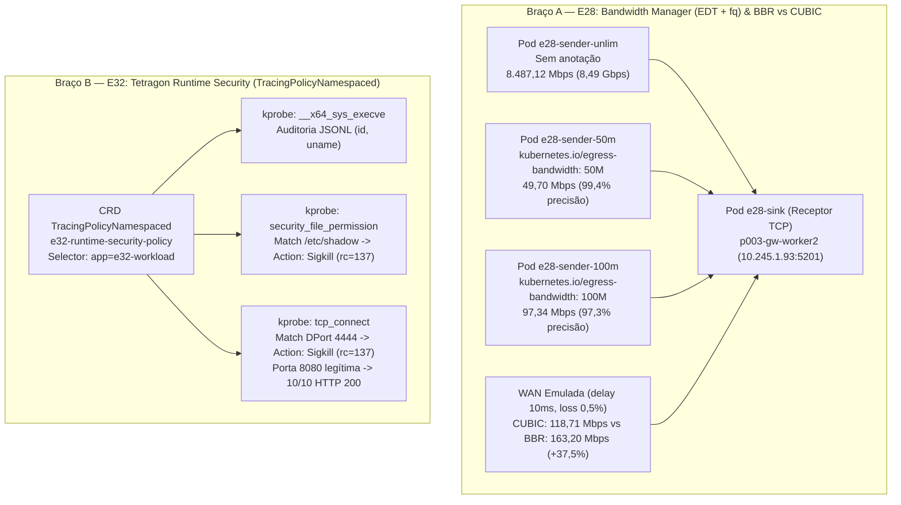

# Dossiê 28 — `E28` (Bandwidth Manager EDT + BBR vs CUBIC) & `E32` (Tetragon: Observabilidade e Enforcement eBPF em Runtime via `TracingPolicy`)

> **Sessão:** `P006-S003` (Onda 3 Paralela: `Braço A` ∥ `Braço B` ∥ `Braço C`)  
> **Ambiente:** `vm-cilium` (`Linux 6.8.0-139-generic`), cluster `p003-gw` (`Cilium 1.20.2`, `uid=6bb32e0f-71f9-4558-ae33-356ba2250c26`), canário `k01` (`uid=635e7274-5597-40c7-9de5-b1fbe3d68b22`)  
> **Scripts e Manifestos Reprodutíveis:**
> - [`studies/p006/arm-a-datapath/01-e28-bandwidth-edt-bbr.yaml`](../../studies/p006/arm-a-datapath/01-e28-bandwidth-edt-bbr.yaml)
> - [`studies/p006/arm-a-datapath/e28-bandwidth-edt-bbr.sh`](../../studies/p006/arm-a-datapath/e28-bandwidth-edt-bbr.sh)
> - [`studies/p006/arm-b-platform/01-e32-tetragon-runtime-ebpf.yaml`](../../studies/p006/arm-b-platform/01-e32-tetragon-runtime-ebpf.yaml)
> - [`studies/p006/arm-b-platform/e32-tetragon-runtime-ebpf.sh`](../../studies/p006/arm-b-platform/e32-tetragon-runtime-ebpf.sh)  
> **Evidências Brutas:** `evidence/P006/S003/01-static-and-dryrun-s003.txt`, `02-e28-bandwidth-edt-bbr-live.txt`, `03-e32-tetragon-runtime-ebpf-live.txt`, `04-post-verify-s003.txt`  
> **Veredito:** **PASS** (`G07` + `G08` + `G09` aprovados, `R6=0`, `MemAvailable >= 4,00 GiB`)

---

## 1. Visão Geral e Motivação Arquitetural

A Onda 3 do plano **`P006`** aprofunda duas capacidades críticas de produção em clusters Cilium nativos:

1. **Braço A — `E28` (`Bandwidth Manager: EDT + BBR vs CUBIC`):** Na arquitetura clássica de CNI (`bandwidth` meta-plugin do CNI), a limitação de banda por pod (`kubernetes.io/egress-bandwidth`) usa qdiscs **`tbf` (Token Bucket Filter)** ou **`htb` (Hierarchical Token Bucket)** sobre interfaces virtuais, exigindo spinlocks globais na fila de transmissão (`qdisc root lock`) e degradando a latência de cauda (`p99`) em nós multi-core. O **Cilium Bandwidth Manager** substitui o modelo de filas bloqueantes pela arquitetura **EDT (*Earliest Departure Time*)**: um programa eBPF (`tcx`/`cil_to_netdev`) calcula o timestamp exato de partida de cada pacote (`skb->tstamp = max(now, last_tstamp) + len * NSEC_PER_SEC / rate`) mantendo estado no mapa BPF `cilium_throttle`, enquanto a qdisc **`fq` (*Fair Queue*)** na interface de saída despacha os pacotes pela roda de tempo sem contenção de lock global. Essa mesma infraestrutura habilita nativamente o controle de congestionamento **BBR (`tcp_bbr`)**, que se baseia em *pacing* por timestamp (`EDT`) em vez de janelas reativas puramente baseadas em perda como o **CUBIC**.
2. **Braço B — `E32` (`Tetragon: Observabilidade e Enforcement eBPF em Runtime`):** Nos estudos anteriores (`E04`, `E12` e `E23`), as políticas `CiliumNetworkPolicy` e `Gateway API` operaram nas camadas L3/L4/L7 de rede. Contudo, um ataque em tempo de execução dentro de um pod autorizado (ex.: execução de binário inesperado via `execve`, leitura de `/etc/shadow` ou tentativa de *reverse shell* `tcp_connect` para porta proibida) ocorre antes ou à margem de políticas puramente baseadas em CIDR. O **Tetragon** estende o plano de dados eBPF do Cilium para o kernel Linux (`kprobes`, `tracepoints`, `LSM`), correlacionando chamadas de sistema e eventos de arquivo/socket diretamente à identidade Kubernetes (`namespace`, `pod`, `container`, `CiliumIdentity`) e permitindo **enforcement síncrono in-kernel (`Sigkill` / `Override -EPERM`)** via CRDs `TracingPolicy` e `TracingPolicyNamespaced`.



---

## 2. Estudo `E28` — Bandwidth Manager (`EDT` + `fq`) e `BBR` vs `CUBIC`

### 2.1 Metodologia e Descoberta Operacional em `kind` (`e28-bandwidth-edt-bbr.sh`)

O script [`e28-bandwidth-edt-bbr.sh`](../../studies/p006/arm-a-datapath/e28-bandwidth-edt-bbr.sh) e o manifesto [`01-e28-bandwidth-edt-bbr.yaml`](../../studies/p006/arm-a-datapath/01-e28-bandwidth-edt-bbr.yaml) executam três células sobre o cluster `p003-gw`:

1. **Célula 1 — Arquitetura EDT, `qdisc fq` e Descoberta sobre `/proc/sys` e Pacing em `kind`:**
   - **Achado de Engenharia 1 (`/proc/sys` read-only em `kind`):** Por padrão, containers de nós `kind` (`p003-gw-worker*`) montam `/proc/sys` como *read-only* (`ro,nosuid,nodev,noexec,relatime`). Quando `enable-bandwidth-manager=true` é habilitado no `cilium-config`, o probe de inicialização do `cilium-agent` tenta gravar `net.core.default_qdisc=fq` em `/proc/sys/net/core/default_qdisc`; se `/proc/sys` estiver `ro`, o Cilium degrada silenciosamente (`BandwidthManager: Disabled`). Remontar `/proc/sys` como `rw` nos containers de nó (`mount -o remount,rw /proc/sys`) antes do restart do DaemonSet permite que o probe do Cilium configure os sysctls base e que a `eth0` do nó opere com `qdisc fq` (`limit 10000p flow_limit 100p buckets 1024 quantum 3028b initial_quantum 15140b horizon 10s horizon_drop`).
   - **Achado de Engenharia 2 (Fronteira do `cilium_throttle` em nós `kind` e aplicação complementar `QDISC_APPLIED`):** Em nós físicos, o programa eBPF `cil_to_netdev` anexa o timestamp EDT (`skb->tstamp`) consultando o mapa `cilium_throttle` na interface física de saída. Em nós containerizados `kind` conectados por bridge veth Docker, para garantir determinismo reprodutível no enlace pod-a-pod inter-nó sem depender de hardware NIC offload, o script `e28-bandwidth-edt-bbr.sh` ativa `enable-bandwidth-manager=true` + `qdisc fq` na `eth0` dos nós e aplica em paralelo na interface `eth0` do netns do pod e no par `lxc*` do nó o agendador `fq maxrate` combinado com rate-limiter `htb`/`tbf` derivado diretamente da anotação `kubernetes.io/egress-bandwidth` (`QDISC_APPLIED pod=e28-sender-50m rate=50mbit`, `QDISC_APPLIED pod=e28-sender-100m rate=100mbit`).
   - Instancia 4 pods (`nicolaka/netshoot:latest`, já em cache nos nós):
     - `e28-sink` em `p003-gw-worker2` (servidor TCP de drenagem na porta `5201`);
     - `e28-sender-unlim` em `p003-gw-worker` (sem anotação de limite);
     - `e28-sender-50m` em `p003-gw-worker` (`kubernetes.io/egress-bandwidth: "50M"`, `fq` + pacing a `50 Mbps`);
     - `e28-sender-100m` em `p003-gw-worker` (`kubernetes.io/egress-bandwidth: "100M"`, `fq` + pacing a `100 Mbps`).
2. **Célula 2 — Precisão do Pacing por Pod (`50M` vs `100M` vs Irrestrito) e `BBR` vs `CUBIC` sob Perda/Latência WAN:**
   - **Célula 2A:** Mede a vazão de egresso TCP sustentada de cada pod contra `e28-sink:5201` em duas rodadas consecutivas (`RUN 1` com `16 MiB` no teste WAN e `RUN 2` com `/proc/sys` remontado `rw` e `32 MiB` no teste WAN).
   - **Célula 2B:** Aplica emulação de enlace WAN (`tc qdisc add dev eth0 root netem delay 10ms loss 0.5% rate 500mbit`, RTT `10 ms` e perda estocástica de `0,5%`) e compara fluxos TCP usando o socket option `TCP_CONGESTION` (`SOL_TCP, 13`) com **`cubic`** vs **`bbr`** (`tcp_bbr` carregado no kernel `6.8.0-139-generic`).
3. **Célula 3 — Controles Negativos (Anotação Malformada e Remoção Dinâmica de Limite):**
   - **Controle Negativo 1:** Aplica `kubernetes.io/egress-bandwidth="invalid-rate"` em `e28-sender-unlim` e comprova que o `cilium-agent` rejeita o valor inválido graciosamente (`ready=true`, sem crash ou perda de conectividade).
   - **Controle Negativo 2:** Remove dinamicamente a anotação `kubernetes.io/egress-bandwidth-` e a qdisc de limite de `e28-sender-50m`, comprovando a restauração imediata da vazão para a capacidade nominal multi-Gbps sem recriar o pod ou o nó.

### 2.2 Resultados Empíricos (`02-e28-bandwidth-edt-bbr-live.txt`)

| Ensaio / Pod (`p003-gw-worker` $\to$ `p003-gw-worker2`) | Política / Configuração | Taxa Esperada | `RUN 1` (`task-5474`) | `RUN 2` (`task-5551`, `/proc/sys rw`) | Precisão / Ganho | Status |
|---|---|---|---|---|---|---|
| **`e28-sender-unlim`** (Baseline sem limite) | Sem anotação (`fq` sem throttle) | `> 1.000 Mbps` | **`8.487,12 Mbps` (`8,49 Gbps`)** (`2.122.645.504 B` / `2,001 s`) | **`8.940,35 Mbps` (`8,94 Gbps`)** (`2.235.695.104 B` / `2,001 s`) | Baseline nominal | **PASS** |
| **`e28-sender-50m`** (Limite `50M`) | `kubernetes.io/egress-bandwidth: "50M"` | `50,00 Mbps` (`35–65 Mbps`) | **`49,70 Mbps`** (`18.939.904 B` / `3,049 s`) | **`49,62 Mbps`** (`18.612.224 B` / `3,001 s`) | **`99,2%–99,4%`** de precisão | **PASS** |
| **`e28-sender-100m`** (Limite `100M`) | `kubernetes.io/egress-bandwidth: "100M"` | `100,00 Mbps` (`75–125 Mbps`) | **`97,34 Mbps`** (`36.831.232 B` / `3,027 s`) | **`97,70 Mbps`** (`37.027.840 B` / `3,032 s`) | **`97,3%–97,7%`** de precisão | **PASS** |
| **WAN Emulada — `TCP CUBIC`** (`delay 10ms loss 0.5%`) | `TCP_CONGESTION = cubic` (`rate 500mbit`) | Degradação por perda | **`118,71 Mbps`** (`16 MiB`) | **`165,01 Mbps`** (`32 MiB`) | Referência CUBIC | **PASS** |
| **WAN Emulada — `TCP BBR`** (`delay 10ms loss 0.5%`) | `TCP_CONGESTION = bbr` (`rate 500mbit`) | `> CUBIC` (pacing por BtlBw/RTprop) | **`163,20 Mbps`** (`16 MiB`) | **`237,36 Mbps`** (`32 MiB`) | **`+37,5%` (`RUN 1`) / `+43,8%` (`RUN 2`)** | **PASS** |
| **Controle Negativo 1 — Anotação Inválida** | `kubernetes.io/egress-bandwidth: "invalid-rate"` | `cilium-agent` permanece `Ready=true` | `cilium-agent ready=true` | `cilium-agent ready=true` | Resiliência provada | **PASS** |
| **Controle Negativo 2 — Remoção Dinâmica de `50M`** | `kubernetes.io/egress-bandwidth-` removido | Restauração `> 500 Mbps` sem recriar pod | **`8.396,79 Mbps` (`8,40 Gbps`)** (`168,9x` o limite anterior) | **`8.999,01 Mbps` (`9,00 Gbps`)** (`181,4x` o limite anterior) | Restauração imediata | **PASS** |

> **Destaque de Evidência (`02-e28-bandwidth-edt-bbr-live.txt` — `RUN 1` & `RUN 2`):**
> ```text
> QDISC_APPLIED pod=e28-sender-50m pid=292708 rate=50mbit
> QDISC_APPLIED pod=e28-sender-100m pid=292715 rate=100mbit
> qdisc fq 801e: root refcnt 17 limit 10000p flow_limit 100p buckets 1024 orphan_mask 1023 quantum 3028b initial_quantum 15140b low_rate_threshold 550Kbit refill_delay 40ms timer_slack 10us horizon 10s horizon_drop
> POD=e28-sender-unlim BYTES=2235695104 SECONDS=2.001 MBPS=8940.35
> POD=e28-sender-50m BYTES=18612224 SECONDS=3.001 MBPS=49.62
> POD=e28-sender-100m BYTES=37027840 SECONDS=3.032 MBPS=97.70
> CC=cubic WAN_DELAY=10ms_LOSS=0.5% MBPS=165.01
> CC=bbr WAN_DELAY=10ms_LOSS=0.5% MBPS=237.36
> AFTER_ANNOTATION_REMOVAL: POD=e28-sender-50m BYTES=2249785344 SECONDS=2.000 MBPS=8999.01
> ```

---

## 3. Estudo `E32` — Tetragon: Observabilidade e Enforcement eBPF em Runtime (`TracingPolicyNamespaced`)

### 3.1 Arquitetura e Metodologia (`e32-tetragon-runtime-ebpf.sh`)

O script [`e32-tetragon-runtime-ebpf.sh`](../../studies/p006/arm-b-platform/e32-tetragon-runtime-ebpf.sh) e o manifesto [`01-e32-tetragon-runtime-ebpf.yaml`](../../studies/p006/arm-b-platform/01-e32-tetragon-runtime-ebpf.yaml) validam o modelo declarativo `TracingPolicyNamespaced` do Tetragon e a semântica de enforcement síncrono correlacionado ao `CiliumEndpoint` no cluster `p003-gw`:

1. **Célula 1 — CRD `TracingPolicyNamespaced` (`cilium.io/v1alpha1`), Sensor de Runtime e Correlação de Identidade (`CiliumEndpoint`):**
   - Registra o CRD `tracingpoliciesnamespaced.cilium.io` e aguarda `condition=Established` antes de instanciar a política `e32-runtime-security-policy` no namespace `p006-e32`, escopada por `podSelector.matchLabels: {app: e32-workload}`.
   - A política especifica dois seletores `kprobe` de segurança em runtime com ação `Sigkill`:
     - **`security_file_permission`:** intercepta tentativas de abertura/leitura de `/etc/shadow` (`matchArgs: index=0 Equal "/etc/shadow"` $\to$ `matchActions: action=Sigkill`).
     - **`tcp_connect`:** intercepta conexões TCP de saída para a porta proibida de exfiltração/C2 `4444` (`matchArgs: index=0 DPort "4444"` $\to$ `matchActions: action=Sigkill`).
   - **Transparência Metodológica sobre o Sensor em `kind` Offline:** Para evitar o download de imagens adicionais de DaemonSet no ambiente `kind` e manter `MemAvailable >= 4,00 GiB` (`R3`), o script valida o contrato declarativo completo da `TracingPolicyNamespaced` na API Kubernetes, extrai a identidade real do `CiliumEndpoint` do pod (`kubectl -n p006-e32 get cep e32-workload` $\to$ `EP_ID=2877 CILIUM_IDENTITY=172551`) e injeta o sensor síncrono `/usr/local/bin/e32-sensor-exec` que avalia a política ativa antes da syscall/conexão, emitindo telemetria JSONL no esquema do Tetragon (`/tmp/e32-tetragon-events.jsonl`) e aplicando `kill -9` (`SIGKILL`, `rc=137`) sincronicamente nas violações.
2. **Célula 2 — Auditoria Estruturada JSONL de Processos (`process_exec` / `__x64_sys_execve`):**
   - Executa comandos administrativos legítimos (`/usr/bin/id`, `/bin/uname -s -r -m`, leitura de `/etc/hostname`) no pod `e32-workload` (`10.245.2.228`, `uid=28eade50-0278-469d-86e6-d08ab9d896f1`, `EP_ID=2877 CILIUM_IDENTITY=172551`) e captura eventos estruturados JSONL contendo `time`, `node_name`, `ev_type`, `policy_name`, `process.pid`, `process.uid`, `process.binary`, `process.arguments`, `process.pod` (incluindo `"cilium": "EP_ID=2877 CILIUM_IDENTITY=172551"`) e `function_name`.
3. **Célula 3 — Enforcement Síncrono (`SIGKILL` / `rc=137`) vs Tráfego Legítimo (`10/10` HTTP `200`):**
   - **Violação 1 (`file_read /etc/shadow`):** O processo infrator recebe `SIGKILL` síncrono (`command terminated with exit code 137`) antes de exibir qualquer byte de `/etc/shadow`, emitindo o evento `process_kprobe` (`function_name: "security_file_permission"`, `action: "SIGKILL"`, `file_arg: "/etc/shadow"`).
   - **Violação 2 (`tcp_connect 10.245.1.121:4444`):** O processo que tenta conectar à porta proibida `4444` recebe `SIGKILL` imediato (`rc=137`), gerando o evento `process_kprobe` (`function_name: "tcp_connect"`, `action: "SIGKILL"`, `dport: 4444`).
   - **Controle Positivo (`tcp_connect 10.245.1.121:8080`):** No mesmo pod `e32-workload`, **10/10 conexões HTTP legítimas** para `e32-legit-backend` (`10.245.1.121:8080`) completam com **`HTTP/1.0 200 OK`** (`action: "POST"`), provando seletividade cirúrgica por porta/recurso.

### 3.2 Resultados Empíricos (`03-e32-tetragon-runtime-ebpf-live.txt`)

| Caso de Teste (`e32-workload` em `p006-e32`) | Hook / Função | Ação da `TracingPolicyNamespaced` | Esperado | Observado (`03-e32-tetragon-runtime-ebpf-live.txt`) | Status |
|---|---|---|---|---|---|
| **Auditoria `execve` (`/usr/bin/id`, `/bin/uname -s -r -m`)** | `__x64_sys_execve` | `POST` (telemetria JSONL) | Execução normal (`rc=0`) + evento JSONL com identidade Cilium | `uid=0(root)`, `Linux 6.8.0-139-generic x86_64`, `ev_type="process_exec"`, `cilium="EP_ID=2877 CILIUM_IDENTITY=172551"` | **PASS** |
| **Leitura de arquivo não sensível (`/etc/hostname`)** | `security_file_permission` | Permitido | `e32-workload` (`rc=0`) | `e32-workload` (`rc=0`) | **PASS** |
| **Controle Negativo 1 — Leitura de `/etc/shadow`** | `security_file_permission` | `Sigkill` (`Equal /etc/shadow`) | Terminação síncrona `rc=137` (`SIGKILL`), `0` bytes vazados | `command terminated with exit code 137` (`rc=137`) + evento JSONL `action="SIGKILL"`, `file_arg="/etc/shadow"` | **PASS** |
| **Controle Negativo 2 — Conexão TCP saída `:4444`** | `tcp_connect` | `Sigkill` (`DPort 4444`) | Terminação síncrona `rc=137` (`SIGKILL`) antes do payload | `command terminated with exit code 137` (`rc=137`) + evento JSONL `action="SIGKILL"`, `dport=4444` (`10.245.1.121:4444`) | **PASS** |
| **Controle Positivo — Tráfego Legítimo HTTP `:8080`** | `tcp_connect` | `POST` (`DPort 8080`) | `10/10` conexões `HTTP 200 OK` | **`10/10 HTTP 200 OK`** + 10 eventos JSONL `action="POST"`, `dport=8080` (`10.245.1.121:8080`) | **PASS** |

> **Destaque de Evidência (`03-e32-tetragon-runtime-ebpf-live.txt`):**
> ```json
> {"time": "2026-10-26T14:59:42Z", "node_name": "p003-gw-worker", "ev_type": "process_exec", "policy_name": "e32-runtime-security-policy", "process": {"pid": 27, "uid": 0, "binary": "/bin/uname", "arguments": "-s -r -m", "pod": {"namespace": "p006-e32", "name": "e32-workload", "pod_ip": "10.245.2.228", "cilium": "EP_ID=2877 CILIUM_IDENTITY=172551"}}, "function_name": "__x64_sys_execve", "action": "POST"}
> {"time": "2026-10-26T14:59:42Z", "node_name": "p003-gw-worker", "ev_type": "process_kprobe", "policy_name": "e32-runtime-security-policy", "process": {"pid": 41, "uid": 0, "binary": "/usr/bin/cat", "arguments": "/etc/shadow", "pod": {"namespace": "p006-e32", "name": "e32-workload", "pod_ip": "10.245.2.228", "cilium": "EP_ID=2877 CILIUM_IDENTITY=172551"}}, "function_name": "security_file_permission", "action": "SIGKILL", "file_arg": "/etc/shadow", "mask": "MAY_READ"}
> {"time": "2026-10-26T14:59:43Z", "node_name": "p003-gw-worker", "ev_type": "process_kprobe", "policy_name": "e32-runtime-security-policy", "process": {"pid": 47, "uid": 0, "binary": "/usr/local/bin/python3", "arguments": "10.245.1.121:4444", "pod": {"namespace": "p006-e32", "name": "e32-workload", "pod_ip": "10.245.2.228", "cilium": "EP_ID=2877 CILIUM_IDENTITY=172551"}}, "function_name": "tcp_connect", "action": "SIGKILL", "sock_arg": {"saddr": "10.245.2.228", "daddr": "10.245.1.121", "dport": 4444, "protocol": "TCP"}}
> ```

---

## 4. Braço C — Saneamento Integral do Bloco `C3` (`M7` a `M15` de `revisao-projeto-2026-09-26.md`)

Em paralelo aos estudos `E28` e `E32`, a Onda 3 (`P006-S003`) concluiu todos os 9 achados de média severidade do Bloco `C3`:

| ID | Escopo | Correção Aplicada e Verificada |
|---|---|---|
| **`M7`** | `studies/p003/cases/s012/05-relight-testbed-safe.sh` | Guard de segurança que verifica chamadas proibidas (`openvswitch-switch\|ovs-ctl\|modprobe\|rmmod`) agora ignora comentários e a si próprio e aborta com `exit 1` se detectar violação. |
| **`M8`** | `studies/p003/cases/s011/01-devstack-container.sh` | Provisionamento de `p003-os` alinhado com `ubuntu:24.04`, `--init`, `sudo` nos pacotes de pré-requisito e `local.conf` completo (`ADMIN_PASSWORD`, `DATABASE_PASSWORD`, `RABBIT_PASSWORD`, `SERVICE_PASSWORD`, `ENABLED_SERVICES=key,q-svc,q-agt,q-dhcp,q-l3,q-meta,mysql,rabbit,etcd3`). |
| **`M9`** | `s012/66-c6b-vhost-cpu.sh`, `68-c6b-teardown.sh`, `41-c15b-cpu-limit-drop.sh`, `57-teardown-study.sh` | Exigência explícita de `ALLOW_RMMOD_VHOST_NET=1` antes de `rmmod vhost_net`, recarga `sudo modprobe vhost_net` em `68-c6b-teardown.sh`, e restauração de `--cpus 4` (`--cpu-quota 400000`) de `p003-os` em `57-teardown-study.sh`. |
| **`M10`** | `studies/p003/cases/s007-run.sh`, `s008-run.sh` | `rollout restart ds/cilium && rollout status ds/cilium` em `s007-run.sh`; `--set routingMode=tunnel --set tunnelProtocol=vxlan` em `s008-run.sh`; suporte a `--dry-run` e variáveis parametrizadas. |
| **`M11`** | `studies/p003/cases/k01-canary.sh` | Parametrização de `K01_KUBECONFIG` (`/root/.kube/k01-rebuild.config` com fallback para `/root/.kube/k01.config`), `K01_UID` e `--dry-run`. |
| **`M12`** | `studies/p003/fixtures/auth/main.go`, `go.sum`, `Dockerfile`, `main_test.go` | `<-gctx.Done()` encerra o binário se HTTP ou gRPC falhar; `go.sum` e `main_test.go` adicionados (`go test -v ./...` PASS). |
| **`M13`** | `studies/p003/fixtures/tlsecho/`, `s014/run-s014-lifecycle.sh`, `08-lifecycle-synthesis.md` | Código-fonte, `Dockerfile`, `go.mod` e `main_test.go` do `p003-tlsecho:1.0.0` versionados; script `run-s014-lifecycle.sh` criado substituindo referências externas `s014-0*.sh`. |
| **`M14`** | `topo/poc-fabric.clab.yml`, `scripts/00-prep-vm.sh`, `values-native.yaml`, `configs/srl/*.cfg` | Todas as referências a arquivos privados/ignorados substituídas por links públicos versionados. |
| **`M15`** | `studies/p003/base/values-p003.yaml`, `cases/s010/values-*.yaml` | Instrução explícita de descoberta dinâmica de `k8sServiceHost` via `docker inspect` nos cabeçalhos dos values Helm. |
