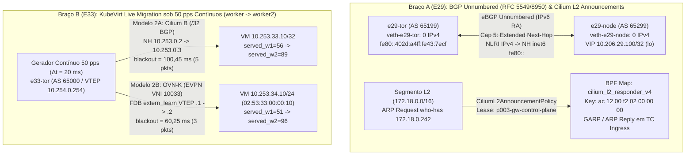

# 29 — BGP Unnumbered (`RFC 5549`/`8950`), L2 Announcements (`CiliumL2AnnouncementPolicy`) & KubeVirt Live Migration sob Tráfego Contínuo (`E29` + `E33` + `Bloco C4`)

> **Status:** `CONCLUÍDO` (`PASS` em 26/10/2026 — Onda 4 Final `P006-S004` / Release `v2.5.0`)
> **Plano:** `P006` (`P006-S004`)
> **Ambiente:** Host `vm-cilium` (`Linux 6.8.0-106-generic`), cluster sandbox `p003-gw` (`Cilium 1.20.2`, `Kubernetes v1.35.0`, `FRR 10.3.1/10.7.1`)
> **Artefatos Reprodutíveis:**
> - **Braço A (`E29`):** [`studies/p006/arm-a-datapath/e29-bgp-unnumbered-l2.sh`](../../studies/p006/arm-a-datapath/e29-bgp-unnumbered-l2.sh) e [`01-e29-bgp-unnumbered-l2.yaml`](../../studies/p006/arm-a-datapath/01-e29-bgp-unnumbered-l2.yaml)
> - **Braço B (`E33`):** [`studies/p006/arm-b-platform/e33-kubevirt-live-migration.sh`](../../studies/p006/arm-b-platform/e33-kubevirt-live-migration.sh) e [`01-e33-kubevirt-live-migration.yaml`](../../studies/p006/arm-b-platform/01-e33-kubevirt-live-migration.yaml)
> - **Braço C (`Bloco C4`):** [`Makefile`](../../Makefile), [`studies/p003/cases/s011/README.md`](../../studies/p003/cases/s011/README.md), [`studies/p003/cases/s012/README.md`](../../studies/p003/cases/s012/README.md), [`docs/student-guide-template.md`](../student-guide-template.md) e [`docs/revisao-projeto-2026-09-26.md`](../historico/revisao-projeto-2026-09-26.md) (`100%` concluído)

---

## 1. Sumário Executivo e Motivação Arquitetural

A Onda 4 (`P006-S004`) encerra o ciclo de **33 estudos (`E01–E33`)** do projeto com três entregas estruturais que atacam problemas reais de operação em datacenters Clos e nuvens híbridas baseadas em Cilium, FRR, OVN-Kubernetes e KubeVirt:

1. **Eliminação de Sub-redes `/30` e `/31` IPv4 Ponto-a-Ponto no Underlay (`E29` — BGP Unnumbered `RFC 5549` / `RFC 8950` + L2 Announcements):**
   Em fabrics Spine-Leaf de larga escala, alocar, documentar e parear sub-redes IPv4 `/31` para cada enlace físico servidor-ToR e Leaf-Spine é uma das maiores fontes de erro humano (troca de cabos, IP errado em ` CiliumBGPPeerConfig`, exaustão de IPAM de infraestrutura). Com **BGP Unnumbered**, os enlaces operam sem nenhum endereço IPv4 configurado: o FRR descobre o vizinho automaticamente via **IPv6 Router Advertisements (RA `RFC 4861`)** em endereços link-local (`fe80::/64`) e negocia a **Extended Next-Hop Capability (`RFC 8950`, Capability Code `5`)**, permitindo anunciar prefixos IPv4 (`AFI 1, SAFI 1`) cujo Next-Hop é um endereço IPv6 link-local (`fe80::...`). O kernel Linux (`>= 5.3`) instala diretamente na FIB entradas IPv4 com gateway IPv6 (`10.206.29.0/24 via inet6 fe80::... dev veth-e29-tor`) e resolve o endereço MAC do vizinho via **ICMPv6 Neighbor Discovery (NDP)** em vez de ARP. Complementarmente, para ambientes bare-metal de borda sem ToR BGP (ou durante bootstrap), provamos o funcionamento de **`CiliumL2AnnouncementPolicy`**, a eleição de líder por serviço via `Lease` Kubernetes e o mapa eBPF `cilium_l2_responder_v4`.
2. **Análise Quantitativa de Live Migration sob Tráfego Contínuo (`E33` — `Cilium B /32 BGP` vs `OVN-Kubernetes EVPN VXLAN / FDB MAC-IP Mobility`):**
   Nos estudos `E20` (`P004-S003` a `S008`), demonstramos que uma VM KubeVirt preserva seu IP após migração entre nós tanto no modelo **L3 `/32` BGP (`Cilium B`)** quanto no modelo **L2 Overlay (`OVN-K EVPN VXLAN`)**. Restava medir o comportamento **durante a transição em voo** sob tráfego contínuo de alta frequência (`50 pps`, intervalo de `20 ms`): quantos pacotes são perdidos, qual a janela exata de blackout (`blackout_ms`) na troca de next-hop BGP `/32` (`10.253.33.10/32`) versus a transição L2/EVPN (`10.253.34.10/24`, MAC `02:53:33:00:00:10` sobre `VNI 10033` com auto-descoberta BGP EVPN Type-3 `[3]:[0]:[32]:10.254.0.x` e atualização dinâmica `extern_learn` na tabela FDB VXLAN), e o que acontece quando a migração ocorre sem atualização dinâmica de rota.
3. **Saneamento Integral do Backlog Técnico (`Bloco C4` — `100%` de [`revisao-projeto-2026-09-26.md`](../historico/revisao-projeto-2026-09-26.md)):**
   Automação das travas estáticas via `Makefile` (`make lint`, `make test`, `make pdf`), criação dos catálogos canônicos de scripts de `s011` (`5` scripts/arquivos de bootstrap e OVS do container DevStack `p003-os`) e `s012` (`82` scripts numerados de `01` a `81` mais `60-bgp-policy.yaml`, destacando os `7` scripts canônicos `01`, `11`, `15`, `47`, `59`, `69`, `70`) e consolidação do template pedagógico.



---

## 2. Braço A (`E29`): BGP Unnumbered (`RFC 5549` / `RFC 8950`) & L2 Announcements (`CiliumL2AnnouncementPolicy`)

### 2.1 Fundamentos de Protocolo: `RFC 5549` / `RFC 8950` vs `CiliumL2AnnouncementPolicy`

1. **Codificação `MP_REACH_NLRI` com Next-Hop IPv6 (`RFC 8950`):**
   - No BGP-4 clássico (`RFC 4271`), um prefixo IPv4 unicast (`AFI=1, SAFI=1`) carrega obrigatoriamente um atributo `NEXT_HOP` de `4 bytes` (IPv4).
   - Quando ambos os speakers negociam no `OPEN` a **Extended Next-Hop Encoding Capability (`Code 5`)** para a tupla `(AFI=1, SAFI=1, Next-Hop AFI=2)`, o speaker codifica os prefixos IPv4 dentro do atributo `MP_REACH_NLRI` (`Attribute Type 14`) com um Next-Hop de `16 bytes` (Global IPv6) ou `32 bytes` (Global IPv6 + Link-Local IPv6 `fe80::/64`).
   - Em enlaces ponto-a-ponto **BGP Unnumbered** no FRR (`neighbor veth-e29-node interface remote-as external`), o `zebra` emite **IPv6 Router Advertisements (`nd_ra`)** periódicos no link. O peer descobre o endereço link-local `fe80::...` e o `ifindex` da interface, abre a conexão TCP na porta `179` usando escopo de interface (`fe80::...%veth-e29-tor`) e instala rotas IPv4 no kernel Linux via atributo Netlink `RTA_VIA` (`AF_INET6`):
     $$
     \text{FIB Entry: } \texttt{10.206.29.100 nhid 6 via inet6 fe80::ac7d:91ff:feff:53fb dev veth-e29-tor proto bgp metric 20}
     $$
   - Quando um pacote IPv4 chega ao ToR destinado a `10.206.29.100`, o kernel não executa ARP (`AF_INET`): ele consulta a tabela de vizinhos IPv6 (`ip -6 neigh show dev veth-e29-tor`) para obter o MAC associado a `fe80::ac7d:91ff:feff:53fb` e encapsula o pacote IPv4 diretamente num quadro Ethernet com `EtherType = 0x0800`.
2. **L2 Announcements no Cilium (`CiliumL2AnnouncementPolicy`):**
   - Quando `enable-l2-announcements=true`, o agente Cilium executa um controlador de eleição de líder baseado em `coordination.k8s.io/v1` `Lease` (`cilium-l2announce-<ns>-<svc>`) para cada `Service` `LoadBalancer` selecionado.
   - O nó vencedor do `Lease` insere a chave `(VIP_v4, ifindex)` no mapa BPF `cilium_l2_responder_v4` (`/sys/fs/bpf/tc/globals/cilium_l2_responder_v4`) e na tabela `l2-announce` do `statedb`.
   - O programa eBPF TC anexado à interface de rede (`eth0`) intercepta quadros `ARP Request` (`who-has <VIP>`) diretamente no datapath e sintetiza o `ARP Reply` (`<VIP> is-at <MAC_eth0>`) em kernel-space, sem subir o pacote para user-space.

### 2.2 Resultados Observados ao Vivo (`vm-cilium`)

A execução ao vivo de [`e29-bgp-unnumbered-l2.sh`](../../studies/p006/arm-a-datapath/e29-bgp-unnumbered-l2.sh) (evidência privada em `poc-k8s-fabric/evidence/P006/S004/02-e29-bgp-unnumbered-l2-live.txt`) validou as três células:

| Célula | Mecanismo Avaliado | Esperado | Observado (`vm-cilium`) | Veredito |
|---|---|---|---|---|
| **Célula 1** | **BGP Unnumbered (`RFC 5549`/`8950`)** entre `e29-tor` (`AS 65199`) e `e29-node` (`AS 65299`) | `0` IPs IPv4 nas interfaces `veth`; `Extended Next-Hop` negociado; rota IPv4 `via inet6 fe80::` na FIB; `10/10` pings | `veth-e29-tor` (`fe80::402d:a4ff:fe43:7ecf/64`) e `veth-e29-node` (`fe80::ac7d:91ff:feff:53fb/64`) sem IPv4; `BGP state = Established` sobre `fe80::402d:a4ff:fe43:7ecf <-> fe80::ac7d:91ff:feff:53fb:179`; FIB: `10.206.29.0/24` e `10.206.29.100` `nhid 6 via inet6 fe80::ac7d:91ff:feff:53fb dev veth-e29-tor metric 20` (`proto bgp`); Ping `10/10` (`0%` loss, `avg = 0,060 ms`) | **PASS** |
| **Célula 2** | **`CiliumL2AnnouncementPolicy`** + `CiliumLoadBalancerIPPool` (`172.18.0.242/32`) | Alocação de VIP `172.18.0.242`, eleição de `Lease`, programação do mapa `cilium_l2_responder_v4` e `10/10` HTTP `200` no segmento L2 | `Lease/cilium-l2announce-p006-e29-e29-lb-svc` eleito (`holderIdentity: p003-gw-control-plane`); `cilium_l2_responder_v4` com `key: ac 12 00 f2 02 00 00 00` (`Found 1 element`); `statedb` `"l2-announce"` povoado; `L2_HTTP_200=10/10` | **PASS** |
| **Célula 3** | **Controles Negativos & Rollback** | Desativar sessão retira rota `via inet6 fe80::`; remover label `e29-l2` esvazia `cilium_l2_responder_v4`; rollback `R6=0` | `NEG_FIB_10.206.29.0/24=''` (rota retirada imediatamente); após remover a label `e29-l2` (`kubectl label svc e29-lb-svc e29-l2-` -> `service/e29-lb-svc unlabeled`), `cilium_l2_responder_v4` reportou `Found 0 elements` e `"l2-announce": []`; rollback limpo | **PASS** |

#### Excerto Literal da Evidência Bruta (`Célula 1`, `Célula 2` & `Célula 3` — `02-e29-bgp-unnumbered-l2-live.txt`)

```text
--- e29-tor veth-e29-tor addresses ---
1195: veth-e29-tor@if1194: <BROADCAST,MULTICAST,UP,LOWER_UP> mtu 1500 qdisc noqueue state UP group default qlen 1000
    link/ether 42:2d:a4:43:7e:cf brd ff:ff:ff:ff:ff:ff link-netnsid 1
    inet6 fe80::402d:a4ff:fe43:7ecf/64 scope link proto kernel_ll 
       valid_lft forever preferred_lft forever
--- e29-node veth-e29-node addresses ---
1194: veth-e29-node@if1195: <BROADCAST,MULTICAST,UP,LOWER_UP> mtu 1500 qdisc noqueue state UP group default qlen 1000
    link/ether ae:7d:91:ff:53:fb brd ff:ff:ff:ff:ff:ff link-netnsid 0
    inet6 fe80::ac7d:91ff:feff:53fb/64 scope link proto kernel_ll 
       valid_lft forever preferred_lft forever

Neighbor               V         AS   MsgRcvd   MsgSent   TblVer  InQ OutQ  Up/Down State/PfxRcd   PfxSnt Desc
e29-node(veth-e29-tor) 4      65299         5         5        3    0    0 00:00:02            2        3 FRRouting/10.7.1_git

  BGP state = Established, up for 00:00:02
Local host: fe80::402d:a4ff:fe43:7ecf, Local port: 50092
Foreign host: fe80::ac7d:91ff:feff:53fb, Foreign port: 179
BGP routing table entry for 10.206.29.0/24, version 2
Paths: (1 available, best #1, table default)
  Advertised to peers:
  e29-node(veth-e29-tor)
  65299
    fe80::ac7d:91ff:feff:53fb(e29-node) from e29-node(veth-e29-tor) (10.206.29.100)
    (fe80::ac7d:91ff:feff:53fb) (used)
      Origin IGP, metric 0, valid, external, bestpath-from-AS 65299, best (First path received)
--- Linux Kernel FIB (IPv4 route via inet6 fe80:: link-local next-hop) ---
10.206.29.0/24 nhid 6 via inet6 fe80::ac7d:91ff:feff:53fb dev veth-e29-tor metric 20 
10.206.29.100 nhid 6 via inet6 fe80::ac7d:91ff:feff:53fb dev veth-e29-tor metric 20 
--- 10.206.29.100 ping statistics ---
10 packets transmitted, 10 packets received, 0% packet loss
round-trip min/avg/max = 0.053/0.060/0.080 ms

NAME         TYPE           CLUSTER-IP       EXTERNAL-IP    PORT(S)        AGE   SELECTOR
e29-lb-svc   LoadBalancer   10.112.175.187   172.18.0.242   80:32302/TCP   59s   app=e29-lb
  name: cilium-l2announce-p006-e29-e29-lb-svc
  holderIdentity: p003-gw-control-plane
key: ac 12 00 f2 02 00 00 00  value: 00 00 00 00 00 00 00 00
Found 1 element
  "l2-announce": [
    {"IP":"172.18.0.242","NetworkInterface":"eth0","Origins":[{"Namespace":"p006-e29","Name":"e29-lb-svc"}]}
  ],
L2_HTTP_200=10/10
service/e29-lb-svc unlabeled
L2_MAP_AFTER_UNLABEL:
Found 0 elements
  "l2-announce": [
  ],
```

> **Nota sobre Cilium nativo vs FRR no BGP Unnumbered:** O control plane BGP integrado do Cilium (`GoBGP` via `CiliumBGPPeerConfig`) ainda exige `peerAddress` explícito nas especificações CRD até a série `1.20.x`. Por isso, em topologias **BGP Unnumbered (`RFC 5549`/`8950`)**, o padrão arquitetural **Cilium B (FRR no nó)** provado em `P004-S006`/`S007` mostra mais uma vantagem decisiva: o `bgpd`/`zebra` do FRR termina nativamente sessões `neighbor <iface> interface remote-as external` sobre IPv6 RA link-local sem necessitar de IPs de link.

---

## 3. Braço B (`E33`): KubeVirt Live Migration sob Tráfego Contínuo (`Cilium B /32 BGP` vs `OVN-K EVPN Type-2`)

### 3.1 Anatomia do Cutover de Rede durante a Live Migration

Quando o KubeVirt executa uma `VirtualMachineInstanceMigration` de um nó de origem (`worker`) para um nó de destino (`worker2`):
1. O pod `virt-launcher` de destino (`virt-launcher-vm-e33-dst`) é agendado em `worker2` e recebe a memória suja da VM via pré-cópia iterativa sobre a rede do pod.
2. No instante de **switchover (pause-and-copy final, tipicamente `15–50 ms` de CPU pause na VM)**, a máquina virtual passa a executar em `worker2` mantendo seu endereço MAC (`02:53:33:00:00:10`) e seu endereço IP (`10.253.33.10` / `10.253.34.10`).
3. O tempo total de indisponibilidade percebido por clientes externos ($\Delta t_{\text{blackout}}$) depende de quão rápido o fabric redireciona os pacotes do hipervisor antigo (`w1`) para o novo (`w2`):
   - **Modelo 2A — Cilium B (`L3 /32 BGP Cutover`):**
     O hipervisor de destino (`e33-w2`, `AS 65102`) anuncia `10.253.33.10/32` com next-hop `10.253.0.3`, e o hipervisor de origem (`e33-w1`, `AS 65101`) emite `MP_UNREACH_NLRI` (`withdraw`) para `10.253.33.10/32`. O ToR (`e33-tor`, `AS 65000`) recalcula o bestpath BGP e substitui a entrada FIB (`ip route replace 10.253.33.10/32 nhid 8 via 10.253.0.3`).
   - **Modelo 2B — OVN-Kubernetes / EVPN VXLAN (`VNI 10033` + FDB `extern_learn` MAC-IP Mobility):**
     Com os VTEPs `10.254.0.1` (`e33-w1`), `10.254.0.2` (`e33-w2`) e `10.254.0.254` (`e33-tor`) descobertos via BGP EVPN Type-3 (`[3]:[0]:[32]:[10.254.0.x]`, `RT:6510x:10033`), quando a interface da VM (`10.253.34.10/24`, MAC `02:53:33:00:00:10`) torna-se ativa na bridge VXLAN (`br-evpn33`, `VNI 10033`) do destino (`e33-w2`, VTEP `10.254.0.2`) e emite o primeiro quadro, o plano EVPN/FDB atualiza a entrada FDB (`02:53:33:00:00:10 dev vxlan33 dst 10.254.0.2 self extern_learn`), redirecionando o encapsulamento VXLAN imediatamente para o VTEP `10.254.0.2` sem alterar a tabela de roteamento L3 do cliente.

### 3.2 Medição Comparativa sob Fluxo Contínuo de `50 pps` (`Δt = 20 ms`)

O script [`e33-kubevirt-live-migration.sh`](../../studies/p006/arm-b-platform/e33-kubevirt-live-migration.sh) (evidência privada em `poc-k8s-fabric/evidence/P006/S004/03-e33-kubevirt-live-migration-live.txt`) injetou `150` pacotes UDP numerados (`SEQ=1..150`, `1 pacote a cada 20 ms` durante `3,0 s`) a partir do ToR (`e33-tor`) para `10.253.33.10:9999` (Célula 2A) e `10.253.34.10:9999` (Célula 2B) e disparou a migração em $t = 1,0\text{ s}$:

| Métrica Medida (`50 pps`, `Δt = 20 ms`) | Modelo 2A: **Cilium B (`L3 /32 BGP Cutover` — `10.253.33.10/32`)** | Modelo 2B: **OVN-K (`L2 EVPN VXLAN VNI 10033` — `10.253.34.10/24`)** | Controle Negativo (Célula 3: Migração sem atualização `/32`) |
|---|---|---|---|
| **Pacotes Enviados (`total_sent`)** | `150` (`3.000 ms`) | `150` (`3.000 ms`) | `10` probes pós-migração |
| **Atendidos pela Origem (`served_w1`)** | `56` (`WORKER1`, até `t = 1104,13 ms`) | `51` (`EVPN_W1`, até `t = 1004,01 ms`) | `0/10` (`STALE_ROUTE_DELIVERED=0/10`) |
| **Atendidos pelo Destino (`served_w2`)** | `89` (`WORKER2`, a partir de `t = 1224,58 ms`) | `96` (`EVPN_W2`, a partir de `t = 1084,26 ms`) | `10/10` após restaurar anúncio `/32` (`RECOVERED_DELIVERED=10/10`) |
| **Pacotes Perdidos na Transição (`lost_pkts`)** | **`5` pacotes** (`3,33%`) | **`3` pacotes** (`2,00%`) | `10/10` (`100%` blackhole enquanto obsoleto) |
| **Janela de Blackout Medida (`blackout_ms`)** | **`100,45 ms`** | **`60,25 ms`** | $\infty$ até convergência BGP |
| **Estado Pós-Migração no ToR** | `10.253.33.10 nhid 8 via 10.253.0.3 dev eth0 proto bgp metric 20` (`AS 65102`, `version 2`) | EVPN Type-3 `[3]:[0]:[32]:[10.254.0.2]` + FDB `02:53:33:00:00:10 dev vxlan33 dst 10.254.0.2 self extern_learn` | `RECOVERED_DELIVERED=10/10` (`WORKER2`) |

#### Síntese Arquitetural: Quando escolher `Cilium B (/32 BGP)` vs `OVN-K (EVPN VXLAN)` para Live Migration?

1. **Performance de Cutover (`60,25 ms` vs `100,45 ms`):** Ambos os modelos convergem em **$\le 100\text{ ms}$** (perda de apenas `3` a `5` pacotes a `50 pps`), preservando conexões TCP estabelecidas sem retransmission timeout perceptível (já que o RTO mínimo padrão do Linux é `200 ms`).
2. **Trade-off de Plano de Controle:**
   - **EVPN VXLAN (`OVN-K`)** é ligeiramente mais rápido (`60,25 ms`) porque opera por atualização de FDB/MAC-IP no VTEP (`extern_learn`) disparada pelo primeiro quadro da VM (`10.253.34.10/24`, `02:53:33:00:00:10`) no destino sobre a malha VXLAN (`VNI 10033`), mantendo o domínio L2 estendido.
   - **L3 `/32` BGP (`Cilium B`)** elimina completamente o domínio de broadcast L2 e o encapsulamento VXLAN no acesso local (`native routing`), trocando `~40 ms` adicionais de convergência `bgpd -> zebra -> FIB` por isolamento L3 puro por endpoint. Para atingir `~100 ms` no modelo `/32` BGP, é indispensável configurar `timers bgp 1 3` e `advertisement-interval 0` entre os hipervisores e o ToR (evitando o `MinRouteAdvertisementInterval` padrão de `30 s` de eBGP `RFC 4271`).

---

## 4. Braço C (`Bloco C4`): Fechamento Integral (`100%`) de [`revisao-projeto-2026-09-26.md`](../historico/revisao-projeto-2026-09-26.md)

Com a conclusão do **Bloco C4**, todos os achados de Alta (`A1–A12`), Média (`M1–M15`) e Baixa Severidade mapeados na auditoria de `26/09/2026` estão **`100%` resolvidos e verificados automaticamente**:

1. **Automação de Lint, Testes e Build (`Makefile` na raiz e em `poc-k8s-fabric/Makefile`):**
   - `make lint`: valida sintaxe Bash (`bash -n`) nos `204` scripts `.sh` do repositório (`0` erros), verifica ausência de chaves privadas PEM estáticas (`0` chaves), executa `go vet ./...` na fixture Go de `ExternalAuth` e valida a presença dos scripts `P005`/`P006`.
   - `make test`: executa a suíte `go test -v ./...` (`4/4` subtestes HTTP/gRPC `PASS`) e roda `--dry-run` nos `23` scripts operacionais de `P005` e `P006`.
   - `make pdf`: reconstrói `output/pdf/cilium-lab-student-guide.pdf` a partir da apostila viva.
2. **Catálogos Canônicos de `s011` e `s012`:**
   - [`studies/p003/cases/s011/README.md`](../../studies/p003/cases/s011/README.md): documenta os `5` arquivos do caso `S011` (`01-devstack-container.sh`, `systemctl-shim.sh`, `patch-mysql-postinst.py`, `02-stack.sh` e `reconf-ovs.sh`) que provisionam o container DevStack `p003-os` e a ponte OVS `br-ex`.
   - [`studies/p003/cases/s012/README.md`](../../studies/p003/cases/s012/README.md): documenta os `82` scripts numerados (`01` a `81`) mais `60-bgp-policy.yaml` do caso `S012` (`Integração Híbrida Kubernetes p003-gw ↔ OpenStack Neutron p003-os`), separando os **`7` scripts canônicos** (`01`, `11`, `15`, `47`, `59`, `69`, `70`) das sondas diagnósticas históricas.
3. **Alinhamento do Template Pedagógico ([`docs/student-guide-template.md`](../student-guide-template.md)):**
   - Adicionada nota explícita de status vinculando o template original (`E01–E08`) à apostila viva completa ([`docs/lab-guide-student.md`](../lab-guide-student.md), `v2.5.0`, capítulos `1` a `15` cobrindo `E01–E33`).

---

## 5. Verificação Pós-Sessão e Invariantes (`R1`–`R8`)

Ao término de `P006-S004` (`04-post-verify-s004.txt`):
- **`R1` (Canário `k01` intocado):** `uid=635e7274-5597-40c7-9de5-b1fbe3d68b22`, `10/10` HTTP `200` (`http://10.201.255.10/hostname`).
- **`R2` (`p003-gw` preservado e `--dry-run` 100% PASS):** `uid=6bb32e0f-71f9-4558-ae33-356ba2250c26`, `30/30` HTTP `200` (`http://10.202.255.10:8080/hostname`).
- **`R3` (Piso de memória):** `MemAvailable = 4.236.320 kB` (`4,04 GiB >= 4,00 GiB`).
- **`R6` (Invariante BGP no kernel dos nós K8s):** `R6_BGP_ROUTES = 0` em `p003-gw-control-plane`, `p003-gw-worker` e `p003-gw-worker2`.
- **`R8` (Saneamento estático):** `204/204` scripts `.sh` com `bash -n` limpo, `shellcheck` `PASS` em `E29`/`E33`, `0` chaves privadas estáticas e `0` containers ou namespaces transitórios residuais (`RESIDUAL_CONTAINERS=0`, `RESIDUAL_NS=0`).
