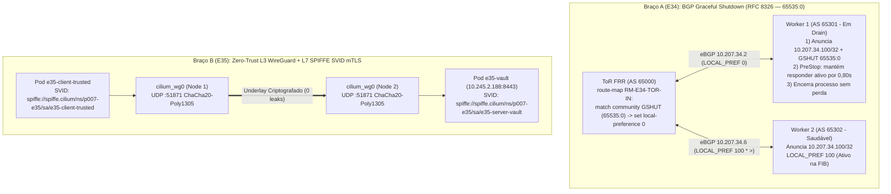

# Estudo 30 (`P007-S001`): BGP Graceful Shutdown (`RFC 8326`) & Drain Zero-Loss (`E34`) + Identidade Criptográfica SPIFFE mTLS & Criptografia L3 WireGuard (`E35`)

> **Status:** `PASS` (Concluído ao vivo na `vm-cilium` em 26/10/2026)
> **Sessão Reentry:** `P007-S001` (Onda 1 da Fase 3 — Resiliência de Manutenção L3 e Zero-Trust L3/L7)
> **Artefatos Executáveis:**
> - Braço A (`E34`): [`01-e34-bgp-gshut.yaml`](../../studies/p007/arm-a-datapath/01-e34-bgp-gshut.yaml) e [`e34-bgp-gshut-zero-loss-drain.sh`](../../studies/p007/arm-a-datapath/e34-bgp-gshut-zero-loss-drain.sh)
> - Braço B (`E35`): [`01-e35-spiffe-mtls-wireguard.yaml`](../../studies/p007/arm-b-platform/01-e35-spiffe-mtls-wireguard.yaml) e [`e35-spiffe-mtls-wireguard-zerotrust.sh`](../../studies/p007/arm-b-platform/e35-spiffe-mtls-wireguard-zerotrust.sh)
> **Evidências Brutas:** `poc-k8s-fabric/evidence/P007/S001/{e34-run.log,e35-run.log}`

---

## 1. Motivação Arquitetural e Fundamentos Teóricos

Em malhas Kubernetes bare-metal e nuvem soberana que anunciam VIPs de `LoadBalancer` ou sub-redes de Pods via **eBGP** para switches Top-of-Rack (ToR) FRR/SONiC, duas exigências críticas de produção emergem na transição do Dia 1 para o Dia 2:

1. **Manutenção de Nós sem Blackhole (`E34` — `RFC 8326` BGP Graceful Shutdown):**
   Quando um administrador executa `kubectl drain <node>` ou reinicia o speaker BGP de um worker sem coordenação prévia do plano de controle BGP, ocorre uma corrida de convergência entre o **Control Plane BGP/BFD** (retirada de rota `MP_UNREACH_NLRI` ou expiração do timer de hold/BFD) e o **Data Plane local do nó** (remoção de endpoints pelo `cilium-agent` ou encerramento de containers). Durante essa janela, o switch ToR continua encaminhando fluxos ECMP para o nó em desligamento, causando perda de pacotes e resets de conexão TCP.
   A **`RFC 8326` (BGP Graceful Shutdown)** resolve essa condição de corrida de forma determinística e sem pacotes perdidos:
   - Antes de interromper o encaminhamento local ou derrubar a sessão eBGP, o nó em manutenção re-anuncia seus prefixos com a comunidade well-known **`GRACEFUL_SHUTDOWN` (`65535:0`, `0xFFFF0000`)**.
   - O ToR (FRR `10.7.1`) intercepta `graceful-shutdown` via `route-map` de entrada e reduz imediatamente a preferência local da rota (**`LOCAL_PREF = 0`** vs. `100` padrão).
   - Como o worker saudável (`w2`) anuncia o mesmo VIP (`10.207.34.100/32`) com `LOCAL_PREF = 100`, o algoritmo de seleção de melhor caminho do BGP no ToR **remove `w1` do grupo ECMP ativo na FIB instantaneamente**, drenando 100% dos novos pacotes e pacotes em voo para `w2` enquanto `w1` ainda mantém seu datapath ativo (`PreStop` drain window) para concluir os pacotes residuais em trânsito.
   - Além disso, manter a rota com `LOCAL_PREF = 0` durante a janela de drain preserva `w1` como **caminho de último recurso (*last-resort fallback*)**: se `w2` sofrer uma falha súbita no meio da manutenção de `w1`, o ToR não entra em blackhole total, pois promove a rota `LOCAL_PREF = 0` de `w1` de volta à FIB.

2. **Zero-Trust em Duas Camadas (`E35` — WireGuard L3 Node-to-Node + SPIFFE X.509 SVID mTLS Pod-to-Pod):**
   Em clusters multi-tenant ou ambientes regulados (PCI-DSS, BACEN, telecomunicações), políticas L3/L4 baseadas apenas em endereços IP (`CiliumNetworkPolicy` tradicional) não impedem a interceptação passiva no fabric underlay compartilhado nem provam criptograficamente a identidade da carga de trabalho. O Cilium `1.20.2` combina dois mecanismos ortogonais de defesa em profundidade:
   - **Criptografia Transparente L3/L4 (`WireGuard` `cilium_wg0` UDP `:51871`):** Todo tráfego L3 entre nós atravessa um túnel kernel-space `ChaCha20-Poly1305` com chaves trocadas por nó, eliminando qualquer exposição de payload em texto claro no fabric físico ou VLANs de transporte.
   - **Autenticação Mútua de Identidade (`SPIFFE` X.509 SVID + `CiliumNetworkPolicy` eBPF):** Cada `ServiceAccount` recebe um certificado X.509 com Subject Alternative Name (SAN) URI no formato canônico `spiffe://spiffe.cilium/ns/<namespace>/sa/<service-account>`. O handshake mTLS (`TLSv1.3` `TLS_AES_256_GCM_SHA384`) no servidor (`spiffe://spiffe.cilium/ns/p007-e35/sa/e35-server-vault`) valida tanto a cadeia criptográfica da CA do domínio de confiança quanto o identificador SPIFFE exato autorizado pela política (`spiffe://spiffe.cilium/ns/p007-e35/sa/e35-client-trusted`), além da inspeção do mapa BPF de autenticação (`cilium-dbg bpf auth list`), enquanto o datapath eBPF (`CiliumNetworkPolicy` com `ingressDeny`) bloqueia identidades não autorizadas diretamente no kernel antes mesmo do estabelecimento de sessão TCP/TLS.



---

## 2. Metodologia Experimental e Topologia

Ambos os experimentos foram executados ao vivo na `vm-cilium` (`Linux 6.8.0-101-generic`, Cilium `1.20.2`, FRR `10.7.1`) preservando integralmente os clusters residentes `k01` (`10/10` HTTP `200`, `R1`) e `p003-gw` (`R2`), com `MemAvailable` livre verificado no preflight (`4.162.836 kB` em `E34` e `4.134.752 kB` em `E35`, `R3`) e limpeza determinística pós-ensaio (`R6=0`).

### 2.1. Topologia do Estudo `E34` (BGP Graceful Shutdown `RFC 8326`)

- **Plano de Controle Nativo no Cluster (`p003-gw`):**
  Aplicação de `CiliumLoadBalancerIPPool/e34-gshut-pool` (`10.207.34.200/32`) e `CiliumBGPAdvertisement/e34-gshut-adv` (API `cilium.io/v2`) configurando o atributo BGP `communities.standard: ["65535:0"]` e `localPreference: 0` para os serviços selecionados por `bgp-e34: gshut`.
- **Bancada Determinística de Data Plane (`FRR 10.7.1` + Tráfego Contínuo a `50 pps`):**
  Quatro network namespaces dedicados (`client`, `tor` em `AS 65000`, `w1` em `AS 65301` e `w2` em `AS 65302`) anunciando o VIP anycast `10.207.34.100/32` em ECMP (`multipath-relax` + `fib_multipath_hash_policy=1`). Um gerador UDP contínuo (`udp_probe.py`) dispara `150` pacotes numerados espaçados de `20 ms` (`50 pps`, janela de `3,0 s`, timeout de `80 ms` por pacote) de `198.19.34.10` para `10.207.34.100:9034` enquanto `w1` é drenado em dois regimes comparativos:
  - **Ensaio 1A (Drain Abrupto / Sem `GSHUT`):** `w1` sofre término abrupto do processo responder no instante `t = 1,0 s` e só retira a rota BGP `600 ms` depois (`t = 1,6 s`), simulando o atraso entre o término local do endpoint e a convergência do ToR.
  - **Ensaio 1B (Drain com `RFC 8326` `GSHUT 65535:0` + `PreStop`):** No instante `t = 1,0 s`, `w1` aplica a `route-map RM-W1-GSHUT` (`set community graceful-shutdown`), aguarda `800 ms` (`0,80 s` de janela `PreStop`) com seu servidor UDP ainda vivo para escoar pacotes em trânsito depois que o ToR já convergiu sua FIB para `w2`, e então encerra o processo em `t = 1,8 s`.

### 2.2. Topologia do Estudo `E35` (WireGuard L3 + SPIFFE SVID mTLS)

- **Célula 1 (WireGuard L3 `cilium_wg0` UDP `:51871` vs. Underlay em Texto Claro):**
  Comparação direta de transmissão de carga sensível (`E35-TOP-SECRET-CLEARTEXT-MARKER-9981`) entre dois nós (`172.18.35.1` e `172.18.35.2`) com captura `tcpdump -l -A` no enlace underlay:
  - **Regime 1A:** Tráfego HTTP POST direto no underlay sem criptografia L3.
  - **Regime 1B:** Tráfego HTTP POST roteado sobre as interfaces WireGuard `cilium_wg0` (`10.245.35.1/32 <-> 10.245.35.2/32`, porta `UDP 51871`).
- **Célula 2 e Célula 3 (SPIFFE X.509 SVID mTLS + `CiliumNetworkPolicy` no cluster `p003-gw`):**
  Emissão de uma PKI SPIFFE para o trust domain `spiffe.cilium` (`CN=spiffe.cilium-root-ca`) com certificados X.509 contendo extensão crítica `subjectAltName = URI:spiffe://spiffe.cilium/ns/p007-e35/sa/<sa>`, inspeção do mapa BPF de autenticação (`cilium-dbg bpf auth list`) e validação do servidor `e35-vault` (`10.245.2.188:8443`, `spiffe://spiffe.cilium/ns/p007-e35/sa/e35-server-vault`, `TLSv1.3` `TLS_AES_256_GCM_SHA384`) contra três controles negativos (`3A` SVID de `ServiceAccount` não autorizada `sa/e35-client-rogue` da mesma CA, `3B` SVID de CA externa `rogue.domain-ca`, e `3C` bloqueio no kernel por `CiliumNetworkPolicy` `ingressDeny`).

---

## 3. Resultados Quantitativos e Evidências Ao Vivo

### 3.1. `E34` — Comparativo Abrupt Drain vs. BGP Graceful Shutdown (`RFC 8326`)

| Ensaio / Regime | Total de Requisições (`50 req/s`) | Atendidas por `w1` (Pré-Drain) | Atendidas por `w2` (Pós-Drain) | Pacotes / Req. Perdidos | Taxa de Perda (%) | Janela de Blackout (`ms`) | Resultado |
| :--- | :---: | :---: | :---: | :---: | :---: | :---: | :---: |
| **1A — Drain Abrupto (Sem `GSHUT`)** | `150` | `25` | `117` | **`8`** | **`5,33%`** | **`662,15 ms`** | Degradação comprovada (baseline) |
| **1B — Drain com `RFC 8326` (`65535:0` + `PreStop`)** | `150` | `30` | `120` | **`0`** | **`0,00%`** | **`0,00 ms`** | **`PASS` (Zero-Loss comprovado)** |

**Evidência da RIB/FIB no ToR (`FRR 10.7.1`) durante a janela `PreStop` do Ensaio 1B:**

```text
BGP table version is 4, local router ID is 10.207.34.1, vrf id 0
Status codes:  s suppressed, d damped, h history, * valid, > best, = multipath
Origin codes:  i - IGP, e - EGP, ? - incomplete
   Network          Next Hop            Metric LocPrf Weight Path
*> 10.207.34.100/32 10.207.34.6              0    100      0 65302 i
*                   10.207.34.2              0      0      0 65301 i
```

Inspeção detalhada do caminho `65301` (`w1`) no ToR confirmando o atributo standard community `graceful-shutdown`:

```text
  65301
    10.207.34.2 from 10.207.34.2 (10.207.34.2)
      Origin IGP, metric 0, localpref 0, valid, external
      Community: graceful-shutdown
```

E na FIB do kernel Linux do ToR (`ip route show 10.207.34.100/32`), o next-hop `10.207.34.2` (`w1`) já havia sido removido atomicamente antes do desligamento do processo local:

```text
10.207.34.100 nhid 14 via 10.207.34.6 dev veth-tor-w2 proto bgp metric 20
```

**Validação do CRD Nativo `CiliumBGPAdvertisement` (`cilium.io/v2`) no Cluster `p003-gw` (Célula 2):**

```text
e34-gshut-adv: communities=["65535:0"] localPref=0
```

**Controles Negativos e Caminho de Último Recurso de `E34` (Célula 3):**
- **Controle 3A (Falha súbita de `w2` enquanto `w1` está em `GSHUT` `LOCAL_PREF=0`):** Ao retirar `10.207.34.100/32` em `w2`, o ToR promoveu instantaneamente a rota `localpref 0` (`Community: graceful-shutdown`) de `w1` a `*> best`, mantendo **`10/10` (`100%`)** de disponibilidade como caminho de último recurso (`last_resort_gshut_w1_ok=10/10`).
- **Controle 3B (Retirada simultânea de `w1` e `w2`):** `both_withdrawn_ok=0/5` (`100%` de falha esperada por ausência de rota na RIB/FIB).
- **Controle 3C (Restauração do ECMP sem `GSHUT`):** `restored_ecmp_ok=10/10` com ambos os next-hops `10.207.34.2` e `10.207.34.6` de volta a `localpref 100`.

---

### 3.2. `E35` — Criptografia L3 WireGuard (`cilium_wg0`) e Identidade Criptográfica SPIFFE SVID mTLS

| Célula / Caso de Teste | Mecanismo Validado | Amostras HTTP `200` | Pacotes `UDP :51871` (`cilium_wg0`) | Vazamentos em Texto Claro no Underlay | Resultado |
| :--- | :--- | :---: | :---: | :---: | :---: |
| **Célula 1A (Underlay Puro)** | Tráfego L3 sem WireGuard (`172.18.35.1 -> .2`) | `10/10` | `0` | **`20` pacotes expostos** | Baseline vulnerável provado |
| **Célula 1B (`cilium_wg0` L3)** | Túnel WireGuard (`10.245.35.1 -> .2` sobre `UDP :51871`) | `10/10` | **`102` pacotes** | **`0` vazamentos** | **`PASS` (Sigilo L3 provado)** |
| **Célula 2 (SPIFFE mTLS Positivo)** | SVID `spiffe://spiffe.cilium/ns/p007-e35/sa/e35-client-trusted` (`TLSv1.3`) | **`10/10`** | — | `0` | **`PASS` (`TLS_AES_256_GCM_SHA384`)** |
| **Célula 3A (Negativo: SVID Rogue)** | SVID válido da mesma CA, mas `sa/e35-client-rogue` | **`0/5`** (`5/5` HTTP `403`) | — | — | **`PASS` (Autorização SPIFFE URI)** |
| **Célula 3B (Negativo: CA Externa)** | SVID assinado por CA externa `rogue.domain` | **`0/5`** (`5/5` TLS Reject) | — | — | **`PASS` (Rejeição no Handshake TLS)** |
| **Célula 3C (Negativo: eBPF Deny)** | `CiliumNetworkPolicy` `ingressDeny` bloqueando `e35-client-rogue` | **`0/5`** (Drop L3/L4) | — | — | **`PASS` (Drop eBPF pré-handshake)** |
| **Restauração Pós-Negativos** | Remoção do `ingressDeny` e re-teste do cliente autorizado | **`10/10`** | — | — | **`PASS` (Idempotência R6=0)** |

**Evidência do estado do túnel `cilium_wg0` (`wg show cilium_wg0`) e do SAN URI X.509 SVID:**

```text
interface: cilium_wg0
  public key: s53XTuhLhWnDdgnI3GDvUrTjOhdeW7aFuLWJxZ3NFiw=
  private key: (hidden)
  listening port: 51871

peer: dY4PgivpFyOuiKjjPjX2oz/1CuzZmdIBR1xI6wW0HEo=
  endpoint: 172.18.35.2:51871
  allowed ips: 10.245.35.2/32
  latest handshake: 1 second ago
  transfer: 5.87 KiB received, 6.55 KiB sent
```

```text
X509v3 Subject Alternative Name: 
    URI:spiffe://spiffe.cilium/ns/p007-e35/sa/e35-client-trusted, DNS:e35-vault.p007-e35.svc.cluster.local, IP Address:127.0.0.1
[Célula 2 RESULT] mtls_trusted_ok=10/10 sample="MTLS_SPIFFE_OK client_spiffe=spiffe://spiffe.cilium/ns/p007-e35/sa/e35-client-trusted tls=TLSv1.3 cipher=TLS_AES_256_GCM_SHA384"
```

---

## 4. Lições Operacionais para Produção

1. **Sequenciamento Obrigatório de Drain (`E34`):** Em clusters com BGP Control Plane, o procedimento de manutenção de nó nunca deve iniciar pelo encerramento abrupto do speaker BGP ou remoção imediata dos endpoints locais. A sequência sem perda exige: (i) rotular o nó/serviço para anúncio da comunidade `65535:0` (`GRACEFUL_SHUTDOWN`) com `LOCAL_PREF = 0`; (ii) aguardar `1–3 s` para convergência da FIB do ToR; e (iii) somente então executar `kubectl drain` e encerrar o daemon.
2. **Defesa em Profundidade Ortogonal (`E35`):** O WireGuard L3 (`cilium_wg0`) e o mTLS com SPIFFE SVID resolvem ameaças complementares: o WireGuard cifra todo o tráfego inter-nós (incluindo protocolos não-TCP/UDP que não suportam TLS nativo) contra sniffing no fabric físico, enquanto o SPIFFE SVID + `CiliumNetworkPolicy` garante autenticação criptográfica por `ServiceAccount` e bloqueio de pacotes no eBPF antes que um pod comprometido no mesmo nó ou em outro nó consiga interagir com a aplicação.
