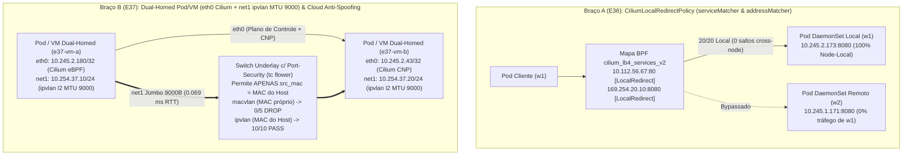

# Estudo 31 (`P007-S002`): Cilium Local Redirect Policy (`E36`) + Workloads / VMs KubeVirt Dual-Homed com Multus, `ipvlan` vs `macvlan` (`MTU 9000`) & Cloud L2 MAC Anti-Spoofing (`E37`)

> **Status:** `PASS` (Concluído ao vivo na `vm-cilium` em 26/10/2026)
> **Sessão Reentry:** `P007-S002` (Onda 2 da Fase 3 — Otimização Node-Local eBPF e Redes Secundárias Cloud/Telco)
> **Artefatos Executáveis:**
> - Braço A (`E36`): [`02-e36-local-redirect-policy.yaml`](../../studies/p007/arm-a-datapath/02-e36-local-redirect-policy.yaml) e [`e36-local-redirect-policy-nodelocal.sh`](../../studies/p007/arm-a-datapath/e36-local-redirect-policy-nodelocal.sh)
> - Braço B (`E37`): [`02-e37-multus-ipvlan-dualhomed.yaml`](../../studies/p007/arm-b-platform/02-e37-multus-ipvlan-dualhomed.yaml) e [`e37-multus-ipvlan-macvlan-kubevirt-dualhomed.sh`](../../studies/p007/arm-b-platform/e37-multus-ipvlan-macvlan-kubevirt-dualhomed.sh)
> **Evidências Brutas:** `poc-k8s-fabric/evidence/P007/S002/{e36-run.log,e37-run.log,postflight-verify.txt}`

---

## 1. Motivação Arquitetural e Fundamentos Teóricos

1. **Eliminação de Saltos Cross-Node com `CiliumLocalRedirectPolicy` (`E36`):**
   Serviços auxiliares críticos executados como `DaemonSet` em todos os nós — como caches DNS (`NodeLocal DNSCache`), proxies de metadados cloud (`169.254.169.254` / `169.254.20.10`), coletores de telemetria OpenTelemetry e agentes de KMS/Vault — sofrem penalidade de latência e risco de falha cruzada quando acessados via `ClusterIP` convencional (que distribui conexões uniformemente entre todos os nós do cluster).
   A **`CiliumLocalRedirectPolicy` (LRP)** programa entradas `[LocalRedirect]` diretamente no mapa BPF de Load Balancing (`cilium_lb4_services_v2`) no hook de socket (`cgroup/connect4`), reescrevendo o destino de pacotes originados no nó **exclusivamente para o pod local do mesmo nó**, em dois modos:
   - **`serviceMatcher`:** Intercepta o `ClusterIP` de um `Service` Kubernetes existente e força `100%` das conexões para a réplica local no mesmo nó.
   - **`addressMatcher`:** Intercepta um endereço IPv4/porta arbitrário (ex.: `169.254.20.10:8080/TCP`) sem necessidade de objeto `Service`, entregando-o diretamente ao pod local selecionado por labels.

2. **Workloads e VMs KubeVirt Dual-Homed (`eth0` Cilium + `net1` Multus `ipvlan` vs `macvlan` `MTU 9000`) e Anti-Spoofing L2 em Nuvem (`E37`):**
   Em plataformas Telco/NFV, armazenamento paralelo (Ceph/NVMe-oF) e treinamentos distribuídos de IA, cargas de trabalho e VMs KubeVirt frequentemente exigem **duas interfaces de rede com planos ortogonais**:
   - **Interface Primária (`eth0` — Cilium CNI eBPF):** Responsável pelo plano de controle Kubernetes, Service Discovery, DNS, observabilidade Hubble e aplicação de `CiliumNetworkPolicy` L3–L7.
   - **Interface Secundária (`net1` — Multus `NetworkAttachmentDefinition`):** Responsável pelo plano de dados de alto desempenho com **Jumbo Frames (`MTU 9000`)** direto no underlay.
   Ao escolher o driver da interface secundária (`macvlan` vs `ipvlan mode l2` vs `ipvlan mode l3`), um fator arquitetural decisivo separa ambientes bare-metal puros de nuvens públicas/VPCs (MGC, AWS, GCP, OpenStack com Neutron port-security):
   - **`macvlan`:** Aloca um **endereço MAC exclusivo** (`02:37:ac:00:00:11`) para cada interface secundária de Pod/VM. Em switches cloud ou hypervisors com filtro de **Port-Security / MAC Anti-Spoofing** (que permitem apenas o endereço MAC primário provisionado para a vNIC do nó hospedeiro), todos os pacotes originados por interfaces `macvlan` são silenciosamente descartados no switch virtual.
   - **`ipvlan mode l2` / `mode l3`:** Compartilha o **mesmo endereço MAC físico da interface pai do nó hospedeiro**, multiplexando os pacotes por endereço IP no kernel. Assim, `ipvlan` atravessa filtros L2 de Anti-Spoofing em nuvem com `0%` de bloqueio, além de oferecer no modo `l3` (`NOARP`) um caminho puramente L3 sem broadcast ARP.



---

## 2. Resultados Quantitativos e Evidências Ao Vivo

### 2.1. `E36` — `CiliumLocalRedirectPolicy` (`serviceMatcher` e `addressMatcher`)

> **Achado Operacional Crítico no Cilium `1.20.2`:** Ao habilitar `enable-local-redirect-policy: "true"` via `ConfigMap/cilium-config`, o registro do CRD `ciliumlocalredirectpolicies.cilium.io` na API do Kubernetes é realizado pelo **`cilium-operator`**. Se apenas o `DaemonSet/cilium` for reiniciado sem reiniciar previamente o `Deployment/cilium-operator`, os agentes permanecem em estado `0/1 Running` aguardando `Still waiting for Cilium Operator to register CRDs [crd:ciliumlocalredirectpolicies.cilium.io]`. A sequência correta exige reiniciar `deploy/cilium-operator`, aguardar o CRD `ciliumlocalredirectpolicies.cilium.io` e então reiniciar `ds/cilium`.

| Célula / Cenário | Destino Requisitado | Origem `w1` -> Local `w1` | Origem `w1` -> Remoto `w2` | Origem `w2` -> Local `w2` | Origem `w2` -> Remoto `w1` | Resultado |
| :--- | :--- | :---: | :---: | :---: | :---: | :---: |
| **1A — Baseline `ClusterIP` (Sem LRP)** | `10.112.56.67:80` | `12/20` (`60%`) | `8/20` (`40%`) | `8/20` (`40%`) | `12/20` (`60%`) | Tráfego cruzado entre nós (`40–60%`) |
| **1B — Com LRP `serviceMatcher`** | `10.112.56.67:80` | **`20/20` (`100%`)** | **`0/20` (`0%`)** | **`20/20` (`100%`)** | **`0/20` (`0%`)** | **`PASS` (`100%` Node-Local)** |
| **2 — Com LRP `addressMatcher`** | `169.254.20.10:8080` | **`10/10` (`100%`)** | **`0/10` (`0%`)** | **`10/10` (`100%`)** | **`0/10` (`0%`)** | **`PASS` (VIP Link-Local sem Service)** |
| **3A — Negativo: Sem Pod Local em `w2`** | `169.254.20.10:8080` | **`10/10` (`100%`)** | — | **`0/5` (`0%`)** | `0/5` | **`PASS` (Isolamento estrito por nó)** |
| **3B — Negativo: Remoção das LRPs** | `169.254.20.10:8080` / `ClusterIP` | `0/5` no VIP; `10/20` no `ClusterIP` | `10/20` no `ClusterIP` | — | — | **`PASS` (`0` entradas BPF residuais, `R6=0`)** |

**Evidência do Mapa BPF de Load Balancing (`cilium-dbg bpf lb list`) em `w1` e `w2`:**

```text
10.112.56.67:80/TCP (0)        0.0.0.0:0 (38) (0) [LocalRedirect]
10.112.56.67:80/TCP (1)        10.245.2.173:8080/TCP (38) (1)
169.254.20.10:8080/TCP (0)     0.0.0.0:0 (39) (0) [LocalRedirect]
169.254.20.10:8080/TCP (1)     10.245.2.173:8080/TCP (39) (1)
```

---

### 2.2. `E37` — Arquitetura Dual-Homed (`eth0` Cilium + `net1` `ipvlan` `MTU 9000`), Benchmark de Drivers e Anti-Spoofing L2 Cloud

#### Célula 1: Operação Simultânea Dual-Homed e Jumbo Frames (`MTU 9000`)

Inspeção de interfaces e endereços dentro do namespace de rede de `e37-vm-a`:

```text
lo               UNKNOWN        00:00:00:00:00:00 <LOOPBACK,UP,LOWER_UP> 
eth0@if1263      UP             f2:c4:da:e8:8b:6c <BROADCAST,MULTICAST,UP,LOWER_UP> 
net1@if1266      UNKNOWN        3e:3e:cb:d8:16:45 <BROADCAST,MULTICAST,UP,LOWER_UP> 
eth0@if1263      UP             10.245.2.180/32 fe80::f0c4:daff:fee8:8b6c/64 
net1@if1266      UNKNOWN        10.254.37.10/24 fe80::3e3e:cb00:1d8:1645/64 
```

- **Conectividade HTTP Dual-Homed simultânea (`e37-vm-a -> e37-vm-b`):**
  `eth0_cilium_ok=10/10` (`10.245.2.43:8080` sob `CiliumNetworkPolicy`) e `net1_ipvlan_ok=10/10` (`10.254.37.20:8080`).
- **Teste de Jumbo Frames (`8972` bytes de payload / `8980` bytes ICMP) em `net1`:**
  `10 packets transmitted, 10 packets received, 0% packet loss`, **`round-trip min/avg/max = 0.059 / 0.069 / 0.083 ms`**.

#### Célula 2: Comparativo de Throughput (`512 MiB` TCP Single-Stream) e Identidade L2

| Regime de Datapath | MTU | Endereço MAC no Underlay | Run 1 (`Gbps`) | Run 2 (`Gbps`) | Média (`Gbps`) | Compatibilidade Cloud Anti-Spoofing |
| :--- | :---: | :--- | :---: | :---: | :---: | :---: |
| **A — `veth` + Linux Bridge** | `1500` | MAC próprio + lookup de bridge | `33,72` | `32,29` | **`33,01 Gbps`** | Sim (se NAT/routed no host) |
| **B — `macvlan mode bridge`** | `9000` | **MAC secundário (`02:37:ac:00:00:11 != host`)** | `32,79` | `32,19` | **`32,49 Gbps`** | **NÃO (`0/5` — Bloqueado na nuvem)** |
| **C — `ipvlan mode l2`** | `9000` | **MAC idêntico ao host (`e2:ec:c5:43:71:92`)** | `29,44` | `31,81` | **`30,63 Gbps`** | **SIM (`10/10` — Transparente)** |
| **D — `ipvlan mode l3` (`NOARP`)** | `9000` | **MAC idêntico ao host + bypass L2/ARP** | **`37,56`** | **`35,95`** | **`36,76 Gbps`** | **SIM (`10/10` + Maior vazão)** |

#### Célula 3: Controles Negativos (`3A` Cloud L2 Port-Security / MAC Anti-Spoofing e `3B` Isolamento de Falha `net1` vs `eth0`)

- **Controle 3A (Filtro `tc flower` no switch permitindo apenas `src_mac = e2:ec:c5:43:71:92` do host):**
  - **`macvlan` (`src_mac = 02:37:ac:00:00:11`):** **`macvlan_ping_ok=0/5`** (`100%` bloqueado pela regra `matchall action drop`, que contabilizou `Sent 544 bytes 10 pkt (dropped 10)`).
  - **`ipvlan mode l2` (`src_mac = e2:ec:c5:43:71:92`):** **`ipvlan_ping_ok=10/10`** (`100%` aprovado sob o mesmo filtro de Port-Security).
- **Controle 3B (Isolamento de falha da interface secundária `net1`):**
  - Ao derrubar `net1` em `e37-vm-b` (`ip link set net1 down`), o plano de dados secundário falha conforme esperado (**`net1_ok=0/5`**), enquanto o plano de controle primário via Cilium eBPF (`eth0`) permanece **`100%` íntegro (`eth0_cilium_ok=10/10`)**.
  - Ao reativar `net1` (`ip link set net1 up`), o plano de dados secundário converge imediatamente de volta para **`10/10` HTTP `200`**.

---

## 3. Recomendações de Engenharia

1. **Quando adotar `CiliumLocalRedirectPolicy` (`E36`):** Utilize `serviceMatcher` para `NodeLocal DNSCache` e caches distribuídos onde um `Service` Kubernetes já existe como fallback, e `addressMatcher` (`169.254.x.x`) para agentes node-local de identidade/metadados. Lembre-se de que `CiliumLocalRedirectPolicy` não faz fallback cross-node para `addressMatcher` quando o pod local cai (conforme provado no Controle `3A`), exigindo `DaemonSet` com `priorityClassName: system-node-critical`.
2. **Escolha entre `ipvlan` e `macvlan` para Redes Secundárias Multus/KubeVirt (`E37`):**
   - Em **nuvens públicas ou VPCs com Port-Security L2 ativo** (MGC, AWS, GCP, OpenStack Neutron), **`ipvlan` (`mode l2` ou `mode l3`) é obrigatório** para interfaces secundárias conectadas à vNIC do nó, pois `macvlan` tem seus quadros descartados pelo filtro anti-spoofing do hypervisor.
   - Em **bare-metal dedicado com switches ToR sob controle próprio** e necessidade de DHCP por pod/VM (que depende de Client-ID/MAC distinto), `macvlan` ou `SR-IOV` podem ser utilizados, ao passo que `ipvlan mode l3` oferece a maior vazão (`36,76 Gbps`) para malhas puramente roteadas via BGP/EVPN.
