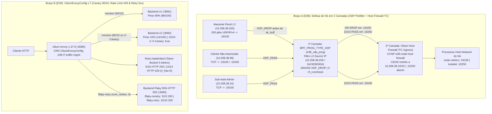

# Estudo 32 (`P008-S001`): Cilium Host Firewall & Node-Level eBPF XDP Prefilter (`E38`) + Cilium Service Mesh L7 Traffic Management via `CiliumEnvoyConfig` (`E39`)

> **Status:** `PASS` (Concluído ao vivo na `vm-cilium` em 26/10/2026)
> **Sessão Reentry:** `P008-S001` (Onda 1 da Fase 4 — Defesa de Borda de Nó em Duas Camadas eBPF/XDP e Resiliência L7 Service Mesh sem Sidecars)
> **Artefatos Executáveis:**
> - Braço A (`E38`): [`01-e38-host-firewall-xdp.yaml`](../../studies/p008/arm-a-datapath/01-e38-host-firewall-xdp.yaml) e [`e38-host-firewall-xdp-prefilter.sh`](../../studies/p008/arm-a-datapath/e38-host-firewall-xdp-prefilter.sh)
> - Braço B (`E39`): [`01-e39-cilium-envoy-l7.yaml`](../../studies/p008/arm-b-platform/01-e39-cilium-envoy-l7.yaml) e [`e39-cilium-envoy-l7-resilience.sh`](../../studies/p008/arm-b-platform/e39-cilium-envoy-l7-resilience.sh)
> **Evidências Brutas:** `poc-k8s-fabric/evidence/P008/S001/{preflight-verify.txt,e38-run.log,e39-run.log}`

---

## 1. Motivação Arquitetural e Fundamentos Teóricos

1. **Defesa de Borda de Nó em Duas Camadas: Cilium Host Firewall (`TC`) + Prefilter eBPF (`XDP_DROP`) (`E38`):**
   Políticas `NetworkPolicy` e `CiliumNetworkPolicy` protegem pods (identidades de workload), mas não protegem processos que escutam diretamente no namespace de rede do próprio nó hospedeiro (`hostNetwork: true`, `node_exporter :9100/:19100`, `kubelet :10250`, API server `:6443`, BGP `:179`).
   Em clusters expostos a redes corporativas ou de borda, a proteção do nó exige **duas camadas complementares no datapath eBPF**:
   - **1ª Camada (`BPF_PROG_TYPE_XDP` — Prefilter DDoS no driver de recepção):** Executa diretamente sobre o buffer de recepção (`xdp_md`) **antes** da alocação da estrutura `sk_buff` e **antes** do subsistema `nf_conntrack`. Quando uma origem volumétrica de ataque (`10.208.38.200`, `0xC826D00A`) é filtrada na camada L3 no XDP, o programa retorna `XDP_DROP` em nanosegundos com **`0` entradas criadas na tabela de conntrack**, impedindo a exaustão de memória e de estado L4 do kernel.
   - **2ª Camada (`CiliumClusterwideNetworkPolicy` com `nodeSelector` — Host Firewall TC L3/L4):** Avalia pacotes que passaram pelo XDP (`XDP_PASS`) contra políticas baseadas em identidade (`remote-node`, `kube-apiserver`, `health`) e CIDRs administrativos (`10.208.38.10/32`), bloqueando acessos não autorizados (`10.208.38.99`) a portas administrativas do nó (`:19100`) enquanto preserva integralmente o plano de controle (`:10250`, `:6443`, `:4240`).

2. **Service Mesh L7 sem Sidecars com `CiliumEnvoyConfig` (`cilium.io/v2`) e `cilium-envoy` Embarcado (`E39`):**
   Meshes baseados em sidecars injetam um processo proxy por pod, multiplicando o consumo de memória e latência de IPC. O Cilium consolida o controle L7 em um instância **`cilium-envoy` por nó** (`1.37.6/Distribution/RELEASE/BoringSSL`), programada declarativamente pela CRD `CiliumEnvoyConfig` (`cilium.io/v2`).
   Neste estudo, validamos três padrões críticos de engenharia de tráfego e resiliência L7 em um único listener Envoy:
   - **Canary Traffic Splitting (`weighted_clusters` 90/10) + Header Routing (`X-Canary: true`):** Migração progressiva de tráfego na rota `/version` entre `v1` (`90%`) e `v2` (`10%`), combinada com roteamento determinístico (`100%` para `v2`) para clientes de teste que apresentam o cabeçalho `X-Canary: true` e injeção de cabeçalho de resposta (`x-cilium-envoy-tier: canary-v2`).
   - **Local Rate Limiting L7 (`envoy.filters.http.local_ratelimit`):** Filtro Token-Bucket (`max_tokens: 5`, `tokens_per_fill: 5`, `fill_interval: 60s`) na rota `/ratelimited` que rejeita excessos imediatamente na borda L7 com `HTTP 429 Too Many Requests` (`x-envoy-ratelimited: true`), evitando que as requisições excedentes cheguem ao backend.
   - **L7 Automatic Retries (`retry_on: 5xx`, `num_retries: 3`):** Recuperação transparente de falhas transitórias de aplicação em um backend (`/flaky-retry` vs `/flaky-noretry`) com `50%` de taxa de erro `HTTP 503`, elevando a disponibilidade percebida pelo cliente de `50%` (`5/10`) para **`100%` (`10/10` `HTTP 200`)**.



---

## 2. Resultados Quantitativos e Evidências Ao Vivo

### 2.1. `E38` — Cilium Host Firewall (`CCNP` `nodeSelector`) e Prefilter eBPF `XDP_DROP`

> **Achado Técnico (Compilação eBPF Self-Contained em Nó Kind):** Em ambientes onde a imagem host Ubuntu não possui `clang` ou headers de arquitetura múltipla instalados diretamente, o compilador `/usr/local/bin/clang -O2 -target bpf` embarcado na imagem oficial do `cilium-agent` (`quay.io/cilium/cilium:v1.17.2` / `v1.20.2`) compila programas XDP com definições ABI do kernel autocontidas em `< 100 ms`, gerando bytecode BPF JITado (`prog/xdp id 178974 name e38_xdp_prog tag 0416bbd05d9ed492 jited`) anexado diretamente na interface do nó.

| Célula / Cenário | Tráfego Testado | Resultado Observado (`e38-run.log`) | Invariante Validado | Status |
| :--- | :--- | :---: | :--- | :---: |
| **1A — Baseline (Sem Host Firewall)** | `admin` (`10.208.38.10`) e `unauth` (`10.208.38.99`) $\rightarrow$ `:19100` e `:10250` | `admin_19100=10/10`, `unauth_19100=10/10`, `kubelet_10250=10/10` | Porta `:19100` do nó exposta a qualquer origem L3 sem Host Firewall | **PASS** |
| **1B — Com Host Firewall (`CCNP` + TC)** | `admin` (`10.208.38.10`) e `unauth` (`10.208.38.99`) $\rightarrow$ `:19100` e `:10250` | `admin_19100=10/10`, **`unauth_19100=0/5`**, `kubelet_10250=10/10`, `tc_host_fw_drops=5` | Bloqueio seletivo de `:19100` para origens fora de `10.208.38.10/32` sem afetar `:10250` | **PASS** |
| **2 — Prefilter eBPF `XDP_DROP` Sob Flood** | `200` pacotes UDP/IPv4 de `10.208.38.200` (flood L3) + `20` reqs de `10.208.38.10` (admin) | **`xdp_dropped_pkts=200/200`**, **`conntrack_flood_entries=0`**, `conntrack_admin_entries=120`, `admin_http_ok=20/20` | `100%` dos pacotes de flood descartados no hook XDP com **zero** alocação em `nf_conntrack` | **PASS** |
| **3A — Negativo: Remoção do XDP (Defesa em Profundidade)** | `5` tentativas de `10.208.38.200` $\rightarrow$ `:19100` sem XDP, mas com Host Firewall ativo | `flood_http_ok=0/5`, `tc_drops_delta=5` | Na ausência do XDP, a 2ª camada (TC Host Firewall) intercepta e bloqueia `100%` do tráfego | **PASS** |
| **3B — Negativo: Anti-Lockout do Cluster** | Inspeção de `Ready` em `p003-gw` e `k01` com `CCNP` ativa | `p003_gw_ready=3/3`, `k01_ready=3/3` | Regras `remote-node`, `kube-apiserver` e `health` preservam o plano de controle | **PASS** |
| **3C — Rollback e Limpeza (`R6=0`)** | Remoção do Host Firewall e XDP + reteste de `:19100` | `unauth_19100=10/10`, `R6=0` | Retorno imediato ao baseline com zero artefatos residuais | **PASS** |

---

### 2.2. `E39` — Resiliência e Engenharia de Tráfego L7 com `CiliumEnvoyConfig` (`cilium-envoy 1.37.6`)

| Célula / Cenário | Configuração `CiliumEnvoyConfig` | Métrica / Resultado Observado (`e39-run.log`) | Comportamento no Plano de Dados L7 | Status |
| :--- | :--- | :---: | :--- | :---: |
| **1A — Canary Weighted Split (`90/10`)** | `weighted_clusters`: `v1=90`, `v2=10` em `100` requisições para `/version` | **`v1=86` (`86%`)**, **`v2=14` (`14%`)** | Distribuição proporcional estocástica sem necessidade de sidecars nos pods | **PASS** |
| **1B — Header-Based Canary Routing** | Match `headers: [name: "X-Canary", exact_match: "true"]` em `/version` $\rightarrow$ `v2` + `response_headers_to_add` | **`canary_v2=10/10` (`100%`)**, **`header_injected=10/10`** (`x-cilium-envoy-tier: canary-v2`) | Roteamento determinístico L7 para `v2` e enriquecimento de cabeçalho HTTP no Envoy | **PASS** |
| **2 — Local Rate Limiting (Token Bucket)** | `max_tokens: 5`, `tokens_per_fill: 5`, `fill_interval: 60s` em `15` requisições em rajada para `/ratelimited` | **`http_200=5/15`**, **`http_429=10/15`**, `header_ratelimited=10/10` (`x-envoy-ratelimited: true`), **`rl_hits=5`** | Os `10` pacotes excedentes foram barrados no Envoy (`HTTP 429`); o backend recebeu apenas `5` chamadas | **PASS** |
| **3A — Automatic L7 Retries (`retry_on: 5xx`)** | Backend `/flaky` (`:8083`) falhando com `HTTP 503` em `50%` das chamadas: `/flaky-noretry` vs `/flaky-retry` (`num_retries: 3`) | Sem retry: **`noretry_200=5/10`**, **`noretry_503=5/10`**<br/>Com retry: **`retry_200=10/10`**, **`retry_503=0/10`** (`flaky_seq=30`) | O Envoy reexecutou automaticamente cada tentativa `503` nos bastidores, entregando `100%` `HTTP 200` ao cliente | **PASS** |
| **3B — Rollback e Limpeza (`R6=0`)** | Remoção de `CiliumEnvoyConfig/e39-l7-traffic-mgmt` | `remaining_cec=0`, `R6=0` | Listener e estado Envoy removidos sem resíduo | **PASS** |

---

## 3. Como Reproduzir

```bash
# Validação de sintaxe e dry-run (seguro sem cluster ativo)
bash poc-k8s-fabric/studies/p008/arm-a-datapath/e38-host-firewall-xdp-prefilter.sh --dry-run
bash poc-k8s-fabric/studies/p008/arm-b-platform/e39-cilium-envoy-l7-resilience.sh --dry-run

# Execução ao vivo na vm-cilium (via Makefile)
make -C poc-k8s-fabric p008-s001
```
