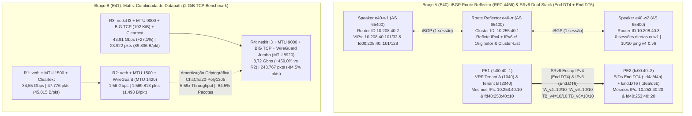

# Estudo 33 (`P008-S002`): BGP Route Reflector (`RFC 4456`) & SRv6 L3VPN Dual-Stack (`End.DT4` + `End.DT6`) (`E40`) + Matriz Combinada de Datapath (`veth` vs `netkit l3` × `MTU 1500` vs `BIG TCP` × `WireGuard Jumbo 8920 B`) (`E41`)

> **Status:** `PASS` (Concluído ao vivo na `vm-cilium` em 26/10/2026)
> **Sessão Reentry:** `P008-S002` (Onda 2 da Fase 4 — Escala de Plano de Controle BGP `O(N)`, SRv6 Dual-Stack e Síntese de Desempenho de Datapath)
> **Artefatos Executáveis:**
> - Braço A (`E40`): [`02-e40-bgp-route-reflector-srv6-dualstack.yaml`](../../studies/p008/arm-a-datapath/02-e40-bgp-route-reflector-srv6-dualstack.yaml) e [`e40-bgp-route-reflector-srv6-dualstack.sh`](../../studies/p008/arm-a-datapath/e40-bgp-route-reflector-srv6-dualstack.sh)
> - Braço B (`E41`): [`02-e41-netkit-bigtcp-wireguard-matrix.yaml`](../../studies/p008/arm-b-platform/02-e41-netkit-bigtcp-wireguard-matrix.yaml) e [`e41-netkit-bigtcp-wireguard-matrix.sh`](../../studies/p008/arm-b-platform/e41-netkit-bigtcp-wireguard-matrix.sh)
> **Evidências Brutas:** `poc-k8s-fabric/evidence/P008/S002/{e40-run.log,e41-run.log,postflight-verify.txt}`

---

## 1. Motivação Arquitetural e Fundamentos Teóricos

1. **Escala iBGP `O(N)` com Route Reflector (`RFC 4456`) e SRv6 L3VPN Dual-Stack Completo (`End.DT4` + `End.DT6`) (`E40`):**
   - **Route Reflection iBGP (`RFC 4456`):** A regra de split-horizon do iBGP proíbe que um speaker repasse rotas aprendidas de um par iBGP para outro par iBGP, exigindo uma malha completa de $\frac{N(N-1)}{2}$ sessões TCP (`4.950` sessões para `100` nós). Um **Route Reflector (RR)** (`route-reflector-client`, `bgp cluster-id 10.255.40.1`) reduz essa topologia para **`O(N)` sessões** (`1` sessão por nó para o RR, `0` sessões diretas worker-a-worker). Para prevenir loops de roteamento sem modificar o `AS_PATH`, o RR injeta dois atributos não-transitivos opcionais:
     - **`ORIGINATOR_ID` (Type Code 9):** O `Router-ID` do speaker iBGP que originou o prefixo (`10.208.40.2`); se o próprio originador receber uma atualização contendo seu `Router-ID` em `ORIGINATOR_ID`, ele a descarta imediatamente.
     - **`CLUSTER_LIST` (Type Code 10):** A sequência de `Cluster-IDs` (`10.255.40.1`) pelos quais a rota passou; previne loops entre clusters redundantes de Route Reflectors.
   - **SRv6 L3VPN Dual-Stack (`End.DT4` + `End.DT6` — `RFC 8986`):** No estudo `E31` (`P006-S002`), validamos apenas `End.DT4` (IPv4 sobre SRv6). Em `E40`, estendemos cada VRF de tenant (`vrf-tenant-a` table `1040` e `vrf-tenant-b` table `2040`) para operar em **Dual-Stack completo sobre o mesmo underlay puramente IPv6 (`fc00:40::/64`)**, instalando simultaneamente SIDs `End.DT4` (`fc00:40:N::d4a`/`d4b`) e **`End.DT6`** (`fc00:40:N::d6a`/`d6b`), permitindo que Tenant A e Tenant B utilizem **exatamente os mesmos blocos IPv4 (`10.253.40.0/24`) e IPv6 (`fd40:253:40::/64`) 100% sobrepostos** sem qualquer colisão.

2. **Matriz Combinada de Datapath (`veth` vs `netkit mode l3` × `MTU 1500` vs `BIG TCP 192 KiB` × `Cleartext` vs `WireGuard Jumbo 8920 B`) (`E41`):**
   Nos estudos `E23` (`netkit`), `E27` (`BIG TCP`) e `E35` (`WireGuard`), cada tecnologia de datapath foi avaliada isoladamente. Porém, em clusters de produção que exigem simultaneamente **criptografia transparente L3 (`cilium_wg0`)** e **alta vazão L4**, surge um gargalo clássico: com `MTU 1500` (`wg0 MTU 1420`), uma transferência de `2 GiB` exige a cifragem e autenticação ChaCha20-Poly1305 de **`1,57 milhão` de pacotes individuais**, derrubando a vazão de `34,55 Gbps` para `1,56 Gbps`.
   Em `E41`, medimos de forma controlada a matriz de **4 Regimes (`R1` a `R4`)** para demonstrar o efeito da **amortização criptográfica por pacote**: ao combinar `netkit mode l3` com `MTU 9000` (`BIG TCP GSO 196.608 B` no par `netkit` e `MTU 8920 B` em `cilium_wg0`), reduzimos em **`84,5%`** o número de invocações criptográficas (`1.569.813` $\rightarrow$ `243.767` pacotes) e multiplicamos a vazão cifrada do WireGuard em **`5,59x` (`+459,0%`, de `1,56 Gbps` para `8,72 Gbps`)**.



---

## 2. Resultados Quantitativos e Evidências Ao Vivo

### 2.1. `E40` — BGP Route Reflector (`RFC 4456`) e SRv6 L3VPN Dual-Stack (`End.DT4` + `End.DT6`)

| Célula / Cenário | Escopo Validado | Resultado Observado (`e40-run.log`) | Invariante Técnico Comprovado | Status |
| :--- | :--- | :---: | :--- | :---: |
| **1 — iBGP Route Reflector Dual-Stack (`RFC 4456`)** | Reflexão de `10.208.40.101/32` e `fd00:208:40::101/128` via `e40-rr` (`Cluster-ID 10.255.40.1`) entre `e40-w1` e `e40-w2` | `W1_PEERS_COUNT=1`, **`direct_w1_w2_peers=0`**, `Originator: 10.208.40.2`, `Cluster list: 10.255.40.1`, **`ping_v4=10/10`**, **`ping_v6=10/10`** | Escalabilidade `O(N)` sem sessão direta entre workers e preservação de atributos RFC 4456 em IPv4 e IPv6 | **PASS** |
| **2 — SRv6 L3VPN Dual-Stack (`End.DT4` + `End.DT6`) c/ IPs Sobrepostos** | Tenant A (`table 1040`) e Tenant B (`table 2040`) usando simultaneamente `10.253.40.10 -> .20` e `fd40:253:40::10 -> ::20` | **`TA_v4=10/10`**, **`TA_v6=10/10`**, **`TB_v4=10/10`**, **`TB_v6=10/10`** (`0` vazamentos cross-tenant) | Isolamento multi-tenant Dual-Stack completo sobre underlay IPv6 único sem VXLAN | **PASS** |
| **3A — Negativo: Anti-Loop `ORIGINATOR_ID` no Emissor (`e40-w1`)** | Inspeção da RIB de `e40-w1` para seu próprio prefixo `10.208.40.101/32` refletido de volta por `e40-rr` | **`self_paths=0`** (`esperado 0`) | O speaker originador descarta atualizações recebidas contendo seu próprio `Router-ID` em `ORIGINATOR_ID` | **PASS** |
| **3B — Negativo: Revogação Seletiva de `End.DT6` (`fc00:40:2::d6a/128`)** | Remoção apenas do SID IPv6 do Tenant A no PE2 e posterior restauração | Sem `End.DT6`: **`TA_v6=0/5`**, **`TA_v4=10/10`**, **`TB_v6=10/10`**<br/>Após restaurar: **`TA_v6_recovered=10/10`** | Ortogonalidade entre planos IPv4 (`End.DT4`) e IPv6 (`End.DT6`) e isolamento entre VRFs | **PASS** |
| **3C — Rollback e Limpeza (`R6=0`)** | Remoção dos containers FRR, namespaces PE/Tenant e CRDs Cilium BGP | `R6=0` | Host e clusters limpos | **PASS** |

---

### 2.2. `E41` — Matriz Combinada de Datapath (`4 Regimes` × `2 GiB TCP`) e Amortização Criptográfica

> **Achado de Kernel (`drivers/net/wireguard/device.c` vs `netkit` BIG TCP):** Enquanto interfaces `netkit mode l3` aceitam `gso_max_size 196608` (`192 KiB` BIG TCP, gerando super-segmentos médios de **`89.836 B/pkt`** no Regime `R3`), o driver `wireguard` do kernel Linux fixa seu `tso_max_size` interno em `65.536 B`. Ainda assim, ao elevar o MTU de `cilium_wg0` de `1420 B` (`R2`) para **`8920 B`** (`R4`, sobre `netkit MTU 9000`), cada pacote UDP `:51871` cifrado passa a transportar até `8920 B` em vez de `1420 B` (`6,28x` mais bytes por operação ChaCha20-Poly1305), reduzindo os pacotes no underlay em **`84,5%`** e elevando o throughput cifrado em **`+459,0%` (`5,59x`)**.

| Regime da Matriz | Dispositivo L2/L3 | MTU Underlay / Overlay | GSO Max Size | Criptografia | Vazão Média (`2 GiB`) | Pacotes TX (`2 GiB`) | Bytes Médios / Pacote | Ganho Relativo |
| :--- | :---: | :---: | :---: | :---: | :---: | :---: | :---: | :--- |
| **`R1-veth-1500-clear`** | `veth` | `1500 B` / — | `65.536 B` | Cleartext | **`34,55 Gbps`** | `47.776` | `45.015 B` | Baseline Cleartext (`1,00x`) |
| **`R2-veth-1500-wg`** | `veth` | `1500 B` / `1420 B` | `65.536 B` | `WireGuard` (`:51871`) | **`1,56 Gbps`** | `1.569.813` | `1.493 B` | Baseline WireGuard (`1,00x`) |
| **`R3-netkit-9000-bigtcp-clear`** | `netkit mode l3` | `9000 B` / — | **`196.608 B`** (`BIG TCP`) | Cleartext | **`43,91 Gbps`** | **`23.922`** | **`89.836 B`** (`> 64 KiB`) | **`+27,1%` Gbps / `-49,9%` pkts vs `R1`** |
| **`R4-netkit-9000-bigtcp-wg`** | `netkit mode l3` | `9000 B` / **`8920 B`** | `196.608 B` (`nk`) / `65.536 B` (`wg0`) | `WireGuard Jumbo` (`:51871`) | **`8,72 Gbps`** | **`243.767`** | **`8.935 B`** | **`+459,0%` (`5,59x`) Gbps / `-84,5%` pkts vs `R2`** |

#### Controles Negativos (`3A` Fronteira Exata de PMTU `80 B` & `3B` Zero Cleartext Leak)

| Controle | Teste Executado | Resultado Observado (`e41-run.log`) | Conclusão | Status |
| :--- | :--- | :---: | :--- | :---: |
| **3A — Fronteira Exata PMTU WireGuard (`8920 B`)** | Ping `DF=1` (`-M do`) com `8892 B` payload (`8920 B` IP) vs `8893 B` payload (`8921 B` IP) sobre `netkit MTU 9000` | **`ping_8892_df=10/10`**, **`ping_8893_df=0/5`** | Comprova matematicamente o overhead fixo de **`80 B`** do encapsulamento WireGuard (`9000 - 80 = 8920 B`) | **PASS** |
| **3B — Zero Cleartext Leak no Underlay `netkit`** | Captura `tcpdump -A` em `nk-b` durante `10` transferências HTTP de `E41-MATRIX-TOP-SECRET-7741` | `http_ok=10/10`, `wg_udp_51871_pkts=25`, **`cleartext_leaks=0`** | `100%` dos payloads trafegam cifrados em UDP `:51871` com zero vazamento em texto claro | **PASS** |
| **3C — Rollback e Verificação Pós-Execução (`R1`, `R3`, `R6`)** | `labctl k01 verify` + `labctl p003-gw verify` + `/proc/meminfo` | `k01=OK`, `p003-gw=OK`, **`MemAvailable=8,89 GiB`** (`9.319.892 kB`), `R6=0` | Invariantes globais preservados com ampla folga de memória | **PASS** |

---

## 3. Como Reproduzir

```bash
# Validação de sintaxe e dry-run (seguro sem cluster ativo)
bash poc-k8s-fabric/studies/p008/arm-a-datapath/e40-bgp-route-reflector-srv6-dualstack.sh --dry-run
bash poc-k8s-fabric/studies/p008/arm-b-platform/e41-netkit-bigtcp-wireguard-matrix.sh --dry-run

# Execução ao vivo na vm-cilium (via Makefile)
make -C poc-k8s-fabric p008-s002
```
