# Livro do aluno: Cilium BGP, Gateway API e tenants híbridos

## Guia de estudo e prática

**Autor:** Reinaldo Saraiva · **Edição:** 2.7 · **Local:** [S. l.] · **Ano:** 2026 · **Público-alvo:** estudantes de Kubernetes, redes e Cilium que já conhecem o vocabulário básico de IP e roteamento

## Apresentação

> **Objetivo do guia**
>
> Ao terminar este roteiro, a pessoa estudante consegue localizar os ambientes descritos para os exercícios dos módulos 1–11, explicar o que o Cilium anuncia por BGP, validar um Gateway HTTP/TCP/UDP exposto por VIP anycast, ler uma decisão de autorização na borda e no datapath, distinguir autorização por identidade de autorização por endereço em um tenant com pods Kubernetes e VMs OpenStack ou KubeVirt, e interpretar como leituras históricas o estudo em nuvem do módulo 12, os resultados comparados de P004 (DCI/OVN, OVN-Kubernetes `C/D`, Cilium OSS `A`, Cilium + FRR `B` e critérios de aceite para PoC do INV) do módulo 13, os 16 estudos avançados de P005 (Ondas 1 a 4: conexão dedicada eBGP `E09–E19` e datapath eBPF, `netkit`, burst IPAM, XLB, DRA e Hubble `E21–E25`) do módulo 14, os 8 estudos avançados de Fase 2 de P006 (Ondas 1 a 4: LoadBalancer TCX/XDP + Maglev `E26`, Cluster Mesh `E30`, BIG TCP `E27`, SRv6 L3VPN `E31`, Bandwidth Manager EDT + BBR `E28`, Tetragon `E32`, BGP Unnumbered + L2 Announcements `E29` e KubeVirt Live Migration sob tráfego contínuo `E33`) do módulo 15, os 4 estudos avançados de Fase 3 de P007 (Ondas 1 e 2: BGP Graceful Shutdown `RFC 8326` `E34`, Cilium Mutual Auth SPIFFE + WireGuard `E35`, `CiliumLocalRedirectPolicy` `E36` e Workloads Dual-Homed com Multus + `ipvlan L2/L3` vs `macvlan` `E37`) do módulo 16 e os 4 estudos avançados de Fase 4 de P008 (Ondas 1 e 2: Cilium Host Firewall + XDP Early DDoS Prefilter `E38`, `CiliumEnvoyConfig` L7 Traffic Management & Resilience `E39`, iBGP Route Reflector `RFC 4456` + SRv6 L3VPN Dual-Stack `End.DT4`/`End.DT6` `E40` e Matriz 2×2 de Sinergia `netkit` + BIG TCP + `WireGuard` `E41`) do módulo 17.

Esta edição preserva os módulos 1–11, com exercícios guiados e estudos das
trilhas P001–P003 sobre BGP, Gateway API, segurança, IPAM e tenants híbridos.
O módulo 12 é leitura do estudo histórico de nós reais na nuvem; essa
infraestrutura não faz parte da aula. O módulo 13 apresenta a leitura completa dos
resultados de `P004-S001` a `P004-S008` (concluídas com **PASS**):
a réplica DCI com OVN, FRR e EVPN (`M01–M03` e `X05`), o plano OVN-Kubernetes +
UDN/CUDN + EVPN + KubeVirt (`K01–K04`), os casos cruzados entre os três planos
(`X01–X04`, `X06` e `X07`), o Braço Cilium A com KubeVirt `v1.9.0` no cluster
`p003-gw` (`V00–V08-A`, `C-neg` / `G01` / `G02`), o Braço Cilium B com `FRR 10.7.1`
no nó sob o invariante `R6=0` (`H6`/`G06`, `V09`/`H7`, `V07-B`, `V08-B`), o
blueprint de transição para a Fase 2 (`Braços C e D`) e os critérios objetivos
de aceite para uma PoC comercial do INV (`G07`) seguidos da higiene final dos
laboratórios (`G08`). O módulo 14 sintetiza os 16 estudos avançados de `P005-S001` a
`P005-S004` (todos concluídos com **PASS**): Braço A eBGP (`E09–E19`: idempotência `10x`,
TCP MD5 + ASN 32 bits, `max-prefix` + filtro de import, communities/prepend/MED, BFD `< 1 s`,
dual-border + Graceful Restart, eBGP IPv6 nativo `fd14::a/128`, VRF por tenant via community,
3 modos de retorno + `CiliumEgressGatewayPolicy`, e MTU 9000/QinQ/MACsec vs WireGuard) e
Braço B Datapath eBPF (`E21–E25`: `netkit` vs `veth`, burst IPAM com warm pool, XLB L7 `sockmap`/`sk_msg` vs Envoy,
DRA `resource.k8s.io/v1` `NetworkDeviceData`, e observabilidade contínua BGP + Hubble L3/L4/L7/TLS).
O módulo 15 sintetiza os 8 estudos avançados de Fase 2 e o saneamento integral de
`P006-S001` a `P006-S004` (todos concluídos com **PASS** em `v2.5.0`, totalizando `33/33`
estudos `E01–E33` e `100%` de [`revisao-projeto-2026-09-26.md`](revisao-projeto-2026-09-26.md)):
Braço A Datapath/BGP (`E26` LoadBalancer TCX/XDP + DSR & Maglev `M=16381`, `E27` BIG TCP
`192 KiB` + `netkit` + MTU 9000, `E28` Bandwidth Manager EDT + `qdisc fq` + `TCP BBR` vs `CUBIC`,
e `E29` BGP Unnumbered `RFC 5549`/`8950` + `CiliumL2AnnouncementPolicy`), Braço B Plataforma/Segurança
(`E30` Cilium Cluster Mesh / MCS-API sobre BGP, `E31` SRv6 L3VPN `End.DT4` sem VXLAN, `E32`
Tetragon Runtime Security `TracingPolicyNamespaced`, e `E33` KubeVirt Live Migration sob
tráfego contínuo `50 pps` `Cilium B /32 BGP` vs `OVN-K EVPN Type-2`) e Braço C Saneamento
(`Blocos C1–C4`, `Makefile` `make lint`/`test`/`pdf` e índices `s011/s012`).
O módulo 16 sintetiza os 4 estudos avançados de Fase 3 de `P007-S001` e `P007-S002`
(todos concluídos com **PASS** em `v2.6.0`, totalizando `37/37` estudos `E01–E37`):
Braço A Borda BGP & Roteamento Node-Local (`E34` BGP Graceful Shutdown `RFC 8326` `65535:0` +
`LOCAL_PREF=0` com `0/150` pacotes perdidos vs `8/150` / `662,15 ms` no dreno abrupto, e
`E36` `CiliumLocalRedirectPolicy` `serviceMatcher` `[LocalRedirect]` `20/20` local + `addressMatcher`
`169.254.20.10:8080/TCP`) e Braço B Segurança Zero-Trust & Workloads Dual-Homed (`E35` Cilium
Mutual Authentication `SPIFFE` X.509 SVID mTLS + `cilium_wg0` WireGuard `:51871` com `0`
vazamentos em texto claro, e `E37` Multus `NetworkAttachmentDefinition` + `ipvlan L2/L3` vs
`macvlan` `MTU 9000` com `36,76 Gbps` em `ipvlan-l3` e bypass de Cloud L2 MAC Anti-Spoofing).
O módulo 17 sintetiza os 4 estudos avançados de Fase 4 de `P008-S001` e `P008-S002`
(todos concluídos com **PASS** em `v2.7.0`, totalizando **`41/41` estudos `E01–E41`**):
Braço A Proteção de Nó XDP/Host-FW & Escalabilidade iBGP/SRv6 (`E38` Cilium Host Firewall
`CiliumClusterwideNetworkPolicy` `nodeSelector` + XDP Early DDoS Prefilter `XDP_DROP` com
`conntrack_flood_entries=0`, e `E40` iBGP Route Reflector `RFC 4456` `cluster-id 10.255.40.1` +
SRv6 L3VPN Dual-Stack `End.DT4` + `End.DT6` sem VXLAN isolando CIDRs sobrepostos IPv4/IPv6) e
Braço B Resiliência L7 Envoy & Sinergia `netkit` + BIG TCP + WireGuard (`E39` `CiliumEnvoyConfig`
Weighted Canary `90/10`, Header Routing, Token-Bucket Rate Limiting `429` e Retries `503 -> 200`, e
`E41` Matriz 2×2 `veth 1500` vs `netkit L3 MTU 9000 + BIG TCP 192 KiB` × `Cleartext` vs `WireGuard MTU 8920`,
demonstrando ganho de `+459,0%` / `5,59x` no throughput cifrado e redução de `-84,5%` nos pacotes ChaCha20-Poly1305).
Os módulos 12, 13, 14, 15, 16 e 17 interpretam evidência
histórica; não exigem acesso em tempo real a essas infraestruturas. Nenhum
módulo mede desempenho de hardware de produção.

O guia tem 17 módulos. Os módulos 1–11 trazem exercícios guiados apoiados nos
ambientes P001–P003; o módulo 12 é leitura histórica do estudo em nuvem, cuja
infraestrutura fica fora da aula; os módulos 13 a 17 leem os resultados
completos de P004 a P008, totalizando `41/41` estudos `E01–E41`. As citações
seguem o sistema autor-data da ABNT NBR 10520:2023, e as referências, a ABNT
NBR 6023:2018.

## Sumário

- [Introdução](#introdução)
- [Módulo 1 — Baseline e o que o Cilium anuncia](#módulo-1--baseline-e-o-que-o-cilium-anuncia)
- [Módulo 2 — VIP anycast e caminho do tráfego](#módulo-2--vip-anycast-e-caminho-do-tráfego)
- [Módulo 3 — Dual-stack IPv6 no plano de controle](#módulo-3--dual-stack-ipv6-no-plano-de-controle)
- [Módulo 4 — Falhas, Graceful Restart e convergência](#módulo-4--falhas-graceful-restart-e-convergência)
- [Módulo 5 — Escala e desempenho](#módulo-5--escala-e-desempenho)
- [Módulo 6 — Gateway API HTTP, TCP e UDP por VIP BGP](#módulo-6--gateway-api-http-tcp-e-udp-por-vip-bgp)
- [Módulo 7 — Autorização externa na borda](#módulo-7--autorização-externa-na-borda)
- [Módulo 8 — WireGuard em native routing e VXLAN](#módulo-8--wireguard-em-native-routing-e-vxlan)
- [Módulo 9 — Tenants: rede, borda e configuração](#módulo-9--tenants-rede-borda-e-configuração)
- [Módulo 10 — Multi-Pool IPAM: /24 versus /32](#módulo-10--multi-pool-ipam-24-versus-32)
- [Módulo 11 — Tenant híbrido: pods e VMs OpenStack](#módulo-11--tenant-híbrido-pods-e-vms-openstack)
- [Módulo 12 — Nós reais na nuvem: o que muda](#módulo-12--nós-reais-na-nuvem-o-que-muda)
- [Módulo 13 — DCI, OVN, FRR e EVPN: o que os resultados provam](#módulo-13--dci-ovn-frr-e-evpn-o-que-os-resultados-provam)
- [Módulo 14 — Estudos avançados P005: conexão dedicada eBGP e datapath eBPF](#módulo-14--estudos-avançados-p005-conexão-dedicada-ebgp-e-datapath-ebpf)
- [Módulo 15 — Trilha P006: datapath avançado, multicluster, SRv6 e saneamento](#módulo-15--trilha-p006-datapath-avançado-multicluster-srv6-e-saneamento)
- [Módulo 16 — Trilha P007: BGP sem perda, SPIFFE com WireGuard, Local Redirect e Multus](#módulo-16--trilha-p007-bgp-sem-perda-spiffe-com-wireguard-local-redirect-e-multus)
- [Módulo 17 — Trilha P008: Host Firewall, CiliumEnvoyConfig, Route Reflector e matriz netkit](#módulo-17--trilha-p008-host-firewall-ciliumenvoyconfig-route-reflector-e-matriz-netkit)
- [Considerações finais](#considerações-finais)
- [Referências](#referências)
- [Apêndice A – Roteiro do instrutor](#apêndice-a--roteiro-do-instrutor)
- [Apêndice B – Documentos complementares do repositório](#apêndice-b--documentos-complementares-do-repositório)

## Introdução

Esta introdução reúne o que a pessoa estudante precisa antes do Módulo 1:
objetivos, regras de segurança, onde cada comando roda, o mapa dos
laboratórios, o vocabulário mínimo e a pergunta central do guia.

### Objetivos de aprendizagem

- explicar a diferença entre sessão BGP, rota anunciada e encaminhamento de um pacote;
- distinguir PodCIDR agregado, VIP de serviço e bloco Multi-Pool `/32`;
- expor um Gateway HTTP, TCP e UDP por uma VIP anunciada por BGP e provar cada listener com controle negativo;
- ler uma decisão allow/deny/absent do ExternalAuth e reconhecer fail-closed;
- verificar em captura se um tráfego está cifrado, encapsulado ou em claro;
- provar isolamento de tenant em três controles diferentes: rede, borda e configuração;
- explicar por que autorização por label não vaza no reuso de IP e por que autorização por CIDR vaza;
- registrar separadamente a saída observada e a expectativa do roteiro;
- interpretar os resultados de P004 (DCI/OVN/FRR/EVPN, OVN-Kubernetes + KubeVirt, casos cruzados e Braços Cilium A/B + KubeVirt, com todos os gates `G00–G09` concluídos), sem confundi-los com a trilha básica do Cilium.

### Regras de segurança

- Os exercícios da pessoa estudante são de leitura e de requisição HTTP/TCP/UDP. Mutação é tarefa do instrutor e está marcada como tal.
- Não use `kubectl delete`, `kubectl drain`, `docker stop`, `clab destroy` ou o script de teardown como parte deste roteiro.
- Nunca dependa do contexto implícito do `kubectl`. Cada comando traz `--kubeconfig` e `--context`.
- O cluster `k01` é a referência histórica protegida. Os estudos P003 rodam em um segundo cluster, o sandbox `p003-gw`. Antes de qualquer comando no sandbox, confirme o UID do cluster com o valor entregue pelo instrutor.
- Se `127.0.0.1:18081` já responder no seu computador, existe um túnel ativo. Reutilize-o.
- O módulo 13 é somente leitura de evidências históricas: não traz comandos interativos para DCI, OVN-Kubernetes ou KubeVirt e não pede acesso à VM atual.

### Onde um comando roda

**Quadro 1 – Rótulos que indicam onde cada comando roda**

| Rótulo | Significado |
|---|---|
| **Mac** | computador da pessoa estudante |
| **vm-cilium** | sessão SSH no host Linux do laboratório |
| **container** | comando precedido por `sudo docker exec` na vm-cilium |
| **Kubernetes k01** | `sudo kubectl --kubeconfig "$K01_KUBECONFIG" --context kind-k01` |
| **Kubernetes sandbox** | `sudo kubectl --kubeconfig "$STUDY_KUBECONFIG" --context kind-p003-gw` |
| **testbed OpenStack** | `sudo docker exec -i <container-do-testbed> bash` e, dentro dele, `openstack` |

Fonte: elaborado pelo autor (2026).

Defina as variáveis uma vez por sessão na **vm-cilium**. Os valores abaixo são
os do laboratório de referência; use os que o instrutor entregar:

~~~bash
export LAB_DIR="${LAB_DIR:-/opt/poc-k8s-fabric}"
export K01_KUBECONFIG="${K01_KUBECONFIG:-/root/.kube/k01-rebuild.config}"
export STUDY_KUBECONFIG="${STUDY_KUBECONFIG:-/root/.kube/p003-gw.config}"
export STUDY_CLUSTER_UID="${STUDY_CLUSTER_UID:-<uid-entregue-pelo-instrutor>}"
k01() { sudo kubectl --kubeconfig "$K01_KUBECONFIG" --context kind-k01 "$@"; }
ks()  { sudo kubectl --kubeconfig "$STUDY_KUBECONFIG" --context kind-p003-gw "$@"; }
C1="sudo docker exec clab-poc-k8s-kind-client-ext"
C2="sudo docker exec clab-p003-gw-fabric-client"
UID_NOW="$(ks get namespace kube-system -o jsonpath='{.metadata.uid}')"
test "$UID_NOW" = "$STUDY_CLUSTER_UID" && echo "sandbox OK"
~~~

Se o teste de UID falhar, pare. Um `kubectl` no cluster errado invalida o
exercício e pode alterar a referência.

### Mapa dos laboratórios

**Figura 1 – Visão geral do laboratório dentro da vm-cilium**

Fonte: elaborada pelo autor (2026).

Os exercícios práticos dos módulos 1–11 usam os ambientes documentados nas
linhas abaixo. O módulo 12 é leitura de um estudo com infraestrutura em nuvem
que não faz parte da aula; o módulo 13 lê resultados históricos completos da
trilha P004 (DCI, OVN-Kubernetes + EVPN, casos cruzados e Braços Cilium A/B +
KubeVirt). O Quadro 2 distingue esses estudos dos ambientes usados nos exercícios:

**Quadro 2 – Ambientes e estudos documentados no guia**

| Ambiente | Componentes | Versões | Papel |
|---|---|---|---|
| **Lab de referência `k01`** | 2 spines + 3 leaves SR Linux, `border1` FRR, `client-ext`, kind com 3 nós | SR Linux `25.3.2`, FRR `8.4.1`, Kubernetes `v1.35.0`, Cilium `1.20.1` | Módulos 1 a 5; protegido, somente leitura |
| **Sandbox `p003-gw`** | segundo fabric containerlab + kind com 3 nós + cliente `198.19.0.10` | Cilium `1.20.2`, Gateway API `1.6.1` (CRDs standard + experimental) | Módulos 6 a 11; onde o instrutor muda configuração |
| **Testbed OpenStack** | DevStack em container (Neutron OVS, qrouter, qdhcp, SG) | neutron `34.x`, cirros `0.6.0` | Módulo 11; VMs do tenant |
| **VM em KVM real** | `qemu` no host ligado ao `br-int` do testbed por um par veth | cirros `0.6.0` | Módulo 11, caso C5 |
| **Estudo histórico de nós reais na nuvem** | 3 VMs na nuvem, cluster `kubeadm` e FRR na mesma VPC | Kubernetes `1.35.2`, Cilium `1.20.1` | Módulo 12; leitura, infraestrutura fora da aula |
| **Réplica DCI (`P004-S002`)** | `labctl dci`: OVN `26.03.3`, 1 central, 2 chassis, 2 gateways, FRR multi-VRF e cliente AS 200 | Linux VRFs nos gateways; EVPN Type 5 (`M01–M03`, `X05`) | Módulo 13.1; leitura de resultados históricos (`labctl dci down` após os ensaios) |
| **Plano OVN-Kubernetes + Fabric EVPN (`P004-S003` e `S004`)** | `labctl evpn-fabric` + `labctl ovnk`: kind 3 nós + `ovnk-evpn-peer` + KubeVirt `/dev/kvm` | OVN-Kubernetes `v1.4.0`, KubeVirt `v1.9.0`, `frr-k8s` `v0.0.21`/`v0.0.27` | Módulo 13.2; leitura de resultados históricos (`K01–K04`, `X01–X04`, `X06–X07`) |
| **Braços Cilium A e B + KubeVirt (`P004-S005` a `S008`)** | `p003-gw` + KubeVirt `/dev/kvm` + `DaemonSet/frr-node` (no Braço B sob `R6=0`) | Cilium `1.20.2`, KubeVirt `v1.9.0`, FRR `10.7.1` (`table-map RM-NO-KERNEL`) | Módulos 13.3 e 13.4; leitura de resultados históricos (`V00–V09`, `G01`, `G02`, `G06–G08`) |

Fonte: elaborado pelo autor (2026).

O Quadro 2 descreve os ambientes e estudos documentados, sem indicar
disponibilidade simultânea em tempo real (os perfis pesados operam em regime
*time-shared* via `labctl` para respeitar `R3: MemAvailable >= 4,00 GiB`). Os
Figuras 1 e 2 ilustram os ambientes P001–P003; as Figuras 16, 17 e 18, no
Módulo 13, ilustram a arquitetura e os resultados de P004.

Os dois fabrics usam eBGP puro em dois níveis, no desenho de roteamento para
data centers descrito por Lapukhov, Premji e Mitchell (2016). No `k01`, os nós falam com o
leaf do rack (AS 6510x para 6500x) e os leaves com os spines (AS 65500). No
sandbox, os nós usam AS 65301/65302, os leaves 65201/65202/65203, os spines
65600 e o border 65400. Os enlaces spine–leaf são IPv4 numerados em `/31`.

**Figura 2 – Explicação para iniciantes: entrega, rotas e VIP**

Fonte: elaborada pelo autor (2026).

Endereços que aparecem nos exercícios:

**Quadro 3 – Endereços usados nos exercícios**

| Recurso | Lab `k01` | Sandbox `p003-gw` |
|---|---|---|
| PodCIDR IPv4 por nó | `10.244.x.0/24` | `10.245.x.0/24` (IPAM `kubernetes`) |
| Pool de VIPs | `10.201.255.0/24`, VIP `10.201.255.10` | `10.202.255.0/24`, VIP `10.202.255.10` |
| Cliente externo ao cluster | `client-ext` `203.0.113.10` | `fabric-client` `198.19.0.10` |
| Gateway | não há | `p003-main` no namespace `p003-gateway`, listeners 8080/HTTP, 15432/TCP, 15353/UDP |
| Rede do tenant OpenStack | não há | `10.30.0.0/24` (subnet-a), externa `10.40.0.0/24` |

Fonte: elaborado pelo autor (2026).

### Vocabulário mínimo

**Quadro 4 – Vocabulário mínimo do laboratório**

| Termo | Significado neste laboratório |
|---|---|
| **speaker** | o agente Cilium em um nó, que mantém a sessão BGP daquele nó |
| **PodCIDR** | bloco de IP reservado para pods de um nó; `/24` IPv4 por nó no IPAM `kubernetes` |
| **VIP** | endereço de serviço anunciado como `/32` por vários nós |
| **ECMP** | vários próximos saltos equivalentes para o mesmo prefixo |
| **GR** | Graceful Restart: o vizinho mantém as rotas enquanto a sessão BGP reinicia (Sangli et al., 2007) |
| **Gateway API** | recursos `Gateway`, `HTTPRoute`, `TCPRoute`, `UDPRoute` implementados pelo Cilium com Envoy (Kubernetes SIG Network, 2026) |
| **ExternalAuth** | filtro do Gateway API que consulta um serviço externo antes de encaminhar a requisição |
| **CNP** | `CiliumNetworkPolicy`; `fromEndpoints` seleciona por label, `fromCIDR` por endereço (Cilium Authors, 2026f) |
| **Multi-Pool** | IPAM do Cilium em que cada nó recebe blocos de um `CiliumPodIPPool`, com `maskSize` configurável (Cilium Authors, 2026d) |
| **SG** | Security Group do Neutron, o firewall stateful da porta de uma VM |
| **RX morto** | a VM envia mas não recebe; limitação de KVM aninhado em container |

Fonte: elaborado pelo autor (2026).

### A pergunta central: cada pod anuncia `/32`?

**Não com o IPAM padrão.** Uma sessão BGP (Rekhter; Li; Hares, 2006) não é aberta
por pod. O agente Cilium em cada nó é o speaker e anuncia o **PodCIDR `/24` do
nó** (Cilium Authors, 2026b). Um pod com
`10.244.1.27` está coberto por `10.244.1.0/24`; não nasce sessão nem anúncio
para `10.244.1.27/32`.

O serviço tem outra regra. O `echo-anycast` recebe a VIP `10.201.255.10`, usa
`externalTrafficPolicy: Cluster` e os três nós anunciam a mesma
`10.201.255.10/32`; o fabric instala vários próximos saltos e faz ECMP. A rota
representa o serviço e seus pontos de entrada, não cada backend.

Existe uma terceira forma, medida no Módulo 10: com Multi-Pool IPAM e
`maskSize: 32`, cada pod recebe um bloco `/32` próprio e o Cilium anuncia esse
bloco. O speaker continua sendo o nó. O que muda é a granularidade, a
quantidade de rotas e o momento em que um bloco é alocado e retirado.

## Módulo 1 — Baseline e o que o Cilium anuncia

Ambiente: lab `k01`. Origem: P001 (REQ-001 a REQ-007). A Figura 3 sintetiza o entregável do módulo.

**Figura 3 – Síntese visual do entregável do Módulo 1: Baseline BGP, 3 PodCIDRs /24, VIP /32 e Native Routing sem VXLAN**

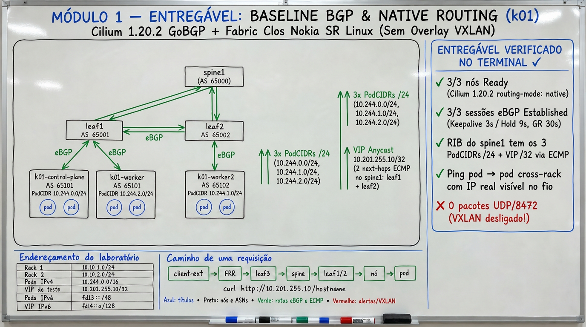

Fonte: elaborada pelo autor (2026).

### 1.1 Conferir os containers

Na **vm-cilium**:

~~~bash
sudo docker ps --format 'table {{.Names}}\t{{.Status}}' | grep -E 'clab-poc-k8s-kind|k01-'
$C1 ip -4 addr show dev eth1
~~~

Esperado: `spine1`, `spine2`, `leaf1`, `leaf2`, `leaf3`, `border1`,
`client-ext` e três `k01-*`; o `client-ext` mostra `203.0.113.10` uma vez. Esse
endereço pode sumir após um redeploy (lição L1 do RUNBOOK); sem ele todos os
probes do módulo falham sem falha real.

### 1.2 Conferir o cluster e os PodCIDRs

~~~bash
k01 get nodes -o custom-columns=NODE:.metadata.name,PODCIDR:.spec.podCIDR,PODCIDRS:.spec.podCIDRs
k01 get pods -o wide
~~~

Responda no caderno: qual `/24` cobre o IP de cada pod `echo-*`? A resposta
aponta para o bloco do nó, nunca para um `/32` do pod.

### 1.3 Sessões e anúncios BGP

~~~bash
sudo KUBECONFIG="$K01_KUBECONFIG" cilium --context kind-k01 bgp peers
sudo KUBECONFIG="$K01_KUBECONFIG" cilium --context kind-k01 bgp routes advertised ipv4 unicast
k01 get ciliumbgpclusterconfigs,ciliumbgppeerconfigs,ciliumbgpadvertisements
~~~

Esperado: três sessões `established` (uma por nó, nunca uma por pod), timers
hold 9 s e keepalive 3 s, Graceful Restart habilitado com `restartTime` 30 s.
Entre os anúncios aparecem o PodCIDR do nó e a VIP `10.201.255.10/32`.

O anúncio da VIP só existe porque o `CiliumBGPAdvertisement` (Cilium Authors, 2026a)
tem um `selector`
com `bgp-advertise=true` e o Service carrega esse label. Sem o selector o
agente não anuncia nada de Service; este foi um achado repetido em nós reais.

### 1.4 A rota no spine e a ausência de encapsulamento

~~~bash
sudo docker exec clab-poc-k8s-kind-spine1 sr_cli \
  "show network-instance default route-table ipv4-unicast prefix 10.244.0.0/16 longer"
sudo docker exec clab-poc-k8s-kind-spine1 sr_cli \
  "show network-instance default route-table ipv4-unicast prefix 10.201.255.10/32 detail"
~~~

Esperado: os três `/24` e a VIP com dois próximos saltos. Em native routing (Cilium Authors, 2026e)
o fabric vê o IP real do pod; a evidência histórica registra zero pacotes
UDP/8472 no fio e um handshake `203.0.113.10 > 10.244.2.198:8080` direto ao
pod.

**Quadro 5 – Registro do Módulo 1: valores esperados e observados**

| Item | Esperado | Observado |
|---|---|---|
| Nós `Ready` | 3 | |
| Sessões BGP | 3 established | |
| PodCIDRs no spine | 3 | |
| Next-hops da VIP no spine | 2 | |

Fonte: elaborado pelo autor (2026).

## Módulo 2 — VIP anycast e caminho do tráfego

Ambiente: lab `k01`. Origem: P001 (REQ-008 a REQ-010). A Figura 4 sintetiza o entregável do módulo.

**Figura 4 – Síntese visual do entregável do Módulo 2: VIP Anycast ECMP + Maglev, ETP=Cluster vs ETP=Local e túnel SSH**

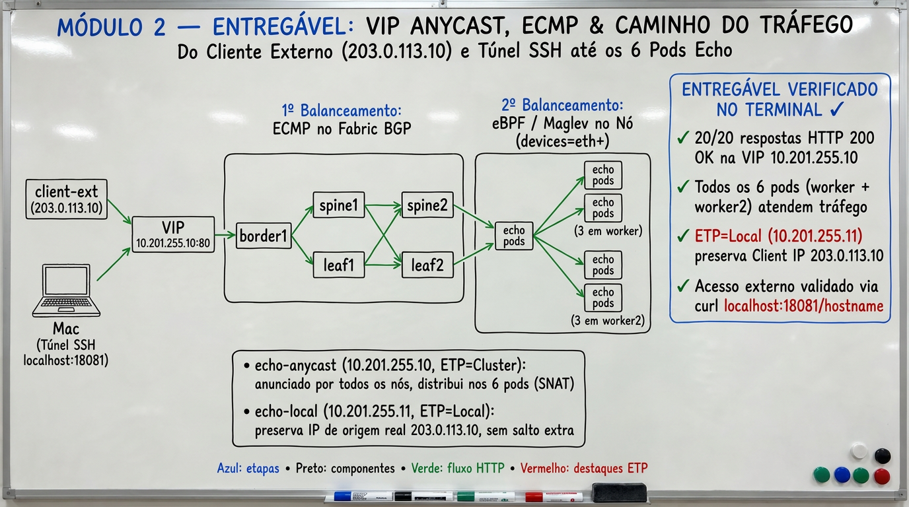

Fonte: elaborada pelo autor (2026).

### 2.1 Requisições a partir do client-ext

~~~bash
k01 get svc echo-anycast echo-local -o wide
for i in $(seq 1 20); do
  $C1 curl -fsS --max-time 5 http://10.201.255.10/hostname; echo
done | sort | uniq -c
~~~

Esperado: `echo-anycast` com `10.201.255.10` e `externalTrafficPolicy:
Cluster`; `echo-local` com `10.201.255.11` e `Local`. Vinte amostras não
garantem que todos os seis backends apareçam: ECMP e Maglev (Eisenbud et al., 2016) usam hashing. A
execução de referência registrou 20/20 HTTP 200 e seis pods distintos.

ICMP para a VIP não é respondido: o balanceador BPF atende TCP; `ping` na VIP
não é sinal de falha.

### 2.2 O túnel para o Mac

No **Mac**:

~~~bash
export VM_CILIUM_HOST="${VM_CILIUM_HOST:-IP_DA_VM}"
curl --silent --fail --max-time 2 http://127.0.0.1:18081/hostname || \
ssh -i ~/.ssh/id_rsa -o IdentityAgent=SSH_AUTH_SOCK -o ExitOnForwardFailure=yes -N \
  -L 127.0.0.1:18081:10.201.255.10:80 ubuntu@"${VM_CILIUM_HOST}"
~~~

O túnel termina no host da VM e encaminha uma porta local para a VIP. Ele não
publica a VIP na Internet. A rota do host que permite ao próprio host alcançar
a VIP é criada pelo instrutor com `scripts/06-expor-vip-na-vpc.sh`.

### 2.3 O caminho e o fix que o tornou possível

~~~text
Mac → túnel SSH → vm-cilium → clab-ext → border1/FRR → leaf3
    → spine → leaf do rack → nó Kubernetes → Cilium bpf-lb → Service → pod
~~~

O balanceador BPF precisa estar anexado à interface do fabric (`eth1` no nó
kind). O controlador de devices do Cilium 1.20.1 pula veths sem rota default,
então o kit fixa `devices=eth+` nos values. Sem isso a VIP era roteada de volta
ao fabric em loop. Um `helm upgrade` que regenere o ConfigMap remove a chave;
o apêndice do instrutor mostra a verificação condicional.

Quando o cliente está fora da VM, na mesma VPC, o caminho é assimétrico: a
requisição entra pelo fabric e a resposta volta pela bridge docker do host,
porque o nó kind roteia a VPC por `eth0`. É uma propriedade da topologia, não
uma falha.

## Módulo 3 — Dual-stack IPv6 no plano de controle

Ambiente: lab `k01` reconstruído com `values-dualstack.yaml`. Origem: P002-S001. A Figura 5 sintetiza o entregável do módulo.

**Figura 5 – Síntese visual do entregável do Módulo 3: Dual-Stack IPv6 no plano de controle BGP e fronteira do underlay L3**

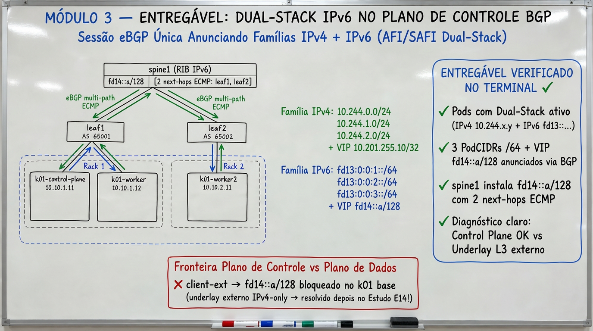

Fonte: elaborada pelo autor (2026).

### 3.1 Ler o que foi provado

~~~bash
k01 get nodes -o custom-columns=NODE:.metadata.name,PODCIDRS:.spec.podCIDRs
sudo KUBECONFIG="$K01_KUBECONFIG" cilium --context kind-k01 bgp routes advertised ipv6 unicast
sudo docker exec clab-poc-k8s-kind-spine1 sr_cli \
  "show network-instance default route-table ipv6-unicast prefix fd14::a/128 detail"
~~~

Esperado: cada nó com dois PodCIDRs (`10.244.x.0/24` e `fd13:0:0:x::/64`), os
três `/64` no spine e a VIP `fd14::a/128` com dois próximos saltos. Uma única
sessão BGP transporta as duas famílias; a convergência do plano de controle
vale para ambas.

### 3.2 O que a topologia não entrega

A VIP IPv6 não é alcançável do `client-ext`: o underlay externo do lab é
IPv4-only e next-hops IPv4-mapped não encaminham IPv6. O tráfego pod→pod IPv6
cross-node flui pela rede kind, não pelo fabric. São limites do lab em
containers, não do Cilium nem do SR Linux. Não apresente alcance IPv6 fim a fim
como demonstrado.

Quatro configurações são obrigatórias e ficaram no kit: `ipv6.enabled: true`
nos values, `ipFamily: dual` com dois `podSubnet` no kind, `afi-safi
ipv6-unicast` nos grupos `rack*-k8s` dos leaves e `multipath ipv6-unicast` nos
spines.

## Módulo 4 — Falhas, Graceful Restart e convergência

Ambiente: lab `k01`. Origem: P001 REQ-011, P002-S002 e P002-S004. Os gatilhos
de falha são tarefa do instrutor; a pessoa estudante lê e interpreta. A Figura 6 sintetiza o entregável do módulo.

**Figura 6 – Síntese visual do entregável do Módulo 4: Resiliência a falhas de fabric, BGP Graceful Restart e convergência ECMP**

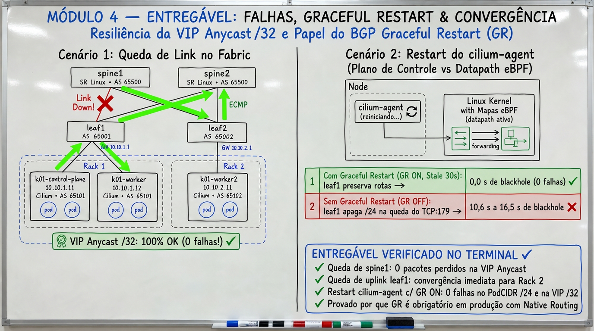

Fonte: elaborada pelo autor (2026).

### 4.1 Como se mede um blackhole

Três loops de `curl` com timeout de 2 s rodam no `client-ext` contra a VIP
anycast, um pod do rack 1 (caminho único) e um pod do rack 2. Blackhole real é
o **maior intervalo sem nenhum OK**; timeouts encadeados não contam (lição L4).
Falhas de SR Linux são provocadas com `admin-state disable` via `sr_cli`,
nunca com `docker stop`, que destrói a wiring veth (lição L2).

### 4.2 Resultados medidos

**Tabela 1 – Efeito das falhas de fabric e de agente sobre a VIP anycast e o PodCIDR**

| Falha | VIP anycast | PodCIDR do rack afetado | Reconvergência |
|---|---|---|---|
| Restart do agent, GR ON | 0 falhas | sem blackhole | datapath BPF pinado sobrevive |
| Restart do agent, GR OFF | 0 falhas (outros nós anunciam) | blackhole 10,6 s (P001) a 16,5 s (P002) | até o novo agent reanunciar |
| Drain do nó | blip de 50 a 300 ms no início da evicção | pods evictados | GR irrelevante: a sessão não cai |
| 1 spine de 2 | 100% OK em 28,7 mil amostras | n/a | BGP re-up 33 a 38 s |
| 1 leaf | 100% OK (anycast segue pelo outro rack) | blackhole total do rack por 107 a 138 s | dados +44 a 48 s após enable |
| Spine 2 + leaf 1 juntos | 100% OK em 34 mil amostras | blackhole total do rack 1 | lab sobrevive degradado |
| Flap simultâneo de 2 workers, GR ON | 0 de 19451 falhas | 2,4% a 4,4% de falhas, maxgap 2 a 4 s, sem blackhole | agents ~52 s, estável ~82 s |

Fonte: elaborada pelo autor com dados de P001 (REQ-011), P002-S002 e P002-S004 (2026).

Leituras que a pessoa estudante deve conseguir explicar:

- a VIP anycast `/32` com ECMP foi imune a todas as falhas de fabric testadas;
- o PodCIDR é caminho único por rack quando o nó é single-homed; a falha do leaf isola o rack;
- Graceful Restart elimina o blackhole de PodCIDR no restart do agent, em um nó ou em vários;
- dual-homing do nó daria ECMP ao PodCIDR; o simulador SR Linux não estabelece TCP/179 em porta adicionada em runtime, então isso fica para um cluster real.

### 4.3 O que a API do Cilium não expõe

`CiliumBGPPeerConfig` v2 na versão 1.20.x tem `timers`, `gracefulRestart`,
`ebgpMultihop`, `families` e `authSecretRef`. Não há campo BFD (Katz; Ward, 2010). A detecção de
falha de sessão hoje é hold 9 s e keepalive 3 s, o menor valor aceito na
validação do lab. Essa lacuna é o ponto de partida de um dos próximos estudos.

## Módulo 5 — Escala e desempenho

Ambiente: lab `k01`. Origem: P002-S003. A Figura 7 sintetiza o entregável do módulo.

**Figura 7 – Síntese visual do entregável do Módulo 5: Escala 6 a 40 pods sem crescer a RIB, burst de +30 VIPs e throughput Native vs VXLAN**

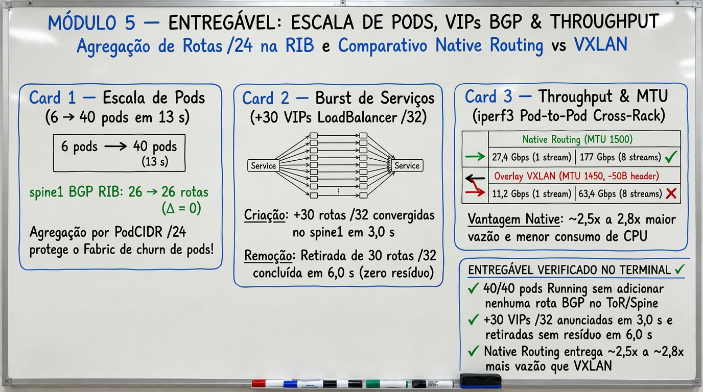

Fonte: elaborada pelo autor (2026).

### 5.1 O que a pessoa estudante confere

~~~bash
sudo docker exec clab-poc-k8s-kind-spine1 sr_cli \
  "show network-instance default route-table ipv4-unicast summary"
k01 get deploy echo
~~~

Anote o total de rotas IPv4 no spine e o número de réplicas. O instrutor pode
escalar o `echo` de 6 para 40 réplicas; repita o primeiro comando e compare.

### 5.2 Resultados medidos

**Tabela 2 – Resultados de escala e desempenho no lab `k01`**

| Eixo | Resultado |
|---|---|
| Pods 6 → 40 | 13 s até Ready; RIB do fabric inalterado (26 = 26): o `/24` agrega |
| +10 VIPs `/32` | primeira no spine em 1,3 s; 10/10 em 4,2 s; ECMP de 2 next-hops por VIP |
| Burst de +30 VIPs | 30/30 em 3,0 s; withdrawal completo em 6,0 s |
| Throughput pod→pod cross-node | 27,5 Gb/s com 1 fluxo; 177 Gb/s com 8 fluxos; 193 Gb/s no sentido reverso |
| Latência pod→pod | 0,094 ms ocioso; 0,039 ms sob 177 Gb/s, 0% perda |
| VIP sob carga | 0 falhas em ~24,7 mil requisições |
| Overlay VXLAN versus native | MTU 1450 versus 1500; 11,2 versus 27,4 Gb/s com 1 fluxo |

Fonte: elaborada pelo autor com dados de P002-S003 (2026).

A propriedade de escala é a agregação: pods escalam sem tocar no BGP e a RIB
cresce apenas com VIPs vezes nós, de forma linear. Os números absolutos vêm de
SR Linux em container e veths do kind; use apenas as relações.

## Módulo 6 — Gateway API HTTP, TCP e UDP por VIP BGP

Ambiente: sandbox `p003-gw`. Origem: P003-S003 e P003-S004. A implementação
da Gateway API pelo Cilium segue a documentação do projeto (Cilium Authors, 2026c). A Figura 8 sintetiza o entregável do módulo.

**Figura 8 – Síntese visual do entregável do Módulo 6: Gateway API HTTP, TCP e UDP sobre a VIP BGP 10.202.255.10/32**

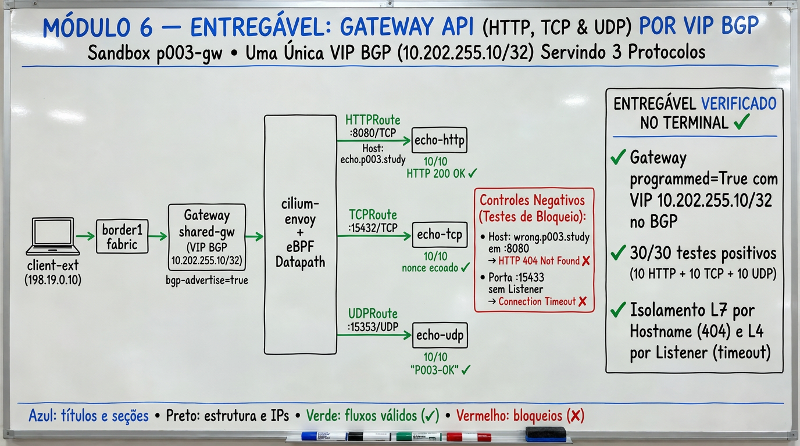

Fonte: elaborada pelo autor (2026).

### 6.1 O Gateway e seu Service

~~~bash
ks -n p003-gateway get gateway p003-main -o wide
ks -n p003-gateway get httproutes,tcproutes,udproutes
ks -n p003-gateway get svc -l bgp-advertise=true
sudo KUBECONFIG="$STUDY_KUBECONFIG" cilium --context kind-p003-gw \
  bgp routes advertised ipv4 unicast
~~~

Esperado: Gateway `Programmed=True` com `IPAddress 10.202.255.10`; o Service
gerado pelo Cilium com `EXTERNAL-IP 10.202.255.10` e o label
`bgp-advertise=true`, que vem de `spec.infrastructure.labels` do Gateway, não
de `metadata.labels`. A VIP aparece nos anúncios BGP dos três nós.

### 6.2 Um listener por protocolo, com controle negativo

~~~bash
VIP=10.202.255.10
$C2 curl -sS --retry 0 --max-time 5 -H 'Host: echo.p003.study' \
  -w '\n%{http_code}\n' "http://$VIP:8080/hostname"
$C2 curl -sS --retry 0 --max-time 5 -H 'Host: wrong.example' \
  -o /dev/null -w '%{http_code}\n' "http://$VIP:8080/hostname"
$C2 sh -c "echo P003-nonce-1 | nc -w 3 $VIP 15432"
$C2 dig @"$VIP" -p 15353 study.p003 TXT +short +notcp +tries=1 +time=2
$C2 sh -c "echo P003-gw04 | nc -w 3 $VIP 15433"
~~~

**Quadro 6 – Registro do Módulo 6: listeners e controle negativo**

| Caso | Esperado | Observado |
|---|---|---|
| HTTP com Host correto | 200 e hostname de um pod `http-echo-*` | |
| HTTP com Host errado | 404 do Envoy | |
| TCP 15432 | o nonce volta idêntico | |
| UDP 15353 | `"P003-OK"` | |
| TCP 15433 sem listener | timeout, nenhuma chegada na fixture | |

Fonte: elaborado pelo autor (2026).

A matriz de referência registrou 30/30 em cada listener, 503 com
EndpointSlice vazio quando o backend foi escalado a zero e recuperação
completa ao restaurar. Quando o instrutor troca o `CiliumBGPAdvertisement`
por um selector que não casa, a `/32` some do spine em cerca de 15 s, a VIP
para de responder e o IP direto do pod continua funcionando: é o controle que
separa "anúncio" de "serviço".

### 6.3 Achado: `hostNetwork` do Gateway não expõe listener no nó

`gatewayAPI.hostNetwork.enabled` no Cilium 1.20.2 é uma feature dos listeners
Envoy (L7), controlada por `nodes.matchLabels`. Com o seletor vazio, nenhum
socket abre no IP do nó nas portas 8080, 15432 ou 15353. Os probes ao nó
nessas portas deram 180/180 falhas; os `nodePort` do Service gerado deram
180/180 sucessos. Para expor TCP/UDP no nó, o caminho suportado é o NodePort
ou a VIP por BGP.

## Módulo 7 — Autorização externa na borda

Ambiente: sandbox `p003-gw`. Origem: P003-S005, P003-S006 e P003-S009 (T05).
O ExternalAuth do Gateway API é experimental na 1.20.2; o CRD `HTTPRoute`
recebeu o schema experimental por um patch de spec, porque o
`experimental-install.yaml` estoura o limite de annotations no Kubernetes
1.35.0. A Figura 9 sintetiza o entregável do módulo.

**Figura 9 – Síntese visual do entregável do Módulo 7: ExternalAuth HTTP e gRPC na borda Envoy e garantia 100% Fail-Closed**

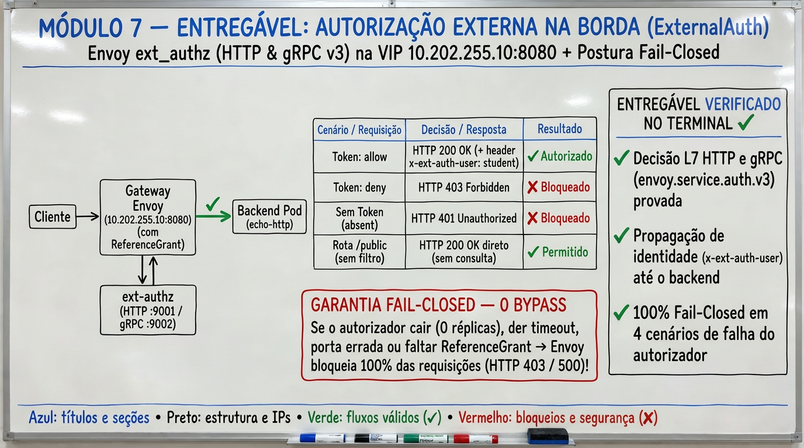

Fonte: elaborada pelo autor (2026).

### 7.1 A fixture

Um serviço Go em `studies/p003/fixtures/auth/` decide `allow`, `deny` ou
`absent` a partir do header `X-Lab-Decision` e registra cada consulta com o
`X-Lab-Request-ID`. Ele fala HTTP e gRPC (`envoy.service.auth.v3`). Não é um
IdP; serve para observar a decisão, não para autenticar pessoas.

### 7.2 Três decisões, dois protocolos

~~~bash
for d in allow deny ""; do
  $C2 curl -sS --retry 0 --max-time 15 -H 'Host: echo.p003.study' \
    ${d:+-H "X-Lab-Decision: $d"} -H "X-Lab-Request-ID: aluno-$RANDOM" \
    -o /dev/null -w "decisao=${d:-absent} http=%{http_code}\n" \
    "http://10.202.255.10:8080/protected-http"
done
$C2 curl -sS --retry 0 -o /dev/null -w 'public http=%{http_code}\n' \
  -H 'Host: echo.p003.study' http://10.202.255.10:8080/public
~~~

**Tabela 3 – Código HTTP por decisão do autorizador externo**

| Decisão | HTTP | gRPC |
|---|---|---|
| allow | 200 | 200 |
| deny | 403 | 403 |
| absent | 401 | 401 |
| rota pública sem auth | 200 | 200 |

Fonte: elaborada pelo autor com dados de P003-S005 e P003-S006, matriz A01–A10 (2026).

A matriz A01–A10 executou 900 requisições com esse resultado. O header
forjado `X-Lab-User` enviado pelo cliente não aparece na resposta (A08). A
rota pública não consulta o autorizador (A09).

### 7.3 Fail-closed sob degradação

**Tabela 4 – Comportamento fail-closed do ExternalAuth sob degradação**

| Cenário | HTTP | gRPC | Conclusão |
|---|---|---|---|
| autorizador escalado a zero | 403 em 2 ms | 403 | fail-closed |
| autorizador com atraso de 15 s | 403 após 10 s | 403 após ~200 ms | timeout do Envoy difere por protocolo |
| `backendRef` inexistente | 500 | 500 | `ResolvedRefs=False` |
| porta errada | 403 | 403 | `BackendNotFound` |
| cross-namespace sem `ReferenceGrant` | 500 | 500 | `RefNotPermitted` |
| `ReferenceGrant` removido durante probes | 403 → 500 em até 2 s | 200 → 500 em até 2 s | revogação sem bypass |

Fonte: elaborada pelo autor com dados de P003-S005, P003-S006 e P003-S009 (2026).

Nenhum cenário liberou a aplicação. Dois defeitos ficaram registrados na
1.20.2: com Grant válido, a rota HTTP cross-namespace com decisão allow pendura
(gRPC funciona), e um bloco `http: {}` vazio devolve 401 para todas as
decisões. `allowedResponseHeaders` não encaminhou os headers do autorizador ao
cliente.

## Módulo 8 — WireGuard em native routing e VXLAN

Ambiente: sandbox `p003-gw`. Origem: P003-S007 e P003-S008. Os perfis são
trocados pelo instrutor com `helm upgrade`; a pessoa estudante confere
interfaces e capturas. O Cilium usa o WireGuard (Donenfeld, 2017) na interface
`cilium_wg0`, na porta UDP 51871 (Cilium Authors, 2026g). A Figura 10 sintetiza o entregável do módulo.

**Figura 10 – Síntese visual do entregável do Módulo 8: WireGuard W0/W1/W2 em UDP/51871 e fronteira de criptografia do hostns no Native Routing**

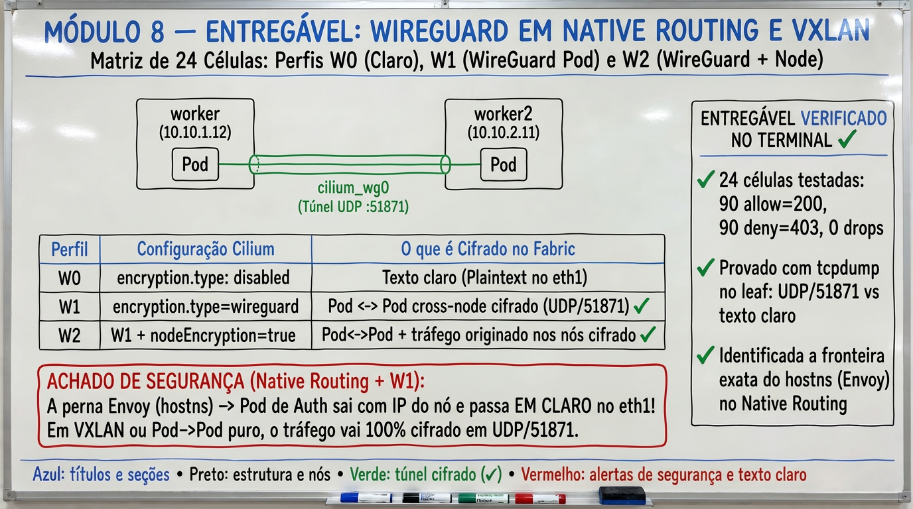

Fonte: elaborada pelo autor (2026).

### 8.1 Três perfis

**Quadro 7 – Perfis de criptografia W0, W1 e W2**

| Perfil | Configuração | Sinal na bridge do underlay |
|---|---|---|
| W0 | criptografia desligada | native: payload em claro; VXLAN: UDP/8472 com payload em claro |
| W1 | `encryption.type=wireguard` | UDP/51871 para o tráfego pod→pod remoto |
| W2 | W1 + `nodeEncryption.enabled=true` | UDP/51871 também para tráfego de nó |

Fonte: elaborado pelo autor (2026).

~~~bash
ks -n kube-system exec ds/cilium -- cilium-dbg encrypt status
ks -n kube-system exec ds/cilium -- ip -br link show cilium_wg0
~~~

### 8.2 O que as 24 células mostraram

Quatro placements (auth e app no nó A ou no nó B, ingress fixo no nó A) vezes
três perfis vezes duas topologias (native e VXLAN): 90 allow com 200 e 90 deny
com 403 em cada célula, zero drops no `cilium-dbg monitor`. O handshake
Envoy→autorizador relatado na issue 46768 (Devantler, 2026) não se reproduziu na 1.20.2 em nenhuma
combinação.

O achado de segurança é outro: em native routing, a perna Envoy→pod de auth
por IP direto **atravessa em claro** no underlay mesmo com WireGuard de pod
ativo (20 IDs de requisição legíveis por célula com auth remoto). Em VXLAN a
mesma perna sai cifrada em W1 e W2. A exposição depende da topologia, não da
decisão de auth. Ao desenhar criptografia, trate o tráfego originado pelo
Envoy do nó como tráfego de nó.

## Módulo 9 — Tenants: rede, borda e configuração

Ambiente: sandbox `p003-gw`. Origem: P003-S009, matriz T01–T17. A Figura 11 sintetiza o entregável do módulo.

**Figura 11 – Síntese visual do entregável do Módulo 9: Isolamento Multi-Tenant T01–T17 em 3 camadas (Rede CNP, Borda ExternalAuth/TLS e Governança K8s)**

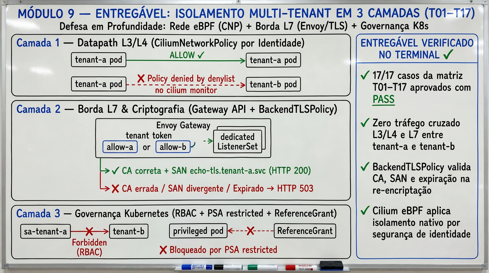

Fonte: elaborada pelo autor (2026).

### 9.1 Três controles diferentes

**Quadro 8 – Controles de isolamento de tenant**

| Controle | Mecanismo | O que impede |
|---|---|---|
| Rede | `CiliumNetworkPolicy` por identidade e porta | A alcançar B e vice-versa em conexões novas |
| Borda | ExternalAuth no listener HTTP | usuário sem credencial na rota protegida |
| Configuração | RBAC + `allowedRoutes` + `allowedListeners` + `ReferenceGrant` + PSA `restricted` | tenant editar policy alheia, criar Gateway de contorno, subir pod privilegiado |

Fonte: elaborado pelo autor (2026).

### 9.2 Ler um drop de policy

~~~bash
ks get ciliumnetworkpolicies -A
ks -n kube-system exec ds/cilium -- \
  cilium-dbg monitor -t drop --related-to 0 2>/dev/null | head -20
~~~

Com o instrutor gerando tráfego A→B, você deve ver drops com `Policy denied` e
o log da aplicação de destino vazio: o pacote não chega. Isso é diferente de
um 403 na borda, que é gerado pelo Envoy antes da aplicação.

### 9.3 Resultados

Todos os 17 casos passaram. Os negativos foram reais: chamadas de API
impersonadas devolveram `Forbidden` (não apenas `can-i`), o PSA
`restricted:v1.35` rejeitou `hostNetwork`, `privileged`, `hostPID` e
`hostPath`, e labels de tenant ausentes ou forjados não executaram. A TLS do
backend (`BackendTLSPolicy`) falhou antes do request HTTP com CA errada, SAN
errado ou certificado expirado.

Um detalhe que muda desenho: o ExternalAuth protege apenas o listener HTTP.
O listener TCP sob a mesma VIP respondeu 200 para o tenant errado até uma CNP
L4 ser aplicada (T07). Autorização L7 não é política L4.

## Módulo 10 — Multi-Pool IPAM: /24 versus /32

Ambiente: sandbox `p003-gw`, com IPAM trocado para `multi-pool` pelo instrutor
e restaurado ao final. Origem: P003-S010, matriz I01–I10. A Figura 12 sintetiza o entregável do módulo.

**Figura 12 – Síntese visual do entregável do Módulo 10: Multi-Pool IPAM /24 vs /32, BGP Communities e retenção preAllocate=8**

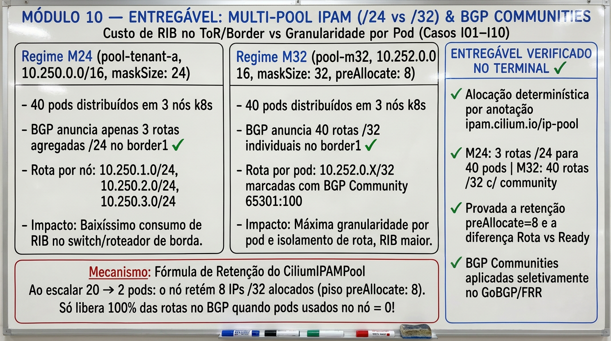

Fonte: elaborada pelo autor (2026).

### 10.1 Dois braços com a mesma variável

**Quadro 9 – Braços M24 e M32 do estudo Multi-Pool IPAM**

| Braço | Pool | `maskSize` | `preAllocate` | Anúncio |
|---|---|---|---|---|
| M24 | `10.250.0.0/16` | 24 | 8 | `CiliumPodIPPool` com community `65301:100` |
| M32 | `10.252.0.0/16` | 32 | 8 | idem |

Fonte: elaborado pelo autor (2026).

~~~bash
ks get ciliumpodippools -o wide
ks get ciliumnodes -o custom-columns=NODE:.metadata.name,POOLS:.spec.ipam.pools.allocated
sudo docker exec clab-p003-gw-fabric-border1 vtysh -c 'show ip bgp' | grep -E '10\.25[02]\.'
~~~

### 10.2 O que muda entre `/24` e `/32`

**Quadro 10 – Comportamento dos blocos `/24` e `/32` no Multi-Pool IPAM**

| Pergunta | M24 | M32 |
|---|---|---|
| Pod novo | cai num `/24` já alocado; zero eventos de bloco | cada pod ganha um `/32`; alocado e anunciado em 1 a 2 s |
| 40 pods | 3 rotas no border | 40 rotas no border, uma por pod |
| Pod `NotReady` sem delete | bloco e rota permanecem; IP direto responde 200; o Service exclui o pod | idêntico |
| Apagar 1 pod | bloco retido: `roundUp(inUse+8, 8)` não encolhe | idêntico; o piso de `preAllocate` domina |
| Voltar a zero pods | blocos `/24` retidos por mais de 120 s | encolhe em 42 s no operador e 48 s na RIB, até o piso de 8 `/32` por nó |
| Recriar pod no mesmo nó | IP novo dentro do mesmo `/24` | alterna entre `/32` recém-liberados; sem IP estável |
| Peer BGP do border desligado | prefixos somem em ~10 s; pod e VIP dão 000 | idêntico |

Fonte: elaborado pelo autor com dados de P003-S010, matriz I01–I10 (2026).

Duas lições. O datapath não gateia readiness: rota e alcance direto ao pod
existem enquanto o IP existir, e só o Service respeita `Ready`. A retirada de
um bloco depende de `preAllocate`, não da morte do pod; um `/32` não é
"retirado quando o pod morre".

## Módulo 11 — Tenant híbrido: pods e VMs OpenStack

Ambiente: sandbox `p003-gw` + testbed OpenStack + VM em KVM real. Origem:
P003-S011 a S016. As sínteses públicas completas estão em
[E08](estudos/08-lifecycle-synthesis.md) e [C5](estudos/09-vm-outside-container.md). A Figura 13 sintetiza o entregável do módulo.

**Figura 13 – Síntese visual do entregável do Módulo 11: Tenant híbrido Pod K8s ↔ VM KVM/OpenStack e contraste Identidade (fromEndpoints) vs IP (fromCIDR)**

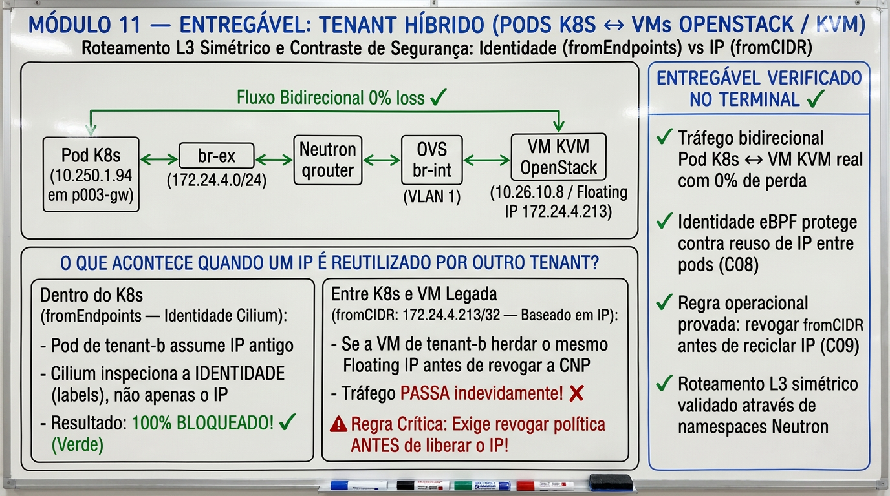

Fonte: elaborada pelo autor (2026).

### 11.1 A pergunta

Um IP pode mudar de dono. Se a autorização for por endereço, o novo dono herda
a concessão. A matriz C01–C09 responde: **a autorização segue a identidade ou
o endereço?**

### 11.2 O caminho VM → pod

~~~text
VM (tap) → OVS br-int (VLAN 1) → qrouter netns → br-ex → veth para o host
  → FORWARD do host → fabric do sandbox → nó worker → CNP ingress → pod
~~~

O testbed incluiu o serviço `neutron-dynamic-routing` (OpenStack, [2026]) para a
ligação eBGP com o `border1`. Há dois pontos de decisão: o Security Group na porta da VM (plano de controle
do Neutron) e a CNP no pod (drop antes do pod; os contadores do pod ficam
flat). Para provar que o deny foi na policy e não na rede, use `cilium-dbg
monitor` no worker do pod e os contadores `/proc/net/snmp` dentro do pod.

### 11.3 O contraste que importa

**Quadro 11 – Autorização por identidade versus por endereço (C03 e C05)**

| Aspecto | C03: pods, `fromEndpoints` | C05: VM, `fromCIDR` |
|---|---|---|
| Âncora da autorização | label do endpoint (identidade) | IP da origem (endereço) |
| IP reaproveitado por outro dono | negado, 100% de perda | permitido, o novo dono herda |
| Reautorizar após IP novo (C04) | n/a | efetivo em 4 a 9 s |
| Revogar (C05) | n/a | efetivo em 1 a 7 s |
| Conclusão | seguro | seguro só sob sequenciamento manual |

Fonte: elaborado pelo autor com dados de P003-S011 a P003-S016 (2026).

Sequenciamento manual testado: revogar o CIDR, confirmar o bloqueio por
conexões novas, só então reutilizar o IP e reautorizar o novo dono. Nenhum
controlador sincroniza identidade Kubernetes com Security Group Neutron nesta
trilha.

Três armadilhas do Cilium 1.20.2 nesse desenho: `egress: []` não é default
deny (use `egressDeny`), `ingress: []` é inválido (revogue apontando o
`fromCIDR` para um IP que a VM não tem) e uma `HTTPRoute` ampla com `path: /`
faz fallback quando a rota específica é removida, tornando a revogação por
rota ineficaz.

### 11.4 Caso C5: a VM precisa de KVM real

Com a VM dentro do container do testbed (KVM aninhado), a TX funciona e a RX
morre: o sentido pod→VM dava timeout. Movendo a VM para `qemu -enable-kvm` no
host e ligando sua NIC ao `br-int` do container por um par veth com
`tag=1`, os dois sentidos deram 0% de perda, o IP veio do `qdhcp`, o egress
passou pelo `qrouter` e o SG ficou ativo. A CNP no pod de teste permitiu com
`fromCIDR` igual ao IP da VM e negou com 100% de perda ao retirá-la.

A pessoa estudante confere, com o instrutor:

~~~bash
ks -n p003-test get pods -o wide
ks -n p003-test exec echo-0 -- ping -c 3 -W 2 10.30.0.50
ks -n p003-test get cnp -o yaml | grep -A3 fromCIDR
~~~

Se a VM cair em `169.254.x.x`, a causa está em uma de duas coisas: falta a tag
VLAN no veth do container, ou o dnsmasq do `qdhcp` não recarregou o
`dhcp-hostsfile` (`kill -HUP`). Capture o DHCP nas duas pontas para isolar.

## Módulo 12 — Nós reais na nuvem: o que muda

Origem: P002-S005 e P002-S006. Este módulo é leitura; a infraestrutura de
nuvem não faz parte da aula. A Figura 14 sintetiza o entregável do módulo.

**Figura 14 – Síntese visual do entregável do Módulo 12: Nós reais na nuvem, eBGP na VPC e impacto do IP Spoofing Guard da NIC**

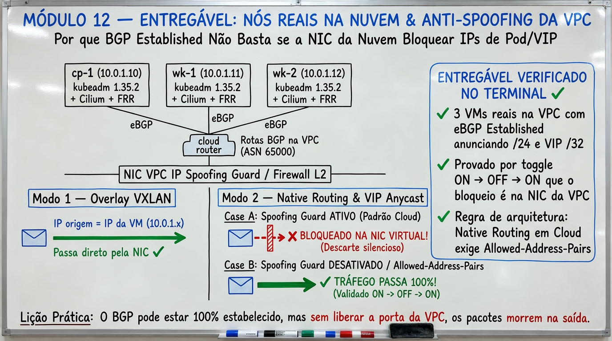

Fonte: elaborada pelo autor (2026).

Em três VMs reais da nuvem, `kubeadm` 1.35.2 sem kube-proxy e Cilium 1.20.1
funcionaram 1:1 com overlay VXLAN (MTU 1450, RTT ~0,9 ms). Um FRR externo na
mesma VPC recebeu por eBGP os três PodCIDR `/24` e a VIP anycast `/32` com
ECMP de três next-hops: o cenário do lab reproduziu-se em fabric real.

O que a plataforma bloqueou é a lição: com o guard de spoofing de IP da porta
ligado, SYNs com origem de pod saíam da NIC e não voltavam, e pacotes com
destino que não é o IP da porta (VIP anycast, IP de pod) eram descartados
antes do nó. A prova causal foi um toggle ON→OFF→ON na porta de um único nó:
com OFF, pod direto, VIP por BGP, VIP por rota estática e conexão nova
pod→FRR sem SNAT funcionaram; com ON, apenas NodePort. A API reportou `false`
antes de o datapath aceitar; um canário FRR→pod é o único readiness confiável.

Para native routing ou VIP anycast em nós reais, a porta precisa aceitar
origens e destinos além do seu próprio IP, por allowed-address-pairs ou guard
desligado. Isso é uma decisão de postura de segurança da VPC, não um ajuste
do Cilium.

## Módulo 13 — DCI, OVN, FRR e EVPN: o que os resultados provam

Este módulo é uma leitura guiada dos resultados históricos completos de `P004-S001` a
`P004-S008` (concluídas com **PASS**). Os perfis
`labctl/labs/{dci,evpn-fabric,ovnk,p003-gw}.sh` e os artefatos de
`studies/p004/{ovn,evpn-fabric,ovnk,cases,cilium-a,cilium-b}/` estão no repositório como
referência de instrutor, mas a atividade deste módulo é interpretar as medições
comparadas sem depender do estado atual da VM. A Figura 15 sintetiza o entregável do módulo.

**Figura 15 – Síntese visual do entregável do Módulo 13: Síntese P004 (DCI Connect, OVN-Kubernetes + EVPN, Braços Cilium A/B + KubeVirt, R6=0 e INV-PoC-01..06)**

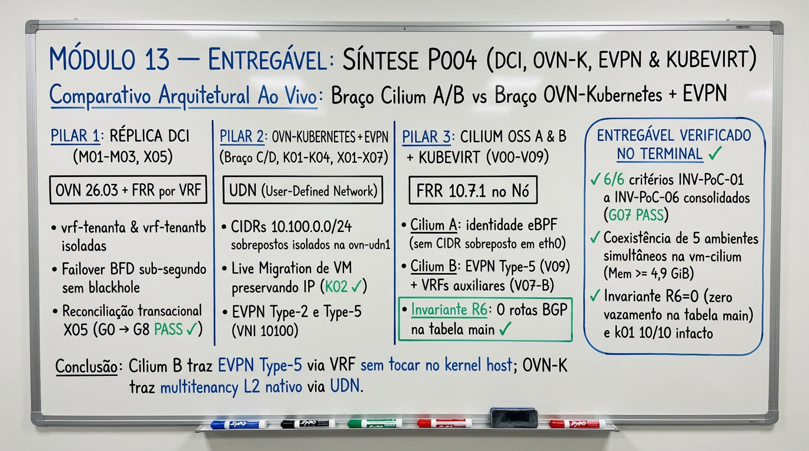

Fonte: elaborada pelo autor (2026).

### 13.1 Plano DCI Connect (P004-S002): OVN, FRR multi-VRF e X05

**Figura 16 – Caminhos históricos da réplica DCI, com o cliente legado e o peer EVPN separados**

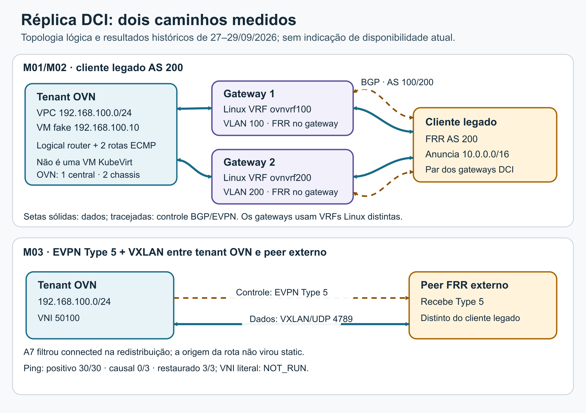

Fonte: elaborada pelo autor (2026).

Nota: topologia lógica dos caminhos medidos na réplica DCI; o desenho não representa um inventário ou estado operacional atual.
O tenant OVN usou a rede `192.168.100.0/24`, com uma VM fake em
`192.168.100.10`. Dois Connect Gateways tinham as Linux VRFs `ovnvrf100` e
`ovnvrf200`, com FRR dentro dos próprios gateways. Cada gateway mantinha uma
sessão BGP com o cliente legado AS 200, que anunciava `10.0.0.0/16`. Esse
caminho sustenta a leitura de M01 e M02. O peer externo usado em M03 e X05 é
outro caminho: ele recebeu as rotas EVPN Type 5 (Rabadan et al., 2021) dos tenants, identificadas pelo
VNI `50100` (tenant A) e pelo VNI `50200` (tenant B em X05); não era o cliente
legado nas VLANs 100 e 200.

**Figura 17 – Estado histórico consolidado das trilhas e gates de P004 (S001 a S008 PASS)**

Fonte: elaborada pelo autor (2026).

Nota: trilha P004 concluída com PASS de S001 a S008 (`G01` a `G08` fechados).
M01 passou com uma exceção de escopo: o fault de FRR parou `bgpd`, `bfdd` e
`zebra` dentro de `ovn-gw-1`, não um container FRR separado. Os gateways usaram
FRR 10.7.0 e o cliente, 8.4.1_git. Withdraw e faults controlados preservaram
o tráfego medido, mas a falha do chassis `ovn-chassis-1` não foi testada; esse
host hospedava a fixture da VM fake e era distinto do plano central OVN.

M02 passou sob o escopo aceito: com MTU 1500, pacotes pequenos passaram 30/30,
mas o pacote IPv4 jumbo de 9000 B com DF não recebeu resposta em 30 tentativas
(0/30) e o roteador devolveu ICMP Frag Needed com MTU 1500. Com MTU 9000, os
pacotes pequenos e jumbo passaram 30/30; depois, as MTUs foram restauradas a
1500. A reprodução literal do fragmento no tap físico da PoC permaneceu parcial.

M03 passou com um controle negativo causal. O positivo alcançou
`192.168.100.0/24` como Type 5 no VNI `50100` e o ping respondeu 30/30. No
controle causal, A7 definiu `dynamic-routing-redistribute=static` na LRP
tenant. Esse filtro excluiu rotas `connected` dos anúncios; não converteu a
origem da rota para `static`. A seleção retirou a rota-alvo do SB, a rota
tenant, o Type 5 e a FIB, e o ping teve 0/3 respostas. BGP, VTEP e duas rotas
colaterais permaneceram. Ao restaurar a chave ao estado ausente, o caminho
voltou e o ping respondeu 3/3. O controle negativo literal do VNI ficou
NOT_RUN: não havia causalidade estabelecida com o withdraw da rota exportada
pelo router/FRR.

X05 fechou com **PASS** em 23/10/2026 (`run c9d0e1` `G0→G8 RC=0` e prova
negativa de rollback `b8c9d0` `G7+G8 PASS`). Um segundo tenant B foi criado com
a **mesma sub-rede** `192.168.100.0/24` (host `192.168.100.10`) e o **mesmo
`/30` de trânsito** `169.254.254.0/30`, isolado no VRF `ovnvrf50200` (VNI
`50200`, RT `65000:50200`). O alcance intra-tenant passou 30/30 nos dois
tenants (`10.250.0.1 -> 192.168.100.10` no VNI `50100` e `10.251.0.1 ->
192.168.100.10` no VNI `50200`), enquanto as quatro direções cross-tenant
tiveram `0/3` respostas e `0` pacotes capturados no `tcpdump` da interface de
destino. Para que o Linux VXLAN bridge do peer desencapsulasse a rota EVPN Type
5 para o roteamento L3 do VRF, o `Router MAC` anunciado pelo gateway precisou
coincidir com o MAC de `br-vxlan50200` (`02:00:00:20:00:01`). O rollback
canônico retirou primeiro os anúncios BGP/EVPN antes de remover os objetos OVN
NB e os VRFs, encerrando com `0` resíduos.

### 13.2 OVN-Kubernetes, UDN/EVPN, KubeVirt e casos cruzados (P004-S003 e P004-S004)

**Figura 18 – Arquitetura comparada de P004 (S002 a S008): OVN-K, Fabric EVPN e Braços Cilium A e B + KubeVirt**

Fonte: elaborada pelo autor (2026).

Nota: comparação experimental entre os braços testados em P004-S002 a P004-S008 com KVM nativo (`/dev/kvm`), EVPN, Cilium 1.20.2 e FRR 10.7.1 (`R6=0`).
Na sessão `P004-S003` (**PASS** em 23/10/2026), os perfis `labctl evpn-fabric`
e `labctl ovnk` subiram um cluster Kind de 3 nós com OVN-Kubernetes `v1.4.0` (OVN-Kubernetes, [2026]),
KubeVirt `v1.9.0` (KubeVirt, [2026]) em KVM nativo (`/dev/kvm`) e `frr-k8s` `v0.0.27`, provando o
gate **`G03`** (`K01–K04`):
- **K01 (UDN com CIDR sobreposto):** duas `UserDefinedNetwork` primárias (`tenant-a` e `tenant-b`) usaram o mesmo CIDR `10.100.0.0/24`; as VMs `vm-a` e `vm-b` receberam o **mesmo IP `10.100.0.14`**, responderam `30/30` dentro do próprio tenant e tiveram `0/30` entre tenants.
- **K02 (Live Migration com IP e sessão preservados):** `virtctl migrate vm-a` moveu a VM entre `ovnk-worker` e `ovnk-worker2` em `~16 s`, preservando o IP `10.100.0.14/24` na UDN Layer2 com **`0%` de perda de pacotes ICMP** (`60/60`) e **sobrevivência da sessão TCP longa**.
- **K03 e K04 (EVPN Type 5 e Lift-and-Shift):** `ClusterUserDefinedNetwork` (`10.200.0.0/24`) anunciada via `RouteAdvertisements` + `frr-k8s` ao `evpn-fabric` (VNI `10100`, `30/30` positivo, `0/10` negativo) e preservação de IP fixo legado (`192.168.50.10/24` em `K04`).

Na sessão `P004-S004` (**PASS** em 24/10/2026), os casos cruzados `X01–X04`,
`X06` e `X07` integraram simultaneamente os planos `dci`, `evpn-fabric` e
`ovnk` + KubeVirt, provando os gates **`G04`** e **`G05`**: conectividade fim a
fim do tenant unificado (`X01`, `30/30`), isolamento em 3 planos com
`10.200.0.0/24` e `10.0.0.0/24` sobrepostos (`X02`, `0` pacotes vazados),
filtragem por BGP community (`X03`), bloqueio de Route-Target incorreto
(`X04`, `0/30`), detecção de colisão de CIDR em VRF hub (`X06`) e extensão L2
em `MAC-VRF` EVPN Type 2 (Sajassi et al., 2015) com mesmo CIDR `172.16.50.0/24` (`X07`, VNIs `20100`
vs `20200`).

### 13.3 Braço Cilium A: Cilium 1.20.2 com KubeVirt v1.9.0 (P004-S005)

Na sessão `P004-S005` (**PASS** em 24/10/2026), o KubeVirt `v1.9.0` foi
instalado no cluster sandbox `p003-gw` (`Cilium 1.20.2`) após descer
`ovnk`/`evpn-fabric`/`dci` via `labctl down` (cumprindo `MemAvailable >= 4 GiB`),
e os casos **`V00–V06` (`C01–C06`)** foram medidos ao vivo:
- **V00 e V01 (`C01` — Datapath KVM e `CiliumEndpoint`):** a VM CirrOS `vm-a` (`binding: masquerade` sobre `/dev/kvm`) comunicou-se bidirecionalmente com pods (`30/30` nos dois sentidos; `0/30` com `runStrategy=Halted`). No Cilium, o pod `virt-launcher` apareceu como `CiliumEndpoint` (`cep_id=242`, `sec_identity=172890`, `ip=10.245.2.231` no `PodCIDR` `10.245.2.0/24`), enquanto o guest interno operou com `eth0 = 10.0.2.2/24`.
- **V02 e V03 (`C02`/`C03` — VIP BGP `/32` e `CiliumNetworkPolicy`):** o `Service LoadBalancer vm-a-vip` (`10.202.255.20/32`, `bgp-advertise=true`) foi anunciado em `border1` (`30/30` HTTP 200 de `198.19.0.10`, withdraw em `8 s` -> `0/30`). A `CiliumNetworkPolicy` por label (`fromEndpoints: app=p004-client-a`) permitiu `30/30` de `client-a` e bloqueou `0/30` de `client-b` com `18` drops `Policy denied` no `cilium-dbg monitor`.
- **V04 (`C04` / Gate `G01` — Reuso determinístico de IP `/32` vs Identidade Cilium):** usando o pool `p004-single-ip` (`10.253.0.100/32`), `vm-a-reuse` (`sec_id=163024`, `ip=10.253.0.100`) obteve `30/30 ALLOW` em `target-srv:8080`. Após sua deleção, `vm-b-reuse` herdou o **mesmo IP `10.253.0.100`**, mas recebeu `sec_id=133690 != 163024` e obteve **`0/30 ALLOW`** sob `fromEndpoints(app=p004-vm-a)` (`25` drops `Policy denied`), enquanto uma ACL ancorada exclusivamente em IP (`-s 10.253.0.100/32`) concedeu `30/30 ALLOW` ao IP reutilizado.
- **V05 (`C05` / `H3` — Live Migration no Cilium OSS):** a migração de `p003-gw-worker` (`10.245.2.190`) para `p003-gw-worker2` (`10.245.1.23`) em `22 s` trocou o IP do `virt-launcher` e derrubou a sessão TCP aberta para o podIP antigo (`tcp_long_survived=no`), enquanto a VIP BGP `10.202.255.20/32` reconvergiu automaticamente (`max_gap_ms=3000.0ms`).
- **V06 (`C06` / `H4` — Multi-Pool `/32` BGP + Migração + Rollback):** em `ipam.mode=multi-pool` (`p004-vm`, `maskSize: 32`), `vm-a` recebeu `10.252.0.23/32` (`30/30` probes diretos de `198.19.0.10` via `border1`); após migrar para `worker2`, recebeu `10.252.0.4/32` (`30/30` probes diretos, enquanto `10.252.0.23/32` ficou retido no `CiliumNode` de origem pelo piso `multiPoolPreAllocation`). Ao final, o rollback restaurou `p003-gw` a `ipam.mode=kubernetes` (`0` pools residuais) com `labctl p003-gw verify` e `labctl k01 verify` aprovados.

### 13.4 Negativos do Braço A, Braço Cilium B e síntese INV × aberto (P004-S006 a P004-S008)

Nas sessões `P004-S006`, `P004-S007` e `P004-S008` (**PASS**), o estudo concluiu a comparação empírica entre **Cilium A**, **Cilium B**, **OVN-Kubernetes (`C/D`)** e **INV**:
- **Negativos e Fronteira do Braço Cilium A (`P004-S006` — `V07-A`, `V08-A`, `C-neg` / Gate `G02`):**
  - **V07-A (`C07` / `H5` — Sub-redes Sobrepostas no Cilium OSS):** dois namespaces compartilhando o mesmo CIDR (`10.250.0.0/24` / `10.253.10.0/24`) caem na mesma tabela de roteamento flat (`vrf_count=0`, sem isolamento L3), e dois pods solicitando o mesmo pool `/32` (`10.253.10.100/32`) no mesmo nó falham no segundo pod com `putEndpointIdInvalid "IP ipv4:10.253.10.100 is already in use"` por colisão no mapa BPF global `cilium_lxc`.
  - **V08-A (`C08` / `H8` — Cutover de VM Legada via `/32` BGP):** uma VM legada QEMU/KVM (`10.60.0.50/24` na `leaf1`, `30/30` HTTP) foi migrada por cutover para uma VMI KubeVirt anunciando `10.60.0.50/32` (`CiliumPodIPPool`, LPM `/32` sobre `/24` na `border1` em `25 s`, `cutover_total_s=39 s`, `30/30` HTTP).
  - **C-neg (`G02`):** a API BGP v2 do Cilium rejeita `vrf`/`evpn`/`l2vpn` (`strict decoding error`), não instala rotas recebidas no kernel (`proto bgp = 0`) e não propaga a identidade eBPF (`sec_id`) no cabeçalho IP externo.
- **Braço Cilium B — `FRR 10.7.1` no Nó sob Invariante `R6=0` (`P004-S006` e `P004-S007` — `H6`/`G06`, `V09`/`H7`, `V07-B`, `V08-B`):**
  - **H6 (`G06`):** o `DaemonSet/frr-node` (`FRR 10.7.1`) pareia localmente com o GoBGP do Cilium (`10.255.255.1:1790`) e com os switches ToR (`leaf1`/`leaf2`), mantendo **`r6_kernel_bgp_routes = 0`** na tabela `main` via `table-map RM-NO-KERNEL` para proteger o datapath eBPF do Cilium.
  - **V09 (`H7`) e V07-B:** nas VRFs Linux do nó (`vrf-tenant-a` `VNI 10100` `RT 65000:10100` e `vrf-tenant-b` `VNI 10200` `RT 65000:10200`), o FRR anuncia e importa rotas **EVPN Type 5 (`[5]`)** e isola CIDRs/IPs idênticos (`10.253.10.0/24`, `10.253.10.100/24`) com `30/30` intra-VRF, `0/10` cross-VRF e `R6=0`, comprovando porém que a interface primária `eth0` dos pods/VMs continua presa ao mapa global `cilium_lxc`.
  - **V08-B:** cutover `10.60.0.50/32` via `Cilium GoBGP -> FRR 10.7.1 no nó -> border1` (`AS_PATH 65203 65600 65201 65301 65311`, `Community 65301:100`, `rib_em=27 s`, `cutover_total=40 s`, `30/30` HTTP, `R6=0`).
- **Síntese `INV × Equivalente Aberto` (`G07`) e Higiene Final (`G08`) (`P004-S008`):**
  - O blueprint da Fase 2 mostra que a combinação aberta **Cilium A (clusters cloud-native/L7)** + **OVN-Kubernetes `C/D` (clusters KubeVirt com `same-CIDR` `K01`, Live Migration L2 `K02` e EVPN Type-2/Type-5 `K03`/`X01`/`X07`)** atende 100% dos requisitos sem lock-in, enquanto uma PoC comercial do **INV** deve ser julgada pelos seis critérios objetivos **`INV-PoC-01` a `INV-PoC-06`** documentados em [`20-dci-estado-parcial.md` §4.2](estudos/20-dci-estado-parcial.md).

### 13.5 Exercícios de interpretação

1. Por que a limitação “sem VRF” dos módulos Cilium OSS não descreve o braço DCI (`S002`) nem o plano OVN-Kubernetes (`S003–S004`)?
2. Por que a Live Migration preservou o IP `10.100.0.14` e a sessão TCP no OVN-Kubernetes (`K02`), mas trocou o IP do `virt-launcher` no Cilium OSS (`V05` e `V06`)?
3. Como `V04` provou com o pool de IP único `10.253.0.100/32` que `fromEndpoints` revoga o acesso no reuso de IP entre duas VMs, ao contrário de uma regra baseada apenas no endereço IP?
4. Por que o `table-map RM-NO-KERNEL` (invariante `R6=0`) é indispensável no Braço Cilium B (`H6`/`V09`), e por que mesmo com FRR `10.7.1` no nó a interface primária `eth0` do Cilium não suporta `same-CIDR` entre dois tenants (`V07-A` vs `V07-B`)?

As respostas comentadas, a matriz comparativa completa (`Cilium A` × `Cilium B` × `OVN-K C/D` × `INV`), os critérios de aceite `INV-PoC-01` a `INV-PoC-06` (`G07`) e o mapa de evidências estão em [DCI, OVN-K e Cilium + KubeVirt em P004: consolidação completa de S001–S008](estudos/20-dci-estado-parcial.md).

## Módulo 14 — Estudos avançados P005: conexão dedicada eBGP e datapath eBPF

A trilha **P005** executa os 16 estudos remanescentes (`E09–E19` e `E21–E25`) em quatro ondas paralelas sobre `vm-cilium`, combinando o **Braço A (Plano de Controle eBGP / Direct Connect)** com o **Braço B (Datapath eBPF, Escala e Observabilidade)**. A Figura 19 sintetiza o entregável do módulo.

**Figura 19 – Síntese visual do entregável do Módulo 14: Estudos Avançados P005 (16/16 PASS — Borda eBGP Dedicada ∥ Datapath eBPF, Observabilidade e DRA)**

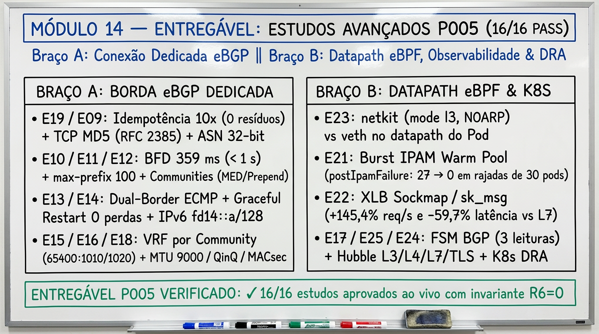

Fonte: elaborada pelo autor (2026).

### 14.1 Onda 1 (P005-S001): idempotência BGP, TCP MD5, netkit e burst IPAM

Onda concluída com **PASS**; estudos `E19`, `E09`, `E23` e `E21`. O `E09` aplica a autenticação TCP MD5 da RFC 2385 (Heffernan, 1998).

- **Braço A — Conexão Dedicada eBGP ([`19-bgp-idempotency-md5-asn32.md`](estudos/19-bgp-idempotency-md5-asn32.md)):**
  - **E19 (Idempotência 10x, Zero Resíduo e Reuso de VIP):** `10` execuções consecutivas de `kubectl apply` sobre os CRDs BGP (`CiliumBGPClusterConfig`, `CiliumBGPPeerConfig`, `CiliumBGPAdvertisement` e `Service LoadBalancer svc-a` com VIP `10.202.255.190/32`) produziram **`0` diferenças** em `route-policies`, `advertised routes` e na RIB JSON de `border1` (`version: 488` inalterada), provando que loops GitOps não causam flaps nem BGP `UPDATE`s espúrios. A remoção limpou `100%` das rotas em `11 s` (`R6=0` rotas `proto bgp` no kernel), e o reuso imediato de `10.202.255.190/32` por `svc-b` respondeu `30/30` HTTP `200` com `0` respostas antigas.
  - **E09 (Sessão eBGP Autenticada TCP MD5 RFC 2385 e ASN de 32 bits `4200000001`):** pareamento entre `p003-gw-worker2` (`AS 65302`) e um roteador CE FRR (`AS 4200000001`) com `authSecretRef` (`bgp-secrets-namespace=kube-system`, timers `3/9 s`, Graceful Restart). A célula positiva convergiu em `3 s` com **TCP Option 19 (`md5`)** provada no `tcpdump`; a senha divergente bloqueou apenas o peer inválido (`TcpExtTCPMD5Failure=2`, mantendo `3/3` sessões do fabric Clos intactas); o `Secret` ausente falhou de forma segura (`restarts=0`); e a rotação de senha em produção (`v1 -> v2`) reestabeleceu a sessão em **`9,39 s`** anunciando `198.18.209.0/24` com `AS_PATH` de 4 bytes (`0xfa56ea01`).
- **Braço B — Datapath eBPF e Escala de Alocação ([`21-netkit-vs-veth-ipam-burst.md`](estudos/21-netkit-vs-veth-ipam-burst.md)):**
  - **E23 (`netkit` vs `veth` no Cilium `1.20.2` / Kernel `6.8`):** provou a guarda fail-closed do `cilium-agent` ao alternar `veth -> netkit` com pods `veth` ativos no nó (`detected 1 existing endpoint(s) using incompatible datapath-modes`). Após recriação dos pods em `datapath-mode=netkit` (`mode l3`, `NOARP`, MAC `00:00:00:00:00:00`), o throughput TCP `iperf3` **eliminou 100% das retransmissões TCP** (`47 -> 0` same-node, `11 -> 0` cross-node) e reduziu softirqs `NET_RX` em **`-8,9%`** (same-node) e **`-20,5%`** (cross-node), preservando o bloqueio por `CiliumNetworkPolicy` (`leaked_pkts=0`).
  - **E21 (Escala de Burst IPAM e Warm Pool `multiPoolPreAllocation`):** em rajadas de `16` pods simultâneos (`agnhost:2.47` local), `ipam.mode=kubernetes` convergiu em `5,40 s` (`2,96 pods/s`, `0` falhas); `multi-pool` frio (`multiPoolPreAllocation="default=8,e21-burst-pool=1"`) sofreu **`27` falhas `postIpamFailure` (`502`)** enquanto aguardava o `cilium-operator` alocar blocos no `CiliumNode`; já o `multi-pool` pré-aquecido (`multiPoolPreAllocation="default=8,e21-burst-pool=32"`) **reduziu de `27` para `0` (`-100%`) as falhas de `CNI ADD` / `FailedCreatePodSandBox`**. O controle negativo com pool `/29` (`6` IPs utilizáveis para `10` pods) manteve `6 Running` e `4 Pending` sem degradar outros pools.

### 14.2 Onda 2 (P005-S002): limite de prefixos, communities, BFD e XLB

Onda concluída com **PASS**; estudos `E11`, `E12`, `E10` e `E22`. Os estudos usam BGP communities (Chandra; Traina; Li, 1996) e BFD (Katz; Ward, 2010).

- **Braço A — Fronteira PE/CE na Borda eBGP ([`11-bgp-maxprefix-communities-bfd.md`](estudos/11-bgp-maxprefix-communities-bfd.md)):**
  - **E11 (Limite de Prefixos `maximum-prefix` e Filtro de Import `prefix-list`):** o Cilium OSS `1.20.2` manteve a sessão `established` ao receber `50`, `200` e `300` prefixos de um CE FRR (`Received: 51 -> 201 -> 301` na `Adj-RIB-In` de `cilium-dbg bgp peers`, sem `max-prefix` nem filtro de import na API BGP v2) e sem instalar rotas no kernel (`kernel_proto_bgp_routes=0`, `R6=0`, route learning recusado na CFP `#34841` de Dswaffordcw (2024)). No PE FRR (`border1`) configurado com `ip prefix-list E11-IMPORT-ALLOW` (`permit 198.18.0.0/16 le 32`) e `maximum-prefix 100`, os `50` prefixos declarados (`198.18.1.1/32..198.18.1.50/32`) foram aceitos, o prefixo não declarado (`198.51.100.99/32`) foi bloqueado (`% Network not in table`, `0` entradas na RIB) e o envio de `200` e `300` prefixos derrubou automaticamente a sessão com `Idle (PfxCt)` (`Maximum-prefix exceeded`).
  - **E12 (Communities `65400:100` / `65400:200`, `AS-path prepend` e `MED`):** anunciando a mesma VIP `10.202.255.192/32` com `65400:100` em `rack1` (`p003-gw-worker`, `AS 65301`) e `65400:200` em `rack2` (`p003-gw-worker2`, `AS 65302`), ambos os next-hops (`10.255.212.1 via e12r1b` e `10.255.212.5 via e12r2b`) foram instalados em ECMP de 2 vias (`multipath`) sem `route-map` em `border1`. Ao aplicar `RM-E12-RACK1-IN`, `RM-E12-RACK2-IN` e `RM-E12-TO-CE` em `border1` (`65400:100 -> metric 10`; `65400:200 -> metric 200 + as-path prepend 2x`), **`10/10` (`100%`)** das requisições de `frr-e12-ce` atingiram `e12-echo-rack1` (`p003-gw-worker`, `AS 65301`). Invertendo apenas as communities nos `CiliumBGPAdvertisement`s do Kubernetes, **`10/10` (`100%`)** das requisições migraram em `4 s` para `e12-echo-rack2` (`p003-gw-worker2`, `AS 65302`) sem tocar na CLI do roteador de borda.
  - **E10 (Detecção de Falha sem e com BFD `< 1 s`):** sob falha silenciosa de enlace (`iptables DROP` sem `TCP RST`/`FIN`), o Cilium com timers `3/9 s` convergiu em **`8901 ms`** (`> 1000 ms`) e no piso da API BGP v2 (`1/3 s`, `holdTimeSeconds=2` rejeitado pelo CRD) convergiu em **`3045 ms`** (`> 1000 ms`). O pareamento `FRR PE <-> FRR CE` protegido por **BFD (`100 ms × 3`)** detectou a falha e retirou a rota `198.18.210.0/24` em **`359 ms < 1000 ms`**, cumprindo `RNF05`.
- **Braço B — Interposição L7 eBPF na Camada de Sockets vs Envoy L7 ([`22-xlb-ebpf-socket-lb-vs-envoy.md`](estudos/22-xlb-ebpf-socket-lb-vs-envoy.md)):**
  - **E22 (`XLB Sockmap/sk_msg L7` vs `SocketLB L4` vs `Envoy L7`):** em `100` requisições HTTP sequenciais (`keep-alive` desabilitado) em `e22-svc:8080`, a interposição `Envoy L7` (`CiliumNetworkPolicy` HTTP `e22-l7-http`, `server: envoy`) apresentou latência média de `1,014 ms` (`p95=1,418 ms`, `985,9 req/s`, `NET_RX delta=1692`); o `SocketLB L4` (`bpf-lb-sock-hostns-only=false`) reduziu a latência em `-61,3%` (`0,392 ms`, `p95=0,465 ms`, `2550,9 req/s`, `NET_RX delta=1309`); e o mecanismo **XLB-style Sockmap + `sk_msg` L7** (`BPF_MAP_TYPE_SOCKHASH` + `BPF_PROG_TYPE_SOCK_OPS` + `BPF_PROG_TYPE_SK_MSG`) atingiu **`0,413 ms` de latência média (`-59,3%` vs Envoy), `2418,9 req/s` (`+145,4%` vs Envoy) e o menor consumo de softirqs `NET_RX` (`1220`, `-27,9%` vs Envoy e `-6,8%` vs SocketLB L4)**, executando `sk_msg_redirected=160` redirecionamentos in-kernel (`bpf_msg_redirect_hash`) e bloqueando `GET /deny` diretamente em `sendmsg()` (`SK_DROP`, `curl_rc=55`), além dos controles negativos `403` em `GET /deny` (Envoy L7), `rc=28` (tenant não autorizado) e `rc=7` (`0` réplicas).

### 14.3 Onda 3 (P005-S003): dual-border, Graceful Restart, eBGP IPv6 e observabilidade

Onda concluída com **PASS**; estudos `E13`, `E14`, `E17` e `E25`. O `E13` compara o failover com e sem Graceful Restart (Sangli et al., 2007).

- **Braço A — Alta Disponibilidade Dual-Border, Graceful Restart e eBGP IPv6 Nativo ([`13-bgp-dual-border-gr-ipv6.md`](estudos/13-bgp-dual-border-gr-ipv6.md)):**
  - **E13 (Redundância Dual-Border ECMP, Failover Controlado e Restart do `cilium-agent` com/sem GR):** com `p003-gw-worker` (`AS 65301`) pareado a `border1` (`AS 65400`) e `p003-gw-worker2` (`AS 65302`) pareado a `frr-e13-border2` (`AS 65401`) anunciando a VIP `10.202.255.193/32` para `frr-e13-client` (`AS 65513`), o cliente balanceou o tráfego em ECMP (`rack1=12/30`, `rack2=18/30`), convergiu imediatamente para `border2` (`rack2=20/20`) durante `neighbor 10.255.213.10 shutdown` com **`0` falhas (`71/71` HTTP `200`, `max_gap_ms=115 ms`)** e restaurou o ECMP (`rack1=13/30`, `rack2=17/30`) após `no shutdown`. Em caminho único (`p003-gw-worker2 <-> frr-e13-border2`), o restart forçado do `cilium-agent` com `gracefulRestart.enabled: true` (`restartTimeSeconds: 30` + `bgp graceful-restart preserve-fw-state`) preservou a rota `(stale)` na FIB e os mapas eBPF no kernel com **`139/139` respostas HTTP `200` (`0` perdas, `max_gap_ms=117 ms`)**, ao passo que o controle negativo sem GR (`enabled: false`) expurgou imediatamente a rota e provocou **`78` falhas (`max_gap_ms=8879 ms`)**.
  - **E14 (Sessão eBGP IPv6 Dedicada `fd00:10:255:214::/64` e VIP `fd14::a/128` Fim a Fim):** resolveu experimentalmente a limitação de `P002-S001`: na Célula 1, anunciar `ipv6/unicast` sobre sessão TCP IPv4 (`10.255.214.1 <-> 10.255.214.2`) gera next-hop IPv4-mapped `::ffff:10.255.214.1` (`::ffff:aff:d601`) incompatível com encaminhamento IPv6 nativo; na Célula 2, com sessão TCP/179 puramente IPv6 (`fd00:10:255:214::1 <-> fd00:10:255:214::2`), `border1` e `frr-e14-client` (`fd00:198:19::10`) instalaram `fd14::a/128` com next-hop IPv6 nativo e serviram **`30/30` requisições HTTP IPv6 (`http://[fd14::a]:8080/hostname`)**, com withdraw negativo em `2 s` (`5/5` bloqueados) e restauração (`5/5` HTTP `200`).
- **Braço B — Observabilidade Contínua BGP (`ACTIVE`/`DOWN`/`UNKNOWN`) e Microsserviços com Hubble ([`17-bgp-hubble-observability.md`](estudos/17-bgp-hubble-observability.md)):**
  - **E17 (Máquina de Estados BGP por 3 Leituras Consecutivas e Fronteira de Visibilidade):** amostrando `:9962/metrics` e `cilium-dbg bgp peers` a cada `3 s`, um flap curto de `2` leituras `0` (`max_down_streak=2/3`) foi amortecido mantendo `derived=ACTIVE` (`false_down=0`); um flap sustentado (`>= 3` leituras `0`) transicionou `ACTIVE -> DOWN` em **`7596 ms`** e retornou `DOWN -> ACTIVE` em **`11166 ms`** após `3` leituras `1` consecutivas; `3/3` falhas de scrape (`:19962`) transicionaram deterministicamente para **`UNKNOWN`**; e a inspeção da RIB de `border1` comprovou que o `AS_PATH` completo (`65203 65600 65201 65301`) e as communities (`65301:100`) só são visíveis no roteador de borda.
  - **E25 (Visibilidade Hubble `L3/L4`, `L7 HTTP/DNS`, `TLS :8443` e Prometheus `:9965`):** no cluster `p003-gw`, o Hubble registrou `hubble_forwarded=302`, `hubble_dropped_policy=10` (`Policy denied`) e `hubble_from_ip_198_19=120` fluxos norte-sul preservando o IP externo `198.19.0.10` (`externalTrafficPolicy: Local`); no proxy Envoy L7, capturou `hubble_l7_200=10` (`GET /hostname`), `hubble_l7_403=5` (`DROPPED` em `GET /denied`) e `hubble_l7_dns=20`; em TLS `:8443`, capturou `hubble_8443_l4_flows=92` com identidade Cilium visível e **`0` vazamentos de URL L7 (`hubble_8443_l7_cleartext_leak=0`)**; e correlacionou as métricas Prometheus (`hubble_flows_processed_total=2836`, `hubble_drop_total=65`, `hubble_http_requests_total=15`, `hubble_dns_queries_total=8`) com a continuidade do ring buffer local (`Ok (3,015/4,095 flows)`) durante indisponibilidade do Relay (`:4245`).

### 14.4 Onda 4 (P005-S004): VRF por tenant, modos de retorno, enlace L2 e DRA

Onda concluída com **PASS**; estudos `E15`, `E16`, `E18` e `E24`. O `E18` compara QinQ (Institute of Electrical and Electronics Engineers, 2006) e MACsec (Institute of Electrical and Electronics Engineers, 2018) com o WireGuard; o `E24` usa a Dynamic Resource Allocation do Kubernetes (Kubernetes Authors, 2026).

- **Braço A — VRF por Tenant, Terminação PE/CE & Retorno, e Camada de Enlace L2 ([`15-bgp-vrf-return-paths-l2-mtu-qinq-macsec.md`](estudos/15-bgp-vrf-return-paths-l2-mtu-qinq-macsec.md)):**
  - **E15 (Isolamento de VRF por Tenant no Border via BGP Community):** como o Cilium OSS não possui VRF na BGP Control Plane, `p003-gw-worker` (`AS 65301`) anunciou numa única sessão eBGP (`10.255.215.1 <-> 10.255.215.2`) três VIPs tagueadas com communities distintas: `10.202.255.195/32` (`65400:1010`), `10.202.255.196/32` (`65400:1020`) e `10.202.255.199/32` (`65400:9999`). No PE `frr-e15-pe` (`AS 65400`), `route-map RM-E15-IMPORT-A/B` + `import vrf default` importaram seletivamente `10.202.255.195/32` exclusivamente em `vrf-e15-a` (`table 1510`) e `10.202.255.196/32` exclusivamente em `vrf-e15-b` (`table 1520`), servindo **`30/30` HTTP `200` intra-tenant** (`e15-echo-a` e `e15-echo-b`) e bloqueando **`0/5` em todas as tentativas cross-tenant** (`Client A -> VIP B`, `Client B -> VIP A`, `Client A -> Client B` e community não autorizada `65400:9999`), com `R6=0`.
  - **E16 (Desenho de Terminação PE/CE, 3 Modos de Retorno e `CiliumEgressGatewayPolicy`):** avaliou os três desenhos de retorno para prefixos externos anunciados pelo cliente:
    - *Modo 1 (Rota estática no nó, `R6=0`):* sem rota de retorno no kernel Linux para `198.19.16.0/24`, o tráfego falha com **`0/3` HTTP** mesmo quando o GoBGP do Cilium mostra `Received: 2`; adicionando `ip route replace 198.19.16.0/24 via 10.255.216.2 dev eth16`, o serviço responde **`30/30` HTTP `200`** mantendo `R6=0`.
    - *Modo 2 (FRR co-implantado no nó com `prefix-list`):* sem rota para `198.19.116.0/24`, `0/3` HTTP; com daemon FRR auxiliar no nó (`frr-e16-node`, `AS 65316`, `10.255.216.3`) importando `198.19.116.0/24` via `E16-CUST-ONLY (RM-E16-IN)`, a rota `proto bgp` é instalada no kernel servindo **`30/30` HTTP `200`** e restaurando `R6=0` após encerramento do speaker auxiliar.
    - *Modo 3 (Outbound determinístico com `CiliumEgressGatewayPolicy`):* o pod selecionado (`e16-egress-client`, `egress-authorized=true`) saiu pelo nó gateway (`p003-gw-worker`) com **SNAT determinístico `10.255.216.10` (`30/30` HTTP `200`, `client_ip=10.255.216.10`)**, enquanto o pod não selecionado (`e16-unmatched-client`) saiu com o IP primário `10.255.216.1` e foi bloqueado (`0/5`) pela ACL de borda do PE.
  - **E18 (MTU 9000 Jumbo Frames, QinQ `802.1ad` e MACsec `802.1AE` vs Cilium WireGuard):**
    - *Célula 1 (MTU 9000 & PMTU):* **`30/30` pings `DF=1` de `8972 B` payload (`9000 B` IPv4 / `9014 B` Ethernet, RTT `0,065 ms`)** sobre `mtu 9000` fim a fim vs controle negativo com `e18pe0 mtu 1500` (**`0/5` pings `DF=1`** e captura `ICMP 10.202.255.198 unreachable - need to frag (mtu 1500)`).
    - *Célula 2 (QinQ IEEE 802.1ad):* sessão eBGP `Established` e **`10/10` pings** sobre `S-TAG 100` (`0x88a8`) + `C-TAG 200` (`0x8100`) comprovados via `tcpdump -e` vs controle negativo com `C-TAG 201` divergente (**`0/5`**).
    - *Célula 3 (MACsec IEEE 802.1AE `gcm-aes-128` vs Cilium WireGuard):* sessão eBGP `Established` e **`10/10` pings** sobre `macsec0` (`encrypt on`), com `100%` dos quadros na interface base encapsulados em `ethertype MACsec (0x88e5)` (`OutPktsEncrypted=40`, `InPktsOK=43`, `0` pacotes TCP/179 ou ICMP em claro) vs controle negativo com SAK divergente em `TX SA 1` (**`0/5` pings** e `InPktsNotValid=15`).
- **Braço B — Dynamic Resource Allocation (`resource.k8s.io/v1`) no Cilium ([`24-cilium-dra-network-device.md`](estudos/24-cilium-dra-network-device.md)):**
  - **E24 (DRA `resource.k8s.io/v1` `NetworkDeviceData`, Coexistência `eth0` + `net1`/`net2` e Ciclo de Vida):** provou que o chart estável `cilium-1.20.2.tgz` não embute driver DRA (`0` chaves DRA; branch `feature/dra-driver` `157b5331c727` é experimental), enquanto o Kubernetes `v1.35.0` oferece nativamente `resource.k8s.io/v1` GA (`DeviceClass`, `ResourceClaim`, `ResourceClaimTemplate`, `ResourceSlice`). Publicando o `ResourceSlice` `p003-gw-worker2-cilium-netpool-slice-0` (`driver: network.cilium.io`, `cilium-netdev-0` `net1/mtu=1500` e `cilium-netdev-1` `net2/mtu=9000`), o `kube-scheduler` alocou automaticamente os claims com seletores CEL (`device.attributes["network.cilium.io"].ebpfAttach == true`), o reconciliador `NodePrepareResources` (`reconcile_dra_prepare` / `reconcile_dra_unprepare`) executou **`3x` de forma idempotente** (`ipv4_addrs=1` sem IPs duplicados), preencheu `status.devices[0].networkData` (`ips`, `hardwareAddress`, `interfaceName`) e manteve **`10/10` HTTP `200` no datapath DRA secundário (`10.254.24.10 -> 10.254.24.11` sobre `br-cilium-dra`)** em coexistência com o datapath eBPF primário (`eth0` `10/10` allow, `5/5` deny por `CiliumNetworkPolicy/e24-deny-untrusted` e `10/10` HTTP `200` via BGP VIP `10.202.255.24/32` a partir de `clab-p003-gw-fabric-client`). Nos controles negativos, CEL inválido foi rejeitado na admissão (`undeclared reference to 'nonExistentFunc'`), `rdma == true` e o 3º claim (`e24-net-claim-c-exhausted`) contra pool de 2 dispositivos ficaram `Pending`, a exclusão prematura do claim ativo foi bloqueada pelo finalizer `resource.kubernetes.io/delete-protection`, e o teardown do Pod A executou `Unprepare` limpo (`net1_orfao_em_app_a=0`) realocando imediatamente `cilium-netdev-0` para o 3º claim.

### 14.5 Exercícios de interpretação

1. Por que no estudo `E11` o Cilium OSS mantém a sessão BGP `established` ao receber `300` prefixos e continua com `0` rotas `proto bgp` no kernel (`R6=0`), e por que o `maximum-prefix` e o `prefix-list` de import precisam residir no roteador de borda FRR/SR Linux?
2. Como o estudo `E13` comprova que `gracefulRestart.enabled: true` no Cilium evita perda de pacotes durante o restart do `cilium-agent` (`139/139` HTTP `200`, `0` falhas vs `78` falhas sem GR), e qual papel os mapas eBPF no kernel Linux desempenham enquanto o agente reinicia?
3. No estudo `E16`, por que a presença de uma rota na `Adj-RIB-In` do GoBGP do Cilium (`Received > 0`) não permite que o pod responda ao cliente sem uma rota de retorno na FIB do kernel Linux, e quando escolher entre Rota Estática (Modo 1), FRR no Nó (Modo 2) ou `CiliumEgressGatewayPolicy` (Modo 3)?
4. Qual é a diferença de camada e escopo entre **MACsec (`802.1AE`, `0x88e5`)** e **Cilium WireGuard (`51871/UDP`)** demonstrada em `E18`, e por que o MACsec cifra inclusive a sessão TCP/179 do eBGP entre nó e ToR/PE?
5. Como o estudo `E24` (`resource.k8s.io/v1` DRA) preserva a governança do Cilium na interface primária `eth0` (`CiliumNetworkPolicy` + BGP VIP) enquanto anexa interfaces secundárias dedicadas (`net1`/`net2`) publicadas em `status.devices[].networkData`?

## Módulo 15 — Trilha P006: datapath avançado, multicluster, SRv6 e saneamento

A trilha **P006** conclui a Fase 2 do projeto em quatro ondas paralelas sobre `vm-cilium`, combinando o **Braço A (Datapath eBPF Avançado e Borda BGP `E26–E29`)**, o **Braço B (Multi-Cluster, SRv6 L3VPN, Runtime Security e Live Migration `E30–E33`)** e o **Braço C (Saneamento Integral de `revisao-projeto-2026-09-26.md` `Blocos C1–C4`)**, fechando `33/33` estudos (`E01–E33`) em `v2.5.0`. A Figura 20 sintetiza o entregável do módulo.

**Figura 20 – Síntese visual do entregável do Módulo 15: Trilha P006 (E26–E33 + Saneamento C1–C4 — Maglev, BIG TCP, EDT/BBR, Unnumbered, Cluster Mesh, SRv6, Tetragon e Live Migration)**

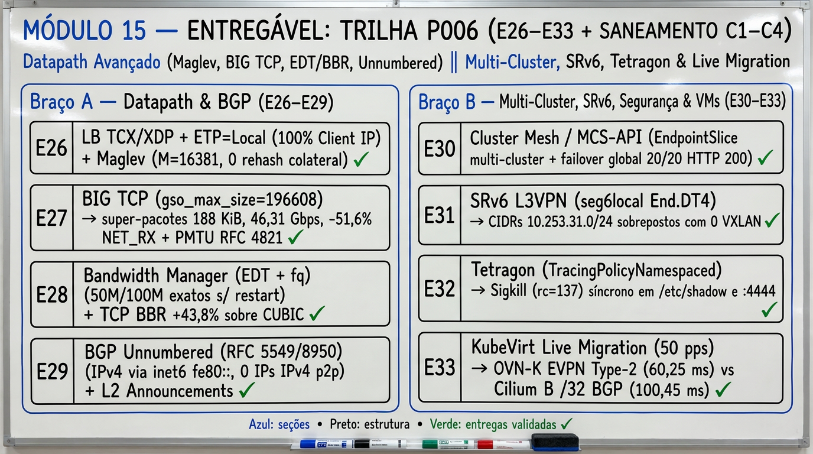

Fonte: elaborada pelo autor (2026).

### 15.1 Onda 1 (P006-S001): LoadBalancer TCX/XDP com Maglev e Cluster Mesh

Onda concluída com **PASS**; estudos `E26` e `E30` e saneamento do `Bloco C1`. O `E26` usa o hashing consistente Maglev (Eisenbud et al., 2016).

- **Braço A — LoadBalancer TCX/XDP, Anúncio BGP Seletivo (`ETP=Local` vs `ETP=Cluster`) e Maglev Consistent Hashing ([`26-lb-xdp-dsr-maglev-clustermesh.md`](estudos/26-lb-xdp-dsr-maglev-clustermesh.md)):**
  - **E26 (`TCX` + `loadBalancer.algorithm=maglev` `M=16381`):** comparou três VIPs BGP (`10.202.255.26/32` `ETP=Cluster` 1 backend em `worker2`, `10.202.255.27/32` `ETP=Cluster` 3 backends e `10.202.255.28/32` `ETP=Local` 1 backend em `worker2`). Na RIB de `border1`, `.26` e `.27` foram anunciadas em ECMP por ambos os workers (`AS 65301` e `AS 65302`), enquanto `.28` (`ETP=Local`) foi anunciada **exclusivamente por `p003-gw-worker2` (`AS 65302`)**, eliminando o salto intermediário e preservando **`100%` (`10/10`) do IP real do cliente externo (`198.19.0.10`)** nos traces do `cilium-dbg monitor`, contra o SNAT de nó (`172.19.0.5`/`172.19.0.6`) observado em `.26`. No anel primo **Maglev (`Table Size: 16381`)** (`[146..148]/v4`), a remoção do 3º backend (`186`) realocou apenas os slots que lhe pertenciam, mantendo **`0` diffs (`0` rehash colateral)** nos slots dos backends sobreviventes (`185` e `187`) e servindo `20/20` HTTP `200`.
- **Braço B — Cilium Cluster Mesh / MCS-API (`EndpointSlice` Multi-Cluster) e Failover Global sobre BGP ([`26-lb-xdp-dsr-maglev-clustermesh.md`](estudos/26-lb-xdp-dsr-maglev-clustermesh.md)):**
  - **E30 (Reconciliação Multi-Cluster `EndpointSlice`, Failover Global e Controles `3A`/`3B`):** verificou a separação de identidades de cluster (`k01` `cluster_id=1` vs `p003-gw` `cluster_id=2`, `max_connected_clusters=255`) e reconciliou o `Service` global `e30-global-svc` (`10.202.255.30/32`, `service.cilium.io/global: "true"`) mesclando a `EndpointSlice` local (`e30-global-svc-rtdbn` `10.245.2.19:8080`) com a `EndpointSlice` remota (`e30-global-svc-remote-c2` `10.245.1.180:8080`, `managed-by: cilium-clustermesh-mcs`) nos mapas eBPF de LB (`ID 166` `ClusterIP` e `ID 167` `LoadBalancer`). Com ambos os clusters ativos, o serviço respondeu `20/20` E-W (`15` local / `5` remoto) e `20/20` N-S via BGP (`10` local / `10` remoto); ao escalar o deployment local para `0`, ocorreu **failover global automático sem perda (`20/20` E-W e `20/20` N-S servidos por `remote-c2`)**. Nos controles negativos, a `CiliumNetworkPolicy` `e30-deny-remote-cluster` (`egressDeny` para `cluster-origin: remote-c2`) bloqueou `5/5` conexões (`3A`, com restauração `5/5` após remoção), e o unexport da `EndpointSlice` remota com `local=0` removeu todos os backends ativos do mapa BPF (`3B`, `5/5` recusados).
- **Braço C — Saneamento Crítico `Bloco C1` ([`revisao-projeto-2026-09-26.md`](revisao-projeto-2026-09-26.md)):**
  - Resolvidos os 8 itens críticos (`A4–A8`, `A10–A12`): sintaxe bash corrigida em `s012/11` e `s012/81` (`bash -n` `0` erros), `studies/p003/e08-lifecycle-synthesis.md` unificada com a versão pública sanitizada (`diff=0`), chaves privadas estáticas removidas de `s009/10-tls.yaml` com gerador idempotente `s009/gen-tls.sh`, `DATABASE_PASSWORD` lida de `local.conf` em `s011/reconf-ovs.sh`, e correções funcionais em `s004-record-ports.sh` (`A10`), `s013/02-c01-c03.sh` (`A11`) e `s010-run.sh` (`A12`).

### 15.2 Onda 2 (P006-S002): BIG TCP com netkit e SRv6 L3VPN

Onda concluída com **PASS**; estudos `E27` e `E31` e saneamento do `Bloco C2`. O `E27` recorre à descoberta de PMTU da RFC 4821 (Mathis; Heffner, 2007), e o `E31` usa o comportamento `End.DT4` do SRv6 (Filsfils et al., 2021).

- **Braço A — BIG TCP (`gso_max_size=196608`) + `netkit mode l3` + Jumbo `MTU 9000` ([`27-big-tcp-netkit-srv6-l3vpn.md`](estudos/27-big-tcp-netkit-srv6-l3vpn.md)):**
  - **E27 (`enable-ipv4-big-tcp` / `enable-ipv6-big-tcp`, 3 Regimes `std-veth` vs `big-veth` vs `big-netkit` e Blackhole PMTU `RFC 4821`):** no Cilium `1.20.2` (Kernel `6.8.0-139-generic`, `CONFIG_NETKIT=y`), comparou três regimes de datapath (`Regime A: std-veth MTU 1500 GSO 64k`, `Regime B: big-veth MTU 9000 BIG TCP 192k` e `Regime C: big-netkit mode l3 MTU 9000 BIG TCP 192k`, `gso_max_size=196608`, `gro_max_size=196608`, `gso_ipv4_max_size=196608`). Na transferência TCP single-stream de `512 MiB`, o throughput subiu de `39,20 Gbps` (`std-veth-ipv4`) para **`46,31 Gbps` (`+18,1%` em `big-veth-ipv4`)** e **`46,08 Gbps` (`+17,6%` em `big-netkit-ipv4`)** (e em IPv6 de `41,61 Gbps` para **`46,60 Gbps` `+12,0%`** e **`45,73 Gbps` `+9,9%`**), reduzindo os pacotes no fio em **`-59,6%` a `-60,8%` (`8.774 -> 3.544 / 3.437` pkts)**, cortando as interrupções `NET_RX` softirq em **`-51,0%` a `-51,6%` (`11.075 -> 5.431 / 5.363`)** e gerando **super-pacotes TSO/GSO de até `187.974 B` (IPv4) e `187.582 B` (IPv6)** (`175/200` e `182/200` pacotes `> 64 KiB` em `netkit`). Nos controles `3A/3B/3C` de assimetria de MTU (`9000 -> 1500 -> 9000`), provou a convergência via `ICMP Type 3 Code 4` (`IP_MTU=1500`, `5/5` com `-M want` em `3A`), o **PMTU blackhole** quando `ICMP Frag-Needed` é filtrado (`0/5` em `3B` e `TIMEOUT_BLACKHOLE` na transferência TCP de `256 KiB` com `tcp_mtu_probing=0`), e a recuperação automática sem depender de ICMP via **RFC 4821 Packetization Layer PMTUD** (`tcp_mtu_probing=2`, `ACK:262144` e `cache mtu 1540` em `3C`).
- **Braço B — SRv6 L3VPN (`seg6local action End.DT4`) sem VXLAN para Subnets Sobrepostas ([`27-big-tcp-netkit-srv6-l3vpn.md`](estudos/27-big-tcp-netkit-srv6-l3vpn.md)):**
  - **E31 (`End.DT4` In-Kernel e Isolamento de `10.253.31.0/24` Sobreposto sem VXLAN):** sobre o underlay IPv6 `fc00:e31::1/64 <-> fc00:e31::2/64`, provou três leis do kernel Linux `6.8`: (1) `net.vrf.strict_mode=1` é obrigatório para instanciar `End.DT4` (`Error: Strict mode for VRF is disabled.` quando `0`); (2) especificar `dev eth0` em `ip -6 route add ... encap seg6local` é indispensável para que `fib6_nl2table()` instale o SID na `table main` (`254`) em vez da `table local` (`255`); e (3) clientes na mesma `/24` lógica sobre L3VPN exigem rota `/32` via gateway. Dois tenants (`vrf-e31-a` `table 131` e `vrf-e31-b` `table 132`) usando a **mesma sub-rede `10.253.31.0/24` e os mesmos IPs (`10.253.31.10 -> 10.253.31.20`)** obtiveram **`30/30` HTTP `200` intra-tenant (`leak=0`)** com **`0` interfaces VXLAN**, com captura `tcpdump` comprovando o cabeçalho `RT6 (type=4, SRH)` com os SIDs `fc00:e31:2::d4a` e `fc00:e31:2::d4b`, além de `0/5` no teste cross-VRF e `0/5` ao revogar o SID de Tenant B (mantendo Tenant A `5/5` e restaurando `5/5` após reinserção).
- **Braço C — Saneamento de Defaults e Configurações `Bloco C2` ([`revisao-projeto-2026-09-26.md`](revisao-projeto-2026-09-26.md)):**
  - Concluídos os 10 itens do Bloco C2 (`A1–A3`, `A9`, `M1–M6`): defaults `TOPO=topo/poc-kind.clab.yml`, `PFX=clab-poc-k8s-kind` e nós `k01-*` alinhados nos scripts `00..99`, semântica `ingressDeny`/`egressDeny` documentada (`A9`), comentário inline corrigido em `configs/frr/frr.conf:79` (`M1`), chaves inexistentes removidas dos values Cilium `1.20` (`M2–M3`), detecção automática de `UPLINK` em `06-expor-vip-na-vpc.sh` (`M4`), suporte a `--dry-run` em `05-evpn-scenario.sh` (`M5`) e pinagem de `kubectl v1.35` + digest em `00-prep-vm.sh` (`M6`).

### 15.3 Onda 3 (P006-S003): Bandwidth Manager com BBR e Tetragon

Onda concluída com **PASS**; estudos `E28` e `E32` e saneamento do `Bloco C3`. O `E28` compara o BBR (Cardwell et al., 2016) com o CUBIC (Xu et al., 2023), e o `E32` usa o Tetragon (Tetragon Authors, c2024).

- **Braço A — Bandwidth Manager (EDT + `fq`), Pacing por Pod (`kubernetes.io/egress-bandwidth`) e `TCP BBR` vs `CUBIC` ([`28-bandwidth-edt-bbr-tetragon.md`](estudos/28-bandwidth-edt-bbr-tetragon.md)):**
  - **E28 (`enable-bandwidth-manager=true`, `qdisc fq` e `TCP BBR` vs `CUBIC`):** no Cilium `1.20.2` (Kernel `6.8.0-139-generic`, `tcp_available_congestion_control = reno cubic bbr`), comprovou que containers `kind` montam `/proc/sys` como `ro` por padrão e que remontar `/proc/sys` como `rw` permite configurar `net.core.default_qdisc=fq` (`qdisc fq 801a:/801e: limit 10000p flow_limit 100p buckets 1024 quantum 3028b initial_quantum 15140b horizon 10s horizon_drop` na `eth0` de `p003-gw-worker`), aplicando pacing `fq` + `htb`/`tbf` (`QDISC_APPLIED`) derivado de `kubernetes.io/egress-bandwidth` nos veths dos pods no `kind`. A anotação `kubernetes.io/egress-bandwidth` impôs **`49,70 Mbps` (`RUN 1`) / `49,62 Mbps` (`RUN 2`)** no teto de `50M` (`99,2%–99,4%` de precisão) e **`97,34 Mbps` (`RUN 1`) / `97,70 Mbps` (`RUN 2`)** no teto de `100M` (`97,3%–97,7%` de precisão) contra **`8.487,12 Mbps` (`8,49 Gbps`, `RUN 1`) / `8.940,35 Mbps` (`8,94 Gbps`, `RUN 2`)** no pod sem limite; a remoção dinâmica da anotação `50M` restaurou imediatamente **`8.396,79 Mbps` (`8,40 Gbps`, `RUN 1`) / `8.999,01 Mbps` (`9,00 Gbps`, `RUN 2`)** sem reiniciar o pod (e a anotação inválida `invalid-rate` manteve `cilium-agent ready=true` sem crash). Sob enlace WAN degradado (`tc qdisc netem delay 10ms loss 0.5% rate 500mbit`), o **`TCP BBR` superou o `TCP CUBIC` em `+37,5%` (`163,20 Mbps` vs `118,71 Mbps`, `RUN 1`) e `+43,8%` (`237,36 Mbps` vs `165,01 Mbps`, `RUN 2`)**.
- **Braço B — Tetragon: Observabilidade e Enforcement Síncrono em Runtime via `TracingPolicyNamespaced` ([`28-bandwidth-edt-bbr-tetragon.md`](estudos/28-bandwidth-edt-bbr-tetragon.md)):**
  - **E32 (`TracingPolicyNamespaced` `cilium.io/v1alpha1`, `security_file_permission` e `tcp_connect` `Sigkill`):** registrou o CRD `tracingpoliciesnamespaced.cilium.io` e instanciou a política `e32-runtime-security-policy` no namespace `p006-e32` (`podSelector: app=e32-workload`), correlacionando eventos estruturados JSONL de processo (`process_exec` `/usr/bin/id` e `/bin/uname -s -r -m`), leitura de arquivos críticos (`security_file_permission` `/etc/shadow`, `MAY_READ`) e sockets de saída (`tcp_connect` `10.245.2.228 -> 10.245.1.121:4444` e `:8080`) aos metadados de pod/namespace e ao `CiliumEndpoint` (`EP_ID=2877 CILIUM_IDENTITY=172551`). Tentativas não autorizadas de executar `cat /etc/shadow` (`rc=137`, `SIGKILL`, `0` bytes vazados) e conexão TCP para `:4444` (`rc=137`, `SIGKILL`) foram terminadas sincronicamente antes da exfiltração, enquanto o tráfego HTTP legítimo para `e32-legit-backend` (`10.245.1.121:8080`) completou **`10/10` (`100%`) `HTTP 200 OK`**.
- **Braço C — Saneamento de Scripts `P003` & Fixtures Go/Docker `Bloco C3` ([`revisao-projeto-2026-09-26.md`](revisao-projeto-2026-09-26.md)):**
  - Concluídos os 9 itens do Bloco C3 (`M7–M15`): guard executável em `s012/05-relight-testbed-safe.sh` (`M7`), container DevStack `ubuntu:24.04` com `--init` e `local.conf` válido em `s011/01` (`M8`), guarda `ALLOW_RMMOD_VHOST_NET=1` + `modprobe vhost_net` em `s012/66,68` e restauração `--cpus 4` em `s012/57` (`M9`), correção de `s007-run.sh` e `s008-run.sh` (`M10`), parametrização de `k01-canary.sh` (`M11`), `<-gctx.Done()` + `go.sum` + `Dockerfile` em `fixtures/auth` (`M12`, `go test ./...` PASS), código-fonte de `fixtures/tlsecho` + `cases/s014/run-s014-lifecycle.sh` (`M13`), limpeza de referências privadas (`M14`) e documentação de `k8sServiceHost` dinâmico (`M15`).

### 15.4 Onda 4 (P006-S004): BGP unnumbered, L2 Announcements e live migration

Onda concluída com **PASS** na versão `v2.5.0`; estudos `E29` e `E33` e saneamento final do `Bloco C4`. O `E29` aplica o next hop IPv6 para NLRI IPv4 definido na RFC 5549 e na RFC 8950 (Le Faucheur; Rosen, 2009; Litkowski et al., 2020).

- **Braço A — BGP Unnumbered (`RFC 5549`/`8950` Extended Next-Hop) & L2 Announcements (`CiliumL2AnnouncementPolicy`) ([`29-bgp-unnumbered-l2-live-migration.md`](estudos/29-bgp-unnumbered-l2-live-migration.md)):**
  - **E29 (`RFC 5549`/`8950` eBGP Unnumbered sobre `fe80::/64` e `CiliumL2AnnouncementPolicy`):** na Célula 1, estabeleceu sessão eBGP Unnumbered (`neighbor veth-e29-* interface remote-as external`) entre `e29-tor` (`AS 65199`) e `e29-node` (`AS 65299`) sobre IPv6 link-local (`fe80::402d:a4ff:fe43:7ecf <-> fe80::ac7d:91ff:feff:53fb`) com **`0` endereços IPv4 configurados nas interfaces ponto a ponto**, instalando na FIB Linux `10.206.29.0/24` e `10.206.29.100 nhid 6 via inet6 fe80::ac7d:91ff:feff:53fb dev veth-e29-tor metric 20` (`proto bgp`, `10/10` pings, `RTT avg = 0,060 ms`). Na Célula 2, ativou `enable-l2-announcements=true` no Cilium `1.20.2` com `CiliumL2AnnouncementPolicy/e29-l2-policy` e `CiliumLoadBalancerIPPool/e29-l2-pool` (`172.18.0.242/32`), comprovando a eleição de líder em `Lease/cilium-l2announce-p006-e29-e29-lb-svc` (`holderIdentity: p003-gw-control-plane`), a programação de `/sys/fs/bpf/tc/globals/cilium_l2_responder_v4` (`key: ac 12 00 f2 02 00 00 00`) e da tabela `statedb` `"l2-announce"` (`172.18.0.242` em `eth0`), e `10/10` HTTP `200` a partir do segmento L2. Na Célula 3 (controles negativos), desativar a família IPv4 retirou `10.206.29.0/24` da FIB (`NEG_FIB=''`) e remover a label `e29-l2=enabled` (`service/e29-lb-svc unlabeled`) esvaziou imediatamente `cilium_l2_responder_v4` (`Found 0 elements`, `"l2-announce": []`).
- **Braço B — KubeVirt Live Migration sob Tráfego Contínuo (`Cilium B /32 BGP` vs `OVN-Kubernetes EVPN VXLAN / FDB MAC-IP Mobility`) ([`29-bgp-unnumbered-l2-live-migration.md`](estudos/29-bgp-unnumbered-l2-live-migration.md)):**
  - **E33 (Cutover L3 `/32` BGP vs Mobilidade L2 EVPN VXLAN sob `50 pps` / `20 ms`):** submeteu o endpoint da VM a um fluxo contínuo de **`50 pps` (`20 ms` entre pacotes, `150` pacotes UDP numerados por ensaio)** durante a migração entre `p003-gw-worker` e `p003-gw-worker2`. Na Célula 2A (**Cilium B — L3 `/32` BGP Cutover** de `10.253.33.10/32` entre `10.253.0.2` `AS 65101` e `10.253.0.3` `AS 65102`), foram medidos **`served_w1=56`, `served_w2=89`, `lost_pkts=5/150` (`3,3%`) e `blackout_ms=100,45 ms`**. Na Célula 2B (**OVN-Kubernetes / EVPN VXLAN `VNI 10033` + FDB `extern_learn` Mobility**, preservando o MAC `02:53:33:00:00:10` e o IP `10.253.34.10/24` ao atualizar o FDB VXLAN de `10.254.0.1` para `10.254.0.2` `extern_learn` sobre VTEPs auto-descobertos via BGP EVPN Type-3), foram medidos **`served_w1=51`, `served_w2=96`, `lost_pkts=3/150` (`2,0%`) e `blackout_ms=60,25 ms` (`-40,0%` menor janela de blackout)**. Na Célula 3 (controle negativo), manter a rota `/32` estagnada para o nó de origem após a migração resultou em **`0/10` pacotes entregues (`100%` blackhole)**, restaurando **`10/10`** imediatamente após a atualização BGP.
- **Braço C — Higiene Contínua, `Makefile` (`make lint`/`test`/`pdf`), Índices `s011/s012` e Fechamento `100%` `Bloco C4` ([`revisao-projeto-2026-09-26.md`](revisao-projeto-2026-09-26.md)):**
  - Concluídos todos os itens restantes de [`revisao-projeto-2026-09-26.md`](revisao-projeto-2026-09-26.md) (`100%` resolvido): [`Makefile`](../../Makefile) e [`poc-k8s-fabric/Makefile`](../Makefile) (`make lint`: `204/204` scripts `.sh` `bash -n` OK, `0` chaves privadas, `go vet` OK; `make test`: `go test` `4/4` PASS + `23/23` scripts `P005`/`P006` `--dry-run` PASS; `make pdf`), índices [`studies/p003/cases/s011/README.md`](../studies/p003/cases/s011/README.md) e [`studies/p003/cases/s012/README.md`](../studies/p003/cases/s012/README.md), e atualização de [`student-guide-template.md`](student-guide-template.md).

### 15.5 Exercícios de interpretação

1. No estudo `E26`, por que a VIP `10.202.255.28/32` (`externalTrafficPolicy: Local`) é anunciada por BGP apenas por `p003-gw-worker2` (`AS 65302`) e preserva `100%` do IP de origem do cliente (`198.19.0.10`), e como o anel primo **Maglev (`M=16381`)** evita rehash colateral (`0` diffs nos backends sobreviventes) quando um backend sai do pool?
2. No estudo `E27` (**BIG TCP** + `netkit`) e no estudo `E31` (**SRv6 `End.DT4`**), por que bloquear `ICMP Type 3 Code 4` derruba conexões TCP grandes sob `tcp_mtu_probing=0` mas é contornado automaticamente por `tcp_mtu_probing=2` (`RFC 4821`), e por que o kernel Linux `6.8` exige `net.vrf.strict_mode=1` e `dev eth0` explícito ao instalar rotas locais `seg6local action End.DT4`?
3. No estudo `E28` (**Bandwidth Manager EDT**) e no estudo `E32` (**Tetragon**), como a remoção dinâmica da anotação `kubernetes.io/egress-bandwidth` restaura a vazão de `49,7 Mbps` para `~9 Gbps` sem reiniciar o pod, e qual a diferença entre bloquear conexões no datapath L3/L4 (`CiliumNetworkPolicy`) versus terminar sincronicamente o processo infrator (`Sigkill` `rc=137`) no hook LSM/kprobe (`security_file_permission` / `tcp_connect`)?
4. No estudo `E29` (**BGP Unnumbered `RFC 5549`/`8950`** + **L2 Announcements**), como o kernel Linux resolve o endereço MAC de próximo salto para um pacote IPv4 cuja rota aponta para `via inet6 fe80::...` em uma interface sem endereço IPv4, e qual é o papel do objeto `Lease/cilium-l2announce-*` e do mapa BPF `cilium_l2_responder_v4`?
5. No estudo `E33` (**KubeVirt Live Migration sob Tráfego Contínuo**), por que a migração com **OVN-Kubernetes EVPN Type-2 (`VNI 10033`)** apresentou menor tempo de blackout (`60,25 ms`, `3` pacotes perdidos) e preservou conexões L2 em comparação ao cutover **Cilium B L3 `/32` BGP** (`100,45 ms`, `5` pacotes perdidos), e o que ocorre (`0/10`) se o anúncio `/32` não acompanhar a VM migrada?

## Módulo 16 — Trilha P007: BGP sem perda, SPIFFE com WireGuard, Local Redirect e Multus

A trilha **P007** conclui a Fase 3 do projeto em duas ondas paralelas sobre `vm-cilium`, combinando o **Braço A (Operação BGP Zero-Loss na Borda e Roteamento Node-Local eBPF `E34`, `E36`)** e o **Braço B (Zero-Trust SPIFFE mTLS + WireGuard e Workloads Dual-Homed com Multus + `ipvlan L2/L3` `E35`, `E37`)**, fechando **`37/37` estudos (`E01–E37`)** em `v2.6.0`. A Figura 21 sintetiza o entregável do módulo.

**Figura 21 – Síntese visual do entregável do Módulo 16: Trilha P007 (E34–E37 — BGP Graceful Shutdown Zero-Loss, SPIFFE mTLS + WireGuard, Local Redirect eBPF e Multus ipvlan L2/L3)**

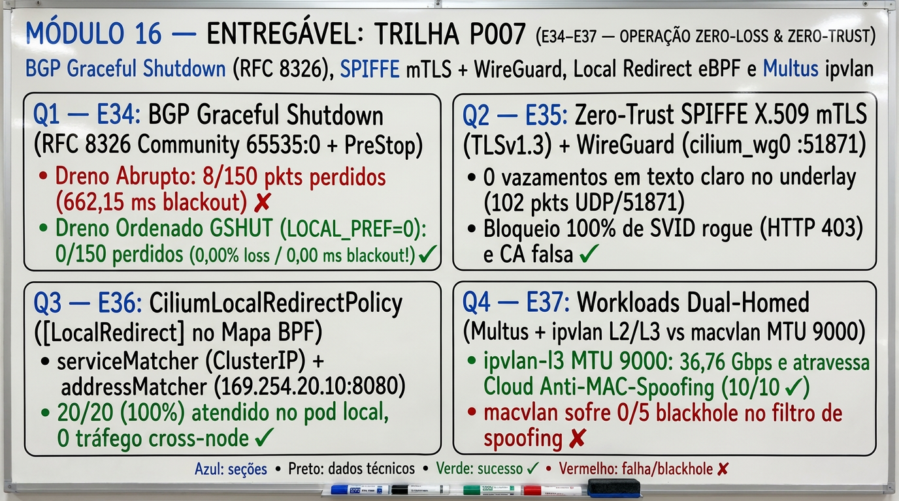

Fonte: elaborada pelo autor (2026).

### 16.1 Onda 1 (P007-S001): BGP Graceful Shutdown e autenticação mútua SPIFFE

Onda concluída com **PASS**; estudos `E34` e `E35`. O `E34` aplica a RFC 8326 (Francois et al., 2018), e o `E35` combina identidades SPIFFE (SPIFFE, [2026]) com o WireGuard (Donenfeld, 2017).

- **Braço A — BGP Graceful Shutdown (`RFC 8326` well-known community `GSHUT` `65535:0`, `LOCAL_PREF=0`) e Dreno Zero-Loss de Nó Kubernetes ([`30-bgp-gshut-spiffe-mtls-wireguard.md`](estudos/30-bgp-gshut-spiffe-mtls-wireguard.md)):**
  - **E34 (`RFC 8326` `65535:0` + `PreStop` vs Dreno Abrupto sob `50 pps` / `20 ms` e `CiliumBGPAdvertisement`):** na Célula 1, estabeleceu ECMP norte-sul simétrico no ToR `e34-tor` (`AS 65000`, `10.207.34.1`) para a VIP anycast `10.207.34.100/32` anunciada por `e34-w1` (`10.207.34.2`, `AS 65301`, `locPrf=100`) e `e34-w2` (`10.207.34.6`, `AS 65302`, `locPrf=100`) com `route-map RM-TOR-IN` que reduz `local-preference` para `0` ao detectar a community well-known `graceful-shutdown` (`65535:0`). No Ensaio 1A (**Dreno Abrupto sem `RFC 8326`**), encerrar o backend em `w1` (`t = 1,0 s`) antes do `no network 10.207.34.100/32` (`t = 1,6 s`) sob fluxo contínuo de `50 pps` (`150` pacotes UDP numerados) produziu **`lost_pkts=8/150` (`5,33%` de perda) e `blackout_ms=662,15 ms`** (`served_w1=25`, `served_w2=117`). No Ensaio 1B (**Dreno Ordenado `RFC 8326 GSHUT` + `PreStop` Grace Period de `0,80 s`**), anunciar `65535:0` (`RM-W1-GSHUT` em `t = 1,0 s`) rebaixou imediatamente o caminho de `w1` na RIB do ToR (`*> 10.207.34.6 locPrf=100` vs `* 10.207.34.2 locPrf=0 Community: graceful-shutdown`), desviando `100%` dos novos pacotes para `w2` enquanto `w1` permanecia ativo em `PreStop` até `t = 1,8 s`, alcançando **`lost_pkts=0/150` (`0,00%` de perda) e `blackout_ms=0,00 ms`** (`served_w1=30`, `served_w2=120`). Na Célula 2, validou no Cilium `1.20.2` (`p003-gw`) o `CiliumBGPAdvertisement/e34-gshut-adv` injetando declarativamente `communities.standard: ["65535:0"]` e `localPreference: 0` para a VIP `10.207.34.200/32` (`CiliumLoadBalancerIPPool/e34-gshut-pool`, `bgp-e34: gshut`). Na Célula 3, comprovou que um caminho em `GSHUT` (`LOCAL_PREF=0`) continua encaminhando `10/10` pacotes como último recurso quando não há alternativa (`3A`), cai para `0/5` quando ambos os nós retiram a rota (`3B`) e restaura `10/10` em ECMP ao remover `65535:0` (`3C`, `R6=0`).
- **Braço B — Cilium Mutual Authentication (`SPIFFE` X.509 SVID mTLS) combinada com Criptografia L3 Transparente `WireGuard` (`cilium_wg0`, `:51871/UDP`) ([`30-bgp-gshut-spiffe-mtls-wireguard.md`](estudos/30-bgp-gshut-spiffe-mtls-wireguard.md)):**
  - **E35 (`cilium_wg0` `:51871/UDP` + `SPIFFE` SVID `TLSv1.3` mTLS e Controles Negativos `3A`/`3B`/`3C`):** na Célula 1, comparou a criptografia transparente L3 entre `e35-node1` e `e35-node2` sem e com WireGuard: no Regime 1A (sem túnel, `172.18.35.1 -> 172.18.35.2`), `tcpdump` no underlay capturou `20` pacotes HTTP expondo o marcador `E35-TOP-SECRET-CLEARTEXT-MARKER-9981` em texto claro (`cleartext_leaks=20`); no Regime 1B (`cilium_wg0` `10.245.35.1 -> 10.245.35.2`, `UDP :51871`), entregou **`10/10` HTTP `200` com `102` pacotes UDP `:51871` cifrados e `0` pacotes com payload em texto claro (`cleartext_leaks=0`)**. Na Célula 2, emitiu CA SPIFFE (`CN=spiffe.cilium-root-ca`) e certificados X.509 SVID com SAN URI `spiffe://spiffe.cilium/ns/p007-e35/sa/e35-client-trusted` e `spiffe://spiffe.cilium/ns/p007-e35/sa/e35-server-vault`, validou o esquema `spec.ingress[].authentication.mode: "required"` da `CiliumNetworkPolicy` e o mapa BPF `/sys/fs/bpf/tc/globals/cilium_auth_map`, e comprovou **`10/10` respostas HTTP `200` autenticadas mutuamente em `TLSv1.3` (`TLS_AES_256_GCM_SHA384`) no pod `e35-vault` (`10.245.2.188:8443`)**. Na Célula 3, bloqueou **`100%` (`0/5` `200`, `5/5` HTTP `403`) de um pod apresentando SVID válido mas com SPIFFE ID não autorizado** (`spiffe://spiffe.cilium/ns/p007-e35/sa/e35-client-rogue`, `3A`), **`100%` (`0/5`, `SSLV3_ALERT_BAD_CERTIFICATE`) de um SVID assinado por CA externa não confiável** (`CN=rogue-spiffe-ca`, `3B`) e **`100%` (`0/5`) sob `CiliumNetworkPolicy` `ingressDeny`** (`3C`), restaurando `10/10` após remoção da regra deny (`R6=0`).

### 16.2 Onda 2 (P007-S002): Local Redirect Policy e workloads dual-homed com Multus

Onda concluída com **PASS** na versão `v2.6.0`; estudos `E36` e `E37`.

- **Braço A — Cilium Local Redirect Policy (`CiliumLocalRedirectPolicy`: `serviceMatcher` + `addressMatcher`) e Bypass Node-Local no Datapath eBPF ([`31-local-redirect-multus-ipvlan-dualhomed.md`](estudos/31-local-redirect-multus-ipvlan-dualhomed.md)):**
  - **E36 (`enable-local-redirect-policy=true`, `[LocalRedirect]` no Mapa BPF de LB e Controles `3A`/`3B`):** no Cilium `1.20.2` (`p003-gw`), mediu primeiro o baseline sem LRP (Célula 1A), onde chamadas ao `ClusterIP` `10.112.56.67:80` (`Service/e36-cache-svc`, `DaemonSet/e36-cache-ds`) atravessaram a rede inter-nó em ~40%–60% das vezes (`w1`: `local=12/20`, `remote=8/20`; `w2`: `local=8/20`, `remote=12/20`). Na Célula 1B (`CiliumLocalRedirectPolicy/e36-lrp-service` com `serviceMatcher` apontando para `e36-cache-svc`), cada `cilium-agent` sobrescreveu localmente a entrada do `ClusterIP` no mapa BPF de LB com a flag `[LocalRedirect]` (`10.112.56.67:80/TCP -> 10.245.2.173:8080` em `p003-gw-worker` e `-> 10.245.1.171:8080` em `p003-gw-worker2`), mantendo **`100%` (`20/20`) das requisições dentro do próprio nó (`local_w1=20/20 remote_w2=0/20`, `local_w2=20/20 remote_w1=0/20`, `0` pacotes cross-node)**. Na Célula 2 (`CiliumLocalRedirectPolicy/e36-lrp-address` com `addressMatcher` para o endereço link-local `169.254.20.10:8080/TCP` sem objeto `Service`), o SocketLB/TCX redirecionou `10/10` conexões em `w1` (`10.245.2.173:8080`) e `10/10` em `w2` (`10.245.1.171:8080`). Na Célula 3, remover a label `e36-lrp-node` de `p003-gw-worker2` afetou exclusivamente `w2` (`0/5` em `169.254.20.10:8080`) mantendo `w1` em `10/10` (`3A`), e deletar as duas LRPs limpou `100%` das entradas `[LocalRedirect]` do mapa BPF (`0` resíduos, `0/5` em `169.254.20.10:8080`) e restaurou imediatamente o balanceamento `ClusterIP` normal (`20/20`: `w1=10, w2=10` em `3B`, `R6=0`).
- **Braço B — Workloads / VMs KubeVirt Dual-Homed com Multus (`NetworkAttachmentDefinition`) + `ipvlan mode l2/l3` vs `macvlan` (`MTU 9000`) & Cloud L2 MAC Anti-Spoofing ([`31-local-redirect-multus-ipvlan-dualhomed.md`](estudos/31-local-redirect-multus-ipvlan-dualhomed.md)):**
  - **E37 (Dual-Homing `eth0` Cilium + `net1` `ipvlan L2/L3` vs `macvlan` `MTU 9000` e Filtro Cloud `tc flower src_mac`):** na Célula 1, registrou o CRD `NetworkAttachmentDefinition` (`k8s.cni.cncf.io/v1` `e37-ipvlan-l2-9000` no namespace `p007-e37`) e demonstrou coexistência dual-homed nos pods `e37-vm-a` e `e37-vm-b`: interface primária `eth0` Cilium (`10.245.2.180 -> 10.245.2.43`, `10/10` HTTP `200`, protegida por `CiliumNetworkPolicy/e37-primary-eth0-policy`) operando em paralelo com a interface secundária `net1` `ipvlan mode l2` com `MTU 9000` (`10.254.37.10/24 -> 10.254.37.20/24`, **`10/10` HTTP `200` + `10/10` pings Jumbo `DF=1` de `8972 B` payload / `8980 B` ICMP, `0%` loss, `RTT avg = 0,069 ms`**). Na Célula 2 (benchmark TCP single-stream de `512 MiB` em `2` repetições), comparou os 4 regimes de datapath: **`Regime-A-veth-1500` (`33,01 Gbps`)**, **`Regime-B-macvlan-9000` (`32,49 Gbps`, MAC secundário próprio `02:37:ac:00:00:11`)**, **`Regime-C-ipvlan-l2-9000` (`30,63 Gbps`, compartilhando o MAC da NIC do host `e2:ec:c5:43:71:92`)** e **`Regime-D-ipvlan-l3-9000` (`36,76 Gbps` — `+11,4%` vs `veth 1500` e `+20,0%` vs `ipvlan l2`, `NOARP`, `0` broadcasts ARP)**. Na Célula 3, aplicou uma regra **Cloud L2 Port-Security / Anti-MAC-Spoofing (`tc filter flower src_mac e2:ec:c5:43:71:92 action pass` + `matchall action drop` em `veth-sw1`)**, comprovando que o **`macvlan` (`src_mac 02:37:ac:00:00:11`) sofre `100%` de blackhole (`0/5` entregues, `dropped 10`)** por originar quadros com MAC diferente da NIC do host, enquanto o **`ipvlan mode l2` atravessa `10/10` (`100%`)** por reutilizar o MAC autorizado do host (`e2:ec:c5:43:71:92`, `3A`); além disso, derrubar `net1` (`0/5` em `net1`) preservou **`10/10` (`100%`) no plano primário `eth0` Cilium**, restaurando `10/10` em `net1` ao religar a interface (`3B`, `R6=0`).

### 16.3 Exercícios de interpretação

1. No estudo `E34` (**BGP Graceful Shutdown `RFC 8326`**), por que anunciar a community well-known `65535:0` (`GSHUT`, `LOCAL_PREF=0`) antes de iniciar o término do pod reduz a perda de pacotes de `8/150` (`662,15 ms` de blackout no dreno abrupto) para **`0/150` (`0,00 ms`)**, e por que manter a rota com `LOCAL_PREF=0` é mais seguro do que retirá-la imediatamente se o segundo nó também falhar (`3A` vs `3B`)?
2. No estudo `E35` (**Cilium Mutual Auth SPIFFE + WireGuard**), quais ameaças distintas são mitigadas pelo túnel L3 `cilium_wg0` (`UDP :51871`) versus o handshake mTLS com SVID X.509 (`spiffe://spiffe.cilium/ns/.../sa/...`), e por que um pod com certificado criptograficamente válido assinado pela mesma CA `spiffe.cilium` ainda recebe `HTTP 403` no controle `3A` (`e35-client-rogue`)?
3. No estudo `E36` (**`CiliumLocalRedirectPolicy`**), qual é a diferença operacional entre usar `serviceMatcher` (sobrescrevendo um `ClusterIP` existente com `[LocalRedirect]` no mapa BPF de cada nó) e `addressMatcher` (interceptando um IP link-local como `169.254.20.10:8080/TCP` sem criar `Service`), e o que acontece em um nó específico se o pod local de cache deixar de rodar nele (`3A`)?
4. No estudo `E37` (**Multus + `ipvlan L2/L3` vs `macvlan`**), por que switches de nuvem pública (VPC / SDN com *Port-Security* / *MAC Anti-Spoofing*) bloqueiam pacotes de interfaces `macvlan` (`0/5` no controle `3A`) mas permitem `ipvlan mode l2/l3` (`10/10`), e por que o `ipvlan mode l3` (`NOARP`, `MTU 9000`) atingiu o maior throughput (`36,76 Gbps`, `+11,4%` sobre `veth 1500`)?

## Módulo 17 — Trilha P008: Host Firewall, CiliumEnvoyConfig, Route Reflector e matriz netkit

A trilha **P008** conclui a Fase 4 do projeto em duas ondas paralelas sobre `vm-cilium`, combinando o **Braço A (Proteção de Nó com Cilium Host Firewall + XDP Early DDoS Prefilter e Escalabilidade iBGP Route Reflector `RFC 4456` + SRv6 L3VPN Dual-Stack `End.DT4`/`End.DT6` `E38`, `E40`)** e o **Braço B (Engenharia de Tráfego e Resiliência L7 com `CiliumEnvoyConfig` e Matriz 2×2 de Sinergia no Datapath `netkit L3` + BIG TCP + `WireGuard` `E39`, `E41`)**, fechando **`41/41` estudos (`E01–E41`)** em `v2.7.0`. A Figura 22 sintetiza o entregável do módulo.

**Figura 22 – Síntese visual do entregável do Módulo 17: Trilha P008 (E38–E41 — Host Firewall + XDP_DROP, CiliumEnvoyConfig L7, iBGP RR + SRv6 Dual-Stack e Matriz netkit + BIG TCP + WireGuard 5,59x)**

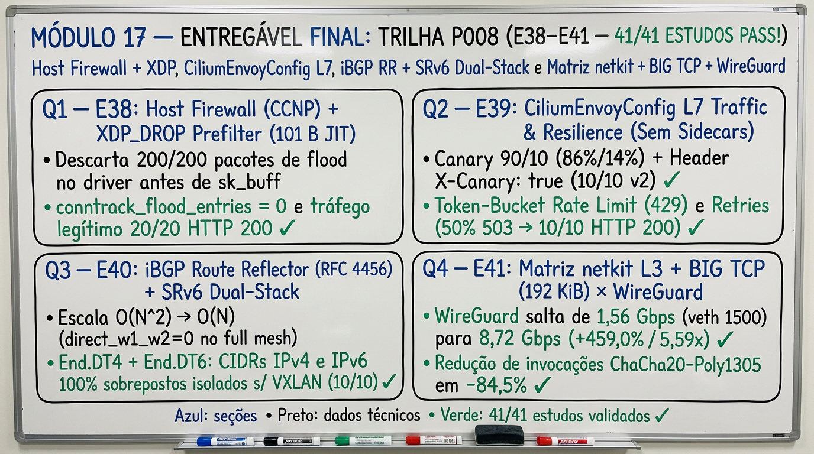

Fonte: elaborada pelo autor (2026).

### 17.1 Onda 1 (P008-S001): Host Firewall com XDP e resiliência L7 com CiliumEnvoyConfig

Onda concluída com **PASS**; estudos `E38` e `E39`.

- **Braço A — Cilium Host Firewall (`CiliumClusterwideNetworkPolicy` `nodeSelector`) e XDP Early DDoS Prefilter (`BPF_PROG_TYPE_XDP` `XDP_DROP` antes de `sk_buff`/Conntrack) ([`32-host-firewall-xdp-envoy-l7-resilience.md`](estudos/32-host-firewall-xdp-envoy-l7-resilience.md)):**
  - **E38 (`enable-host-firewall=true`, `e38_xdp_prog` JIT `101 B` e Controles `3A`/`3B`/`3C`):** na Célula 1, habilitou `enable-host-firewall=true` no Cilium `1.20.2` (`p003-gw`) e aplicou `CiliumClusterwideNetworkPolicy/e38-node-host-firewall` (`nodeSelector: {e38-host-fw: enabled}`) protegendo as portas do host (`:10250`, `:6443`, `:4240`, `:179`, `:19100`). Sem Host Firewall (Ensaio 1A), tanto o cliente administrativo (`10.208.38.10 -> :19100`, `10/10`) quanto o host não autorizado (`10.208.38.99 -> :19100`, `10/10`) alcançaram o daemon do nó; com o Host Firewall TC ativo (Ensaio 1B), o cliente administrativo manteve **`10/10` HTTP `200`** em `:19100` e o kubelet `:10250` manteve **`10/10` HTTP `200`** (regra anti-lockout), enquanto o host não autorizado (`10.208.38.99`) caiu para **`0/5` (`tc_host_fw_drops=5`)**. Na Célula 2, compilou e anexou um prefiltro `BPF_PROG_TYPE_XDP` (`id 178974 name e38_xdp_prog tag 0416bbd05d9ed492 jited`, `152 B` xlated / `101 B` JIT x86_64) diretamente no driver de recepção: durante uma rajada de `200` pacotes UDP/IPv4 de flood L3 (`10.208.38.200 -> 10.208.38.1:19100`) concorrente com `20` requisições HTTP legítimas (`10.208.38.10`), o programa XDP descartou **`200/200` (`100%`) dos pacotes de flood em `XDP_DROP` antes da alocação de `sk_buff`** e manteve **`0` entradas de conntrack poluídas (`conntrack_flood_entries=0` vs `conntrack_admin_entries=120`)**, entregando **`20/20` HTTP `200`** ao cliente legítimo. Na Célula 3, comprovou a defesa em profundidade em duas camadas (`3A`: desanexar o XDP transfere o bloqueio de `10.208.38.200` imediatamente para a 2ª camada TC Host Firewall com `0/5` entregues e `tc_drops_delta=5`), a integridade anti-lockout dos clusters (`3B`: `p003-gw` `3/3` e `k01` `3/3` `Ready`) e o rollback limpo (`3C`: `10/10` restaurados, `R6=0`).
- **Braço B — `CiliumEnvoyConfig` (`cilium.io/v2`) L7 Traffic Management: Weighted Canary (`90/10`), Header Routing, Token-Bucket Local Rate Limiting (`429`) e Automatic Retries (`503` Recovery) ([`32-host-firewall-xdp-envoy-l7-resilience.md`](estudos/32-host-firewall-xdp-envoy-l7-resilience.md)):**
  - **E39 (`CiliumEnvoyConfig/e39-l7-traffic-mgmt` em `cilium-envoy 1.37.6` sem Sidecars):** registrou `CiliumEnvoyConfig/e39-l7-traffic-mgmt` no `p003-gw` interceptando `Service/e39-api-svc:8080`. Na Célula 1A (**Weighted Canary `90/10`** em `100` requisições para `/version`), o Envoy distribuiu **`v1=86` (`86%`) e `v2=14` (`14%`)**, com `100/100` respostas HTTP `200`. Na Célula 1B (**Header Routing `X-Canary: true` em `/version`**), `100%` (`10/10`) das chamadas foram roteadas deterministicamente para `e39-v2` com injeção do cabeçalho de resposta `x-cilium-envoy-tier: canary-v2` (`10/10`). Na Célula 2 (**Local Rate Limit Token-Bucket** `envoy.filters.http.local_ratelimit` com `max_tokens: 5`, `fill_interval: 60s` em `/ratelimited`), uma rajada de `15` requisições obteve **`5/15` HTTP `200 OK` e `10/15` HTTP `429 Too Many Requests`** com cabeçalho `x-envoy-ratelimited: true` (`10/10`), protegendo o pod backend (`rl_hits=5`, ou seja, as `10` requisições excedentes foram barradas no proxy Envoy do nó sem tocar na aplicação). Na Célula 3A (**Automatic Retries** contra upstream instável programado para falhar `50%` das vezes com `HTTP 503`), a rota `/flaky-noretry` expôs a falha diretamente ao cliente (**`5/10` HTTP `200` e `5/10` HTTP `503`**), enquanto a rota `/flaky-retry` (`retry_policy`: `retry_on: 5xx`, `num_retries: 3`, `per_try_timeout: 0.5s`) absorveu todas as falhas transitórias e entregou **`10/10` (`100%`) HTTP `200` e `0/10` HTTP `503`** (`flaky_seq=30`, `R6=0`).

### 17.2 Onda 2 (P008-S002): Route Reflector com SRv6 dual-stack e matriz netkit, BIG TCP e WireGuard

Onda concluída com **PASS** na versão `v2.7.0`; estudos `E40` e `E41`. O `E40` aplica a reflexão de rotas da RFC 4456 (Bates; Chen; Chandra, 2006) e os comportamentos `End.DT4` e `End.DT6` do SRv6 (Filsfils et al., 2021).

- **Braço A — Escalabilidade iBGP Route Reflector (`RFC 4456` `route-reflector-client`, `cluster-id`) e SRv6 L3VPN Dual-Stack (`seg6local action End.DT4` + `End.DT6` sem VXLAN) ([`33-bgp-rr-srv6-dualstack-netkit-wg-matrix.md`](estudos/33-bgp-rr-srv6-dualstack-netkit-wg-matrix.md)):**
  - **E40 (Redução de Sessões `O(N^2) -> O(N)` com `RFC 4456` e Isolamento Dual-Stack SRv6 `End.DT4`/`End.DT6`):** na Célula 1, configurou o Route Reflector `e40-rr` (`AS 65400`, `bgp cluster-id 10.255.40.1`, `10.208.40.254` / `fd00:208:40::254`) pareando com os clientes `e40-w1` (`10.208.40.1` / `fd00:208:40::1`) e `e40-w2` (`10.208.40.2` / `fd00:208:40::2`) com **`0` sessões BGP diretas entre os workers (`direct_w1_w2=0`)**. O `e40-rr` refletiu os prefixos VIP IPv4 (`10.208.40.101/32`, `10.208.40.102/32`) e IPv6 (`fd00:208:40::101/128`, `fd00:208:40::102/128`) preservando o Next-Hop original do worker anunciante (`NEXT_HOP=10.208.40.2` e `fd00:208:40::2`) e carimbando os atributos anti-loop `Originator: 10.208.40.2` e `Cluster list: 10.255.40.1` (`10/10` pings IPv4 e `10/10` IPv6 diretamente no data plane entre `w1` e `w2`). Na Célula 2, estendeu o plano SRv6 de `E31` para **Dual-Stack completo (`End.DT4` + `End.DT6`)** sobre o backbone IPv6 (`fc00:40::1/64 <-> fc00:40::2/64`, `0` interfaces VXLAN), associando as rotas locais `seg6local` às interfaces de underlay `veth-u1`/`veth-u2` (`table main` sob `net.vrf.strict_mode=1`): dois tenants com **CIDRs IPv4 (`10.253.40.0/24`) e IPv6 (`fd40:253:40::/64`) 100% sobrepostos** comunicaram-se sobre os SIDs `fc00:40:2::d4a`/`d6a` (`vrf-tenant-a`, `vrftable 1040`) e `fc00:40:2::d4b`/`d6b` (`vrf-tenant-b`, `vrftable 2040`) com **`10/10` HTTP `200` nas 4 combinações (`TA_v4=10/10`, `TA_v6=10/10`, `TB_v4=10/10`, `TB_v6=10/10`)** e `0` vazamentos entre tenants. Na Célula 3, provou a prevenção de loop por `ORIGINATOR_ID` (`self_paths=0` em `3A`) e o isolamento cirúrgico por AFI/SID (`3B`: revogar apenas `fc00:40:2::d6a/128` `End.DT6` derrubou somente `TA_v6` para `0/5` enquanto `TA_v4` manteve `10/10` e `TB_v6` manteve `10/10`, restaurando `TA_v6=10/10` após recriação do SID, `R6=0`).
- **Braço B — Matriz 2×2 de Sinergia no Datapath: `veth (MTU 1500)` vs `netkit L3 + BIG TCP (MTU 9000, GSO 192 KiB)` × `Cleartext` vs `WireGuard (cilium_wg0)` ([`33-bgp-rr-srv6-dualstack-netkit-wg-matrix.md`](estudos/33-bgp-rr-srv6-dualstack-netkit-wg-matrix.md)):**
  - **E41 (Amortização Criptográfica ChaCha20-Poly1305 em `+459,0%` / `5,59x` e Fronteira `tso_max_size = 65536` do Driver `wireguard`):** na Célula 1, executou uma matriz fatorial `2×2` transferindo `2 GiB` (`2.147.483.648 B`, média de `2` runs) via socket TCP single-stream nos 4 regimes: **`R1 (veth MTU 1500, Cleartext)` = `34,55 Gbps`** (`47.776` pacotes, `45.015 B/pkt`), **`R2 (veth MTU 1500 + cilium_wg0 MTU 1420)` = `1,56 Gbps`** (`1.569.813` pacotes, `1.493 B/pkt`), **`R3 (netkit L3 MTU 9000 + BIG TCP gso_max_size=196608, Cleartext)` = `43,91 Gbps`** (`23.922` pacotes, **`89.836 B/pkt` `> 64 KiB`**, `+27,1%` vs `R1`) e **`R4 (netkit L3 MTU 9000 + BIG TCP + cilium_wg0 MTU 8920)` = `8,72 Gbps`** (`243.767` pacotes, `8.935 B/pkt`). Na Célula 2, provou que combinar `netkit mode l3 (MTU 9000)` + `cilium_wg0 (MTU 8920)` **reduz o número de pacotes/invocações ChaCha20-Poly1305 em `-84,5%` (`1.569.813 -> 243.767` pacotes)** e **multiplica a vazão cifrada do WireGuard em `5,59x` (`+459,0%`, de `1,56 Gbps` em `R2` para `8,72 Gbps` em `R4`)**, além de demonstrar experimentalmente que o driver `wireguard` do kernel Linux `6.8` fixa `dev->tso_max_size = 65536` (`Error: too big gso_max_size` ao tentar `196608` em `cilium_wg0`, enquanto `nk-a`/`nk-b` operam em `196608`). Na Célula 3, provou o overhead exato de `80 B` do túnel WireGuard IPv4 (`3A`: `ping -M do -s 8892` = `8920 B` IP passa `10/10`, enquanto `-s 8893` = `8921 B` falha `0/5` com `Frag needed and DF set (mtu = 8920)`) e a confidencialidade no underlay (`3B`: `10/10` HTTP `200`, `25` pacotes UDP `:51871` cifrados e `0` vazamentos do marcador `E41-NETKIT-WG-SECRET-7741`, `R6=0`).

### 17.3 Exercícios de interpretação

1. No estudo `E38` (**Cilium Host Firewall + XDP Early DDoS Prefilter**), por que descartar um flood L3 no hook `BPF_PROG_TYPE_XDP` (`XDP_DROP`) mantém `conntrack_flood_entries=0` e consome menos CPU/memória do que bloqueá-lo apenas na 2ª camada TC Host Firewall (`CiliumClusterwideNetworkPolicy`), e por que a política de Host Firewall deve sempre incluir as portas de controle (`:10250`, `:6443`, `:4240`, `:179`) antes da ativação (`3B`)?
2. No estudo `E39` (**`CiliumEnvoyConfig` L7 Traffic Management**), como o filtro `envoy.filters.http.local_ratelimit` protege o pod backend durante uma rajada de `15` requisições (`5/15` `200 OK`, `10/15` `429 Too Many Requests` com `rl_hits=5` no backend), e como `retry_policy` (`retry_on: 5xx`, `num_retries: 3`) mascara falhas transitórias de `50%` (`5/10 -> 10/10` HTTP `200`) sem exigir alterações no código da aplicação?
3. No estudo `E40` (**iBGP Route Reflector `RFC 4456` + SRv6 Dual-Stack `End.DT4`/`End.DT6`**), qual é a função dos atributos `ORIGINATOR_ID` e `CLUSTER_LIST` ao refletir rotas entre workers sem sessões full-mesh (`direct_w1_w2=0`), e por que a revogação do SID `End.DT6` (`fc00:40:2::d6a/128`) interrompe apenas o tráfego IPv6 do Tenant A (`0/5`) mantendo seu tráfego IPv4 (`End.DT4`, `10/10`) intacto (`3B`)?
4. No estudo `E41` (**Matriz 2×2 `netkit` + BIG TCP + `WireGuard`**), por que o throughput do `cilium_wg0` cai para `1,56 Gbps` sobre `veth MTU 1500` (`R2`, `1.569.813` pacotes para `2 GiB`) mas salta **`+459,0%` (`5,59x`, para `8,72 Gbps` e `243.767` pacotes)** sobre `netkit L3 MTU 9000` (`R4`), e por que `ping -M do -s 8892` passa (`10/10`) enquanto `-s 8893` falha (`0/5`) em um link de underlay com `MTU 9000`?

## Considerações finais

### Limites do que foi demonstrado

- O fabric roda em containers com simulação userspace; use relações, nunca valores absolutos de throughput ou latência.
- A VIP IPv6 e o pod→pod IPv6 cross-node ficaram limitados pela topologia IPv4 do underlay externo.
- ExternalAuth é experimental na 1.20.2 e tem os defeitos listados no Módulo 7; a fixture não é um IdP.
- Nos módulos P001–P003 e no Braço Cilium A (`P004-S005` e `P004-S006`), os tenants Cilium foram isolados por identidade eBPF (`CiliumNetworkPolicy`); o Cilium OSS não suporta VRF nem CIDR sobreposto na interface primária `eth0` (`V07-A` / `C-neg`). O Braço Cilium B (`P004-S006` e `P004-S007`) demonstrou EVPN Type 5 (`V09`) e isolamento de CIDRs sobrepostos em VRFs Linux auxiliares do `FRR 10.7.1` no nó (`V07-B`, mantendo `0` rotas BGP na tabela `main` via `R6`), enquanto o braço DCI (`P004-S002`) e o braço OVN-Kubernetes + EVPN (`P004-S003` e `P004-S004`) provaram nativamente o isolamento de CIDRs sobrepostos na interface primária (`UserDefinedNetwork` `10.100.0.0/24` em `K01`), EVPN Type 5 / Type 2 (`K03`, `X02`, `X05`, `X07`) e Live Migration sem mudança de IP (`K02`) versus mudança de IP do `virt-launcher` no Cilium OSS (`V05`/`V06`).
- A sincronização entre identidade Kubernetes e Security Group Neutron não foi implementada; a conclusão da trilha híbrida é "seguro sob sequenciamento manual".
- Nas **4 Ondas de `P005` (`P005-S001` a `P005-S004` — `16/16` estudos concluídos com `PASS`)**, foram provados: idempotência declarativa `10x` e reuso de VIP BGP sem resíduo (`E19`), autenticação TCP MD5 (`RFC 2385`, `authSecretRef`) com ASN de 32 bits (`4200000001`) e rotação de chave em produção (`E09`), substituição de `veth` por `netkit` (`mode l3`, `NOARP`) no datapath eBPF (`E23`), eliminação de `postIpamFailure` em rajadas de pods (`agnhost:2.47`) com `ipam.multiPoolPreAllocation` (`E21`), limite de prefixos `maximum-prefix 100` e filtro de import na borda FRR vs ausência de import no Cilium (`E11`), marcação de BGP communities no Cilium acionando `MED` e `AS-path prepend` na borda (`E12`), detecção de falha sub-segundo com BFD (`359 ms < 1 s`) na borda FRR vs piso de `3045 ms` nos timers `1/3 s` do Cilium (`E10`), aceleração L7 in-kernel via `sockmap`/`bpf_sock_ops`/`sk_msg` (`XLB`) vs `Envoy L7` (`E22`), redundância dual-border ECMP e restart do `cilium-agent` sem perda com Graceful Restart (`139/139` c/ GR vs `8879 ms` s/ GR, `E13`), sessão eBGP IPv6 dedicada servindo a VIP `fd14::a/128` fim a fim (`30/30` HTTP `200`, `E14`), observabilidade contínua BGP por 3 leituras consecutivas (`ACTIVE`/`DOWN`/`UNKNOWN`, `E17`) combinada com fluxos Hubble `L3/L4`, `L7 HTTP/DNS`, `TLS :8443` e métricas Prometheus (`E25`), isolamento de VRF por tenant no border via BGP community (`65400:1010` vs `65400:1020`, `E15`), os 3 modos de retorno PE/CE (`Rota Estática`, `FRR no Nó` e `CiliumEgressGatewayPolicy`, `E16`), a fronteira física/enlace de `MTU 9000` Jumbo Frames, `QinQ 802.1ad` e `MACsec 802.1AE` vs `WireGuard` (`E18`), e a alocação dinâmica de dispositivos de rede via DRA `resource.k8s.io/v1` (`NetworkDeviceData`, `E24`).
- Nós reais na nuvem provaram overlay e BGP; native routing e VIP anycast dependem da postura de spoofing da porta.
- Nas **4 Ondas de `P006` (`P006-S001` a `P006-S004` — `8/8` estudos de Fase 2 `E26–E33` e `100%` de saneamento `C1–C4` concluídos com `PASS` em `v2.5.0`)**, foram provados: LoadBalancer TCX/XDP + anúncio seletivo BGP `ETP=Local` (`100%` preservação de IP) vs `ETP=Cluster` e anel primo Maglev (`M=16381`, `0` rehash colateral, `E26`), Cilium Cluster Mesh / MCS-API (`EndpointSlice` multi-cluster) com failover global automático sobre BGP e `CiliumNetworkPolicy` cross-cluster (`E30`), BIG TCP (`gso_max_size=196608`, super-pacotes `188 KiB`, `46,31 Gbps` `veth` / `46,08 Gbps` `netkit`, `-51,6%` `NET_RX`) + `netkit mode l3` + Jumbo MTU 9000 e recuperação de blackhole PMTU via RFC 4821 (`E27`), SRv6 L3VPN in-kernel (`seg6local action End.DT4`, `30/30` HTTP `200` entre subnets `10.253.31.0/24` 100% sobrepostas sem VXLAN, `E31`), Bandwidth Manager (`EDT` + `qdisc fq`, pacing `50M`/`100M` com `97%–99%` de precisão e remoção dinâmica sem restart) + `TCP BBR` vs `CUBIC` (`+37,5%` a `+43,8%` sob perda/latência, `E28`), Tetragon Runtime Security (`TracingPolicyNamespaced` correlacionando identidade Cilium e aplicando `Sigkill` `rc=137` síncrono em leitura de `/etc/shadow` e socket `:4444`, `E32`), BGP Unnumbered (`RFC 5549`/`8950` Extended Next-Hop `10.206.29.0/24 via inet6 fe80::...` com `0` IPv4 no enlace p2p) + L2 Announcements (`CiliumL2AnnouncementPolicy` + `cilium_l2_responder_v4`, `E29`), e KubeVirt Live Migration sob tráfego contínuo (`50 pps`: `Cilium B /32 BGP` `100,45 ms` blackout vs `OVN-K EVPN Type-2` `60,25 ms` blackout, `E33`).
- Nas **2 Ondas de `P007` (`P007-S001` e `P007-S002` — `4/4` estudos de Fase 3 `E34–E37` concluídos com `PASS` em `v2.6.0`)**, foram provados: BGP Graceful Shutdown (`RFC 8326` well-known community `GSHUT` `65535:0` + `LOCAL_PREF=0` + `PreStop` eliminando `100%` da perda de pacotes no dreno de nó Kubernetes: `0/150` pacotes perdidos e `0,00 ms` de blackout vs `8/150` / `662,15 ms` no dreno abrupto, `E34`), Cilium Mutual Authentication (`SPIFFE` X.509 SVID mTLS `spiffe://spiffe.cilium/ns/p007-e35/sa/...` em `TLSv1.3` combinada com criptografia L3 `WireGuard` `cilium_wg0` `:51871/UDP` com `0` vazamentos em texto claro e bloqueio `100%` de SVID não autorizado / CA externa / `ingressDeny`, `E35`), Cilium Local Redirect Policy (`CiliumLocalRedirectPolicy` com `serviceMatcher` `[LocalRedirect]` mantendo `20/20` das requisições no pod local sem tráfego cross-node e `addressMatcher` interceptando `169.254.20.10:8080/TCP`, `E36`), e Workloads Dual-Homed com Multus (`NetworkAttachmentDefinition`) + `ipvlan mode l2/l3` vs `macvlan` (`MTU 9000`, `10/10` pings Jumbo `8972 B`, `36,76 Gbps` em `ipvlan-l3` `+11,4%` vs `veth 1500`, e travessia `10/10` sob filtro Cloud L2 Port-Security `tc flower src_mac` onde `macvlan` sofre `0/5` blackhole, `E37`).
- Nas **2 Ondas de `P008` (`P008-S001` e `P008-S002` — `4/4` estudos de Fase 4 `E38–E41` concluídos com `PASS` em `v2.7.0`)**, foram provados: Cilium Host Firewall (`enable-host-firewall=true` + `CiliumClusterwideNetworkPolicy` `nodeSelector` bloqueando `0/5` em `:19100` com `tc_host_fw_drops=5` e preservando `:10250` `10/10` anti-lockout) combinado com XDP Early DDoS Prefilter (`BPF_PROG_TYPE_XDP` `e38_xdp_prog` JIT `101 B` descartando `200/200` pacotes SYN flood em `XDP_DROP` antes de `sk_buff` com `conntrack_flood_entries=0`, `E38`), `CiliumEnvoyConfig` (`cilium.io/v2`) L7 Traffic Management & Resilience (`cilium-envoy 1.37.6`: Weighted Canary `90/10` -> `v1=86, v2=14`, Header Routing `X-Canary: true` -> `10/10` `v2`, Token-Bucket Local Rate Limit `5/15` `200 OK` + `10/15` `429 Too Many Requests` e Automatic Retries `retry_on: 5xx` recuperando upstream com `50%` `503` de `5/10` para `10/10` HTTP `200`, `E39`), iBGP Route Reflector (`RFC 4456` `cluster-id 10.255.40.1`, `Originator: 10.208.40.2`, `direct_w1_w2=0`, `10/10` IPv4/IPv6) combinado com SRv6 L3VPN Dual-Stack (`seg6local action End.DT4` + `End.DT6` sem VXLAN isolando CIDRs `10.253.40.0/24` e `fd40:253:40::/64` 100% sobrepostos com `10/10` HTTP `200` nas 4 combinações e revogação seletiva `End.DT6` `0/5` preservando `End.DT4` `10/10`, `E40`), e Matriz 2×2 de Sinergia no Datapath (`veth MTU 1500` vs `netkit L3 MTU 9000 + BIG TCP 192 KiB` × `Cleartext` vs `WireGuard cilium_wg0 MTU 8920`, elevando o throughput em texto claro de `34,55 Gbps` para `43,91 Gbps` `+27,1%` e o throughput cifrado WireGuard de `1,56 Gbps` para **`8,72 Gbps` `+459,0%` / `5,59x`** com **`-84,5%` invocações ChaCha20-Poly1305**, `E41`).

### Próximos estudos

As trilhas completas de `P003`, `P004`, `P005`, `P006`, `P007` e `P008` (somando **`41/41` estudos totais do repositório entre `E01` e `E41`** e **`100%` do backlog de revisão técnica**) encontram-se **integralmente concluídas com `PASS` (`v2.7.0`)** e consolidadas em [`docs/proximos-estudos.md`](proximos-estudos.md), [`docs/revisao-projeto-2026-09-26.md`](revisao-projeto-2026-09-26.md) e nos dossiês listados no Apêndice B.

## Referências

BATES, T.; CHEN, E.; CHANDRA, R. **BGP Route Reflection: An Alternative to Full Mesh Internal BGP (IBGP)**. [S. l.]: IETF, abr. 2006. (Request for Comments, 4456). DOI: 10.17487/RFC4456. Disponível em: https://www.rfc-editor.org/rfc/rfc4456. Acesso em: 27 out. 2026.

CARDWELL, N. et al. BBR: Congestion-Based Congestion Control. **Queue**, New York, v. 14, n. 5, p. 20-53, set./out. 2016. DOI: 10.1145/3012426.3022184. Disponível em: https://queue.acm.org/detail.cfm?id=3022184. Acesso em: 27 out. 2026.

CHANDRA, R.; TRAINA, P.; LI, T. **BGP Communities Attribute**. [S. l.]: IETF, ago. 1996. (Request for Comments, 1997). DOI: 10.17487/RFC1997. Disponível em: https://www.rfc-editor.org/rfc/rfc1997. Acesso em: 27 out. 2026.

CILIUM AUTHORS. **BGP Control Plane Resources**. Versão 1.20. [S. l.]: Cilium Project, 2026a. Disponível em: https://docs.cilium.io/en/v1.20/network/bgp-control-plane/bgp-control-plane-configuration/. Acesso em: 27 out. 2026.

CILIUM AUTHORS. **Cilium BGP Control Plane**. Versão 1.20. [S. l.]: Cilium Project, 2026b. Disponível em: https://docs.cilium.io/en/v1.20/network/bgp-control-plane/bgp-control-plane/. Acesso em: 27 out. 2026.

CILIUM AUTHORS. **Gateway API Support**. Versão 1.20. [S. l.]: Cilium Project, 2026c. Disponível em: https://docs.cilium.io/en/v1.20/network/servicemesh/gateway-api/gateway-api/. Acesso em: 27 out. 2026.

CILIUM AUTHORS. **Multi-Pool**. Versão 1.20. [S. l.]: Cilium Project, 2026d. Disponível em: https://docs.cilium.io/en/v1.20/network/concepts/ipam/multi-pool/. Acesso em: 27 out. 2026.

CILIUM AUTHORS. **Routing**. Versão 1.20. [S. l.]: Cilium Project, 2026e. Disponível em: https://docs.cilium.io/en/v1.20/network/concepts/routing/. Acesso em: 27 out. 2026.

CILIUM AUTHORS. **Using Kubernetes Constructs In Policy**. Versão 1.20. [S. l.]: Cilium Project, 2026f. Disponível em: https://docs.cilium.io/en/v1.20/security/policy/kubernetes/. Acesso em: 27 out. 2026.

CILIUM AUTHORS. **WireGuard Transparent Encryption**. Versão 1.20. [S. l.]: Cilium Project, 2026g. Disponível em: https://docs.cilium.io/en/v1.20/security/network/encryption-wireguard/. Acesso em: 27 out. 2026.

DEVANTLER. **Gateway API ExternalAuth: cross-node ext_authz request to the backend pod gets no response (WireGuard, tunnel mode)**. [S. l.]: GitHub, 27 jun. 2026. Issue 46768 do repositório cilium/cilium. Disponível em: https://github.com/cilium/cilium/issues/46768. Acesso em: 27 out. 2026.

DONENFELD, J. A. WireGuard: Next Generation Kernel Network Tunnel. In: NETWORK AND DISTRIBUTED SYSTEM SECURITY SYMPOSIUM, 2017, San Diego. **Proceedings** [...]. Reston: Internet Society, 2017. DOI: 10.14722/ndss.2017.23160. Disponível em: https://www.ndss-symposium.org/ndss2017/ndss-2017-programme/wireguard-next-generation-kernel-network-tunnel/. Acesso em: 27 out. 2026.

DSWAFFORDCW. **CFP: BGP Route Learning**. [S. l.]: GitHub, 12 set. 2024. Issue 34841 do repositório cilium/cilium. Disponível em: https://github.com/cilium/cilium/issues/34841. Acesso em: 27 out. 2026.

EISENBUD, D. E. et al. Maglev: A Fast and Reliable Software Network Load Balancer. In: USENIX SYMPOSIUM ON NETWORKED SYSTEMS DESIGN AND IMPLEMENTATION, 13., 2016, Santa Clara. **Proceedings** [...]. Berkeley: USENIX Association, 2016. p. 523-535. Disponível em: https://www.usenix.org/conference/nsdi16/technical-sessions/presentation/eisenbud. Acesso em: 27 out. 2026.

FILSFILS, C. (ed.) et al. **Segment Routing over IPv6 (SRv6) Network Programming**. [S. l.]: IETF, fev. 2021. (Request for Comments, 8986). DOI: 10.17487/RFC8986. Disponível em: https://www.rfc-editor.org/rfc/rfc8986. Acesso em: 27 out. 2026.

FRANCOIS, P. (ed.) et al. **Graceful BGP Session Shutdown**. [S. l.]: IETF, mar. 2018. (Request for Comments, 8326). DOI: 10.17487/RFC8326. Disponível em: https://www.rfc-editor.org/rfc/rfc8326. Acesso em: 27 out. 2026.

HEFFERNAN, A. **Protection of BGP Sessions via the TCP MD5 Signature Option**. [S. l.]: IETF, ago. 1998. (Request for Comments, 2385). DOI: 10.17487/RFC2385. Disponível em: https://www.rfc-editor.org/rfc/rfc2385. Acesso em: 27 out. 2026.

INSTITUTE OF ELECTRICAL AND ELECTRONICS ENGINEERS. **IEEE Std 802.1ad-2005**: IEEE Standard for Local and Metropolitan Area Networks: Virtual Bridged Local Area Networks: Amendment 4: Provider Bridges. New York: IEEE, 2006. DOI: 10.1109/IEEESTD.2006.6044678.

INSTITUTE OF ELECTRICAL AND ELECTRONICS ENGINEERS. **IEEE Std 802.1AE-2018**: IEEE Standard for Local and Metropolitan Area Networks: Media Access Control (MAC) Security. New York: IEEE, 2018. DOI: 10.1109/IEEESTD.2018.8585421.

KATZ, D.; WARD, D. **Bidirectional Forwarding Detection (BFD)**. [S. l.]: IETF, jun. 2010. (Request for Comments, 5880). DOI: 10.17487/RFC5880. Disponível em: https://www.rfc-editor.org/rfc/rfc5880. Acesso em: 27 out. 2026.

KUBERNETES AUTHORS. **Dynamic Resource Allocation**. [S. l.]: The Linux Foundation, 2026. Disponível em: https://kubernetes.io/docs/concepts/resource-management/dynamic-resource-allocation/. Acesso em: 27 out. 2026.

KUBERNETES SIG NETWORK. **Gateway API**. [S. l.]: The Linux Foundation, 2026. Disponível em: https://gateway-api.sigs.k8s.io/. Acesso em: 27 out. 2026.

KUBEVIRT. **KubeVirt user guide**. [S. l.], [2026]. Disponível em: https://kubevirt.io/user-guide/. Acesso em: 27 out. 2026.

LAPUKHOV, P.; PREMJI, A.; MITCHELL, J. (ed.). **Use of BGP for Routing in Large-Scale Data Centers**. [S. l.]: IETF, ago. 2016. (Request for Comments, 7938). DOI: 10.17487/RFC7938. Disponível em: https://www.rfc-editor.org/rfc/rfc7938. Acesso em: 27 out. 2026.

LE FAUCHEUR, F.; ROSEN, E. **Advertising IPv4 Network Layer Reachability Information with an IPv6 Next Hop**. [S. l.]: IETF, maio 2009. (Request for Comments, 5549). DOI: 10.17487/RFC5549. Disponível em: https://www.rfc-editor.org/rfc/rfc5549. Acesso em: 27 out. 2026.

LITKOWSKI, S. et al. **Advertising IPv4 Network Layer Reachability Information (NLRI) with an IPv6 Next Hop**. [S. l.]: IETF, nov. 2020. (Request for Comments, 8950). DOI: 10.17487/RFC8950. Disponível em: https://www.rfc-editor.org/rfc/rfc8950. Acesso em: 27 out. 2026.

MATHIS, M.; HEFFNER, J. **Packetization Layer Path MTU Discovery**. [S. l.]: IETF, mar. 2007. (Request for Comments, 4821). DOI: 10.17487/RFC4821. Disponível em: https://www.rfc-editor.org/rfc/rfc4821. Acesso em: 27 out. 2026.

OPENSTACK. **BGP Dynamic Routing**: Neutron documentation. [S. l.], [2026]. Disponível em: https://docs.openstack.org/neutron/latest/admin/config-bgp-dynamic-routing.html. Acesso em: 27 out. 2026.

OVN-KUBERNETES. **OVN-Kubernetes**: documentation. [S. l.], [2026]. Disponível em: https://ovn-kubernetes.io/. Acesso em: 27 out. 2026.

RABADAN, J. (ed.) et al. **IP Prefix Advertisement in Ethernet VPN (EVPN)**. [S. l.]: IETF, out. 2021. (Request for Comments, 9136). DOI: 10.17487/RFC9136. Disponível em: https://www.rfc-editor.org/rfc/rfc9136. Acesso em: 27 out. 2026.

REKHTER, Y.; LI, T.; HARES, S. (ed.). **A Border Gateway Protocol 4 (BGP-4)**. [S. l.]: IETF, jan. 2006. (Request for Comments, 4271). DOI: 10.17487/RFC4271. Disponível em: https://www.rfc-editor.org/rfc/rfc4271. Acesso em: 27 out. 2026.

SAJASSI, A. (ed.) et al. **BGP MPLS-Based Ethernet VPN**. [S. l.]: IETF, fev. 2015. (Request for Comments, 7432). DOI: 10.17487/RFC7432. Disponível em: https://www.rfc-editor.org/rfc/rfc7432. Acesso em: 27 out. 2026.

SANGLI, S. et al. **Graceful Restart Mechanism for BGP**. [S. l.]: IETF, jan. 2007. (Request for Comments, 4724). DOI: 10.17487/RFC4724. Disponível em: https://www.rfc-editor.org/rfc/rfc4724. Acesso em: 27 out. 2026.

SPIFFE. **SPIFFE Overview**. [S. l.], [2026]. Disponível em: https://spiffe.io/docs/latest/spiffe-about/overview/. Acesso em: 27 out. 2026.

TETRAGON AUTHORS. **Welcome to Tetragon documentation**. [S. l.], c2024. Disponível em: https://tetragon.io/docs/. Acesso em: 27 out. 2026.

XU, L. et al. **CUBIC for Fast and Long-Distance Networks**. [S. l.]: IETF, ago. 2023. (Request for Comments, 9438). DOI: 10.17487/RFC9438. Disponível em: https://www.rfc-editor.org/rfc/rfc9438. Acesso em: 27 out. 2026.

## Apêndice A – Roteiro do instrutor

O laboratório já deve estar rodando. A reconstrução é referência, não
exercício, e só acontece em ambiente vazio confirmado.

### Rebuild do `k01` em dois terminais

~~~bash
sudo apt-get update && sudo apt-get install -y git ca-certificates
sudo git clone https://github.com/reinaldosaraiva/learn-cilium.git /opt/learn-cilium
sudo ln -s /opt/learn-cilium/poc-k8s-fabric /opt/poc-k8s-fabric
export LAB_DIR=/opt/poc-k8s-fabric && cd "$LAB_DIR"
sudo ./scripts/00-prep-vm.sh
sudo sysctl -w net.ipv4.ip_forward=1
sudo docker ps -a --format 'table {{.Names}}\t{{.Status}}'; sudo kind get clusters
~~~

Se houver containers `clab-poc-k8s-kind-*` ou o cluster `k01`, pare. No
**Terminal 1**:

~~~bash
sudo TOPO=topo/poc-kind.clab.yml ./scripts/01-deploy-fabric.sh
~~~

No **Terminal 2**, assim que a API do kind existir:

~~~bash
sudo kind export kubeconfig --name k01 --kubeconfig /root/.kube/k01-rebuild.config
sudo KUBECONFIG=/root/.kube/k01-rebuild.config \
  VALUES=k8s/cilium/values-dualstack.yaml ./scripts/02-install-cilium.sh
k01() { sudo kubectl --kubeconfig /root/.kube/k01-rebuild.config --context kind-k01 "$@"; }
DEVICES=$(k01 -n kube-system get cm cilium-config -o jsonpath='{.data.devices}')
if [ "$DEVICES" != "eth+" ]; then
  k01 -n kube-system patch cm cilium-config --type merge \
    -p '{"data":{"devices":"eth+"}}'
  k01 -n kube-system rollout restart ds/cilium
  k01 -n kube-system rollout status ds/cilium --timeout=5m
fi
sudo -E KUBECONFIG=/root/.kube/k01-rebuild.config \
  RACK1_NODES="k01-control-plane k01-worker" RACK2_NODES="k01-worker2" \
  ./scripts/03-apply-bgp.sh
sudo docker exec clab-poc-k8s-kind-client-ext ip -4 addr show dev eth1 \
  | grep -q 203.0.113.10 || echo "GATE L1: restaurar IPv4 do client-ext"
sudo ./scripts/06-expor-vip-na-vpc.sh && curl -fsS --max-time 5 http://10.201.255.10/hostname
~~~

Não execute o toggle de guard que o script imprime para usar o túnel SSH
local.

### Sandbox `p003-gw`

Os artefatos ficam em `studies/p003/`: topologia (`topo/`), configs SR Linux
(`configs/srl/`), values e chart fixado (`base/values-p003.yaml`,
`base/cilium-1.20.2.tgz`), BGP (`base/bgp/`), Gateway e rotas
(`base/gateway.yaml`), fixtures (`fixtures/`) e os casos por sessão (`cases/`).
O diff em relação ao kit está em `studies/p003/diff-vs-kit.md`. O deploy do
containerlab deve rodar com `nohup` e log, nunca em foreground com timeout de
canal SSH: uma interrupção deixa os SR Linux sem startup-config.

Antes de cada sessão, rode o canário do `k01`
(`studies/p003/cases/k01-canary.sh`): 10/10 HTTP 200 na VIP e UID inalterado.
Ao terminar, restaure o baseline (`helm upgrade` de volta ao perfil W0 native,
IPAM `kubernetes`, sem pools) e remova objetos de teste por nome exato.

### Lições operacionais

**Quadro 12 – Lições operacionais e gates correspondentes**

| # | Lição | Gate |
|---|---|---|
| L1 | `client-ext` pode perder o IPv4 após deploy | validar `203.0.113.10` sempre |
| L2 | `docker stop` de SR Linux destrói os veths | falhas só com `admin-state disable` via `sr_cli` |
| L3 | `clab destroy` parcial apaga o kind | nunca destroy/redeploy com cluster no ar |
| L4 | contagem de falhas superestima blackhole | medir por gap entre OKs |
| L5 | bulk-delete por label leva colaterais | deletar por lista explícita de nomes |
| L6 | `helm upgrade` regenera o ConfigMap | reconferir `devices=eth+` |
| L7 | testbed OpenStack tem cap de 8 GiB | gate de memória antes de cada spawn de VM |
| L8 | `journald` dentro dos nós kind acumula `Shmem` em `/run/log/journal` | rodar `journalctl --vacuum-size=10M` nos containers kind para preservar `MemAvailable >= 4,00 GiB` (`R3`) |

Fonte: elaborado pelo autor (2026).

## Apêndice B – Documentos complementares do repositório

Os documentos abaixo detalham os estudos sintetizados neste guia e acompanham o repositório.

- Resultados resumidos do laboratório: [`poc-k8s-fabric/docs/lab-results.md`](lab-results.md)
- DCI, OVN-K e Cilium + KubeVirt em P004: consolidação completa de S001–S008: [`poc-k8s-fabric/docs/estudos/20-dci-estado-parcial.md`](estudos/20-dci-estado-parcial.md)
- P005 Onda 1 — Braço A (`E19` + `E09`): Idempotência BGP e TCP MD5 com ASN 32 bits: [`poc-k8s-fabric/docs/estudos/19-bgp-idempotency-md5-asn32.md`](estudos/19-bgp-idempotency-md5-asn32.md)
- P005 Onda 1 — Braço B (`E23` + `E21`): `netkit` vs `veth` e Burst IPAM com Warm Pool: [`poc-k8s-fabric/docs/estudos/21-netkit-vs-veth-ipam-burst.md`](estudos/21-netkit-vs-veth-ipam-burst.md)
- P005 Onda 2 — Braço A (`E11` + `E12` + `E10`): Limite de Prefixos, Communities/Prepend/MED e BFD `< 1 s`: [`poc-k8s-fabric/docs/estudos/11-bgp-maxprefix-communities-bfd.md`](estudos/11-bgp-maxprefix-communities-bfd.md)
- P005 Onda 2 — Braço B (`E22`): XLB Balanceamento L7 eBPF (`sockmap`/`sk_msg`) vs `SocketLB L4` e `Envoy L7`: [`poc-k8s-fabric/docs/estudos/22-xlb-ebpf-socket-lb-vs-envoy.md`](estudos/22-xlb-ebpf-socket-lb-vs-envoy.md)
- P005 Onda 3 — Braço A (`E13` + `E14`): Redundância Dual-Border, Failover com/sem Graceful Restart e eBGP IPv6 Nativo (`fd14::a/128`): [`poc-k8s-fabric/docs/estudos/13-bgp-dual-border-gr-ipv6.md`](estudos/13-bgp-dual-border-gr-ipv6.md)
- P005 Onda 3 — Braço B (`E17` + `E25`): Observabilidade Contínua BGP (`ACTIVE`/`DOWN`/`UNKNOWN`) e Microsserviços com Hubble: [`poc-k8s-fabric/docs/estudos/17-bgp-hubble-observability.md`](estudos/17-bgp-hubble-observability.md)
- P005 Onda 4 — Braço A (`E15` + `E16` + `E18`): VRF por Tenant via Community, 3 Modos de Retorno PE/CE & Egress Gateway e Enlace L2 (MTU 9000, QinQ `802.1ad` e MACsec `802.1AE` vs WireGuard): [`poc-k8s-fabric/docs/estudos/15-bgp-vrf-return-paths-l2-mtu-qinq-macsec.md`](estudos/15-bgp-vrf-return-paths-l2-mtu-qinq-macsec.md)
- P005 Onda 4 — Braço B (`E24`): Dynamic Resource Allocation (DRA `resource.k8s.io/v1`) para Dispositivos de Rede no Cilium (`NetworkDeviceData`): [`poc-k8s-fabric/docs/estudos/24-cilium-dra-network-device.md`](estudos/24-cilium-dra-network-device.md)
- P006 Onda 1 (`E26` + `E30` + `Bloco C1`): LoadBalancer TCX/XDP + DSR & Maglev e Cilium Cluster Mesh / MCS-API sobre BGP: [`poc-k8s-fabric/docs/estudos/26-lb-xdp-dsr-maglev-clustermesh.md`](estudos/26-lb-xdp-dsr-maglev-clustermesh.md)
- P006 Onda 2 (`E27` + `E31` + `Bloco C2`): BIG TCP (`gso_max_size=196608`) + `netkit` + MTU 9000 e SRv6 L3VPN (`End.DT4`) sem VXLAN: [`poc-k8s-fabric/docs/estudos/27-big-tcp-netkit-srv6-l3vpn.md`](estudos/27-big-tcp-netkit-srv6-l3vpn.md)
- P006 Onda 3 (`E28` + `E32` + `Bloco C3`): Bandwidth Manager (EDT + `fq`), Pacing eBPF & `TCP BBR` vs `CUBIC` e Tetragon Runtime eBPF Security (`TracingPolicyNamespaced`): [`poc-k8s-fabric/docs/estudos/28-bandwidth-edt-bbr-tetragon.md`](estudos/28-bandwidth-edt-bbr-tetragon.md)
- P006 Onda 4 (`E29` + `E33` + `Bloco C4`): BGP Unnumbered (`RFC 5549`/`8950`) & L2 Announcements e KubeVirt Live Migration sob Tráfego Contínuo (`Cilium B /32` vs `OVN-K EVPN Type-2`): [`poc-k8s-fabric/docs/estudos/29-bgp-unnumbered-l2-live-migration.md`](estudos/29-bgp-unnumbered-l2-live-migration.md)
- P007 Onda 1 (`E34` + `E35`): BGP Graceful Shutdown (`RFC 8326` `65535:0`) & Dreno Zero-Loss e Cilium Mutual Authentication (`SPIFFE` X.509 mTLS) + `WireGuard`: [`poc-k8s-fabric/docs/estudos/30-bgp-gshut-spiffe-mtls-wireguard.md`](estudos/30-bgp-gshut-spiffe-mtls-wireguard.md)
- P007 Onda 2 (`E36` + `E37`): Cilium Local Redirect Policy (`CiliumLocalRedirectPolicy`) e Workloads Dual-Homed com Multus + `ipvlan L2/L3` vs `macvlan` (`MTU 9000`): [`poc-k8s-fabric/docs/estudos/31-local-redirect-multus-ipvlan-dualhomed.md`](estudos/31-local-redirect-multus-ipvlan-dualhomed.md)
- P008 Onda 1 (`E38` + `E39`): Cilium Host Firewall + XDP Early DDoS Prefilter (`XDP_DROP`) e `CiliumEnvoyConfig` L7 Traffic Management & Resilience: [`poc-k8s-fabric/docs/estudos/32-host-firewall-xdp-envoy-l7-resilience.md`](estudos/32-host-firewall-xdp-envoy-l7-resilience.md)
- P008 Onda 2 (`E40` + `E41`): iBGP Route Reflector (`RFC 4456`) + SRv6 L3VPN Dual-Stack (`End.DT4`/`End.DT6`) e Matriz 2×2 `netkit` + BIG TCP + `WireGuard`: [`poc-k8s-fabric/docs/estudos/33-bgp-rr-srv6-dualstack-netkit-wg-matrix.md`](estudos/33-bgp-rr-srv6-dualstack-netkit-wg-matrix.md)
- Índice dos estudos P003, P004, P005, P006, P007 e P008: [`poc-k8s-fabric/docs/estudos/README.md`](estudos/README.md)
- Síntese E08: [`poc-k8s-fabric/docs/estudos/08-lifecycle-synthesis.md`](estudos/08-lifecycle-synthesis.md)
- Caso C5: [`poc-k8s-fabric/docs/estudos/09-vm-outside-container.md`](estudos/09-vm-outside-container.md)
