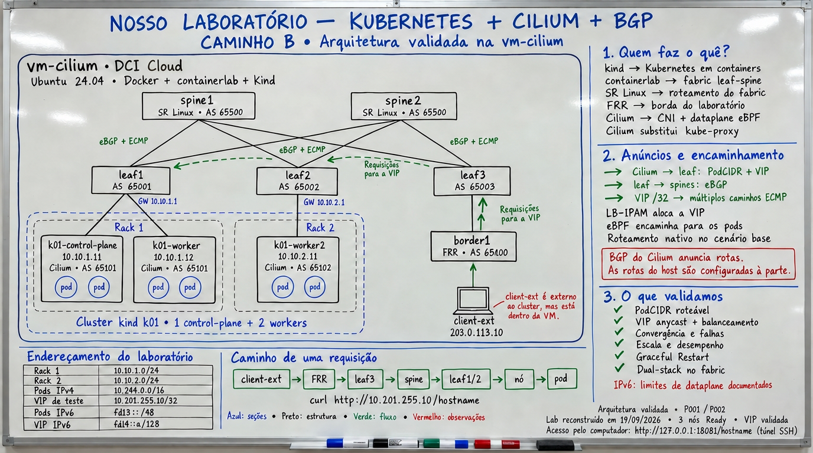
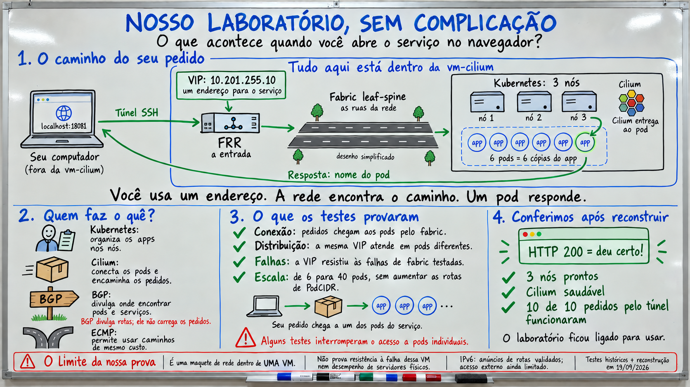
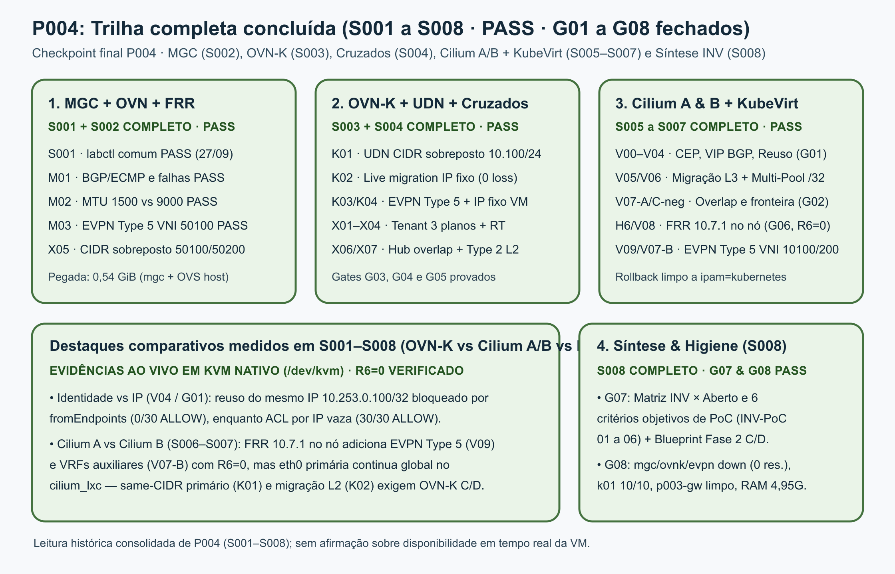
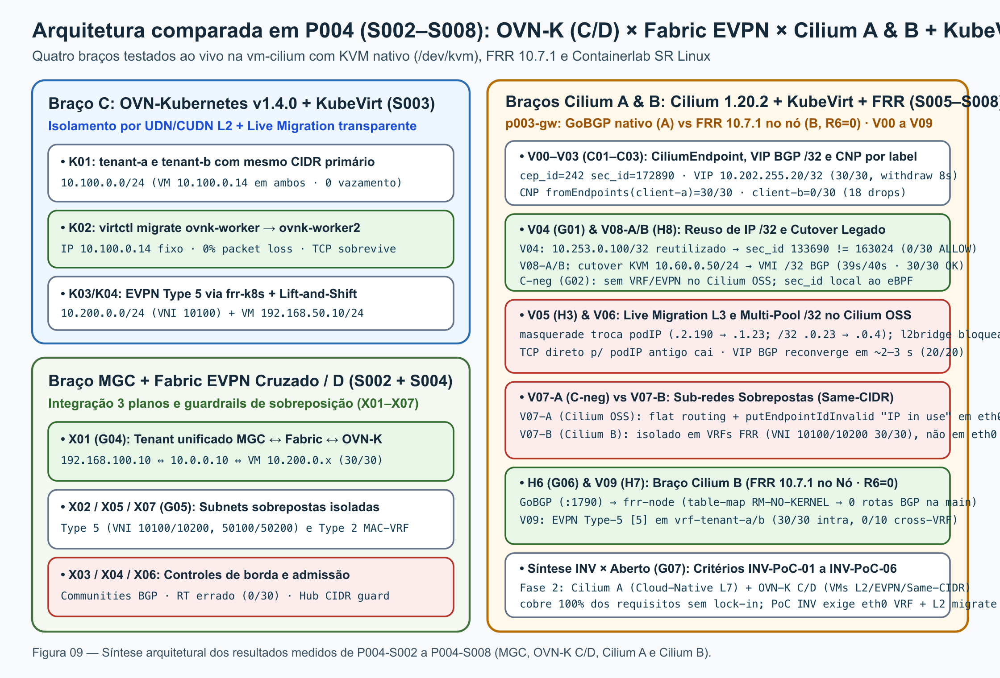

# Livro do aluno: Cilium BGP, Gateway API e tenants híbridos

## Guia de estudo e prática

**Edição:** 2.3 · **Formato:** módulos 1–11 com exercícios guiados apoiados nos ambientes P001–P003; módulo 12 de leitura histórica do estudo em nuvem, cuja infraestrutura fica fora da aula; módulo 13 de leitura dos resultados históricos completos de P004-S001 a P004-S008 (MGC, OVN-Kubernetes + KubeVirt, casos cruzados, Braços Cilium A e B + KubeVirt e síntese INV × equivalente aberto) · **Público-alvo:** estudantes de Kubernetes, redes e Cilium que já conhecem o vocabulário básico de IP e roteamento

> **Objetivo do módulo**
>
> Ao terminar este roteiro, a pessoa estudante consegue localizar os ambientes descritos para os exercícios dos módulos 1–11, explicar o que o Cilium anuncia por BGP, validar um Gateway HTTP/TCP/UDP exposto por VIP anycast, ler uma decisão de autorização na borda e no datapath, distinguir autorização por identidade de autorização por endereço em um tenant com pods Kubernetes e VMs OpenStack ou KubeVirt, e interpretar como leituras históricas o estudo em nuvem do módulo 12 e os resultados comparados de P004 (MGC/OVN, OVN-Kubernetes `C/D`, Cilium OSS `A`, Cilium + FRR `B` e critérios de aceite para PoC do INV) do módulo 13.

Esta edição preserva os módulos 1–11, com exercícios guiados e estudos das
trilhas P001–P003 sobre BGP, Gateway API, segurança, IPAM e tenants híbridos.
O módulo 12 é leitura do estudo histórico de nós reais na nuvem; essa
infraestrutura não faz parte da aula. O módulo 13 apresenta a leitura completa dos
resultados de `P004-S001` a `P004-S008` (concluídas com **PASS**):
a réplica MGC com OVN, FRR e EVPN (`M01–M03` e `X05`), o plano OVN-Kubernetes +
UDN/CUDN + EVPN + KubeVirt (`K01–K04`), os casos cruzados entre os três planos
(`X01–X04`, `X06` e `X07`), o Braço Cilium A com KubeVirt `v1.9.0` no cluster
`p003-gw` (`V00–V08-A`, `C-neg` / `G01` / `G02`), o Braço Cilium B com `FRR 10.7.1`
no nó sob o invariante `R6=0` (`H6`/`G06`, `V09`/`H7`, `V07-B`, `V08-B`), o
blueprint de transição para a Fase 2 (`Braços C e D`) e os critérios objetivos
de aceite para uma PoC comercial do INV (`G07`) seguidos da higiene final dos
laboratórios (`G08`). Os módulos 12 e 13 interpretam evidência
histórica; não exigem acesso em tempo real a essas infraestruturas. Nenhum
módulo mede desempenho de hardware de produção.

## Sumário

1. [Como usar o guia](#como-usar-o-guia)
2. [Mapa dos laboratórios](#mapa-dos-laboratórios)
3. [Vocabulário mínimo](#vocabulário-mínimo)
4. [Módulo 1 — Baseline e o que o Cilium anuncia](#módulo-1--baseline-e-o-que-o-cilium-anuncia)
5. [Módulo 2 — VIP anycast e caminho do tráfego](#módulo-2--vip-anycast-e-caminho-do-tráfego)
6. [Módulo 3 — Dual-stack IPv6 no plano de controle](#módulo-3--dual-stack-ipv6-no-plano-de-controle)
7. [Módulo 4 — Falhas, Graceful Restart e convergência](#módulo-4--falhas-graceful-restart-e-convergência)
8. [Módulo 5 — Escala e desempenho](#módulo-5--escala-e-desempenho)
9. [Módulo 6 — Gateway API HTTP, TCP e UDP por VIP BGP](#módulo-6--gateway-api-http-tcp-e-udp-por-vip-bgp)
10. [Módulo 7 — Autorização externa na borda](#módulo-7--autorização-externa-na-borda)
11. [Módulo 8 — WireGuard em native routing e VXLAN](#módulo-8--wireguard-em-native-routing-e-vxlan)
12. [Módulo 9 — Tenants: rede, borda e configuração](#módulo-9--tenants-rede-borda-e-configuração)
13. [Módulo 10 — Multi-Pool IPAM: /24 versus /32](#módulo-10--multi-pool-ipam-24-versus-32)
14. [Módulo 11 — Tenant híbrido: pods e VMs OpenStack](#módulo-11--tenant-híbrido-pods-e-vms-openstack)
15. [Módulo 12 — Nós reais na nuvem: o que muda](#módulo-12--nós-reais-na-nuvem-o-que-muda)
16. [Módulo 13 — MGC, OVN, FRR e EVPN: o que os resultados provam](#módulo-13--mgc-ovn-frr-e-evpn-o-que-os-resultados-provam)
17. [Apêndice do instrutor](#apêndice-do-instrutor)
18. [Limites do que foi demonstrado](#limites-do-que-foi-demonstrado)
19. [Próximos estudos](#próximos-estudos)

## Como usar o guia

### Objetivos de aprendizagem

- explicar a diferença entre sessão BGP, rota anunciada e encaminhamento de um pacote;
- distinguir PodCIDR agregado, VIP de serviço e bloco Multi-Pool `/32`;
- expor um Gateway HTTP, TCP e UDP por uma VIP anunciada por BGP e provar cada listener com controle negativo;
- ler uma decisão allow/deny/absent do ExternalAuth e reconhecer fail-closed;
- verificar em captura se um tráfego está cifrado, encapsulado ou em claro;
- provar isolamento de tenant em três controles diferentes: rede, borda e configuração;
- explicar por que autorização por label não vaza no reuso de IP e por que autorização por CIDR vaza;
- registrar separadamente a saída observada e a expectativa do roteiro;
- interpretar os resultados de P004 (MGC/OVN/FRR/EVPN, OVN-Kubernetes + KubeVirt, casos cruzados e Braços Cilium A/B + KubeVirt, com todos os gates `G00–G09` concluídos), sem confundi-los com a trilha básica do Cilium.

### Regras de segurança

- Os exercícios da pessoa estudante são de leitura e de requisição HTTP/TCP/UDP. Mutação é tarefa do instrutor e está marcada como tal.
- Não use `kubectl delete`, `kubectl drain`, `docker stop`, `clab destroy` ou o script de teardown como parte deste roteiro.
- Nunca dependa do contexto implícito do `kubectl`. Cada comando traz `--kubeconfig` e `--context`.
- O cluster `k01` é a referência histórica protegida. Os estudos P003 rodam em um segundo cluster, o sandbox `p003-gw`. Antes de qualquer comando no sandbox, confirme o UID do cluster com o valor entregue pelo instrutor.
- Se `127.0.0.1:18081` já responder no seu computador, existe um túnel ativo. Reutilize-o.
- O módulo 13 é somente leitura de evidências históricas: não traz comandos interativos para MGC, OVN-Kubernetes ou KubeVirt e não pede acesso à VM atual.

### Onde um comando roda

| Rótulo | Significado |
|---|---|
| **Mac** | computador da pessoa estudante |
| **vm-cilium** | sessão SSH no host Linux do laboratório |
| **container** | comando precedido por `sudo docker exec` na vm-cilium |
| **Kubernetes k01** | `sudo kubectl --kubeconfig "$K01_KUBECONFIG" --context kind-k01` |
| **Kubernetes sandbox** | `sudo kubectl --kubeconfig "$STUDY_KUBECONFIG" --context kind-p003-gw` |
| **testbed OpenStack** | `sudo docker exec -i <container-do-testbed> bash` e, dentro dele, `openstack` |

Defina as variáveis uma vez por sessão na **vm-cilium**. Os valores abaixo são
os do laboratório de referência; use os que o instrutor entregar:

~~~bash
export LAB_DIR="${LAB_DIR:-/opt/poc-k8s-fabric}"
export K01_KUBECONFIG="${K01_KUBECONFIG:-/root/.kube/k01-rebuild.config}"
export STUDY_KUBECONFIG="${STUDY_KUBECONFIG:-/root/.kube/p003-gw.config}"
export STUDY_CLUSTER_UID="${STUDY_CLUSTER_UID:-<uid-entregue-pelo-instrutor>}"
k01() { sudo kubectl --kubeconfig "$K01_KUBECONFIG" --context kind-k01 "$@"; }
ks()  { sudo kubectl --kubeconfig "$STUDY_KUBECONFIG" --context kind-p003-gw "$@"; }
C1="sudo docker exec clab-poc-k8s-kind-client-ext"
C2="sudo docker exec clab-p003-gw-fabric-client"
UID_NOW="$(ks get namespace kube-system -o jsonpath='{.metadata.uid}')"
test "$UID_NOW" = "$STUDY_CLUSTER_UID" && echo "sandbox OK"
~~~

Se o teste de UID falhar, pare. Um `kubectl` no cluster errado invalida o
exercício e pode alterar a referência.

## Mapa dos laboratórios

Os exercícios práticos dos módulos 1–11 usam os ambientes documentados nas
linhas abaixo. O módulo 12 é leitura de um estudo com infraestrutura em nuvem
que não faz parte da aula; o módulo 13 lê resultados históricos completos da
trilha P004 (MGC, OVN-Kubernetes + EVPN, casos cruzados e Braços Cilium A/B +
KubeVirt). A tabela distingue esses estudos dos ambientes usados nos exercícios:

| Ambiente | Componentes | Versões | Papel |
|---|---|---|---|
| **Lab de referência `k01`** | 2 spines + 3 leaves SR Linux, `border1` FRR, `client-ext`, kind com 3 nós | SR Linux `25.3.2`, FRR `8.4.1`, Kubernetes `v1.35.0`, Cilium `1.20.1` | Módulos 1 a 5; protegido, somente leitura |
| **Sandbox `p003-gw`** | segundo fabric containerlab + kind com 3 nós + cliente `198.19.0.10` | Cilium `1.20.2`, Gateway API `1.6.1` (CRDs standard + experimental) | Módulos 6 a 11; onde o instrutor muda configuração |
| **Testbed OpenStack** | DevStack em container (Neutron OVS, qrouter, qdhcp, SG) | neutron `34.x`, cirros `0.6.0` | Módulo 11; VMs do tenant |
| **VM em KVM real** | `qemu` no host ligado ao `br-int` do testbed por um par veth | cirros `0.6.0` | Módulo 11, caso C5 |
| **Estudo histórico de nós reais na nuvem** | 3 VMs na nuvem, cluster `kubeadm` e FRR na mesma VPC | Kubernetes `1.35.2`, Cilium `1.20.1` | Módulo 12; leitura, infraestrutura fora da aula |
| **Réplica MGC (`P004-S002`)** | `labctl mgc`: OVN `26.03.3`, 1 central, 2 chassis, 2 gateways, FRR multi-VRF e cliente AS 200 | Linux VRFs nos gateways; EVPN Type 5 (`M01–M03`, `X05`) | Módulo 13.1; leitura de resultados históricos (`labctl mgc down` após os ensaios) |
| **Plano OVN-Kubernetes + Fabric EVPN (`P004-S003` e `S004`)** | `labctl evpn-fabric` + `labctl ovnk`: kind 3 nós + `ovnk-evpn-peer` + KubeVirt `/dev/kvm` | OVN-Kubernetes `v1.4.0`, KubeVirt `v1.9.0`, `frr-k8s` `v0.0.21`/`v0.0.27` | Módulo 13.2; leitura de resultados históricos (`K01–K04`, `X01–X04`, `X06–X07`) |
| **Braços Cilium A e B + KubeVirt (`P004-S005` a `S008`)** | `p003-gw` + KubeVirt `/dev/kvm` + `DaemonSet/frr-node` (no Braço B sob `R6=0`) | Cilium `1.20.2`, KubeVirt `v1.9.0`, FRR `10.7.1` (`table-map RM-NO-KERNEL`) | Módulos 13.3 e 13.4; leitura de resultados históricos (`V00–V09`, `G01`, `G02`, `G06–G08`) |

A tabela descreve os ambientes e estudos documentados, sem indicar
disponibilidade simultânea em tempo real (os perfis pesados operam em regime
*time-shared* via `labctl` para respeitar `R3: MemAvailable >= 4,00 GiB`). Os
quadros 05 e 06 ilustram os ambientes P001–P003; as figuras [07](diagramas/07-mgc-caminhos.png),
[08](diagramas/08-p004-estado.png) e [09](diagramas/09-p004-tres-planos-kubevirt.png)
ilustram a arquitetura e os resultados de P004.

Os dois fabrics usam eBGP puro em dois níveis. No `k01`, os nós falam com o
leaf do rack (AS 6510x para 6500x) e os leaves com os spines (AS 65500). No
sandbox, os nós usam AS 65301/65302, os leaves 65201/65202/65203, os spines
65600 e o border 65400. Os enlaces spine–leaf são IPv4 numerados em `/31`.

Endereços que aparecem nos exercícios:

| Recurso | Lab `k01` | Sandbox `p003-gw` |
|---|---|---|
| PodCIDR IPv4 por nó | `10.244.x.0/24` | `10.245.x.0/24` (IPAM `kubernetes`) |
| Pool de VIPs | `10.201.255.0/24`, VIP `10.201.255.10` | `10.202.255.0/24`, VIP `10.202.255.10` |
| Cliente externo ao cluster | `client-ext` `203.0.113.10` | `fabric-client` `198.19.0.10` |
| Gateway | não há | `p003-main` no namespace `p003-gateway`, listeners 8080/HTTP, 15432/TCP, 15353/UDP |
| Rede do tenant OpenStack | não há | `10.30.0.0/24` (subnet-a), externa `10.40.0.0/24` |

## Vocabulário mínimo

| Termo | Significado neste laboratório |
|---|---|
| **speaker** | o agente Cilium em um nó, que mantém a sessão BGP daquele nó |
| **PodCIDR** | bloco de IP reservado para pods de um nó; `/24` IPv4 por nó no IPAM `kubernetes` |
| **VIP** | endereço de serviço anunciado como `/32` por vários nós |
| **ECMP** | vários próximos saltos equivalentes para o mesmo prefixo |
| **GR** | Graceful Restart: o vizinho mantém as rotas enquanto a sessão BGP reinicia |
| **Gateway API** | recursos `Gateway`, `HTTPRoute`, `TCPRoute`, `UDPRoute` implementados pelo Cilium com Envoy |
| **ExternalAuth** | filtro do Gateway API que consulta um serviço externo antes de encaminhar a requisição |
| **CNP** | `CiliumNetworkPolicy`; `fromEndpoints` seleciona por label, `fromCIDR` por endereço |
| **Multi-Pool** | IPAM do Cilium em que cada nó recebe blocos de um `CiliumPodIPPool`, com `maskSize` configurável |
| **SG** | Security Group do Neutron, o firewall stateful da porta de uma VM |
| **RX morto** | a VM envia mas não recebe; limitação de KVM aninhado em container |

## A pergunta central: cada pod anuncia `/32`?

**Não com o IPAM padrão.** Uma sessão BGP não é aberta por pod. O agente
Cilium em cada nó é o speaker e anuncia o **PodCIDR `/24` do nó**. Um pod com
`10.244.1.27` está coberto por `10.244.1.0/24`; não nasce sessão nem anúncio
para `10.244.1.27/32`.

O serviço tem outra regra. O `echo-anycast` recebe a VIP `10.201.255.10`, usa
`externalTrafficPolicy: Cluster` e os três nós anunciam a mesma
`10.201.255.10/32`; o fabric instala vários próximos saltos e faz ECMP. A rota
representa o serviço e seus pontos de entrada, não cada backend.

Existe uma terceira forma, medida no Módulo 10: com Multi-Pool IPAM e
`maskSize: 32`, cada pod recebe um bloco `/32` próprio e o Cilium anuncia esse
bloco. O speaker continua sendo o nó. O que muda é a granularidade, a
quantidade de rotas e o momento em que um bloco é alocado e retirado.

## Módulo 1 — Baseline e o que o Cilium anuncia

Ambiente: lab `k01`. Origem: P001 (REQ-001 a REQ-007).

### 1.1 Conferir os containers

Na **vm-cilium**:

~~~bash
sudo docker ps --format 'table {{.Names}}\t{{.Status}}' | grep -E 'clab-poc-k8s-kind|k01-'
$C1 ip -4 addr show dev eth1
~~~

Esperado: `spine1`, `spine2`, `leaf1`, `leaf2`, `leaf3`, `border1`,
`client-ext` e três `k01-*`; o `client-ext` mostra `203.0.113.10` uma vez. Esse
endereço pode sumir após um redeploy (lição L1 do RUNBOOK); sem ele todos os
probes do módulo falham sem falha real.

### 1.2 Conferir o cluster e os PodCIDRs

~~~bash
k01 get nodes -o custom-columns=NODE:.metadata.name,PODCIDR:.spec.podCIDR,PODCIDRS:.spec.podCIDRs
k01 get pods -o wide
~~~

Responda no caderno: qual `/24` cobre o IP de cada pod `echo-*`? A resposta
aponta para o bloco do nó, nunca para um `/32` do pod.

### 1.3 Sessões e anúncios BGP

~~~bash
sudo KUBECONFIG="$K01_KUBECONFIG" cilium --context kind-k01 bgp peers
sudo KUBECONFIG="$K01_KUBECONFIG" cilium --context kind-k01 bgp routes advertised ipv4 unicast
k01 get ciliumbgpclusterconfigs,ciliumbgppeerconfigs,ciliumbgpadvertisements
~~~

Esperado: três sessões `established` (uma por nó, nunca uma por pod), timers
hold 9 s e keepalive 3 s, Graceful Restart habilitado com `restartTime` 30 s.
Entre os anúncios aparecem o PodCIDR do nó e a VIP `10.201.255.10/32`.

O anúncio da VIP só existe porque o `CiliumBGPAdvertisement` tem um `selector`
com `bgp-advertise=true` e o Service carrega esse label. Sem o selector o
agente não anuncia nada de Service; este foi um achado repetido em nós reais.

### 1.4 A rota no spine e a ausência de encapsulamento

~~~bash
sudo docker exec clab-poc-k8s-kind-spine1 sr_cli \
  "show network-instance default route-table ipv4-unicast prefix 10.244.0.0/16 longer"
sudo docker exec clab-poc-k8s-kind-spine1 sr_cli \
  "show network-instance default route-table ipv4-unicast prefix 10.201.255.10/32 detail"
~~~

Esperado: os três `/24` e a VIP com dois próximos saltos. Em native routing o
fabric vê o IP real do pod; a evidência histórica registra zero pacotes
UDP/8472 no fio e um handshake `203.0.113.10 > 10.244.2.198:8080` direto ao
pod.

| Item | Esperado | Observado |
|---|---|---|
| Nós `Ready` | 3 | |
| Sessões BGP | 3 established | |
| PodCIDRs no spine | 3 | |
| Next-hops da VIP no spine | 2 | |

## Módulo 2 — VIP anycast e caminho do tráfego

Ambiente: lab `k01`. Origem: P001 (REQ-008 a REQ-010).

### 2.1 Requisições a partir do client-ext

~~~bash
k01 get svc echo-anycast echo-local -o wide
for i in $(seq 1 20); do
  $C1 curl -fsS --max-time 5 http://10.201.255.10/hostname; echo
done | sort | uniq -c
~~~

Esperado: `echo-anycast` com `10.201.255.10` e `externalTrafficPolicy:
Cluster`; `echo-local` com `10.201.255.11` e `Local`. Vinte amostras não
garantem que todos os seis backends apareçam: ECMP e Maglev usam hashing. A
execução de referência registrou 20/20 HTTP 200 e seis pods distintos.

ICMP para a VIP não é respondido: o balanceador BPF atende TCP; `ping` na VIP
não é sinal de falha.

### 2.2 O túnel para o Mac

No **Mac**:

~~~bash
export VM_CILIUM_HOST="${VM_CILIUM_HOST:-IP_DA_VM}"
curl --silent --fail --max-time 2 http://127.0.0.1:18081/hostname || \
ssh -i ~/.ssh/id_rsa -o IdentityAgent=SSH_AUTH_SOCK -o ExitOnForwardFailure=yes -N \
  -L 127.0.0.1:18081:10.201.255.10:80 ubuntu@"${VM_CILIUM_HOST}"
~~~

O túnel termina no host da VM e encaminha uma porta local para a VIP. Ele não
publica a VIP na Internet. A rota do host que permite ao próprio host alcançar
a VIP é criada pelo instrutor com `scripts/06-expor-vip-na-vpc.sh`.

### 2.3 O caminho e o fix que o tornou possível

~~~text
Mac → túnel SSH → vm-cilium → clab-ext → border1/FRR → leaf3
    → spine → leaf do rack → nó Kubernetes → Cilium bpf-lb → Service → pod
~~~

O balanceador BPF precisa estar anexado à interface do fabric (`eth1` no nó
kind). O controlador de devices do Cilium 1.20.1 pula veths sem rota default,
então o kit fixa `devices=eth+` nos values. Sem isso a VIP era roteada de volta
ao fabric em loop. Um `helm upgrade` que regenere o ConfigMap remove a chave;
o apêndice do instrutor mostra a verificação condicional.

Quando o cliente está fora da VM, na mesma VPC, o caminho é assimétrico: a
requisição entra pelo fabric e a resposta volta pela bridge docker do host,
porque o nó kind roteia a VPC por `eth0`. É uma propriedade da topologia, não
uma falha.

## Módulo 3 — Dual-stack IPv6 no plano de controle

Ambiente: lab `k01` reconstruído com `values-dualstack.yaml`. Origem: P002-S001.

### 3.1 Ler o que foi provado

~~~bash
k01 get nodes -o custom-columns=NODE:.metadata.name,PODCIDRS:.spec.podCIDRs
sudo KUBECONFIG="$K01_KUBECONFIG" cilium --context kind-k01 bgp routes advertised ipv6 unicast
sudo docker exec clab-poc-k8s-kind-spine1 sr_cli \
  "show network-instance default route-table ipv6-unicast prefix fd14::a/128 detail"
~~~

Esperado: cada nó com dois PodCIDRs (`10.244.x.0/24` e `fd13:0:0:x::/64`), os
três `/64` no spine e a VIP `fd14::a/128` com dois próximos saltos. Uma única
sessão BGP transporta as duas famílias; a convergência do plano de controle
vale para ambas.

### 3.2 O que a topologia não entrega

A VIP IPv6 não é alcançável do `client-ext`: o underlay externo do lab é
IPv4-only e next-hops IPv4-mapped não encaminham IPv6. O tráfego pod→pod IPv6
cross-node flui pela rede kind, não pelo fabric. São limites do lab em
containers, não do Cilium nem do SR Linux. Não apresente alcance IPv6 fim a fim
como demonstrado.

Quatro configurações são obrigatórias e ficaram no kit: `ipv6.enabled: true`
nos values, `ipFamily: dual` com dois `podSubnet` no kind, `afi-safi
ipv6-unicast` nos grupos `rack*-k8s` dos leaves e `multipath ipv6-unicast` nos
spines.

## Módulo 4 — Falhas, Graceful Restart e convergência

Ambiente: lab `k01`. Origem: P001 REQ-011, P002-S002 e P002-S004. Os gatilhos
de falha são tarefa do instrutor; a pessoa estudante lê e interpreta.

### 4.1 Como se mede um blackhole

Três loops de `curl` com timeout de 2 s rodam no `client-ext` contra a VIP
anycast, um pod do rack 1 (caminho único) e um pod do rack 2. Blackhole real é
o **maior intervalo sem nenhum OK**; timeouts encadeados não contam (lição L4).
Falhas de SR Linux são provocadas com `admin-state disable` via `sr_cli`,
nunca com `docker stop`, que destrói a wiring veth (lição L2).

### 4.2 Resultados medidos

| Falha | VIP anycast | PodCIDR do rack afetado | Reconvergência |
|---|---|---|---|
| Restart do agent, GR ON | 0 falhas | sem blackhole | datapath BPF pinado sobrevive |
| Restart do agent, GR OFF | 0 falhas (outros nós anunciam) | blackhole 10,6 s (P001) a 16,5 s (P002) | até o novo agent reanunciar |
| Drain do nó | blip de 50 a 300 ms no início da evicção | pods evictados | GR irrelevante: a sessão não cai |
| 1 spine de 2 | 100% OK em 28,7 mil amostras | n/a | BGP re-up 33 a 38 s |
| 1 leaf | 100% OK (anycast segue pelo outro rack) | blackhole total do rack por 107 a 138 s | dados +44 a 48 s após enable |
| Spine 2 + leaf 1 juntos | 100% OK em 34 mil amostras | blackhole total do rack 1 | lab sobrevive degradado |
| Flap simultâneo de 2 workers, GR ON | 0 de 19451 falhas | 2,4% a 4,4% de falhas, maxgap 2 a 4 s, sem blackhole | agents ~52 s, estável ~82 s |

Leituras que a pessoa estudante deve conseguir explicar:

- a VIP anycast `/32` com ECMP foi imune a todas as falhas de fabric testadas;
- o PodCIDR é caminho único por rack quando o nó é single-homed; a falha do leaf isola o rack;
- Graceful Restart elimina o blackhole de PodCIDR no restart do agent, em um nó ou em vários;
- dual-homing do nó daria ECMP ao PodCIDR; o simulador SR Linux não estabelece TCP/179 em porta adicionada em runtime, então isso fica para um cluster real.

### 4.3 O que a API do Cilium não expõe

`CiliumBGPPeerConfig` v2 na versão 1.20.x tem `timers`, `gracefulRestart`,
`ebgpMultihop`, `families` e `authSecretRef`. Não há campo BFD. A detecção de
falha de sessão hoje é hold 9 s e keepalive 3 s, o menor valor aceito na
validação do lab. Essa lacuna é o ponto de partida de um dos próximos estudos.

## Módulo 5 — Escala e desempenho

Ambiente: lab `k01`. Origem: P002-S003.

### 5.1 O que a pessoa estudante confere

~~~bash
sudo docker exec clab-poc-k8s-kind-spine1 sr_cli \
  "show network-instance default route-table ipv4-unicast summary"
k01 get deploy echo
~~~

Anote o total de rotas IPv4 no spine e o número de réplicas. O instrutor pode
escalar o `echo` de 6 para 40 réplicas; repita o primeiro comando e compare.

### 5.2 Resultados medidos

| Eixo | Resultado |
|---|---|
| Pods 6 → 40 | 13 s até Ready; RIB do fabric inalterado (26 = 26): o `/24` agrega |
| +10 VIPs `/32` | primeira no spine em 1,3 s; 10/10 em 4,2 s; ECMP de 2 next-hops por VIP |
| Burst de +30 VIPs | 30/30 em 3,0 s; withdrawal completo em 6,0 s |
| Throughput pod→pod cross-node | 27,5 Gb/s com 1 fluxo; 177 Gb/s com 8 fluxos; 193 Gb/s no sentido reverso |
| Latência pod→pod | 0,094 ms ocioso; 0,039 ms sob 177 Gb/s, 0% perda |
| VIP sob carga | 0 falhas em ~24,7 mil requisições |
| Overlay VXLAN versus native | MTU 1450 versus 1500; 11,2 versus 27,4 Gb/s com 1 fluxo |

A propriedade de escala é a agregação: pods escalam sem tocar no BGP e a RIB
cresce apenas com VIPs vezes nós, de forma linear. Os números absolutos vêm de
SR Linux em container e veths do kind; use apenas as relações.

## Módulo 6 — Gateway API HTTP, TCP e UDP por VIP BGP

Ambiente: sandbox `p003-gw`. Origem: P003-S003 e P003-S004.

### 6.1 O Gateway e seu Service

~~~bash
ks -n p003-gateway get gateway p003-main -o wide
ks -n p003-gateway get httproutes,tcproutes,udproutes
ks -n p003-gateway get svc -l bgp-advertise=true
sudo KUBECONFIG="$STUDY_KUBECONFIG" cilium --context kind-p003-gw \
  bgp routes advertised ipv4 unicast
~~~

Esperado: Gateway `Programmed=True` com `IPAddress 10.202.255.10`; o Service
gerado pelo Cilium com `EXTERNAL-IP 10.202.255.10` e o label
`bgp-advertise=true`, que vem de `spec.infrastructure.labels` do Gateway, não
de `metadata.labels`. A VIP aparece nos anúncios BGP dos três nós.

### 6.2 Um listener por protocolo, com controle negativo

~~~bash
VIP=10.202.255.10
$C2 curl -sS --retry 0 --max-time 5 -H 'Host: echo.p003.study' \
  -w '\n%{http_code}\n' "http://$VIP:8080/hostname"
$C2 curl -sS --retry 0 --max-time 5 -H 'Host: wrong.example' \
  -o /dev/null -w '%{http_code}\n' "http://$VIP:8080/hostname"
$C2 sh -c "echo P003-nonce-1 | nc -w 3 $VIP 15432"
$C2 dig @"$VIP" -p 15353 study.p003 TXT +short +notcp +tries=1 +time=2
$C2 sh -c "echo P003-gw04 | nc -w 3 $VIP 15433"
~~~

| Caso | Esperado | Observado |
|---|---|---|
| HTTP com Host correto | 200 e hostname de um pod `http-echo-*` | |
| HTTP com Host errado | 404 do Envoy | |
| TCP 15432 | o nonce volta idêntico | |
| UDP 15353 | `"P003-OK"` | |
| TCP 15433 sem listener | timeout, nenhuma chegada na fixture | |

A matriz de referência registrou 30/30 em cada listener, 503 com
EndpointSlice vazio quando o backend foi escalado a zero e recuperação
completa ao restaurar. Quando o instrutor troca o `CiliumBGPAdvertisement`
por um selector que não casa, a `/32` some do spine em cerca de 15 s, a VIP
para de responder e o IP direto do pod continua funcionando: é o controle que
separa "anúncio" de "serviço".

### 6.3 Achado: `hostNetwork` do Gateway não expõe listener no nó

`gatewayAPI.hostNetwork.enabled` no Cilium 1.20.2 é uma feature dos listeners
Envoy (L7), controlada por `nodes.matchLabels`. Com o seletor vazio, nenhum
socket abre no IP do nó nas portas 8080, 15432 ou 15353. Os probes ao nó
nessas portas deram 180/180 falhas; os `nodePort` do Service gerado deram
180/180 sucessos. Para expor TCP/UDP no nó, o caminho suportado é o NodePort
ou a VIP por BGP.

## Módulo 7 — Autorização externa na borda

Ambiente: sandbox `p003-gw`. Origem: P003-S005, P003-S006 e P003-S009 (T05).
O ExternalAuth do Gateway API é experimental na 1.20.2; o CRD `HTTPRoute`
recebeu o schema experimental por um patch de spec, porque o
`experimental-install.yaml` estoura o limite de annotations no Kubernetes
1.35.0.

### 7.1 A fixture

Um serviço Go em `studies/p003/fixtures/auth/` decide `allow`, `deny` ou
`absent` a partir do header `X-Lab-Decision` e registra cada consulta com o
`X-Lab-Request-ID`. Ele fala HTTP e gRPC (`envoy.service.auth.v3`). Não é um
IdP; serve para observar a decisão, não para autenticar pessoas.

### 7.2 Três decisões, dois protocolos

~~~bash
for d in allow deny ""; do
  $C2 curl -sS --retry 0 --max-time 15 -H 'Host: echo.p003.study' \
    ${d:+-H "X-Lab-Decision: $d"} -H "X-Lab-Request-ID: aluno-$RANDOM" \
    -o /dev/null -w "decisao=${d:-absent} http=%{http_code}\n" \
    "http://10.202.255.10:8080/protected-http"
done
$C2 curl -sS --retry 0 -o /dev/null -w 'public http=%{http_code}\n' \
  -H 'Host: echo.p003.study' http://10.202.255.10:8080/public
~~~

| Decisão | HTTP | gRPC |
|---|---|---|
| allow | 200 | 200 |
| deny | 403 | 403 |
| absent | 401 | 401 |
| rota pública sem auth | 200 | 200 |

A matriz A01–A10 executou 900 requisições com esse resultado. O header
forjado `X-Lab-User` enviado pelo cliente não aparece na resposta (A08). A
rota pública não consulta o autorizador (A09).

### 7.3 Fail-closed sob degradação

| Cenário | HTTP | gRPC | Conclusão |
|---|---|---|---|
| autorizador escalado a zero | 403 em 2 ms | 403 | fail-closed |
| autorizador com atraso de 15 s | 403 após 10 s | 403 após ~200 ms | timeout do Envoy difere por protocolo |
| `backendRef` inexistente | 500 | 500 | `ResolvedRefs=False` |
| porta errada | 403 | 403 | `BackendNotFound` |
| cross-namespace sem `ReferenceGrant` | 500 | 500 | `RefNotPermitted` |
| `ReferenceGrant` removido durante probes | 403 → 500 em até 2 s | 200 → 500 em até 2 s | revogação sem bypass |

Nenhum cenário liberou a aplicação. Dois defeitos ficaram registrados na
1.20.2: com Grant válido, a rota HTTP cross-namespace com decisão allow pendura
(gRPC funciona), e um bloco `http: {}` vazio devolve 401 para todas as
decisões. `allowedResponseHeaders` não encaminhou os headers do autorizador ao
cliente.

## Módulo 8 — WireGuard em native routing e VXLAN

Ambiente: sandbox `p003-gw`. Origem: P003-S007 e P003-S008. Os perfis são
trocados pelo instrutor com `helm upgrade`; a pessoa estudante confere
interfaces e capturas.

### 8.1 Três perfis

| Perfil | Configuração | Sinal na bridge do underlay |
|---|---|---|
| W0 | criptografia desligada | native: payload em claro; VXLAN: UDP/8472 com payload em claro |
| W1 | `encryption.type=wireguard` | UDP/51871 para o tráfego pod→pod remoto |
| W2 | W1 + `nodeEncryption.enabled=true` | UDP/51871 também para tráfego de nó |

~~~bash
ks -n kube-system exec ds/cilium -- cilium-dbg encrypt status
ks -n kube-system exec ds/cilium -- ip -br link show cilium_wg0
~~~

### 8.2 O que as 24 células mostraram

Quatro placements (auth e app no nó A ou no nó B, ingress fixo no nó A) vezes
três perfis vezes duas topologias (native e VXLAN): 90 allow com 200 e 90 deny
com 403 em cada célula, zero drops no `cilium-dbg monitor`. O handshake
Envoy→autorizador relatado na issue 46768 não se reproduziu na 1.20.2 em nenhuma
combinação.

O achado de segurança é outro: em native routing, a perna Envoy→pod de auth
por IP direto **atravessa em claro** no underlay mesmo com WireGuard de pod
ativo (20 IDs de requisição legíveis por célula com auth remoto). Em VXLAN a
mesma perna sai cifrada em W1 e W2. A exposição depende da topologia, não da
decisão de auth. Ao desenhar criptografia, trate o tráfego originado pelo
Envoy do nó como tráfego de nó.

## Módulo 9 — Tenants: rede, borda e configuração

Ambiente: sandbox `p003-gw`. Origem: P003-S009, matriz T01–T17.

### 9.1 Três controles diferentes

| Controle | Mecanismo | O que impede |
|---|---|---|
| Rede | `CiliumNetworkPolicy` por identidade e porta | A alcançar B e vice-versa em conexões novas |
| Borda | ExternalAuth no listener HTTP | usuário sem credencial na rota protegida |
| Configuração | RBAC + `allowedRoutes` + `allowedListeners` + `ReferenceGrant` + PSA `restricted` | tenant editar policy alheia, criar Gateway de contorno, subir pod privilegiado |

### 9.2 Ler um drop de policy

~~~bash
ks get ciliumnetworkpolicies -A
ks -n kube-system exec ds/cilium -- \
  cilium-dbg monitor -t drop --related-to 0 2>/dev/null | head -20
~~~

Com o instrutor gerando tráfego A→B, você deve ver drops com `Policy denied` e
o log da aplicação de destino vazio: o pacote não chega. Isso é diferente de
um 403 na borda, que é gerado pelo Envoy antes da aplicação.

### 9.3 Resultados

Todos os 17 casos passaram. Os negativos foram reais: chamadas de API
impersonadas devolveram `Forbidden` (não apenas `can-i`), o PSA
`restricted:v1.35` rejeitou `hostNetwork`, `privileged`, `hostPID` e
`hostPath`, e labels de tenant ausentes ou forjados não executaram. A TLS do
backend (`BackendTLSPolicy`) falhou antes do request HTTP com CA errada, SAN
errado ou certificado expirado.

Um detalhe que muda desenho: o ExternalAuth protege apenas o listener HTTP.
O listener TCP sob a mesma VIP respondeu 200 para o tenant errado até uma CNP
L4 ser aplicada (T07). Autorização L7 não é política L4.

## Módulo 10 — Multi-Pool IPAM: /24 versus /32

Ambiente: sandbox `p003-gw`, com IPAM trocado para `multi-pool` pelo instrutor
e restaurado ao final. Origem: P003-S010, matriz I01–I10.

### 10.1 Dois braços com a mesma variável

| Braço | Pool | `maskSize` | `preAllocate` | Anúncio |
|---|---|---|---|---|
| M24 | `10.250.0.0/16` | 24 | 8 | `CiliumPodIPPool` com community `65301:100` |
| M32 | `10.252.0.0/16` | 32 | 8 | idem |

~~~bash
ks get ciliumpodippools -o wide
ks get ciliumnodes -o custom-columns=NODE:.metadata.name,POOLS:.spec.ipam.pools.allocated
sudo docker exec clab-p003-gw-fabric-border1 vtysh -c 'show ip bgp' | grep -E '10\.25[02]\.'
~~~

### 10.2 O que muda entre `/24` e `/32`

| Pergunta | M24 | M32 |
|---|---|---|
| Pod novo | cai num `/24` já alocado; zero eventos de bloco | cada pod ganha um `/32`; alocado e anunciado em 1 a 2 s |
| 40 pods | 3 rotas no border | 40 rotas no border, uma por pod |
| Pod `NotReady` sem delete | bloco e rota permanecem; IP direto responde 200; o Service exclui o pod | idêntico |
| Apagar 1 pod | bloco retido: `roundUp(inUse+8, 8)` não encolhe | idêntico; o piso de `preAllocate` domina |
| Voltar a zero pods | blocos `/24` retidos por mais de 120 s | encolhe em 42 s no operador e 48 s na RIB, até o piso de 8 `/32` por nó |
| Recriar pod no mesmo nó | IP novo dentro do mesmo `/24` | alterna entre `/32` recém-liberados; sem IP estável |
| Peer BGP do border desligado | prefixos somem em ~10 s; pod e VIP dão 000 | idêntico |

Duas lições. O datapath não gateia readiness: rota e alcance direto ao pod
existem enquanto o IP existir, e só o Service respeita `Ready`. A retirada de
um bloco depende de `preAllocate`, não da morte do pod; um `/32` não é
"retirado quando o pod morre".

## Módulo 11 — Tenant híbrido: pods e VMs OpenStack

Ambiente: sandbox `p003-gw` + testbed OpenStack + VM em KVM real. Origem:
P003-S011 a S016. As sínteses públicas completas estão em
[E08](estudos/08-lifecycle-synthesis.md) e [C5](estudos/09-vm-outside-container.md).

### 11.1 A pergunta

Um IP pode mudar de dono. Se a autorização for por endereço, o novo dono herda
a concessão. A matriz C01–C09 responde: **a autorização segue a identidade ou
o endereço?**

### 11.2 O caminho VM → pod

~~~text
VM (tap) → OVS br-int (VLAN 1) → qrouter netns → br-ex → veth para o host
  → FORWARD do host → fabric do sandbox → nó worker → CNP ingress → pod
~~~

Há dois pontos de decisão: o Security Group na porta da VM (plano de controle
do Neutron) e a CNP no pod (drop antes do pod; os contadores do pod ficam
flat). Para provar que o deny foi na policy e não na rede, use `cilium-dbg
monitor` no worker do pod e os contadores `/proc/net/snmp` dentro do pod.

### 11.3 O contraste que importa

| | C03: pods, `fromEndpoints` | C05: VM, `fromCIDR` |
|---|---|---|
| Âncora da autorização | label do endpoint (identidade) | IP da origem (endereço) |
| IP reaproveitado por outro dono | negado, 100% de perda | permitido, o novo dono herda |
| Reautorizar após IP novo (C04) | n/a | efetivo em 4 a 9 s |
| Revogar (C05) | n/a | efetivo em 1 a 7 s |
| Conclusão | seguro | seguro só sob sequenciamento manual |

Sequenciamento manual testado: revogar o CIDR, confirmar o bloqueio por
conexões novas, só então reutilizar o IP e reautorizar o novo dono. Nenhum
controlador sincroniza identidade Kubernetes com Security Group Neutron nesta
trilha.

Três armadilhas do Cilium 1.20.2 nesse desenho: `egress: []` não é default
deny (use `egressDeny`), `ingress: []` é inválido (revogue apontando o
`fromCIDR` para um IP que a VM não tem) e uma `HTTPRoute` ampla com `path: /`
faz fallback quando a rota específica é removida, tornando a revogação por
rota ineficaz.

### 11.4 Caso C5: a VM precisa de KVM real

Com a VM dentro do container do testbed (KVM aninhado), a TX funciona e a RX
morre: o sentido pod→VM dava timeout. Movendo a VM para `qemu -enable-kvm` no
host e ligando sua NIC ao `br-int` do container por um par veth com
`tag=1`, os dois sentidos deram 0% de perda, o IP veio do `qdhcp`, o egress
passou pelo `qrouter` e o SG ficou ativo. A CNP no pod de teste permitiu com
`fromCIDR` igual ao IP da VM e negou com 100% de perda ao retirá-la.

A pessoa estudante confere, com o instrutor:

~~~bash
ks -n p003-test get pods -o wide
ks -n p003-test exec echo-0 -- ping -c 3 -W 2 10.30.0.50
ks -n p003-test get cnp -o yaml | grep -A3 fromCIDR
~~~

Se a VM cair em `169.254.x.x`, a causa está em uma de duas coisas: falta a tag
VLAN no veth do container, ou o dnsmasq do `qdhcp` não recarregou o
`dhcp-hostsfile` (`kill -HUP`). Capture o DHCP nas duas pontas para isolar.

## Módulo 12 — Nós reais na nuvem: o que muda

Origem: P002-S005 e P002-S006. Este módulo é leitura; a infraestrutura de
nuvem não faz parte da aula.

Em três VMs reais da nuvem, `kubeadm` 1.35.2 sem kube-proxy e Cilium 1.20.1
funcionaram 1:1 com overlay VXLAN (MTU 1450, RTT ~0,9 ms). Um FRR externo na
mesma VPC recebeu por eBGP os três PodCIDR `/24` e a VIP anycast `/32` com
ECMP de três next-hops: o cenário do lab reproduziu-se em fabric real.

O que a plataforma bloqueou é a lição: com o guard de spoofing de IP da porta
ligado, SYNs com origem de pod saíam da NIC e não voltavam, e pacotes com
destino que não é o IP da porta (VIP anycast, IP de pod) eram descartados
antes do nó. A prova causal foi um toggle ON→OFF→ON na porta de um único nó:
com OFF, pod direto, VIP por BGP, VIP por rota estática e conexão nova
pod→FRR sem SNAT funcionaram; com ON, apenas NodePort. A API reportou `false`
antes de o datapath aceitar; um canário FRR→pod é o único readiness confiável.

Para native routing ou VIP anycast em nós reais, a porta precisa aceitar
origens e destinos além do seu próprio IP, por allowed-address-pairs ou guard
desligado. Isso é uma decisão de postura de segurança da VPC, não um ajuste
do Cilium.

## Módulo 13 — MGC, OVN, FRR e EVPN: o que os resultados provam

Este módulo é uma leitura guiada dos resultados históricos completos de `P004-S001` a
`P004-S008` (concluídas com **PASS**). Os perfis
`labctl/labs/{mgc,evpn-fabric,ovnk,p003-gw}.sh` e os artefatos de
`studies/p004/{ovn,evpn-fabric,ovnk,cases,cilium-a,cilium-b}/` estão no repositório como
referência de instrutor, mas a atividade deste módulo é interpretar as medições
comparadas sem depender do estado atual da VM.

### 13.1 Plano MGC Connect (`P004-S002`: OVN + FRR multi-VRF e `X05`)

*Figura 07 — Topologia lógica dos caminhos medidos na réplica MGC; o desenho não
representa um inventário ou estado operacional atual.*

O tenant OVN usou a rede `192.168.100.0/24`, com uma VM fake em
`192.168.100.10`. Dois Connect Gateways tinham as Linux VRFs `ovnvrf100` e
`ovnvrf200`, com FRR dentro dos próprios gateways. Cada gateway mantinha uma
sessão BGP com o cliente legado AS 200, que anunciava `10.0.0.0/16`. Esse
caminho sustenta a leitura de M01 e M02. O peer externo usado em M03 e X05 é
outro caminho: ele recebeu as rotas EVPN Type 5 dos tenants, identificadas pelo
VNI `50100` (tenant A) e pelo VNI `50200` (tenant B em X05); não era o cliente
legado nas VLANs 100 e 200.

*Figura 08 — Trilha P004 concluída com PASS de S001 a S008 (`G01` a `G08` fechados).*

M01 passou com uma exceção de escopo: o fault de FRR parou `bgpd`, `bfdd` e
`zebra` dentro de `ovn-gw-1`, não um container FRR separado. Os gateways usaram
FRR 10.7.0 e o cliente, 8.4.1_git. Withdraw e faults controlados preservaram
o tráfego medido, mas a falha do chassis `ovn-chassis-1` não foi testada; esse
host hospedava a fixture da VM fake e era distinto do plano central OVN.

M02 passou sob o escopo aceito: com MTU 1500, pacotes pequenos passaram 30/30,
mas o pacote IPv4 jumbo de 9000 B com DF não recebeu resposta em 30 tentativas
(0/30) e o roteador devolveu ICMP Frag Needed com MTU 1500. Com MTU 9000, os
pacotes pequenos e jumbo passaram 30/30; depois, as MTUs foram restauradas a
1500. A reprodução literal do fragmento no tap físico da PoC permaneceu parcial.

M03 passou com um controle negativo causal. O positivo alcançou
`192.168.100.0/24` como Type 5 no VNI `50100` e o ping respondeu 30/30. No
controle causal, A7 definiu `dynamic-routing-redistribute=static` na LRP
tenant. Esse filtro excluiu rotas `connected` dos anúncios; não converteu a
origem da rota para `static`. A seleção retirou a rota-alvo do SB, a rota
tenant, o Type 5 e a FIB, e o ping teve 0/3 respostas. BGP, VTEP e duas rotas
colaterais permaneceram. Ao restaurar a chave ao estado ausente, o caminho
voltou e o ping respondeu 3/3. O controle negativo literal do VNI ficou
NOT_RUN: não havia causalidade estabelecida com o withdraw da rota exportada
pelo router/FRR.

X05 fechou com **PASS** em 23/10/2026 (`run c9d0e1` `G0→G8 RC=0` e prova
negativa de rollback `b8c9d0` `G7+G8 PASS`). Um segundo tenant B foi criado com
a **mesma sub-rede** `192.168.100.0/24` (host `192.168.100.10`) e o **mesmo
`/30` de trânsito** `169.254.254.0/30`, isolado no VRF `ovnvrf50200` (VNI
`50200`, RT `65000:50200`). O alcance intra-tenant passou 30/30 nos dois
tenants (`10.250.0.1 -> 192.168.100.10` no VNI `50100` e `10.251.0.1 ->
192.168.100.10` no VNI `50200`), enquanto as quatro direções cross-tenant
tiveram `0/3` respostas e `0` pacotes capturados no `tcpdump` da interface de
destino. Para que o Linux VXLAN bridge do peer desencapsulasse a rota EVPN Type
5 para o roteamento L3 do VRF, o `Router MAC` anunciado pelo gateway precisou
coincidir com o MAC de `br-vxlan50200` (`02:00:00:20:00:01`). O rollback
canônico retirou primeiro os anúncios BGP/EVPN antes de remover os objetos OVN
NB e os VRFs, encerrando com `0` resíduos.

### 13.2 OVN-Kubernetes + UDN/EVPN + KubeVirt e Casos Cruzados (`P004-S003` e `P004-S004`)

*Figura 09 — Comparação experimental entre os braços testados em P004-S002
a P004-S008 com KVM nativo (`/dev/kvm`), EVPN, Cilium 1.20.2 e FRR 10.7.1 (`R6=0`).*

Na sessão `P004-S003` (**PASS** em 23/10/2026), os perfis `labctl evpn-fabric`
e `labctl ovnk` subiram um cluster Kind de 3 nós com OVN-Kubernetes `v1.4.0`,
KubeVirt `v1.9.0` em KVM nativo (`/dev/kvm`) e `frr-k8s` `v0.0.27`, provando o
gate **`G03`** (`K01–K04`):
- **K01 (UDN com CIDR sobreposto):** duas `UserDefinedNetwork` primárias (`tenant-a` e `tenant-b`) usaram o mesmo CIDR `10.100.0.0/24`; as VMs `vm-a` e `vm-b` receberam o **mesmo IP `10.100.0.14`**, responderam `30/30` dentro do próprio tenant e tiveram `0/30` entre tenants.
- **K02 (Live Migration com IP e sessão preservados):** `virtctl migrate vm-a` moveu a VM entre `ovnk-worker` e `ovnk-worker2` em `~16 s`, preservando o IP `10.100.0.14/24` na UDN Layer2 com **`0%` de perda de pacotes ICMP** (`60/60`) e **sobrevivência da sessão TCP longa**.
- **K03 e K04 (EVPN Type 5 e Lift-and-Shift):** `ClusterUserDefinedNetwork` (`10.200.0.0/24`) anunciada via `RouteAdvertisements` + `frr-k8s` ao `evpn-fabric` (VNI `10100`, `30/30` positivo, `0/10` negativo) e preservação de IP fixo legado (`192.168.50.10/24` em `K04`).

Na sessão `P004-S004` (**PASS** em 24/10/2026), os casos cruzados `X01–X04`,
`X06` e `X07` integraram simultaneamente os planos `mgc`, `evpn-fabric` e
`ovnk` + KubeVirt, provando os gates **`G04`** e **`G05`**: conectividade fim a
fim do tenant unificado (`X01`, `30/30`), isolamento em 3 planos com
`10.200.0.0/24` e `10.0.0.0/24` sobrepostos (`X02`, `0` pacotes vazados),
filtragem por BGP community (`X03`), bloqueio de Route-Target incorreto
(`X04`, `0/30`), detecção de colisão de CIDR em VRF hub (`X06`) e extensão L2
em `MAC-VRF` EVPN Type 2 com mesmo CIDR `172.16.50.0/24` (`X07`, VNIs `20100`
vs `20200`).

### 13.3 Braço Cilium A: `Cilium 1.20.2` + `KubeVirt v1.9.0` no `p003-gw` (`P004-S005`)

Na sessão `P004-S005` (**PASS** em 24/10/2026), o KubeVirt `v1.9.0` foi
instalado no cluster sandbox `p003-gw` (`Cilium 1.20.2`) após descer
`ovnk`/`evpn-fabric`/`mgc` via `labctl down` (cumprindo `MemAvailable >= 4 GiB`),
e os casos **`V00–V06` (`C01–C06`)** foram medidos ao vivo:
- **V00 e V01 (`C01` — Datapath KVM e `CiliumEndpoint`):** a VM CirrOS `vm-a` (`binding: masquerade` sobre `/dev/kvm`) comunicou-se bidirecionalmente com pods (`30/30` nos dois sentidos; `0/30` com `runStrategy=Halted`). No Cilium, o pod `virt-launcher` apareceu como `CiliumEndpoint` (`cep_id=242`, `sec_identity=172890`, `ip=10.245.2.231` no `PodCIDR` `10.245.2.0/24`), enquanto o guest interno operou com `eth0 = 10.0.2.2/24`.
- **V02 e V03 (`C02`/`C03` — VIP BGP `/32` e `CiliumNetworkPolicy`):** o `Service LoadBalancer vm-a-vip` (`10.202.255.20/32`, `bgp-advertise=true`) foi anunciado em `border1` (`30/30` HTTP 200 de `198.19.0.10`, withdraw em `8 s` -> `0/30`). A `CiliumNetworkPolicy` por label (`fromEndpoints: app=p004-client-a`) permitiu `30/30` de `client-a` e bloqueou `0/30` de `client-b` com `18` drops `Policy denied` no `cilium-dbg monitor`.
- **V04 (`C04` / Gate `G01` — Reuso determinístico de IP `/32` vs Identidade Cilium):** usando o pool `p004-single-ip` (`10.253.0.100/32`), `vm-a-reuse` (`sec_id=163024`, `ip=10.253.0.100`) obteve `30/30 ALLOW` em `target-srv:8080`. Após sua deleção, `vm-b-reuse` herdou o **mesmo IP `10.253.0.100`**, mas recebeu `sec_id=133690 != 163024` e obteve **`0/30 ALLOW`** sob `fromEndpoints(app=p004-vm-a)` (`25` drops `Policy denied`), enquanto uma ACL ancorada exclusivamente em IP (`-s 10.253.0.100/32`) concedeu `30/30 ALLOW` ao IP reutilizado.
- **V05 (`C05` / `H3` — Live Migration no Cilium OSS):** a migração de `p003-gw-worker` (`10.245.2.190`) para `p003-gw-worker2` (`10.245.1.23`) em `22 s` trocou o IP do `virt-launcher` e derrubou a sessão TCP aberta para o podIP antigo (`tcp_long_survived=no`), enquanto a VIP BGP `10.202.255.20/32` reconvergiu automaticamente (`max_gap_ms=3000.0ms`).
- **V06 (`C06` / `H4` — Multi-Pool `/32` BGP + Migração + Rollback):** em `ipam.mode=multi-pool` (`p004-vm`, `maskSize: 32`), `vm-a` recebeu `10.252.0.23/32` (`30/30` probes diretos de `198.19.0.10` via `border1`); após migrar para `worker2`, recebeu `10.252.0.4/32` (`30/30` probes diretos, enquanto `10.252.0.23/32` ficou retido no `CiliumNode` de origem pelo piso `multiPoolPreAllocation`). Ao final, o rollback restaurou `p003-gw` a `ipam.mode=kubernetes` (`0` pools residuais) com `labctl p003-gw verify` e `labctl k01 verify` aprovados.

### 13.4 Negativos do Braço Cilium A, Braço Cilium B (`FRR 10.7.1` + EVPN Type 5) e Síntese `INV × Aberto` (`P004-S006` a `P004-S008`)

Nas sessões `P004-S006`, `P004-S007` e `P004-S008` (**PASS**), o estudo concluiu a comparação empírica entre **Cilium A**, **Cilium B**, **OVN-Kubernetes (`C/D`)** e **INV**:
- **Negativos e Fronteira do Braço Cilium A (`P004-S006` — `V07-A`, `V08-A`, `C-neg` / Gate `G02`):**
  - **V07-A (`C07` / `H5` — Sub-redes Sobrepostas no Cilium OSS):** dois namespaces compartilhando o mesmo CIDR (`10.250.0.0/24` / `10.253.10.0/24`) caem na mesma tabela de roteamento flat (`vrf_count=0`, sem isolamento L3), e dois pods solicitando o mesmo pool `/32` (`10.253.10.100/32`) no mesmo nó falham no segundo pod com `putEndpointIdInvalid "IP ipv4:10.253.10.100 is already in use"` por colisão no mapa BPF global `cilium_lxc`.
  - **V08-A (`C08` / `H8` — Cutover de VM Legada via `/32` BGP):** uma VM legada QEMU/KVM (`10.60.0.50/24` na `leaf1`, `30/30` HTTP) foi migrada por cutover para uma VMI KubeVirt anunciando `10.60.0.50/32` (`CiliumPodIPPool`, LPM `/32` sobre `/24` na `border1` em `25 s`, `cutover_total_s=39 s`, `30/30` HTTP).
  - **C-neg (`G02`):** a API BGP v2 do Cilium rejeita `vrf`/`evpn`/`l2vpn` (`strict decoding error`), não instala rotas recebidas no kernel (`proto bgp = 0`) e não propaga a identidade eBPF (`sec_id`) no cabeçalho IP externo.
- **Braço Cilium B — `FRR 10.7.1` no Nó sob Invariante `R6=0` (`P004-S006` e `P004-S007` — `H6`/`G06`, `V09`/`H7`, `V07-B`, `V08-B`):**
  - **H6 (`G06`):** o `DaemonSet/frr-node` (`FRR 10.7.1`) pareia localmente com o GoBGP do Cilium (`10.255.255.1:1790`) e com os switches ToR (`leaf1`/`leaf2`), mantendo **`r6_kernel_bgp_routes = 0`** na tabela `main` via `table-map RM-NO-KERNEL` para proteger o datapath eBPF do Cilium.
  - **V09 (`H7`) e V07-B:** nas VRFs Linux do nó (`vrf-tenant-a` `VNI 10100` `RT 65000:10100` e `vrf-tenant-b` `VNI 10200` `RT 65000:10200`), o FRR anuncia e importa rotas **EVPN Type 5 (`[5]`)** e isola CIDRs/IPs idênticos (`10.253.10.0/24`, `10.253.10.100/24`) com `30/30` intra-VRF, `0/10` cross-VRF e `R6=0`, comprovando porém que a interface primária `eth0` dos pods/VMs continua presa ao mapa global `cilium_lxc`.
  - **V08-B:** cutover `10.60.0.50/32` via `Cilium GoBGP -> FRR 10.7.1 no nó -> border1` (`AS_PATH 65203 65600 65201 65301 65311`, `Community 65301:100`, `rib_em=27 s`, `cutover_total=40 s`, `30/30` HTTP, `R6=0`).
- **Síntese `INV × Equivalente Aberto` (`G07`) e Higiene Final (`G08`) (`P004-S008`):**
  - O blueprint da Fase 2 mostra que a combinação aberta **Cilium A (clusters cloud-native/L7)** + **OVN-Kubernetes `C/D` (clusters KubeVirt com `same-CIDR` `K01`, Live Migration L2 `K02` e EVPN Type-2/Type-5 `K03`/`X01`/`X07`)** atende 100% dos requisitos sem lock-in, enquanto uma PoC comercial do **INV** deve ser julgada pelos seis critérios objetivos **`INV-PoC-01` a `INV-PoC-06`** documentados em [`20-mgc-estado-parcial.md` §4.2](estudos/20-mgc-estado-parcial.md).

### Exercícios de interpretação

1. Por que a limitação “sem VRF” dos módulos Cilium OSS não descreve o braço MGC (`S002`) nem o plano OVN-Kubernetes (`S003–S004`)?
2. Por que a Live Migration preservou o IP `10.100.0.14` e a sessão TCP no OVN-Kubernetes (`K02`), mas trocou o IP do `virt-launcher` no Cilium OSS (`V05` e `V06`)?
3. Como `V04` provou com o pool de IP único `10.253.0.100/32` que `fromEndpoints` revoga o acesso no reuso de IP entre duas VMs, ao contrário de uma regra baseada apenas no endereço IP?
4. Por que o `table-map RM-NO-KERNEL` (invariante `R6=0`) é indispensável no Braço Cilium B (`H6`/`V09`), e por que mesmo com FRR `10.7.1` no nó a interface primária `eth0` do Cilium não suporta `same-CIDR` entre dois tenants (`V07-A` vs `V07-B`)?

As respostas comentadas, a matriz comparativa completa (`Cilium A` × `Cilium B` × `OVN-K C/D` × `INV`), os critérios de aceite `INV-PoC-01` a `INV-PoC-06` (`G07`) e o mapa de evidências estão em [MGC, OVN-K e Cilium + KubeVirt em P004: consolidação completa de S001–S008](estudos/20-mgc-estado-parcial.md).

## Apêndice do instrutor

O laboratório já deve estar rodando. A reconstrução é referência, não
exercício, e só acontece em ambiente vazio confirmado.

### Rebuild do `k01` em dois terminais

~~~bash
sudo apt-get update && sudo apt-get install -y git ca-certificates
sudo git clone https://github.com/reinaldosaraiva/learn-cilium.git /opt/learn-cilium
sudo ln -s /opt/learn-cilium/poc-k8s-fabric /opt/poc-k8s-fabric
export LAB_DIR=/opt/poc-k8s-fabric && cd "$LAB_DIR"
sudo ./scripts/00-prep-vm.sh
sudo sysctl -w net.ipv4.ip_forward=1
sudo docker ps -a --format 'table {{.Names}}\t{{.Status}}'; sudo kind get clusters
~~~

Se houver containers `clab-poc-k8s-kind-*` ou o cluster `k01`, pare. No
**Terminal 1**:

~~~bash
sudo TOPO=topo/poc-kind.clab.yml ./scripts/01-deploy-fabric.sh
~~~

No **Terminal 2**, assim que a API do kind existir:

~~~bash
sudo kind export kubeconfig --name k01 --kubeconfig /root/.kube/k01-rebuild.config
sudo KUBECONFIG=/root/.kube/k01-rebuild.config \
  VALUES=k8s/cilium/values-dualstack.yaml ./scripts/02-install-cilium.sh
k01() { sudo kubectl --kubeconfig /root/.kube/k01-rebuild.config --context kind-k01 "$@"; }
DEVICES=$(k01 -n kube-system get cm cilium-config -o jsonpath='{.data.devices}')
if [ "$DEVICES" != "eth+" ]; then
  k01 -n kube-system patch cm cilium-config --type merge \
    -p '{"data":{"devices":"eth+"}}'
  k01 -n kube-system rollout restart ds/cilium
  k01 -n kube-system rollout status ds/cilium --timeout=5m
fi
sudo -E KUBECONFIG=/root/.kube/k01-rebuild.config \
  RACK1_NODES="k01-control-plane k01-worker" RACK2_NODES="k01-worker2" \
  ./scripts/03-apply-bgp.sh
sudo docker exec clab-poc-k8s-kind-client-ext ip -4 addr show dev eth1 \
  | grep -q 203.0.113.10 || echo "GATE L1: restaurar IPv4 do client-ext"
sudo ./scripts/06-expor-vip-na-vpc.sh && curl -fsS --max-time 5 http://10.201.255.10/hostname
~~~

Não execute o toggle de guard que o script imprime para usar o túnel SSH
local.

### Sandbox `p003-gw`

Os artefatos ficam em `studies/p003/`: topologia (`topo/`), configs SR Linux
(`configs/srl/`), values e chart fixado (`base/values-p003.yaml`,
`base/cilium-1.20.2.tgz`), BGP (`base/bgp/`), Gateway e rotas
(`base/gateway.yaml`), fixtures (`fixtures/`) e os casos por sessão (`cases/`).
O diff em relação ao kit está em `studies/p003/diff-vs-kit.md`. O deploy do
containerlab deve rodar com `nohup` e log, nunca em foreground com timeout de
canal SSH: uma interrupção deixa os SR Linux sem startup-config.

Antes de cada sessão, rode o canário do `k01`
(`studies/p003/cases/k01-canary.sh`): 10/10 HTTP 200 na VIP e UID inalterado.
Ao terminar, restaure o baseline (`helm upgrade` de volta ao perfil W0 native,
IPAM `kubernetes`, sem pools) e remova objetos de teste por nome exato.

### Lições operacionais

| # | Lição | Gate |
|---|---|---|
| L1 | `client-ext` pode perder o IPv4 após deploy | validar `203.0.113.10` sempre |
| L2 | `docker stop` de SR Linux destrói os veths | falhas só com `admin-state disable` via `sr_cli` |
| L3 | `clab destroy` parcial apaga o kind | nunca destroy/redeploy com cluster no ar |
| L4 | contagem de falhas superestima blackhole | medir por gap entre OKs |
| L5 | bulk-delete por label leva colaterais | deletar por lista explícita de nomes |
| L6 | `helm upgrade` regenera o ConfigMap | reconferir `devices=eth+` |
| L7 | testbed OpenStack tem cap de 8 GiB | gate de memória antes de cada spawn de VM |
| L8 | `journald` dentro dos nós kind acumula `Shmem` em `/run/log/journal` | rodar `journalctl --vacuum-size=10M` nos containers kind para preservar `MemAvailable >= 4,00 GiB` (`R3`) |

## Limites do que foi demonstrado

- O fabric roda em containers com simulação userspace; use relações, nunca valores absolutos de throughput ou latência.
- A VIP IPv6 e o pod→pod IPv6 cross-node ficaram limitados pela topologia IPv4 do underlay externo.
- ExternalAuth é experimental na 1.20.2 e tem os defeitos listados no Módulo 7; a fixture não é um IdP.
- Nos módulos P001–P003 e no Braço Cilium A (`P004-S005` e `P004-S006`), os tenants Cilium foram isolados por identidade eBPF (`CiliumNetworkPolicy`); o Cilium OSS não suporta VRF nem CIDR sobreposto na interface primária `eth0` (`V07-A` / `C-neg`). O Braço Cilium B (`P004-S006` e `P004-S007`) demonstrou EVPN Type 5 (`V09`) e isolamento de CIDRs sobrepostos em VRFs Linux auxiliares do `FRR 10.7.1` no nó (`V07-B`, mantendo `0` rotas BGP na tabela `main` via `R6`), enquanto o braço MGC (`P004-S002`) e o braço OVN-Kubernetes + EVPN (`P004-S003` e `P004-S004`) provaram nativamente o isolamento de CIDRs sobrepostos na interface primária (`UserDefinedNetwork` `10.100.0.0/24` em `K01`), EVPN Type 5 / Type 2 (`K03`, `X02`, `X05`, `X07`) e Live Migration sem mudança de IP (`K02`) versus mudança de IP do `virt-launcher` no Cilium OSS (`V05`/`V06`).
- A sincronização entre identidade Kubernetes e Security Group Neutron não foi implementada; a conclusão da trilha híbrida é "seguro sob sequenciamento manual".
- BFD, MD5 na sessão BGP, limite de prefixos, communities e prepend não foram exercitados porque a API do Cilium 1.20.x não os expõe ou porque não estavam no escopo; veja os próximos estudos.
- Nós reais na nuvem provaram overlay e BGP; native routing e VIP anycast dependem da postura de spoofing da porta.

## Próximos estudos

A nova trilha, orientada pelos requisitos de um produto de conexão dedicada
com eBGP, está em [`docs/proximos-estudos.md`](proximos-estudos.md). Ela
parte das lacunas registradas acima e mapeia cada uma a uma capacidade
documentada do Cilium ou a uma alternativa fora dele. Nenhuma dessas
variantes é aplicada ao laboratório desta aula.

## Referências públicas

- [Resultados resumidos do laboratório](lab-results.md)
- [MGC, OVN-K e Cilium + KubeVirt em P004: consolidação completa de S001–S008](estudos/20-mgc-estado-parcial.md)
- [Índice dos estudos P003 e P004](estudos/README.md), [síntese E08](estudos/08-lifecycle-synthesis.md) e [caso C5](estudos/09-vm-outside-container.md)
- [Cilium BGP Control Plane](https://docs.cilium.io/en/stable/network/bgp-control-plane/bgp-control-plane/)
- [Recursos do BGP Control Plane](https://docs.cilium.io/en/stable/network/bgp-control-plane/bgp-control-plane-configuration/)
- [Gateway API no Cilium](https://docs.cilium.io/en/stable/network/servicemesh/gateway-api/gateway-api/)
- [Multi-Pool IPAM](https://docs.cilium.io/en/stable/network/concepts/ipam/multi-pool/)
- [WireGuard no Cilium](https://docs.cilium.io/en/stable/security/network/encryption-wireguard/)
- [Políticas Kubernetes do Cilium](https://docs.cilium.io/en/stable/security/policy/kubernetes/)
- [Neutron: roteamento dinâmico BGP](https://docs.openstack.org/neutron/latest/admin/config-bgp-dynamic-routing.html)
