# Livro do aluno: Cilium BGP, Gateway API e tenants híbridos

## Guia de estudo e prática

**Autor:** Reinaldo Saraiva · **Edição:** 2.9 · **Local:** Teresina · **Ano:** 2026 · **Público-alvo:** estudantes de Kubernetes, redes e Cilium que já conhecem o vocabulário básico de IP e roteamento

## Apresentação

~~~{=latex}
\setmonofont{DejaVuSansMono}[Extension=.ttf,Scale=0.91,BoldFont=*-Bold,ItalicFont=*-Oblique,BoldItalicFont=*-BoldOblique]
\RecustomVerbatimEnvironment{verbatim}{Verbatim}{breaklines,breakanywhere,fontsize=\normalsize,frame=single,framesep=2mm}
~~~

> **Objetivo do guia**
>
> Ao final do guia, a pessoa estudante deve conseguir:
>
> - explicar o que o Cilium anuncia por BGP e como o tráfego chega a um pod ou a uma VIP anycast;
> - validar um Gateway HTTP, TCP e UDP exposto por VIP e ler decisões de autorização na borda e no datapath;
> - distinguir autorização por identidade de autorização por endereço em tenants com pods e VMs;
> - interpretar, como evidência histórica, os estudos avançados dos módulos 12 a 17.

Este livro acompanha um laboratório de redes Kubernetes construído com Cilium,
BGP e um fabric de data center simulado em contêineres. Ele foi escrito para
quem já conhece o básico de IP e roteamento e quer entender, com evidência
medida, o que o Cilium faz e onde ele para.

O guia tem 17 módulos, organizados em quatro blocos. Para as práticas M1–M10,
a pessoa estudante prepara uma VM Ubuntu própria por meio de Make e Ansible,
seleciona um perfil, verifica seu estado e usa o kubeconfig gerado para os
comandos do livro. A VM e o estado são próprios da pessoa estudante; o fluxo
não depende de UID ou confirmação operacional fornecidos por outra pessoa. O M11
descreve uma composição híbrida ainda bloqueada; os M12–M17
continuam leitura de resultados históricos.

- **Módulos 1 a 5, fundamentos:** o perfil `LAB=fundamentos` cria um cluster e fabric próprios com os nomes de referência `k01` e `poc-k8s-kind`. M1–M3 observam baseline/BGP/IPv6; as falhas e medidas de escala em M4–M5 são resultados históricos, sem mutação habilitada neste perfil.
- **Módulos 6 a 10, plataforma:** `LAB=plataforma` usa um cenário por vez: `baseline`, `auth`, `wireguard-native`, `wireguard-vxlan`, `tenants`, `ipam24` ou `ipam32`. As práticas atuais ainda precisam passar por revisão e execução fresca; os números e saídas reproduzidos no livro continuam históricos.
- **Módulo 11, preparação híbrida:** um novo desenho de QEMU, Neutron/OVS, CirrOS, BGP e Cilium está em revisão. `lab-up`, `lab-env`, `lab-verify` e `lab-session` para `LAB=hibrido` recusam a ação antes de criar recursos. Não é um laboratório executável nesta edição.
- **Módulos 12 e 13, estudos históricos:** nós reais em nuvem e a trilha P004, que compara o Cilium com OVN-Kubernetes, FRR e EVPN para VMs KubeVirt.
- **Módulos 14 a 17, estudos avançados P005 a P008:** 32 estudos sobre borda eBGP, datapath eBPF, multicluster, SRv6, segurança em tempo de execução e desempenho, com síntese das medições e limites.

Os módulos 12 a 17 são leitura: não exigem acesso às infraestruturas que
descrevem. Nenhum módulo mede desempenho de hardware de produção; os números
vêm de um laboratório em contêineres e valem como comparação entre
configurações, não como valor absoluto.

Os códigos que aparecem ao longo do texto, como `P004-S003`, `E27` e `G07`,
identificam trilhas, sessões, estudos e critérios do projeto; o Quadro 2, na
Introdução, explica como lê-los. As citações seguem o sistema autor-data da
ABNT NBR 10520:2023, e as referências, a ABNT NBR 6023:2018.

## Sumário

- [Introdução](#introdução)
- [Módulo 1 — Baseline e o que o Cilium anuncia](#módulo-1--baseline-e-o-que-o-cilium-anuncia)
- [Módulo 2 — VIP anycast e caminho do tráfego](#módulo-2--vip-anycast-e-caminho-do-tráfego)
- [Módulo 3 — Dual-stack IPv6 no plano de controle](#módulo-3--dual-stack-ipv6-no-plano-de-controle)
- [Módulo 4 — Falhas, Graceful Restart e convergência](#módulo-4--falhas-graceful-restart-e-convergência)
- [Módulo 5 — Escala e desempenho](#módulo-5--escala-e-desempenho)
- [Módulo 6 — Gateway API HTTP, TCP e UDP por VIP BGP](#módulo-6--gateway-api-http-tcp-e-udp-por-vip-bgp)
- [Módulo 7 — Autorização externa na borda](#módulo-7--autorização-externa-na-borda)
- [Módulo 8 — WireGuard em native routing e VXLAN](#módulo-8--wireguard-em-native-routing-e-vxlan)
- [Módulo 9 — Tenants: rede, borda e configuração](#módulo-9--tenants-rede-borda-e-configuração)
- [Módulo 10 — Multi-Pool IPAM: /24 versus /32](#módulo-10--multi-pool-ipam-24-versus-32)
- [Módulo 11 — Tenant híbrido: pods e VMs OpenStack (em validação)](#módulo-11--tenant-híbrido-pods-e-vms-openstack-em-validação)
- [Módulo 12 — Nós reais na nuvem: o que muda](#módulo-12--nós-reais-na-nuvem-o-que-muda)
- [Módulo 13 — DCI, OVN, FRR e EVPN: o que os resultados provam](#módulo-13--dci-ovn-frr-e-evpn-o-que-os-resultados-provam)
- [Módulo 14 — Estudos avançados P005: eBGP dedicado e datapath eBPF](#módulo-14--estudos-avançados-p005-ebgp-dedicado-e-datapath-ebpf)
- [Módulo 15 — Datapath, multicluster, SRv6 e mobilidade](#módulo-15--datapath-multicluster-srv6-e-mobilidade)
- [Módulo 16 — BGP sem perda, SPIFFE, WireGuard e Multus](#módulo-16--bgp-sem-perda-spiffe-wireguard-e-multus)
- [Módulo 17 — Host Firewall, Envoy, Route Reflector e WireGuard](#módulo-17--host-firewall-envoy-route-reflector-e-wireguard)
- [Considerações finais](#considerações-finais)
- [Referências](#referências)
- [Apêndice A – Preparar, verificar e encerrar o laboratório próprio](#apêndice-a--preparar-verificar-e-encerrar-o-laboratório-próprio)
- [Apêndice B – Documentos complementares do repositório](#apêndice-b--documentos-complementares-do-repositório)
- [Apêndice C – Diagnóstico curto de conectividade no laboratório próprio](#apêndice-c--diagnóstico-curto-de-conectividade-no-laboratório-próprio)

## Introdução

Esta introdução apresenta o Cilium e o vocabulário do guia, discute quando faz
sentido usá-lo e reúne o que a pessoa estudante precisa antes do Módulo 1:
objetivos, regras de segurança, onde cada comando roda, o mapa dos
laboratórios e a pergunta central do guia.

### O que é o Cilium

O Cilium é um software de código aberto que fornece rede, segurança e
observabilidade para cargas em contêineres, principalmente no Kubernetes
(Cilium Authors, 2026d). No Kubernetes, ele atua como plugin CNI: cria a
interface de rede de cada pod, atribui endereços e encaminha o tráfego entre
pods, nós e o mundo externo.

A base do Cilium é o eBPF, tecnologia que executa programas verificados e
isolados dentro do kernel Linux, sem alterar o código do kernel nem carregar
módulos (eBPF Foundation, [2026]). Em vez de depender de longas cadeias de
regras do `iptables`, o Cilium anexa programas eBPF aos pontos por onde os
pacotes passam e guarda o estado em mapas eBPF. É por isso que, no Módulo 4, o
datapath continua encaminhando enquanto o agente reinicia.

Três ideias do Cilium aparecem em quase todos os módulos:

- **identidade em vez de endereço:** o Cilium atribui uma identidade de segurança a cada conjunto de labels e aplica as políticas sobre ela, não sobre o IP (Cilium Authors, 2026d); o Módulo 11 mostra a consequência prática quando um IP muda de dono;
- **um agente por nó:** o `cilium-agent` programa o datapath do nó e, com o BGP Control Plane habilitado, mantém as sessões BGP daquele nó (Cilium Authors, 2026b);
- **funções integradas:** balanceamento de Services sem o `kube-proxy`, Gateway API com Envoy embutido, criptografia transparente com WireGuard e observabilidade de fluxos com o Hubble vêm do mesmo projeto (Cilium Authors, 2026d).

O Cilium foi criado pela Isovalent, entrou na Cloud Native Computing
Foundation (CNCF) como projeto incubado em outubro de 2021 e foi graduado em
outubro de 2023 (Cloud Native Computing Foundation, 2023). A versão usada no
laboratório, a 1.20, exige kernel Linux 5.10 ou superior, ou equivalente como o
4.18 do RHEL 8.10 (Cilium Authors, 2026g).

### A Isovalent e o ecossistema comercial

A Isovalent é a empresa que criou o Cilium e que vende distribuições
comerciais do projeto, com suporte e recursos adicionais. Em abril de 2024, a
Cisco concluiu a aquisição da Isovalent (Isovalent, 2024). O Cilium segue como
projeto graduado da CNCF, com mantenedores de várias empresas (Cloud Native
Computing Foundation, 2023).

Este guia usa apenas o Cilium de código aberto (OSS). A sigla **INV**, que
aparece no Módulo 13, designa o *Isovalent Networking for Virtualization*,
oferta comercial voltada a máquinas virtuais no Kubernetes (Isovalent, 2026).
A trilha P004 compara as capacidades que essa oferta anuncia com o que se
obtém combinando projetos abertos; ela não testa o produto comercial.

### Termos principais

O Quadro 1 reúne os termos técnicos usados ao longo do guia, e o Quadro 2,
os códigos que identificam trilhas, sessões, estudos e critérios do projeto.
Vale consultá-los sempre que um termo ou código parecer obscuro.

**Quadro 1 – Termos principais usados no guia**

| Termo | Significado neste laboratório |
|---|---|
| **eBPF** | tecnologia do kernel Linux que executa programas verificados e isolados em pontos do caminho dos pacotes |
| **CNI** | interface pela qual o Kubernetes pede a um plugin de rede que conecte cada pod; o Cilium é um plugin CNI |
| **datapath** | conjunto de programas eBPF e mapas que encaminham, filtram e balanceiam os pacotes no nó |
| **XDP e TC/TCX** | pontos do kernel onde o Cilium anexa programas eBPF: XDP na chegada do pacote à interface, TC/TCX na pilha de rede |
| **identidade** | número que o Cilium atribui a um conjunto de labels; as políticas são avaliadas sobre a identidade, não sobre o IP |
| **speaker** | o agente Cilium em um nó, que mantém a sessão BGP daquele nó |
| **PodCIDR** | bloco de IP reservado para pods de um nó; `/24` IPv4 por nó no IPAM `kubernetes` |
| **VIP** | endereço de serviço anunciado como `/32` por vários nós |
| **native routing** | o pacote do pod viaja com o IP real do pod, roteado pelo fabric, sem encapsulamento |
| **overlay VXLAN** | o pacote do pod viaja encapsulado em UDP entre os nós; o fabric vê apenas os IPs dos nós |
| **ECMP** | vários próximos saltos equivalentes para o mesmo prefixo |
| **GR** | Graceful Restart: o vizinho mantém as rotas enquanto a sessão BGP reinicia (Sangli et al., 2007) |
| **Gateway API** | recursos `Gateway`, `HTTPRoute`, `TCPRoute`, `UDPRoute` implementados pelo Cilium com Envoy (Kubernetes SIG Network, 2026) |
| **Envoy** | proxy L7 que o Cilium executa no nó para a Gateway API, as políticas HTTP e o `CiliumEnvoyConfig` |
| **ExternalAuth** | filtro do Gateway API que consulta um serviço externo antes de encaminhar a requisição |
| **CNP** | `CiliumNetworkPolicy`; `fromEndpoints` seleciona por label, `fromCIDR` por endereço (Cilium Authors, 2026h) |
| **Multi-Pool** | IPAM do Cilium em que cada nó recebe blocos de um `CiliumPodIPPool`, com `maskSize` configurável (Cilium Authors, 2026e) |
| **Hubble** | camada de observabilidade do Cilium que registra fluxos L3/L4 e L7 |
| **WireGuard** | protocolo de túnel cifrado que o Cilium usa para criptografar o tráfego entre nós |
| **VRF** | tabela de roteamento isolada; permite que tenants diferentes usem o mesmo CIDR |
| **EVPN** | família do BGP que anuncia redes L2 (Type 2) e prefixos IP (Type 5) de tenants, em geral sobre VXLAN |
| **SRv6** | roteamento por segmentos sobre IPv6; aqui, usado como VPN L3 (`End.DT4`/`End.DT6`) sem VXLAN |
| **KubeVirt** | extensão que executa máquinas virtuais como recursos do Kubernetes |
| **OVN-Kubernetes** | plugin CNI baseado em OVN e OVS, usado como alternativa aberta no Módulo 13 |
| **SG** | Security Group do Neutron, o firewall stateful da porta de uma VM |
| **RX morto** | a VM envia mas não recebe; limitação de KVM aninhado em container |

Fonte: elaborado pelo autor (2026).

**Quadro 2 – Códigos do projeto usados no guia**

| Código | Significado | Exemplo |
|---|---|---|
| `P001`–`P008` | trilha (plano de trabalho) do projeto | `P004`: DCI, OVN-Kubernetes e KubeVirt |
| `S001`, `S002`... | sessão de execução dentro de uma trilha | `P004-S003` |
| `E01`–`E41` | estudo experimental | `E27`: BIG TCP com `netkit` |
| Onda e Braço | grupo de estudos executados juntos e frente de trabalho dentro da onda | Onda 2, Braço A |
| `G00`–`G09` | gate: critério que a trilha precisa cumprir para ser fechada | `G07`: critérios de aceite do INV |
| letras e número (`M01`, `K02`, `X05`, `V07-A`, `C04`, `T07`, `A08`, `I01`) | caso de teste dentro de uma matriz | `K02`: live migration no OVN-Kubernetes |
| **PASS** | sessão ou estudo concluído com todos os critérios atendidos | P005-S001 concluída com PASS |
| `R3`, `R6` | regras invariantes do laboratório | `R6=0`: nenhuma rota BGP instalada na tabela `main` do kernel |
| `INV-PoC-01`–`INV-PoC-06` | critérios de aceite para uma prova de conceito do INV | Módulo 13.4 |
| `L1`–`L8` | lições operacionais | Apêndice A |

Fonte: elaborado pelo autor (2026).

### Quando usar e quando não usar o Cilium

Não existe resposta universal. O Quadro 3 resume o que os estudos deste guia
mostraram a favor e contra o Cilium, com o módulo em que cada evidência
aparece.

**Quadro 3 – Situações a favor e contra o Cilium, segundo os estudos do guia**

| Situação | Indicação | Evidência no guia |
|---|---|---|
| Política de rede por identidade, inclusive em L7 | o Cilium é forte candidato | Módulos 9 e 11 |
| Anunciar PodCIDRs e VIPs de Service por BGP a um fabric físico | o BGP Control Plane do Cilium atende | Módulos 1 a 5 |
| Observar fluxos L3 a L7 sem sidecar | o Cilium com o Hubble atende | Módulo 14 (`E25`) |
| Gateway API, criptografia e balanceamento no mesmo componente | o Cilium reduz o número de peças | Módulos 6 a 8 |
| VRF, CIDR sobreposto ou EVPN na interface primária do pod | o Cilium OSS não atende; o OVN-Kubernetes atendeu | Módulo 13 (`V07-A`, `C-neg`, `K01`) |
| Live migration de VM KubeVirt preservando IP e sessões | o Cilium OSS troca o IP; o OVN-Kubernetes preservou | Módulo 13 (`V05`, `K02`) |
| Aprender rotas BGP no kernel, limitar prefixos ou usar BFD | manter essas funções no roteador de borda | Módulos 4 e 14 (`E10`, `E11`) |
| Kernel Linux anterior ao 5.10 (exceto equivalentes, como o 4.18 do RHEL 8.10) | o Cilium 1.20 não é suportado | requisitos do Cilium 1.20 |
| Apenas conectividade básica entre pods, sem política nem integração BGP | um CNI mais simples pode bastar | — |

Fonte: elaborado pelo autor (2026).

Em resumo, o Cilium é a escolha natural quando política por identidade,
observabilidade e integração BGP com o fabric são requisitos. Quando o
requisito central é multi-tenancy L3 com VRF e CIDR sobreposto para VMs, os
resultados do Módulo 13 apontam para o OVN-Kubernetes ou para uma oferta
comercial, a ser avaliada pelos critérios `INV-PoC-01` a `INV-PoC-06`.

### Objetivos de aprendizagem

- explicar a diferença entre sessão BGP, rota anunciada e encaminhamento de um pacote;
- distinguir PodCIDR agregado, VIP de serviço e bloco Multi-Pool `/32`;
- expor um Gateway HTTP, TCP e UDP por uma VIP anunciada por BGP e provar cada listener com controle negativo;
- ler uma decisão allow/deny/absent do ExternalAuth e reconhecer fail-closed;
- verificar em captura se um tráfego está cifrado, encapsulado ou em claro;
- provar isolamento de tenant em três controles diferentes: rede, borda e configuração;
- explicar por que autorização por label não vaza no reuso de IP e por que autorização por CIDR vaza;
- registrar separadamente a saída observada e a expectativa do roteiro;
- interpretar os resultados de P004 (DCI/OVN/FRR/EVPN, OVN-Kubernetes + KubeVirt, casos cruzados e Braços Cilium A/B + KubeVirt, com todos os gates `G00–G09` concluídos), sem confundi-los com a trilha básica do Cilium.

### Regras de segurança

- Use uma VM Ubuntu 24.04 amd64 própria, uma cópia coerente do repositório e o usuário não-root com sudo. Cada perfil tem estado, identificadores, locks e diretório de execução próprios em `~/.local/state/p010-student-lab`.
- Não edite `state.json`, não adote recursos pelo nome e não escolha contexto ou UID manualmente. `lab-status`, `lab-verify` e `lab-env` consultam a identidade persistida; divergência, falha de consulta ou capacidade insuficiente exige parada.
- Não use rotas, interfaces, firewall, sysctl, bridge ou configuração de Docker do host como atalho. Não rode `helm upgrade`, `clab destroy`, `docker stop` nem scripts históricos do apêndice antigo.
- `lab-down` limpa somente a infraestrutura cuja identidade foi persistida e validada. No perfil iniciante, E06 remove primeiro a namespace da rodada por UID e `LAB_RUN_ID`; depois `lab-down` encerra o cluster e o fabric próprios.
- Nunca dependa do contexto implícito do `kubectl`. Use o kubeconfig/contexto gerados e mantidos no shell desta rodada.
- Os módulos 12–17 e os resultados tabelados de execuções anteriores são leitura histórica; números passados não são prova de uma execução nova.

Para separar uma falha de aplicação de uma falha de rede sem alterar o laboratório, consulte o procedimento proposto no [Apêndice C](#apêndice-c--diagnóstico-curto-de-conectividade-no-laboratório-próprio); ele não registra execução nova.

### Onde um comando roda

**Quadro 4 – Rótulos que indicam onde cada comando roda**

| Rótulo | Significado |
|---|---|
| **VM Ubuntu própria · Terminal A** | shell em que se executa Make, se carrega `lab-env` e se mantém a prática |
| **Kubernetes fundamentos** | função `k01`, ligada a `LAB_KUBECONFIG` e `LAB_CONTEXT` do perfil `fundamentos` |
| **Kubernetes plataforma** | função `ks`, ligada aos mesmos campos do perfil `plataforma` |
| **Cliente do fabric** | `sudo docker exec` no cliente pertencente ao perfil selecionado, dentro da própria VM |
| **Terminal B** | shell separado que recarrega o mesmo `lab-env`; usado para o port-forward Hubble quando o perfil o habilita |

Fonte: elaborado pelo autor (2026).

### Preparar uma rodada própria

Os exemplos e nomes históricos `k01`/`p003-gw` continuam nos comandos para
facilitar a comparação com os registros do estudo. A automação cria recursos
próprios na VM do aluno e recusa colisões; não conecte a outro laboratório com
os mesmos nomes.

**Passo 0 — obter a cópia do repositório.** Parta de uma VM Ubuntu 24.04 amd64
limpa, com uma conta não-root com sudo e acesso à Internet. O repositório é
público e já traz o guia, os manifests, os Makefiles e `automation/student-lab`
da mesma árvore. Instale somente `git` e `make` e clone a branch desta edição:

~~~bash
sudo apt-get update && sudo apt-get install -y git make
git clone --branch docs/p010-s001-20261028 https://github.com/reinaldosaraiva/learn-cilium.git
cd learn-cilium
pwd
test -f Makefile && test -f poc-k8s-fabric/Makefile
~~~

A cópia precisa ser um clone Git: `lab-env` lê o `HEAD` com `git rev-parse` e
falha em uma árvore sem `.git`, como a obtida de um arquivo TAR ou ZIP. O campo
`LAB_GUIDE_REVISION` registra esse `HEAD`; se você alterar arquivos do clone,
registre também os hashes efetivos dos arquivos alterados. Rode todos os
comandos seguintes na raiz do clone, no Terminal A.

Não é necessário usar SSH para entrar em outra VM nem receber kubeconfig, UID,
porta ou senha de instrutor. lab-preflight inspeciona dependências, capacidade
e colisões; os alvos públicos preparam os pacotes e ferramentas pinados do
perfil, incluindo Ansible Core 2.19.3 em uma venv privada. Não instale outra
versão de Ansible por fora. O sistema pode solicitar a senha do sudo no
terminal; não a inclua em argumentos, variáveis ou recibos.

Para M1–M5, escolha `fundamentos`. Para M6–M10, escolha um cenário `plataforma`
por vez. Antes de escolher, confira os requisitos e o estado de validação de
cada perfil no Quadro 4A. Primeiro confira a admissão e então suba, inspecione
e verifique o perfil próprio. Exemplo M1–M5:

~~~bash
make --no-print-directory lab-preflight LAB=fundamentos
make --no-print-directory lab-up LAB=fundamentos
make --no-print-directory lab-status LAB=fundamentos
make --no-print-directory lab-verify LAB=fundamentos
lab_env="$(make --no-print-directory lab-env LAB=fundamentos)" \
  && eval "$lab_env" \
  || { echo "lab-env falhou; veja a mensagem acima"; false; }
unset lab_env
k01() { kubectl --kubeconfig "$LAB_KUBECONFIG" --context "$LAB_CONTEXT" "$@"; }
C1="sudo docker exec clab-poc-k8s-kind-client-ext"
~~~

As duas últimas linhas definem os atalhos usados de M1 a M5: `k01` chama
`kubectl` com o kubeconfig e o contexto do perfil, e `$C1` executa comandos no
cliente do fabric. Sem elas os comandos dos módulos falham com
`command not found`.

Depois do status `up` e do verify, carregue `lab-env` antes de definir os
atalhos ou usar `kubectl`, `cilium` e `hubble`. `fundamentos` não usa
`lab-session`; o alvo gera os caminhos, contexto e UID próprios do perfil. Se
`lab-env` falhar, o padrão `|| { ...; false; }` imprime o aviso e devolve erro
sem fechar o seu terminal; leia a mensagem acima dele e não substitua o padrão
por `exit`, que encerraria o Terminal A.

Para uma prática de plataforma, escolha o valor antes de iniciar:

- **M1–M5 — fundamentos:** `make --no-print-directory lab-up LAB=fundamentos`; BGP, IPv6 e baseline próprios. Resultados de falha e escala são históricos.
- **M6 — baseline:** `EXERCISE=baseline`; Gateway API básico.
- **M7 — auth:** `EXERCISE=auth`; ExternalAuth.
- **M8 — WireGuard:** escolha `EXERCISE=wireguard-native` ou `wireguard-vxlan` e um único `WG=W0`, `WG=W1` ou `WG=W2` antes de iniciar.
- **M9 — tenants:** `EXERCISE=tenants`.
- **M10 — IPAM:** escolha `EXERCISE=ipam24` ou `ipam32`.

Exemplo de M6. Para M7–M10, substitua o cenário nas duas primeiras chamadas;
status, verify e env continuam recebendo somente o perfil:

~~~bash
make --no-print-directory lab-preflight LAB=plataforma EXERCISE=baseline
make --no-print-directory lab-up LAB=plataforma EXERCISE=baseline
make --no-print-directory lab-status LAB=plataforma
make --no-print-directory lab-verify LAB=plataforma
lab_env="$(make --no-print-directory lab-env LAB=plataforma)" \
  && eval "$lab_env" \
  || { echo "lab-env falhou; veja a mensagem acima"; false; }
unset lab_env
~~~

Use `EXERCISE` e `WG` somente nas chamadas a `lab-preflight` e `lab-up`.
Depois da subida, `lab-status`, `lab-verify`, `lab-env` e `lab-down` recebem
somente `LAB=plataforma`; o cenário vem do estado persistido. Para trocar o
cenário ou alternar entre perfis, encerre o perfil atual com
`lab-down LAB=<perfil-atual>` e confirme `lab-status LAB=<perfil-atual>` antes
de iniciar o próximo. Um perfil ativo não recebe novo preflight; consulte
status/verify e carregue `lab-env` no shell atual. Se lab-preflight retornar
rc=2 informando que o state já está up, pare e confira esse estado com status e
verify; não repita preflight sobre a infraestrutura ativa. Só use lab-down
quando a identidade persistida for sua, confirme down e então inicie uma nova
admissão. Nunca limpe recursos por nome.

O `lab-preflight` recusa a subida quando a memória disponível medida no
momento (`MemAvailable`) fica abaixo do pico estimado do perfil mais uma
reserva de 4096 MiB. O quadro a seguir reúne o gate real de cada perfil e o que
já foi observado em VM Ubuntu 24.04 limpa. A RAM total é a única configuração
em que o perfil passou, não um mínimo garantido; não diminua limites se a
checagem recusar.

**Quadro 4A – Requisitos de admissão e validação em VM limpa, por perfil**

| Perfil | vCPU | RAM total que funcionou | `MemAvailable` exigida pelo gate | Disco livre em `/` | Validação em VM limpa |
|---|---|---|---|---|---|
| `iniciantes` | 4 | 8 GiB (4 vCPU, 40 GiB de disco) | 6656 MiB (pico 2560 MiB + 4096 MiB) | 25 GiB (25600 MiB) | validado em 10/11/2026: `lab-up` em 4 min 20 s, `status`, `verify`, `session` e `env` com `rc=0` |
| `fundamentos` | 8 | 24 GiB (8 vCPU, 80 GiB de disco) | 10240 MiB (pico 6144 MiB + 4096 MiB) | 40 GiB (40960 MiB) | validado somente com 24 GiB; com 16 GiB o gate recusou |
| `plataforma` | 8 | não determinada | 10240 MiB (pico 6144 MiB + 4096 MiB) | 40 GiB (40960 MiB) | ainda não validado em VM limpa |
| `hibrido` | 12 | não aplicável | 19456 MiB, mais `/dev/kvm` | 80 GiB (81920 MiB) | incompleto: `lab-up` recusa por desenho; o preflight termina em `PRECHECK_OK_CAPACITY_ONLY`, que só atesta capacidade |

Fonte: elaborado pelo autor (2026).

Na rodada de `iniciantes` de 10/11/2026, o preflight imprimiu CPU 4/4 vCPU,
RAM total 7940 MiB (recomendado 8192), `MemAvailable` 7228 MiB, disco livre
36436 MiB para 25600 MiB exigidos e `PRECHECK_OK`. A observação F07, no Apêndice A,
mediu uma única execução de `fundamentos` com 24 GiB e não mede o perfil
`plataforma`.

No perfil iniciante, `lab-session` cria a identidade da prática, mas não cria a
namespace. Capture apenas depois do status `up`, da verificação bem-sucedida e
da sessão registrada. Avalie somente o texto de atribuições gerado pelo alvo:

~~~bash
make --no-print-directory lab-status LAB=iniciantes
make --no-print-directory lab-verify LAB=iniciantes
make --no-print-directory lab-session LAB=iniciantes
lab_env="$(make --no-print-directory lab-env LAB=iniciantes)" \
  && eval "$lab_env" \
  || { echo "lab-env falhou; veja a mensagem acima"; false; }
unset lab_env
~~~

Esse alvo imprime `LAB_CONTEXT`, `LAB_API_SERVER`, `LAB_CLUSTER_UID`, os
caminhos privados do kubeconfig e do livro, `LAB_RUN_ID` e `LAB_NS`. A sessão
terminal é a mesma durante a prática. `LAB_RUN_ID` é diferente do identificador
da infraestrutura. `lab-session` só deve ser repetido depois da limpeza própria
E06; não o execute no Terminal B.

Defina aliases explícitos depois de carregar o ambiente, para que os blocos
históricos usem a identidade criada nesta rodada:

~~~bash
k01() { kubectl --kubeconfig "$LAB_KUBECONFIG" --context "$LAB_CONTEXT" "$@"; }
ks()  { kubectl --kubeconfig "$LAB_KUBECONFIG" --context "$LAB_CONTEXT" "$@"; }
C1="sudo docker exec clab-poc-k8s-kind-client-ext"
C2="sudo docker exec clab-p003-gw-fabric-client"
~~~

`k01` serve ao perfil `fundamentos`; `ks` e `C2` aos exemplos de `plataforma`;
`C1` pertence ao perfil `fundamentos`. Não exporte nem reconstrua esses valores
por conta própria. A saída gerada fixa o kubeconfig e o contexto. Em uma
divergência de UID, API, cenário ou owner, interrompa o exercício e preserve o
estado para `lab-status`/`lab-down`; não tente outro contexto.

### Mapa dos laboratórios

As Figuras 1 e 2 desta seção são históricas: mostram a arquitetura do host do
instrutor nos estudos P001–P003, com nomes como `vm-cilium` e acesso por túnel
SSH. Esse host e esse túnel não fazem parte do seu ambiente; você trabalha na
sua própria VM Ubuntu, sem SSH para outra máquina. Leia as figuras só como
desenho da topologia dos resultados publicados.

**Figura 1 – Arquitetura histórica do host do instrutor; não é o ambiente do aluno**

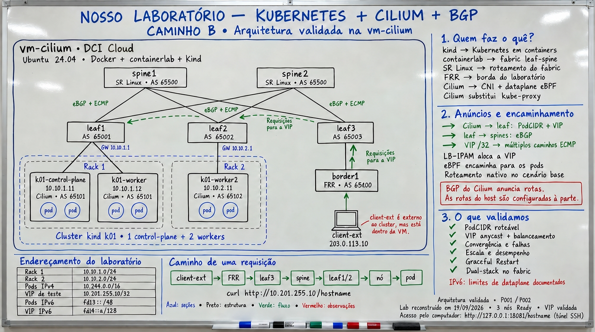

Fonte: elaborada pelo autor (2026).

Os exercícios práticos dos módulos 1–10 usam os perfis próprios descritos
acima. Os nomes e endereços das linhas seguintes registram a topologia dos
resultados publicados; compare-os com a saída observada em sua rodada. O módulo
11 está bloqueado nesta edição. O módulo 12 é leitura de um estudo com infraestrutura em nuvem
que não faz parte da aula; o módulo 13 lê resultados históricos completos da
trilha P004 (DCI, OVN-Kubernetes + EVPN, casos cruzados e Braços Cilium A/B +
KubeVirt). O Quadro 5 distingue esses estudos dos ambientes usados nos exercícios:

**Quadro 5 – Ambientes e estudos documentados no guia**

| Ambiente | Componentes | Versões | Papel |
|---|---|---|---|
| **Perfil `fundamentos`** | kind de 3 nós, Cilium dual-stack, Containerlab SR Linux/FRR e `client-ext` | usa o kit e versões declarados no perfil; verificar `lab-env` | Módulos 1–5; criado na VM do aluno por `make` |
| **Perfil `plataforma`** | kind de 3 nós, fabric Containerlab, `client` e um cenário selecionado | Cilium 1.20.2 e Gateway API conforme CRDs do perfil | Módulos 6–10; cenário escolhido antes de `lab-up` |
| **M11 híbrido** | QEMU irmãos, DevStack/Neutron-OVS, CirrOS, border e Cilium | composição nova não executada | leitura do desenho, não uma prática disponível |
| **Estudo histórico de nós reais na nuvem** | 3 VMs na nuvem, cluster `kubeadm` e FRR na mesma VPC | Kubernetes 1.35.2, Cilium 1.20.1 | Módulo 12; leitura, infraestrutura fora da aula |
| **Réplica DCI (`P004-S002`)** | `labctl dci`: OVN 26.03.3, 1 central, 2 chassis, 2 gateways, FRR multi-VRF e cliente AS 200 | Linux VRFs nos gateways; EVPN Type 5 (`M01–M03`, `X05`) | Módulo 13.1; leitura de resultados históricos (`labctl dci down` após os ensaios) |
| **Plano OVN-Kubernetes + Fabric EVPN (`P004-S003` e `S004`)** | `labctl evpn-fabric` + `labctl ovnk`: kind 3 nós + `ovnk-evpn-peer` + KubeVirt `/dev/kvm` | OVN-Kubernetes v1.4.0, KubeVirt v1.9.0, `frr-k8s` v0.0.21/v0.0.27 | Módulo 13.2; leitura de resultados históricos (`K01–K04`, `X01–X04`, `X06–X07`) |
| **Braços Cilium A e B + KubeVirt (`P004-S005` a `S008`)** | `p003-gw` + KubeVirt `/dev/kvm` + `DaemonSet/frr-node` (no Braço B sob `R6=0`) | Cilium 1.20.2, KubeVirt v1.9.0, FRR 10.7.1 (`table-map RM-NO-KERNEL`) | Módulos 13.3 e 13.4; leitura de resultados históricos (`V00–V09`, `G01`, `G02`, `G06–G08`) |

Fonte: elaborado pelo autor (2026).

O Quadro 5 descreve configurações de perfil e estudos documentados, sem indicar
aceite da composição atual nem disponibilidade simultânea em tempo real. A
admissão é feita pelo preflight no ambiente próprio; não use o valor de RAM do
ensaio histórico para contornar a reserva de capacidade. As
Figuras 1 e 2 ilustram a arquitetura histórica dos estudos P001–P003, no host do
instrutor; as Figuras 16, 17 e 18, no
Módulo 13, ilustram a arquitetura e os resultados de P004.

Os dois fabrics usam eBGP puro em dois níveis, no desenho de roteamento para
data centers descrito por Lapukhov, Premji e Mitchell (2016). No `k01`, os nós falam com o
leaf do rack (AS 6510x para 6500x) e os leaves com os spines (AS 65500). No
sandbox, os nós usam AS 65301/65302, os leaves 65201/65202/65203, os spines
65600 e o border 65400. Os enlaces spine–leaf são IPv4 numerados em `/31`.

**Figura 2 – Rotas e entrega da VIP, na arquitetura histórica do host do instrutor; não é o ambiente do aluno**

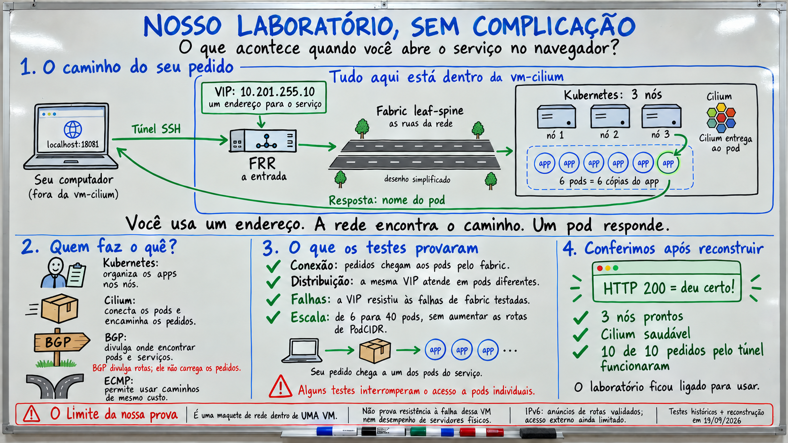

Fonte: elaborada pelo autor (2026).

Endereços que aparecem nos exercícios:

**Quadro 6 – Endereços usados nos exercícios**

| Recurso | Lab `k01` | Sandbox `p003-gw` |
|---|---|---|
| PodCIDR IPv4 por nó | `10.244.x.0/24` | `10.245.x.0/24` (IPAM `kubernetes`) |
| Pool de VIPs | `10.201.255.0/24`, VIP `10.201.255.10` | `10.202.255.0/24`, VIP `10.202.255.10` |
| Cliente externo ao cluster | `client-ext` `203.0.113.10` | `fabric-client` `198.19.0.10` |
| Gateway | não há | `p003-main` no namespace `p003-gateway`, listeners 8080/HTTP, 15432/TCP, 15353/UDP |
| Rede do tenant OpenStack | não há | histórico, não criado por `make`: `10.30.0.0/24` (subnet-a), externa `10.40.0.0/24` |

Fonte: elaborado pelo autor (2026).

```{=latex}
\FloatBarrier
```

### A pergunta central: cada pod anuncia `/32`?

**Não com o IPAM padrão.** Uma sessão BGP (Rekhter; Li; Hares, 2006) não é aberta
por pod. O agente Cilium em cada nó é o speaker e anuncia o **PodCIDR `/24` do
nó** (Cilium Authors, 2026b). Um pod com
`10.244.1.27` está coberto por `10.244.1.0/24`; não nasce sessão nem anúncio
para `10.244.1.27/32`.

O serviço tem outra regra. O `echo-anycast` recebe a VIP `10.201.255.10`, usa
`externalTrafficPolicy: Cluster` e os três nós anunciam a mesma
`10.201.255.10/32`; o fabric instala vários próximos saltos e faz ECMP. A rota
representa o serviço e seus pontos de entrada, não cada backend.

Existe uma terceira forma, medida no Módulo 10: com Multi-Pool IPAM e
`maskSize: 32`, cada pod recebe um bloco `/32` próprio e o Cilium anuncia esse
bloco. O speaker continua sendo o nó. O que muda é a granularidade, a
quantidade de rotas e o momento em que um bloco é alocado e retirado.

## Módulo 1 — Baseline e o que o Cilium anuncia

Ambiente de prática: perfil próprio `LAB=fundamentos`. Origem dos valores
publicados: P001 (REQ-001 a REQ-007), execução histórica. A Figura 3 situa a VIP
no caminho BGP dos PodCIDRs. Antes dos comandos, suba e verifique o perfil pelo
Apêndice A; `lab-verify` não converte os resultados históricos em observações
desta edição.

**Figura 3 – BGP, PodCIDRs e VIP anycast**

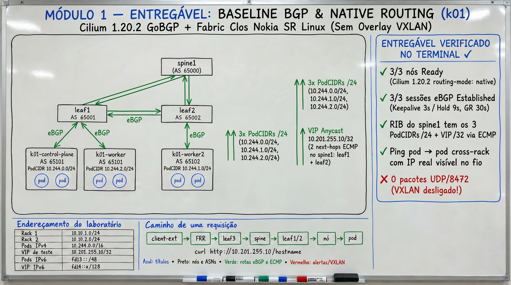

Fonte: elaborada pelo autor (2026).

### 1.1 Conferir os containers

Na VM Ubuntu própria, Terminal A:

~~~bash
sudo docker ps --format 'table {{.Names}}\t{{.Status}}' | grep -E 'clab-poc-k8s-kind|k01-'
$C1 ip -4 addr show dev eth1
~~~

Esperado — configuração do perfil: `spine1`, `spine2`, `leaf1`, `leaf2`, `leaf3`, `border1`,
`client-ext` e três `k01-*`; o `client-ext` mostra `203.0.113.10` uma vez. Esse
endereço pode sumir após um redeploy do fabric; sem ele todos os probes do
módulo falham sem falha real, e o caminho é repetir `lab-verify` e conferir o
endereço antes de investigar o Cilium.

### 1.2 Conferir o cluster e os PodCIDRs

~~~bash
k01 get nodes -o custom-columns=NODE:.metadata.name,PODCIDR:.spec.podCIDR,PODCIDRS:.spec.podCIDRs
k01 get pods -o wide
~~~

Responda no caderno: qual `/24` cobre o IP de cada pod `echo-*`? A resposta
aponta para o bloco do nó, nunca para um `/32` do pod.

### 1.3 Sessões e anúncios BGP

~~~bash
cilium --kubeconfig "$LAB_KUBECONFIG" --context "$LAB_CONTEXT" bgp peers
cilium --kubeconfig "$LAB_KUBECONFIG" --context "$LAB_CONTEXT" bgp routes advertised ipv4 unicast
k01 get ciliumbgpclusterconfigs,ciliumbgppeerconfigs,ciliumbgpadvertisements
~~~

Esperado: três sessões `established` (uma por nó, nunca uma por pod), cada uma
com as famílias ipv4 e ipv6. Entre os anúncios aparecem o PodCIDR de cada nó, a
VIP `10.201.255.10/32` nos três nós e `10.201.255.11/32` só nos dois workers.

Os timers e o Graceful Restart não aparecem nos comandos acima; consulte-os no
`CiliumBGPPeerConfig`:

~~~bash
k01 get ciliumbgppeerconfigs fabric-peer \
  -o jsonpath='{.spec.timers}{"\n"}{.spec.gracefulRestart}{"\n"}'
~~~

Esperado: `holdTimeSeconds` 9 e `keepAliveTimeSeconds` 3; Graceful Restart
`enabled: true` com `restartTimeSeconds` 30.

O anúncio da VIP só existe porque o `CiliumBGPAdvertisement` (Cilium Authors, 2026a)
tem um `selector`
com `bgp-advertise=true` e o Service carrega esse label. Sem o selector o
agente não anuncia nada de Service; este foi um achado repetido em nós reais.

### 1.4 A rota no spine e a ausência de encapsulamento

~~~bash
sudo docker exec clab-poc-k8s-kind-spine1 sr_cli \
  "show network-instance default route-table ipv4-unicast prefix *"
sudo docker exec clab-poc-k8s-kind-spine1 sr_cli \
  "show network-instance default route-table ipv4-unicast prefix 10.201.255.10/32 detail"
~~~

Esperado: os três `/24` e a VIP com dois próximos saltos. Em native routing (Cilium Authors, 2026f)
o fabric vê o IP real do pod; a evidência histórica registra zero pacotes
UDP/8472 no fio e um handshake `203.0.113.10 > 10.244.2.198:8080` direto ao
pod.


**Observação real F07 — 31/10/2026.** Estes probes de leitura foram executados
no guest Ubuntu 24.04 amd64, com kubeconfig e contexto explícitos para Kubernetes
e endpoint Docker local explícito para o spine. A saída abaixo é desta rodada,
não uma garantia para todas as execuções.

~~~bash
kubectl --request-timeout=15s --kubeconfig "$LAB_KUBECONFIG" --context "$LAB_CONTEXT" get nodes -o custom-columns=NODE:.metadata.name,PODCIDR:.spec.podCIDR,PODCIDRS:.spec.podCIDRs
sudo -n /usr/bin/docker --host unix:///var/run/docker.sock exec clab-poc-k8s-kind-spine1 sr_cli \
  "show network-instance default route-table ipv4-unicast prefix *"
sudo -n /usr/bin/docker --host unix:///var/run/docker.sock exec clab-poc-k8s-kind-spine1 sr_cli \
  "show network-instance default route-table ipv4-unicast prefix 10.201.255.10/32 detail"
~~~

A consulta de nós (03) terminou `rc=0` às 08:28:46.993–08:28:47.087 UTC:

~~~text
NODE                PODCIDR         PODCIDRS
k01-control-plane   10.244.0.0/24   [10.244.0.0/24 fd13::/64]
k01-worker          10.244.2.0/24   [10.244.2.0/24 fd13:0:0:2::/64]
k01-worker2         10.244.1.0/24   [10.244.1.0/24 fd13:0:0:1::/64]
~~~

O probe 08 terminou `rc=0` às 08:28:47.721–08:28:49.128 UTC. Sua saída
original tinha 12.515 bytes e linhas de até 200 colunas; o resumo a seguir
normaliza somente as três rotas de PodCIDR e não reproduz literalmente a tabela
completa. Os prefixos coincidem com o conjunto observado em 03.

- `10.244.0.0/24` → `10.255.1.0/31` (indirect/local), pela
  `ethernet-1/1.0`.
- `10.244.1.0/24` → `10.255.3.0/31` (indirect/local), pela
  `ethernet-1/2.0`.
- `10.244.2.0/24` → `10.255.1.0/31` (indirect/local), pela
  `ethernet-1/1.0`.

A associação entre PodCIDR, worker e interface do spine depende da ordem em que
os nós se registram e muda de uma rodada para outra. Na rodada de 10/11/2026 em
VM limpa, por exemplo, `10.244.1.0/24` saiu pela `ethernet-1/1.0` e
`10.244.2.0/24` pela `ethernet-1/2.0`. Leia a sua associação em `k01 get nodes`
e confira as contagens do Quadro 7, não as interfaces deste registro.

O probe 09 terminou `rc=0` às 08:28:49.128–08:28:50.263 UTC. Este trecho é
literal; campos não exibidos foram omitidos:

~~~text
Destination            : 10.201.255.10/32
Route Type             : bgp
Route Owner            : bgp_mgr
Preference             : 170
Active                 : true
Next hops: 2 entries
10.255.1.1 (indirect) resolved by route to 10.255.1.0/31 (local)
  via 10.255.1.1 (direct) via [ethernet-1/1.0]
10.255.3.1 (indirect) resolved by route to 10.255.3.0/31 (local)
  via 10.255.3.1 (direct) via [ethernet-1/2.0]
Backup Next hops: 0 entries
~~~

A leitura conjunta mostra três anúncios IPv4 `/24` correspondentes aos
PodCIDRs de 03 e uma rota BGP ativa para a VIP com dois próximos saltos no
spine. Ela não associa cada próximo salto a um nó Kubernetes por nome; essa
relação exigiria outra evidência.

**Quadro 7 – Registro do Módulo 1: valores esperados e observados**

| Item | Esperado | Observado |
|---|---|---|
| Nós `Ready` | 3 | |
| Sessões BGP | 3 established | |
| PodCIDRs no spine | 3 | |
| Next-hops da VIP no spine | 2 | |

Fonte: elaborado pelo autor (2026).

## Módulo 2 — VIP anycast e caminho do tráfego

Ambiente de prática: perfil próprio `LAB=fundamentos`. Origem dos resultados:
P001 (REQ-008 a REQ-010), execução histórica. A Figura 4 acompanha o caminho da
requisição até a VIP.

**Figura 4 – Caminho da VIP e balanceamento**

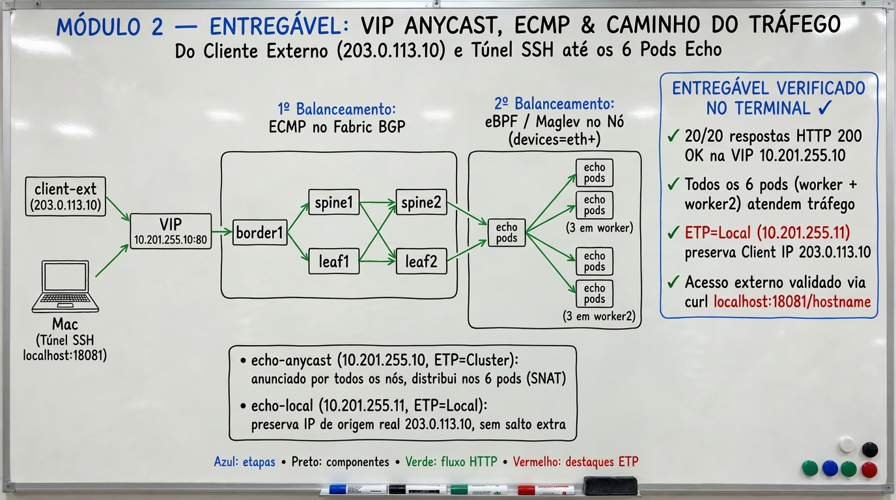

Fonte: elaborada pelo autor (2026).

### 2.1 Requisições a partir do client-ext

~~~bash
k01 get svc echo-anycast echo-local -o wide
for i in $(seq 1 20); do
  $C1 curl -fsS --max-time 5 http://10.201.255.10/hostname; echo
done | sort | uniq -c
~~~

O código de saída desse pipeline é o do `uniq`, então uma falha do `curl` não
aparece nele. Some as contagens da primeira coluna: o total deve ser 20.

Esperado: `echo-anycast` com `10.201.255.10` e `externalTrafficPolicy:
Cluster`; `echo-local` com `10.201.255.11` e `Local`. Vinte amostras não
garantem que todos os seis backends apareçam: ECMP e Maglev (Eisenbud et al., 2016) usam hashing. A
execução de referência registrou 20/20 HTTP 200 e seis pods distintos.

ICMP para a VIP não é respondido: o balanceador BPF atende TCP; `ping` na VIP
não é sinal de falha.

### 2.2 Cliente externo dentro do fabric próprio

O cliente deste perfil já está ligado ao fabric privado da própria VM. Rode os
pedidos no **Terminal A**, pelo alias `C1`; não abra SSH para uma VM de aula,
não crie túnel no computador pessoal e não acrescente rota à tabela principal
do host. O teste em `2.1` é o caminho atual disponível. A referência antiga a
uma VIP encaminhada por túnel SSH para o Mac foi retirada do fluxo executável.

### 2.3 O caminho e o fix que o tornou possível

~~~text
Terminal A na VM do aluno → cliente do fabric `client-ext` → border/FRR
  → leaf → spine → leaf do rack → nó Kubernetes → Cilium BPF LB → Service → Pod
~~~

O caminho e os endereços acima descrevem a topologia medida no registro P001.
Compare a RIB, os serviços e as respostas da sua rodada; o diagrama não é
recibo nem garante que cada probe atual repita aquela medição. O balanceador
BPF precisa estar anexado à interface do fabric (`eth1` no nó kind). O
controlador de devices do Cilium 1.20.1 pulava veths sem rota default, então o
kit fixava `devices=eth+` nos values. Esse é o relato histórico, não uma
instrução para editar ConfigMap ou executar `helm upgrade` nesta prática.

Quando o cliente está fora da VM, na mesma VPC, o caminho é assimétrico: a
requisição entra pelo fabric e a resposta volta pela bridge docker do host,
porque o nó kind roteia a VPC por `eth0`. É uma propriedade da topologia, não
uma falha.

## Módulo 3 — Dual-stack IPv6 no plano de controle

Ambiente de prática: perfil próprio `LAB=fundamentos`, que configura os values
dual-stack do kit. Origem dos números: P002-S001, execução histórica. A Figura
5 situa a VIP nas duas famílias do plano de controle BGP.

**Figura 5 – IPv6 no plano de controle BGP**

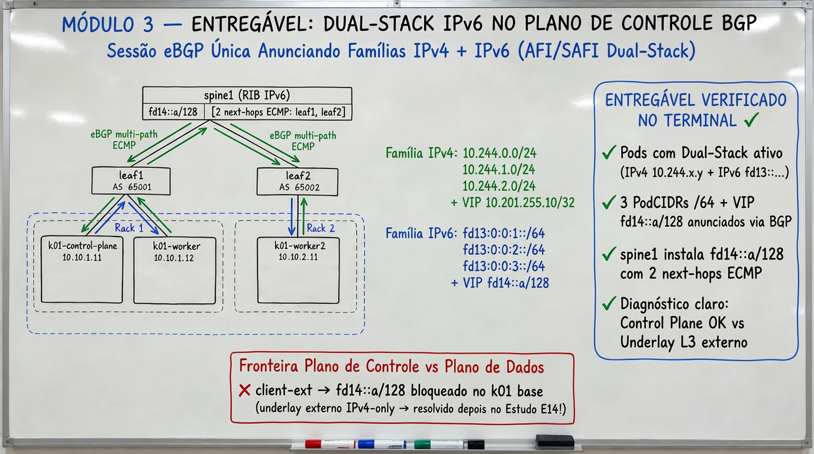

Fonte: elaborada pelo autor (2026).

### 3.1 Ler o que foi provado

~~~bash
k01 get nodes -o custom-columns=NODE:.metadata.name,PODCIDRS:.spec.podCIDRs
cilium --kubeconfig "$LAB_KUBECONFIG" --context "$LAB_CONTEXT" bgp routes advertised ipv6 unicast
sudo docker exec clab-poc-k8s-kind-spine1 sr_cli \
  "show network-instance default route-table ipv6-unicast prefix fd14::a/128 detail"
~~~

Esperado: cada nó com dois PodCIDRs (`10.244.x.0/24` e `fd13:0:0:x::/64`), os
três `/64` no spine e a VIP `fd14::a/128` com dois próximos saltos. Uma única
sessão BGP transporta as duas famílias; a convergência do plano de controle
vale para ambas.

### 3.2 O que a topologia não entrega

A VIP IPv6 não é alcançável do `client-ext`: o underlay externo do lab é
IPv4-only e next-hops IPv4-mapped não encaminham IPv6. O tráfego pod→pod IPv6
cross-node flui pela rede kind, não pelo fabric. São limites do lab em
containers, não do Cilium nem do SR Linux. Não apresente alcance IPv6 fim a fim
como demonstrado.

Quatro configurações são obrigatórias e ficaram no kit: `ipv6.enabled: true`
nos values, `ipFamily: dual` com dois `podSubnet` no kind, `afi-safi
ipv6-unicast` nos grupos `rack*-k8s` dos leaves e `multipath ipv6-unicast` nos
spines.

## Módulo 4 — Falhas, Graceful Restart e convergência

Ambiente: perfil próprio `LAB=fundamentos`. Origem da tabela: P001 REQ-011,
P002-S002 e P002-S004, ensaios históricos. A automação atual não expõe gatilhos
de falha nem autorização para desabilitar nós; leia os dados como um estudo de
convergência, sem repetir falha de leaf, spine, agent ou worker. A Figura 6
relaciona os resultados históricos à convergência ECMP.

**Figura 6 – Falhas BGP e convergência ECMP**

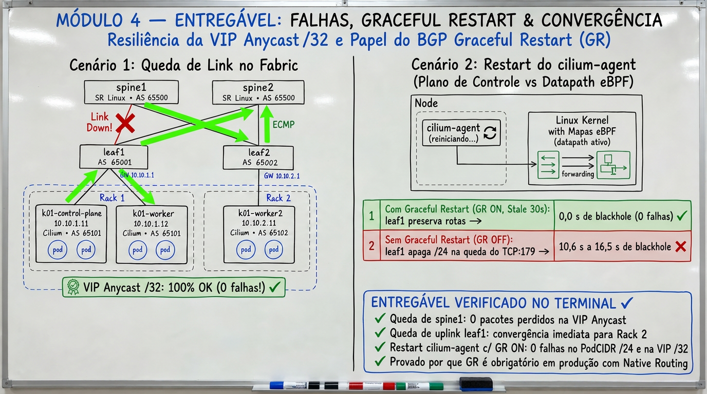

Fonte: elaborada pelo autor (2026).

### 4.1 Como se mede um blackhole

Na execução histórica, três loops de `curl` com timeout de 2 s rodaram no
`client-ext` contra a VIP anycast, um pod do rack 1 (caminho único) e um pod do
rack 2. Blackhole real é
o **maior intervalo sem nenhum OK**; timeouts encadeados não contam (lição L4).
Nos registros históricos, falhas de SR Linux foram provocadas com
`admin-state disable` via `sr_cli`. Isso descreve o método daquela execução;
não execute mutações de link ou de container nesta edição.

### 4.2 Resultados medidos

**Tabela 1 – Efeito das falhas de fabric e de agente sobre a VIP anycast e o PodCIDR**

| Falha | VIP anycast | PodCIDR do rack afetado | Reconvergência |
|---|---|---|---|
| Restart do agent, GR ON | 0 falhas | sem blackhole | datapath BPF pinado sobrevive |
| Restart do agent, GR OFF | 0 falhas (outros nós anunciam) | blackhole 10,6 s (P001) a 16,5 s (P002) | até o novo agent reanunciar |
| Drain do nó | blip de 50 a 300 ms no início da evicção | pods evictados | GR irrelevante: a sessão não cai |
| 1 spine de 2 | 100% OK em 28,7 mil amostras | n/a | BGP re-up 33 a 38 s |
| 1 leaf | 100% OK (anycast segue pelo outro rack) | blackhole total do rack por 107 a 138 s | dados +44 a 48 s após enable |
| Spine 2 + leaf 1 juntos | 100% OK em 34 mil amostras | blackhole total do rack 1 | lab sobrevive degradado |
| Flap simultâneo de 2 workers, GR ON | 0 de 19451 falhas | 2,4% a 4,4% de falhas, maxgap 2 a 4 s, sem blackhole | agents ~52 s, estável ~82 s |

Fonte: elaborada pelo autor com dados de P001 (REQ-011), P002-S002 e P002-S004 (2026).

Leituras que a pessoa estudante deve conseguir explicar:

- a VIP anycast `/32` com ECMP foi imune a todas as falhas de fabric testadas;
- o PodCIDR é caminho único por rack quando o nó é single-homed; a falha do leaf isola o rack;
- Graceful Restart elimina o blackhole de PodCIDR no restart do agent, em um nó ou em vários;
- dual-homing do nó daria ECMP ao PodCIDR; o simulador SR Linux não estabelece TCP/179 em porta adicionada em runtime, então isso fica para um cluster real.

### 4.3 O que a API do Cilium não expõe

`CiliumBGPPeerConfig` v2 na versão 1.20.x tem `timers`, `gracefulRestart`,
`ebgpMultihop`, `families` e `authSecretRef`. Não há campo BFD (Katz; Ward, 2010). A detecção de
falha de sessão hoje é hold 9 s e keepalive 3 s, o menor valor aceito na
validação do lab. Essa lacuna é o ponto de partida de um dos próximos estudos.

## Módulo 5 — Escala e desempenho

Ambiente: perfil próprio `LAB=fundamentos`. Origem da tabela: P002-S003,
execução histórica. A Figura 7 relaciona a escala de pods e VIPs à vazão.

**Figura 7 – Escala de pods, VIPs e throughput**

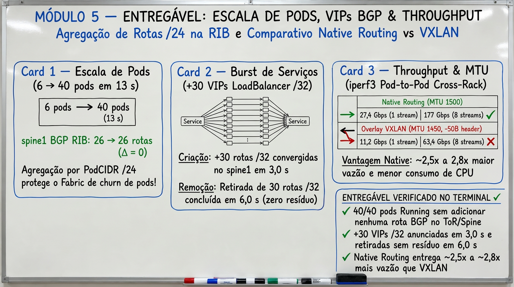

Fonte: elaborada pelo autor (2026).

### 5.1 O que a pessoa estudante confere

~~~bash
sudo docker exec clab-poc-k8s-kind-spine1 sr_cli \
  "show network-instance default route-table ipv4-unicast summary"
k01 get deploy echo
~~~

O `summary` imprime a tabela inteira antes dos totais. Anote o valor da linha
`IPv4 routes total` (26 na rodada de 10/11/2026 em VM limpa) e o número de
réplicas (`6/6`). O perfil atual não
oferece um alvo de escala deste exercício; não altere réplicas para tentar
recriar a tabela histórica.

### 5.2 Resultados medidos

**Tabela 2 – Resultados de escala e desempenho no lab `k01`**

| Eixo | Resultado |
|---|---|
| Pods 6 → 40 | 13 s até Ready; RIB do fabric inalterado (26 = 26): o `/24` agrega |
| +10 VIPs `/32` | primeira no spine em 1,3 s; 10/10 em 4,2 s; ECMP de 2 next-hops por VIP |
| Burst de +30 VIPs | 30/30 em 3,0 s; withdrawal completo em 6,0 s |
| Throughput pod→pod cross-node | 27,5 Gb/s com 1 fluxo; 177 Gb/s com 8 fluxos; 193 Gb/s no sentido reverso |
| Latência pod→pod | 0,094 ms ocioso; 0,039 ms sob 177 Gb/s, 0% perda |
| VIP sob carga | 0 falhas em ~24,7 mil requisições |
| Overlay VXLAN versus native | MTU 1450 versus 1500; 11,2 versus 27,4 Gb/s com 1 fluxo |

Fonte: elaborada pelo autor com dados de P002-S003 (2026).

A propriedade de escala é a agregação: pods escalam sem tocar no BGP e a RIB
cresce apenas com VIPs vezes nós, de forma linear. Os números absolutos vêm de
SR Linux em container e veths do kind; use apenas as relações.

## Módulo 6 — Gateway API HTTP, TCP e UDP por VIP BGP

> **Aviso.** Este cenário ainda não foi executado em uma VM Ubuntu limpa. As
> saídas esperadas e os números deste módulo são históricos; compare-os com o que
> a sua rodada mostrar, sem tratá-los como resultado garantido.

Ambiente de prática: perfil próprio `LAB=plataforma EXERCISE=baseline`. Origem
dos resultados: P003-S003 e P003-S004, execução histórica. A implementação
da Gateway API pelo Cilium segue a documentação do projeto (Cilium Authors, 2026c). A Figura 8 destaca os listeners HTTP, TCP e UDP do Gateway.

**Figura 8 – Gateway API sobre VIP BGP**

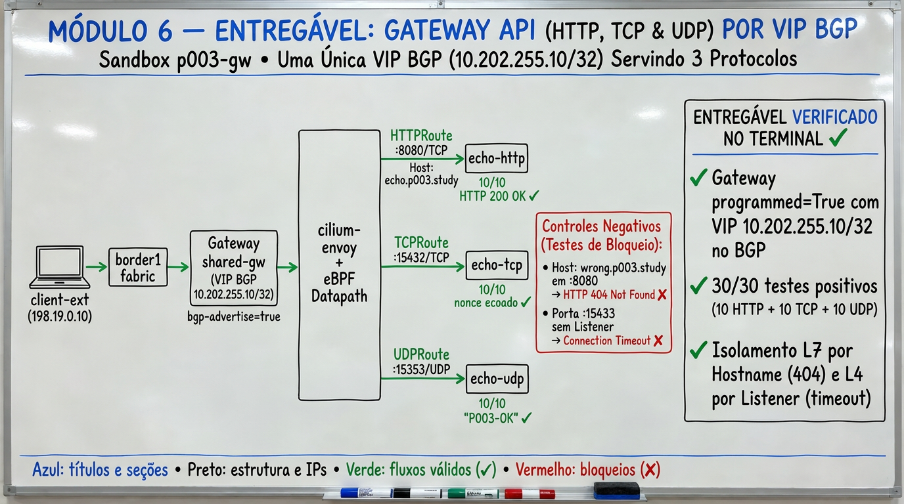

Fonte: elaborada pelo autor (2026).

### 6.1 O Gateway e seu Service

~~~bash
ks -n p003-gateway get gateway p003-main -o wide
ks -n p003-gateway get httproutes,tcproutes,udproutes
ks -n p003-gateway get svc -l bgp-advertise=true
cilium --kubeconfig "$LAB_KUBECONFIG" --context "$LAB_CONTEXT" \
  bgp routes advertised ipv4 unicast
~~~

Esperado: Gateway `Programmed=True` com `IPAddress 10.202.255.10`; o Service
gerado pelo Cilium com `EXTERNAL-IP 10.202.255.10` e o label
`bgp-advertise=true`, que vem de `spec.infrastructure.labels` do Gateway, não
de `metadata.labels`. A VIP aparece nos anúncios BGP dos três nós.

### 6.2 Um listener por protocolo, com controle negativo

~~~bash
VIP=10.202.255.10
$C2 curl -sS --retry 0 --max-time 5 -H 'Host: echo.p003.study' \
  -w '\n%{http_code}\n' "http://$VIP:8080/hostname"
$C2 curl -sS --retry 0 --max-time 5 -H 'Host: wrong.example' \
  -o /dev/null -w '%{http_code}\n' "http://$VIP:8080/hostname"
$C2 sh -c "echo P003-nonce-1 | nc -w 3 $VIP 15432"
$C2 dig @"$VIP" -p 15353 study.p003 TXT +short +notcp +tries=1 +time=2
$C2 sh -c "echo P003-gw04 | nc -w 3 $VIP 15433"
~~~

**Quadro 8 – Registro do Módulo 6: listeners e controle negativo**

| Caso | Esperado | Observado |
|---|---|---|
| HTTP com Host correto | 200 e hostname de um pod `http-echo-*` | |
| HTTP com Host errado | 404 do Envoy | |
| TCP 15432 | o nonce volta idêntico | |
| UDP 15353 | `"P003-OK"` | |
| TCP 15433 sem listener | timeout, nenhuma chegada na fixture | |

Fonte: elaborado pelo autor (2026).

A matriz histórica registrou 30/30 em cada listener, 503 com
EndpointSlice vazio quando o backend foi escalado a zero e recuperação
completa ao restaurar. Um controle histórico trocou o selector do
`CiliumBGPAdvertisement`; não repita essa mutação como exercício autônomo.

### 6.3 Achado: `hostNetwork` do Gateway não expõe listener no nó

`gatewayAPI.hostNetwork.enabled` no Cilium 1.20.2 é uma feature dos listeners
Envoy (L7), controlada por `nodes.matchLabels`. Com o seletor vazio, nenhum
socket abre no IP do nó nas portas 8080, 15432 ou 15353. Os probes ao nó
nessas portas deram 180/180 falhas; os `nodePort` do Service gerado deram
180/180 sucessos. Para expor TCP/UDP no nó, o caminho suportado é o NodePort
ou a VIP por BGP.

## Módulo 7 — Autorização externa na borda

> **Aviso.** Este cenário ainda não foi executado em uma VM Ubuntu limpa. As
> saídas esperadas e os números deste módulo são históricos; compare-os com o que
> a sua rodada mostrar, sem tratá-los como resultado garantido.

Ambiente de prática: perfil próprio `LAB=plataforma EXERCISE=auth`. Origem
dos números: P003-S005, P003-S006 e P003-S009 (T05), execução histórica. A
Figura 9 mostra o fluxo de autorização externa na borda.
O ExternalAuth do Gateway API é experimental na 1.20.2. Nesse cenário, a
automação aplica os CRDs experimentais do Gateway API (`experimental-install.yaml`)
por server-side apply, que evita o limite de tamanho das annotations do
`kubectl apply` comum no Kubernetes 1.35.0; você não aplica esses CRDs à mão.

**Figura 9 – Autorização externa na borda**

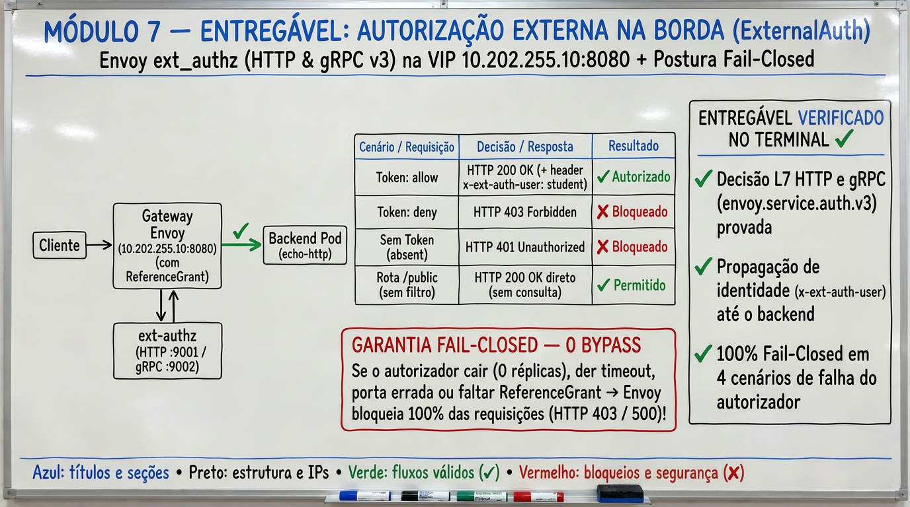

Fonte: elaborada pelo autor (2026).

### 7.1 A fixture

Um serviço Go em `studies/p003/fixtures/auth/` decide `allow`, `deny` ou
`absent` a partir do header `X-Lab-Decision` e registra cada consulta com o
`X-Lab-Request-ID`. Ele fala HTTP e gRPC (`envoy.service.auth.v3`). Não é um
IdP; serve para observar a decisão, não para autenticar pessoas.

### 7.2 Três decisões, dois protocolos

~~~bash
for d in allow deny ""; do
  $C2 curl -sS --retry 0 --max-time 15 -H 'Host: echo.p003.study' \
    ${d:+-H "X-Lab-Decision: $d"} -H "X-Lab-Request-ID: aluno-$RANDOM" \
    -o /dev/null -w "decisao=${d:-absent} http=%{http_code}\n" \
    "http://10.202.255.10:8080/protected-http"
done
$C2 curl -sS --retry 0 -o /dev/null -w 'public http=%{http_code}\n' \
  -H 'Host: echo.p003.study' http://10.202.255.10:8080/public
~~~

**Tabela 3 – Código HTTP por decisão do autorizador externo**

| Decisão | HTTP | gRPC |
|---|---|---|
| allow | 200 | 200 |
| deny | 403 | 403 |
| absent | 401 | 401 |
| rota pública sem auth | 200 | 200 |

Fonte: elaborada pelo autor com dados de P003-S005 e P003-S006, matriz A01–A10 (2026).

A matriz A01–A10 executou 900 requisições com esse resultado. O header
forjado `X-Lab-User` enviado pelo cliente não aparece na resposta (A08). A
rota pública não consulta o autorizador (A09).

### 7.3 Fail-closed sob degradação

**Tabela 4 – Comportamento fail-closed do ExternalAuth sob degradação**

| Cenário | HTTP | gRPC | Conclusão |
|---|---|---|---|
| autorizador escalado a zero | 403 em 2 ms | 403 | fail-closed |
| autorizador com atraso de 15 s | 403 após 10 s | 403 após ~200 ms | timeout do Envoy difere por protocolo |
| `backendRef` inexistente | 500 | 500 | `ResolvedRefs=False` |
| porta errada | 403 | 403 | `BackendNotFound` |
| cross-namespace sem `ReferenceGrant` | 500 | 500 | `RefNotPermitted` |
| `ReferenceGrant` removido durante probes | 403 → 500 em até 2 s | 200 → 500 em até 2 s | revogação sem bypass |

Fonte: elaborada pelo autor com dados de P003-S005, P003-S006 e P003-S009 (2026).

Nenhum cenário liberou a aplicação. Dois defeitos ficaram registrados na
1.20.2: com Grant válido, a rota HTTP cross-namespace com decisão allow pendura
(gRPC funciona), e um bloco `http: {}` vazio devolve 401 para todas as
decisões. `allowedResponseHeaders` não encaminhou os headers do autorizador ao
cliente.

## Módulo 8 — WireGuard em native routing e VXLAN

> **Aviso.** Este cenário ainda não foi executado em uma VM Ubuntu limpa. As
> saídas esperadas e os números deste módulo são históricos; compare-os com o que
> a sua rodada mostrar, sem tratá-los como resultado garantido.

Ambiente de prática: perfil próprio `LAB=plataforma EXERCISE=wireguard-native`
ou `wireguard-vxlan`, com `WG=W0|W1|W2` selecionado antes de `lab-up`.
Origem dos números: P003-S007 e P003-S008, execução histórica. Não altere
values com `helm upgrade`; encerre a execução própria e selecione outro
cenário pela interface Make. O Cilium usa o WireGuard (Donenfeld, 2017) na interface
`cilium_wg0`, na porta UDP 51871 (Cilium Authors, 2026i). A Figura 10 compara os caminhos WireGuard em native routing e VXLAN.

**Figura 10 – WireGuard em dois datapaths**

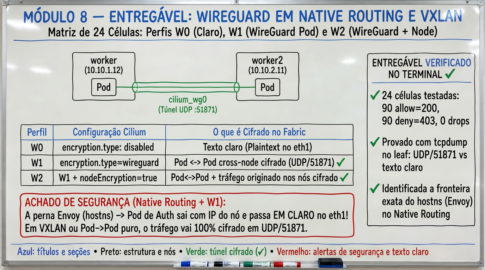

Fonte: elaborada pelo autor (2026).

### 8.1 Três perfis

**Quadro 9 – Perfis de criptografia W0, W1 e W2**

| Perfil | Configuração | Sinal na bridge do underlay |
|---|---|---|
| W0 | criptografia desligada | native: payload em claro; VXLAN: UDP/8472 com payload em claro |
| W1 | `encryption.type=wireguard` | UDP/51871 para o tráfego pod→pod remoto |
| W2 | W1 + `nodeEncryption.enabled=true` | UDP/51871 também para tráfego de nó |

Fonte: elaborado pelo autor (2026).

~~~bash
ks -n kube-system exec ds/cilium -- cilium-dbg encrypt status
ks -n kube-system exec ds/cilium -- ip -br link show cilium_wg0
~~~

### 8.2 O que as 24 células mostraram

Quatro placements (auth e app no nó A ou no nó B, ingress fixo no nó A) vezes
três perfis vezes duas topologias (native e VXLAN): 90 allow com 200 e 90 deny
com 403 em cada célula, zero drops no `cilium-dbg monitor`. O handshake
Envoy→autorizador relatado na issue 46768 (Devantler, 2026) não se reproduziu na 1.20.2 em nenhuma
combinação.

O achado de segurança é outro: em native routing, a perna Envoy→pod de auth
por IP direto **atravessa em claro** no underlay mesmo com WireGuard de pod
ativo (20 IDs de requisição legíveis por célula com auth remoto). Em VXLAN a
mesma perna sai cifrada em W1 e W2. A exposição depende da topologia, não da
decisão de auth. Ao desenhar criptografia, trate o tráfego originado pelo
Envoy do nó como tráfego de nó.

## Módulo 9 — Tenants: rede, borda e configuração

> **Aviso.** Este cenário ainda não foi executado em uma VM Ubuntu limpa. As
> saídas esperadas e os números deste módulo são históricos; compare-os com o que
> a sua rodada mostrar, sem tratá-los como resultado garantido.

Ambiente de prática: perfil próprio `LAB=plataforma EXERCISE=tenants`. Origem
dos resultados: P003-S009, matriz T01–T17, execução histórica. A Figura 11
situa os controles de isolamento de tenants nas três camadas.

**Figura 11 – Isolamento de tenants T01–T17 em três camadas**

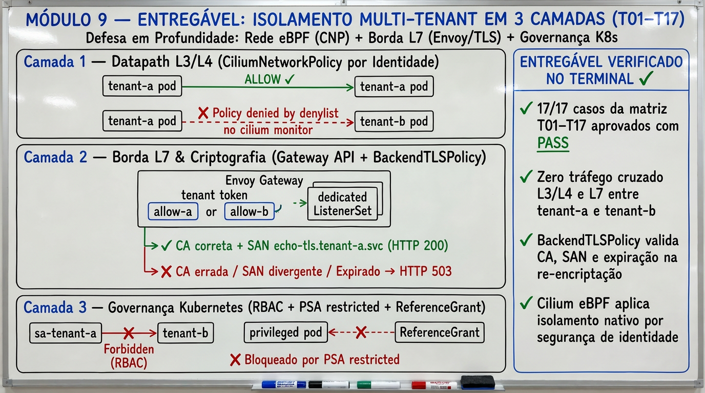

Fonte: elaborada pelo autor (2026).

### 9.1 Três controles diferentes

**Quadro 10 – Controles de isolamento de tenant**

| Controle | Mecanismo | O que impede |
|---|---|---|
| Rede | `CiliumNetworkPolicy` por identidade e porta | A alcançar B e vice-versa em conexões novas |
| Borda | ExternalAuth no listener HTTP | usuário sem credencial na rota protegida |
| Configuração | RBAC + `allowedRoutes` + `allowedListeners` + `ReferenceGrant` + PSA `restricted` | tenant editar policy alheia, criar Gateway de contorno, subir pod privilegiado |

Fonte: elaborado pelo autor (2026).

### 9.2 Ler um drop de policy

O `cilium-dbg monitor` só imprime algo enquanto há tráfego negado, e sem tráfego
ele fica bloqueado. O bloco abaixo limita o monitor a 20 s, escolhe o agente do
nó em que roda o backend do tenant B e gera uma requisição do cliente do tenant A
ao backend do tenant B enquanto o monitor escuta:

~~~bash
ks get ciliumnetworkpolicies -A
NODE_B="$(ks -n p003-tenant-b get pod -l app=p003-b-backend \
  -o jsonpath='{.items[0].spec.nodeName}')"
AGENT_B="$(ks -n kube-system get pod -l k8s-app=cilium \
  --field-selector "spec.nodeName=$NODE_B" -o name)"
ks -n kube-system exec "$AGENT_B" -- \
  timeout 20 cilium-dbg monitor -t drop --related-to 0 2>/dev/null | head -20 &
sleep 2
ks -n p003-tenant-a exec deploy/p003-a-client -- \
  curl -sS --max-time 3 -o /dev/null -w 'A->B http=%{http_code}\n' \
  http://p003-b-backend.p003-tenant-b.svc:8080/hostname
wait
~~~

Com a policy de isolamento ativa, o `curl` de A para B deve esgotar o tempo
(`http=000`). Se o monitor não listar nenhum drop, repita com o agente do nó do
cliente A: o drop pode ser registrado no nó de origem.

Na execução histórica, com tráfego A→B, foram observados drops com
`Policy denied` e o log da aplicação de destino vazio. Compare com a sua
observação; um pacote que não chegou pode ter falhado em outra camada. Isso é diferente de
um 403 na borda, que é gerado pelo Envoy antes da aplicação.

### 9.3 Resultados

Todos os 17 casos passaram. Os negativos foram reais: chamadas de API
impersonadas devolveram `Forbidden` (não apenas `can-i`), o PSA
`restricted:v1.35` rejeitou `hostNetwork`, `privileged`, `hostPID` e
`hostPath`, e labels de tenant ausentes ou forjados não executaram. A TLS do
backend (`BackendTLSPolicy`) falhou antes do request HTTP com CA errada, SAN
errado ou certificado expirado.

Um detalhe que muda desenho: o ExternalAuth protege apenas o listener HTTP.
O listener TCP sob a mesma VIP respondeu 200 para o tenant errado até uma CNP
L4 ser aplicada (T07). Autorização L7 não é política L4.

## Módulo 10 — Multi-Pool IPAM: /24 versus /32

> **Aviso.** Este cenário ainda não foi executado em uma VM Ubuntu limpa. As
> saídas esperadas e os números deste módulo são históricos; compare-os com o que
> a sua rodada mostrar, sem tratá-los como resultado garantido.

Ambiente de prática: perfil próprio `LAB=plataforma EXERCISE=ipam24` ou
`ipam32`, selecionado antes de `lab-up`. Origem dos números: P003-S010,
matriz I01–I10, execução histórica. A Figura 12 compara os pools `/24` e `/32`
do Multi-Pool IPAM.

**Figura 12 – Multi-Pool IPAM: pools /24 e /32**

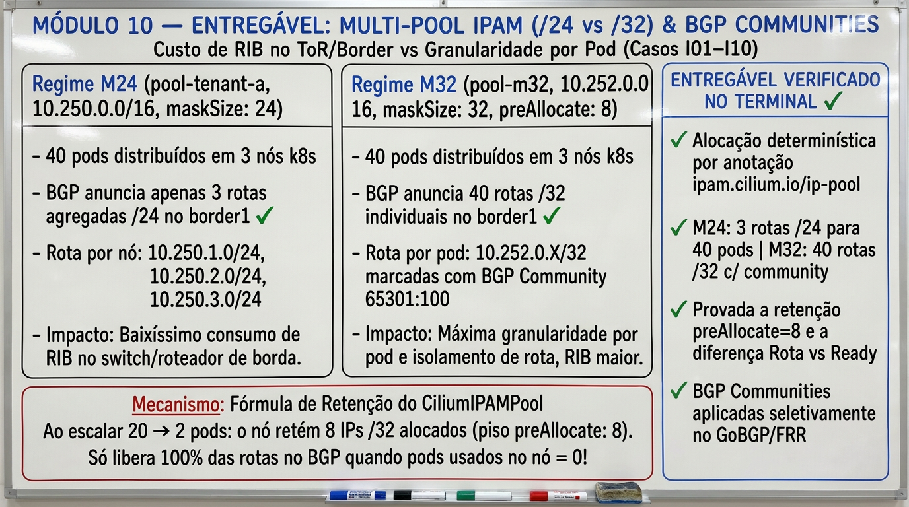

Fonte: elaborada pelo autor (2026).

### 10.1 Dois braços com a mesma variável

**Quadro 11 – Braços M24 e M32 do estudo Multi-Pool IPAM**

| Braço | Pool | `maskSize` | `preAllocate` | Anúncio |
|---|---|---|---|---|
| M24 | `10.250.0.0/16` | 24 | 8 | `CiliumPodIPPool` com community `65301:100` |
| M32 | `10.252.0.0/16` | 32 | 8 | idem |

Fonte: elaborado pelo autor (2026).

~~~bash
ks get ciliumpodippools -o wide
ks get ciliumnodes -o custom-columns=NODE:.metadata.name,POOLS:.spec.ipam.pools.allocated
sudo docker exec clab-p003-gw-fabric-border1 vtysh -c 'show ip bgp' | grep -E '10\.25[02]\.'
~~~

### 10.2 O que muda entre `/24` e `/32`

**Quadro 12 – Comportamento dos blocos `/24` e `/32` no Multi-Pool IPAM**

| Pergunta | M24 | M32 |
|---|---|---|
| Pod novo | cai num `/24` já alocado; zero eventos de bloco | cada pod ganha um `/32`; alocado e anunciado em 1 a 2 s |
| 40 pods | 3 rotas no border | 40 rotas no border, uma por pod |
| Pod `NotReady` sem delete | bloco e rota permanecem; IP direto responde 200; o Service exclui o pod | idêntico |
| Apagar 1 pod | bloco retido: `roundUp(inUse+8, 8)` não encolhe | idêntico; o piso de `preAllocate` domina |
| Voltar a zero pods | blocos `/24` retidos por mais de 120 s | encolhe em 42 s no operador e 48 s na RIB, até o piso de 8 `/32` por nó |
| Recriar pod no mesmo nó | IP novo dentro do mesmo `/24` | alterna entre `/32` recém-liberados; sem IP estável |
| Peer BGP do border desligado | prefixos somem em ~10 s; pod e VIP dão 000 | idêntico |

Fonte: elaborado pelo autor com dados de P003-S010, matriz I01–I10 (2026).

Duas lições. O datapath não gateia readiness: rota e alcance direto ao pod
existem enquanto o IP existir, e só o Service respeita `Ready`. A retirada de
um bloco depende de `preAllocate`, não da morte do pod; um `/32` não é
"retirado quando o pod morre".

## Módulo 11 — Tenant híbrido: pods e VMs OpenStack (em validação)

**Estado desta edição:** a nova composição híbrida não foi executada. O guard
público recusa `make lab-up LAB=hibrido` antes de efeitos até instalação,
binding/SG, DHCP, retorno BGP e verificação bidirecional serem implementados e
revisados. `lab-status` e `lab-down` só inspecionam ou limpam estado de
identidade própria; `lab-shell` não prepara uma VM nem substitui o guard. Não
use estes comandos como caminho de criação nesta edição.

Os resultados de P003-S011 a S016, a síntese [E08](estudos/08-lifecycle-synthesis.md)
e o caso [C5](estudos/09-vm-outside-container.md) continuam como registro
histórico separado. A antiga imagem
`diagramas/m11-whiteboard-entregavel.png` mantém VLAN1, Floating IP e medições
do testbed daquele estudo; foi preservada como história, mas não é a figura da
composição nova. A Figura 13 abaixo apresenta somente o caminho previsto.

**Figura 13 – Componentes e caminhos previstos do M11; composição NOT_RUN**

![Arquitetura prevista e NOT_RUN. A gestão usa SSH com hostkeys verificadas por loopback e SLIRP, separada do tenant. No caminho tenant, CirrOS recebe DHCP do Neutron e liga sua NIC a um stream Unix até tenant0 do Ubuntu. O Ubuntu conecta essa porta a br-int e ao Security Group Neutron; o tráfego segue pelo qrouter, br-ex/external0 e uma TAP no netns do border até FRR, fabric BGP, worker Cilium, CNP e Pod. O Neutron NDR anuncia o prefixo do tenant ao border FRR, com o endereço externo do qrouter como next-hop. A entrega, o retorno e as políticas seguem sem validação de runtime.](diagramas/m11-student-bootstrap.png)

Fonte: elaboração própria (2026), a partir do desenho técnico M11.
Nota: arquitetura em revisão; a figura não é observação, teste de aceitação ou
medição de tráfego.

~~~{=latex}
\FloatBarrier
~~~

### 11.1 A pergunta: quem decide a autorização?

Um IP pode mudar de dono. Se a autorização depender apenas do endereço, um
novo dono pode herdar a permissão; uma policy Cilium selecionada por identidade
de endpoint tem outra âncora. O quadro seguinte resume os ensaios antigos, não
o novo ambiente:

**Quadro 13 – Resultado histórico de identidade versus endereço (C03 e C05)**

| Aspecto | C03 histórico: Pods, `fromEndpoints` | C05 histórico: VM, `fromCIDR` |
|---|---|---|
| Âncora da autorização | label do endpoint | IP de origem |
| Reuso do IP | deny medido naquela sequência | allow medido para o novo dono |
| Limite | configuração e caso P003-S011–S016 | dependia de sequenciamento manual |

Fonte: dados históricos de P003-S011 a P003-S016 (2026); não é prova da nova
composição.

### 11.2 Caminho que a implementação deve comprovar

Na composição prevista, QEMU inicia os guests como irmãos dentro da VM Ubuntu.
O Ubuntu executa DevStack e o cliente OpenStack; ele não é um nó Nova que cria o
CirrOS. A rede de gestão usa loopback/SLIRP e SSH com hostkeys fixadas antes do
boot. Os QEMU usam o namespace do border próprio para a interface externa, sem
criar bridge, rota, regra de firewall ou sysctl no host.

O stream Unix liga as NICs tenant do CirrOS e do Ubuntu; ele não é uma TAP nem
uma VLAN. A interface `tenant0` do Ubuntu recebe o binding da porta Neutron em
`br-int`, e o agente OVS aplica o Security Group. A interface `external0` liga
`br-ex` à TAP no netns do border. Não configure VLAN, fluxos OVS ou portas
manualmente. O speaker NDR do Neutron anuncia o prefixo tenant ao border FRR
(OpenStack, [2026]); no fabric, o next-hop desse prefixo é o endereço externo
do qrouter. A origem
que o tenant deve observar e o caminho de retorno são requisitos a medir, não
resultados atuais.

### 11.3 Caso C5 e diagnóstico

No caso histórico C5, o teste com QEMU em uma topologia modificada teve
assimetria de envio e recepção; fora de um container, outro arranjo mediu
tráfego nos dois sentidos. Esses registros não mostram que o container seja
uma camada de virtualização: containers Linux compartilham o kernel. Um
QEMU iniciado no Ubuntu do aluno ainda depende da virtualização aninhada
permitida pelo host. A causa do RX histórico não se deduz apenas da presença de
um endereço link-local.

Quando o M11 for liberado, a investigação começa por uma observação DORA
correlacionada e pelos registros próprios de binding/SG, DHCP, bridge/porta e
rotas. Um timeout ou um endereço link-local sozinho não prova qual componente
falhou. A avaliação ainda precisa separar entrega DHCP, tráfego pod→VM e
VM→pod, origem preservada, SG allow/deny/restore e CNP allow/deny/restore.
Todos esses controles seguem NOT_RUN nesta edição; não existe saída de exemplo
para preencher como se tivesse sido executada.

## Módulo 12 — Nós reais na nuvem: o que muda

Origem: P002-S005 e P002-S006. Este módulo é leitura; a infraestrutura de
nuvem não faz parte da aula. A Figura 14 situa BGP e native routing na topologia da nuvem.

**Figura 14 – BGP em nós reais na nuvem**

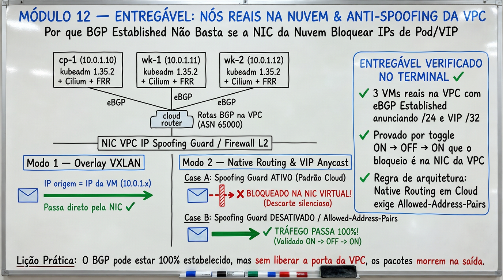

Fonte: elaborada pelo autor (2026).

Em três VMs reais da nuvem, `kubeadm` 1.35.2 sem kube-proxy e Cilium 1.20.1
funcionaram 1:1 com overlay VXLAN (MTU 1450, RTT ~0,9 ms). Um FRR externo na
mesma VPC recebeu por eBGP os três PodCIDR `/24` e a VIP anycast `/32` com
ECMP de três next-hops: o cenário do lab reproduziu-se em fabric real.

O que a plataforma bloqueou é a lição: com o guard de spoofing de IP da porta
ligado, SYNs com origem de pod saíam da NIC e não voltavam, e pacotes com
destino que não é o IP da porta (VIP anycast, IP de pod) eram descartados
antes do nó. A prova causal foi um toggle ON→OFF→ON na porta de um único nó:
com OFF, pod direto, VIP por BGP, VIP por rota estática e conexão nova
pod→FRR sem SNAT funcionaram; com ON, apenas NodePort. A API reportou `false`
antes de o datapath aceitar; um canário FRR→pod é o único readiness confiável.

Para native routing ou VIP anycast em nós reais, a porta precisa aceitar
origens e destinos além do seu próprio IP, por allowed-address-pairs ou guard
desligado. Isso é uma decisão de postura de segurança da VPC, não um ajuste
do Cilium.

## Módulo 13 — DCI, OVN, FRR e EVPN: o que os resultados provam

Cilium aplica políticas à identidade eBPF do endpoint, mas isso não cria uma VRF nem separa domínios de rede.
No Cilium B, FRR usou VRFs auxiliares, enquanto `eth0` permaneceu no mapa global do Cilium.
OVN-Kubernetes isolou CIDRs sobrepostos em redes primárias com EVPN e preservou o IP e a sessão TCP das VMs na live migration testada.

**Quadro 14 – Comparação dos planos de rede testados**

| Plano | VRF e CIDR sobreposto | EVPN | Mobilidade de VM |
|---|---|---|---|
| Cilium A | Política por identidade eBPF; a API não oferece VRF para CIDRs iguais na `eth0` primária. | API BGP v2 rejeitou `vrf`, `evpn` e `l2vpn`; anúncio EVPN não foi provado. | Live migration mudou o IP do `virt-launcher` e derrubou a sessão TCP para o IP antigo. |
| Cilium B | FRR isolou CIDRs iguais em VRFs Linux auxiliares; `eth0` permaneceu no mapa global `cilium_lxc`. | FRR anunciou/importou EVPN Type 5 nas VRFs auxiliares; `R6=0`. | Cutover pela rota `/32`: 40 s, 30/30 HTTP. Este comparativo P004 não mediu live migration. |
| OVN-Kubernetes | UDNs primárias usaram o mesmo CIDR e IP, isolados entre tenants. | `RouteAdvertisements` anunciou Type 5; outro caso mediu extensão L2 com Type 2. | Live migration preservou IP e sessão TCP: 60/60 pings, sem perda. |

Fonte: elaborado pelo autor (2026).

Nota: cada linha descreve somente os casos testados. Os três planos foram ensaiados separadamente; resultados do Cilium A não demonstram o comportamento do Cilium B. A Figura 15 situa pods e VMs nos planos comparados. As medições e ressalvas estão no [dossiê P004](estudos/20-dci-estado-parcial.md).

**Figura 15 – Planos de rede testados com pods e VMs**

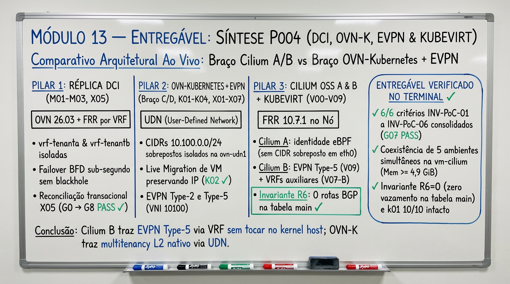

Fonte: elaborada pelo autor (2026).


### 13.1 Réplica DCI: OVN e FRR por VRF

**Figura 16 – Caminhos DCI da réplica histórica P004**


Fonte: elaboração própria, derivada do registro histórico P004.

**Inscrições preservadas da Figura 16 — réplica DCI (27–29/09/2026)**

> Transcrição do registro histórico. As métricas e o limite `VNI literal: NOT_RUN` pertencem a essa réplica; não foram refeitos nem indicam disponibilidade atual.

- Réplica DCI: dois caminhos medidos
- Topologia lógica e resultados históricos de 27–29/09/2026; sem indicação de disponibilidade atual.
- M01/M02 · cliente legado AS 200
- Tenant OVN
- VPC 192.168.100.0/24
- VM fake 192.168.100.10
- Logical router + 2 rotas ECMP
- Não é uma VM KubeVirt
- OVN: 1 central · 2 chassis
- Gateway 1
- Linux VRF ovnvrf100
- VLAN 100 · FRR no gateway
- Gateway 2
- Linux VRF ovnvrf200
- VLAN 200 · FRR no gateway
- Cliente legado
- FRR AS 200
- Anuncia 10.0.0.0/16
- Par dos gateways DCI
- BGP · AS 100/200
- Setas sólidas: dados; tracejadas: controle BGP/EVPN. Os gateways usam VRFs Linux distintas.
- M03 · EVPN Type 5 + VXLAN entre tenant OVN e peer externo
- Tenant OVN
- 192.168.100.0/24
- VNI 50100
- Peer FRR externo
- Recebe Type 5
- Distinto do cliente legado
- Controle: EVPN Type 5
- Dados: VXLAN/UDP 4789
- A7 filtrou connected na redistribuição; a origem da rota não virou static.
- Ping: positivo 30/30 · causal 0/3 · restaurado 3/3; VNI literal: NOT\_RUN.

Os caminhos distintos da réplica DCI aparecem na Figura 16.

Nota: topologia lógica dos caminhos medidos na réplica DCI; o desenho não representa um inventário ou estado operacional atual.

A réplica tinha dois caminhos distintos:

- **Cliente legado:** o tenant OVN usou `192.168.100.0/24` com uma VM simulada. Dois Connect Gateways tinham as VRFs Linux `ovnvrf100` e `ovnvrf200`, com FRR nos próprios gateways; cada um mantinha BGP com o cliente legado AS 200, que anunciava `10.0.0.0/16`.
- **Peer EVPN:** o peer externo recebeu rotas EVPN Type 5 (Rabadan et al., 2021), no VNI 50100 para o tenant A e no VNI 50200 para o tenant B. Esse peer não era o cliente legado das VLANs 100 e 200.

**Figura 17 – Checkpoint histórico das sessões P004**


Fonte: elaboração própria, derivada do checkpoint histórico P004.

**Inscrições preservadas da Figura 17 — checkpoint das sessões P004**

> Os rótulos `PASS` são os anotados nesse checkpoint, não uma validação desta edição. A Figura 16 registra `VNI literal: NOT_RUN` no escopo da réplica DCI; o rótulo M03/VNI 50100 abaixo permanece no quadro histórico de sessões. A distinção é preservada sem reavaliação ou harmonização.

- P004: Trilha completa concluída (S001 a S008 · PASS · G01 a G08 fechados)
- Checkpoint final P004 · DCI (S002), OVN-K (S003), Cruzados (S004), Cilium A/B + KubeVirt (S005–S007) e Síntese INV (S008)
- 1. DCI + OVN + FRR
- S001 + S002 COMPLETO · PASS
- S001 · labctl comum PASS (27/09)
- M01 · BGP/ECMP e falhas PASS
- M02 · MTU 1500 vs 9000 PASS
- M03 · EVPN Type 5 VNI 50100 PASS
- X05 · CIDR sobreposto 50100/50200
- Pegada: 0,54 GiB (dci + OVS host)
- 2. OVN-K + UDN + Cruzados
- S003 + S004 COMPLETO · PASS
- K01 · UDN CIDR sobreposto 10.100/24
- K02 · Live migration IP fixo (0 loss)
- K03/K04 · EVPN Type 5 + IP fixo VM
- X01–X04 · Tenant 3 planos + RT
- X06/X07 · Hub overlap + Type 2 L2
- Gates G03, G04 e G05 provados
- 3. Cilium A & B + KubeVirt
- S005 a S007 COMPLETO · PASS
- V00–V04 · CEP, VIP BGP, Reuso (G01)
- V05/V06 · Migração L3 + Multi-Pool /32
- V07-A/C-neg · Overlap e fronteira (G02)
- H6/V08 · FRR 10.7.1 no nó (G06, R6=0)
- V09/V07-B · EVPN Type 5 VNI 10100/200
- Rollback limpo a ipam=kubernetes
- Destaques comparativos medidos em S001–S008 (OVN-K vs Cilium A/B vs INV)
- EVIDÊNCIAS AO VIVO EM KVM NATIVO (/dev/kvm) · R6=0 VERIFICADO
- Identidade vs IP (V04 / G01): reuso do mesmo IP 10.253.0.100/32 bloqueado por
- fromEndpoints (0/30 ALLOW), enquanto ACL por IP vaza (30/30 ALLOW).
- Cilium A vs Cilium B (S006–S007): FRR 10.7.1 no nó adiciona EVPN Type 5 (V09)
- e VRFs auxiliares (V07-B) com R6=0, mas eth0 primária continua global no
- cilium\_lxc — same-CIDR primário (K01) e migração L2 (K02) exigem OVN-K C/D.
- 4. Síntese & Higiene (S008)
- S008 COMPLETO · G07 & G08 PASS
- G07: Matriz INV × Aberto e 6
- critérios objetivos de PoC (INV-PoC
- 01 a 06) + Blueprint Fase 2 C/D.
- G08: dci/ovnk/evpn down (0 res.),
- k01 10/10, p003-gw limpo, RAM 4,95G.
- Leitura histórica consolidada de P004 (S001–S008); sem afirmação sobre disponibilidade em tempo real da VM.

A Figura 17 registra a sequência histórica das sessões P004.

Nota: registro histórico do plano; não representa o estado operacional atual.

- **Falhas no plano de controle (M01):** withdraws e falhas controladas preservaram o tráfego medido. A falha de FRR parou `bgpd`, `bfdd` e `zebra` dentro de `ovn-gw-1`, não em um contêiner FRR separado. Os gateways usaram FRR 10.7.0 e o cliente, 8.4.1_git. A falha do chassis `ovn-chassis-1`, que hospedava a VM simulada, não foi testada.
- **MTU e pacotes jumbo (M02):** com MTU 1500, pacotes pequenos passaram 30/30; o pacote IPv4 jumbo de 9000 B com DF teve 0/30 respostas, e o roteador enviou ICMP Frag Needed com MTU 1500. Com MTU 9000, pacotes pequenos e jumbo passaram 30/30. As MTUs voltaram a 1500; a fragmentação literal no tap físico da PoC ficou parcialmente reproduzida.
- **Anúncio causal de EVPN Type 5 (M03):** o positivo alcançou `192.168.100.0/24` no VNI 50100 e respondeu 30/30. No controle negativo, `dynamic-routing-redistribute=static` retirou rotas `connected` do anúncio: a rota saiu do SB, da tabela do tenant, do Type 5 e da FIB, e o ping caiu a 0/3, embora BGP e VTEP seguissem ativos. Ao remover a chave, o ping voltou a 3/3. O controle negativo literal do VNI não foi executado, pois não tinha causalidade com o withdraw da rota.
- **CIDRs sobrepostos em tenants OVN (X05):** o tenant B reutilizou `192.168.100.0/24` e o trânsito `169.254.254.0/30`, isolado em `ovnvrf50200` (VNI 50200). O tráfego interno respondeu 30/30; as quatro direções entre tenants tiveram 0/3 respostas, sem pacote capturado no destino. Para o peer desencapsular Type 5, o `Router MAC` anunciado precisou coincidir com o MAC de `br-vxlan50200`. O rollback retirou anúncios BGP/EVPN antes dos objetos OVN e VRFs, sem resíduos.

### 13.2 OVN-Kubernetes, EVPN e casos entre planos

**Figura 18 – Planos de rede registrados nos ensaios P004 com KubeVirt**


Fonte: elaboração própria, derivada dos registros experimentais históricos P004.

**Inscrições preservadas da Figura 18 — planos e ensaios P004**

> As métricas são vinculadas aos IDs e braços descritos. São registros históricos e não demonstram disponibilidade atual nem permitem transferir resultado de um braço para outro.

- Arquitetura comparada em P004 (S002–S008): OVN-K (C/D) × Fabric EVPN × Cilium A & B + KubeVirt
- Quatro braços testados ao vivo na vm-cilium com KVM nativo (/dev/kvm), FRR 10.7.1 e Containerlab SR Linux
- Braço C: OVN-Kubernetes v1.4.0 + KubeVirt (S003)
- Isolamento por UDN/CUDN L2 + Live Migration transparente
- K01: tenant-a e tenant-b com mesmo CIDR primário
- 10.100.0.0/24 (VM 10.100.0.14 em ambos · 0 vazamento)
- K02: virtctl migrate ovnk-worker → ovnk-worker2
- IP 10.100.0.14 fixo · 0% packet loss · TCP sobrevive
- K03/K04: EVPN Type 5 via frr-k8s + Lift-and-Shift
- 10.200.0.0/24 (VNI 10100) + VM 192.168.50.10/24
- Braço DCI + Fabric EVPN Cruzado / D (S002 + S004)
- Integração 3 planos e guardrails de sobreposição (X01–X07)
- X01 (G04): Tenant unificado DCI ↔ Fabric ↔ OVN-K
- 192.168.100.10 ↔ 10.0.0.10 ↔ VM 10.200.0.x (30/30)
- X02 / X05 / X07 (G05): Subnets sobrepostas isoladas
- Type 5 (VNI 10100/10200, 50100/50200) e Type 2 MAC-VRF
- X03 / X04 / X06: Controles de borda e admissão
- Communities BGP · RT errado (0/30) · Hub CIDR guard
- Braços Cilium A & B: Cilium 1.20.2 + KubeVirt + FRR (S005–S008)
- p003-gw: GoBGP nativo (A) vs FRR 10.7.1 no nó (B, R6=0) · V00 a V09
- V00–V03 (C01–C03): CiliumEndpoint, VIP BGP /32 e CNP por label
- cep\_id=242 sec\_id=172890 · VIP 10.202.255.20/32 (30/30, withdraw 8s)
- CNP fromEndpoints(client-a)=30/30 · client-b=0/30 (18 drops)
- V04 (G01) & V08-A/B (H8): Reuso de IP /32 e Cutover Legado
- V04: 10.253.0.100/32 reutilizado → sec\_id 133690 != 163024 (0/30 ALLOW)
- V08-A/B: cutover KVM 10.60.0.50/24 → VMI /32 BGP (39s/40s · 30/30 OK)
- C-neg (G02): sem VRF/EVPN no Cilium OSS; sec\_id local ao eBPF
- V05 (H3) & V06: Live Migration L3 e Multi-Pool /32 no Cilium OSS
- masquerade troca podIP (.2.190 → .1.23; /32 .0.23 → .0.4); l2bridge bloqueado
- TCP direto p/ podIP antigo cai · VIP BGP reconverge em ~2–3 s (20/20)
- V07-A (C-neg) vs V07-B: Sub-redes Sobrepostas (Same-CIDR)
- V07-A (Cilium OSS): flat routing + putEndpointIdInvalid "IP in use" em eth0
- V07-B (Cilium B): isolado em VRFs FRR (VNI 10100/10200 30/30), não em eth0
- H6 (G06) & V09 (H7): Braço Cilium B (FRR 10.7.1 no Nó · R6=0)
- GoBGP (:1790) → frr-node (table-map RM-NO-KERNEL → 0 rotas BGP na main)
- V09: EVPN Type-5 \[5\] em vrf-tenant-a/b (30/30 intra, 0/10 cross-VRF)
- Síntese INV × Aberto (G07): Critérios INV-PoC-01 a INV-PoC-06
- Fase 2: Cilium A (Cloud-Native L7) + OVN-K C/D (VMs L2/EVPN/Same-CIDR)
- cobre 100% dos requisitos sem lock-in; PoC INV exige eth0 VRF + L2 migrate
- Figura 09 — Síntese arquitetural dos resultados medidos de P004-S002 a P004-S008 (DCI, OVN-K C/D, Cilium A e Cilium B).

A Figura 18 compara os planos experimentais nos casos KubeVirt.

Nota: comparação dos planos experimentais com KVM nativo (`/dev/kvm`), EVPN, Cilium 1.20.2 e FRR 10.7.1 (`R6=0`).

O cluster kind tinha três nós e usou OVN-Kubernetes `v1.4.0` (OVN-Kubernetes, [2026]), KubeVirt `v1.9.0` (KubeVirt, [2026]) em KVM nativo e `frr-k8s` `v0.0.27`.

- **CIDR primário sobreposto (K01):** duas `UserDefinedNetwork` usaram `10.100.0.0/24`. As VMs dos dois tenants receberam o mesmo IP `10.100.0.14`, responderam 30/30 dentro do próprio tenant e 0/30 entre tenants.
- **Live migration com IP preservado (K02):** `virtctl migrate` moveu a VM entre workers em cerca de 16 s. O IP `10.100.0.14/24` permaneceu igual, houve 0% de perda ICMP (60/60) e a sessão TCP longa sobreviveu.
- **EVPN Type 5 e lift-and-shift (K03 e K04):** uma `ClusterUserDefinedNetwork` `10.200.0.0/24` foi anunciada ao fabric via `RouteAdvertisements` e `frr-k8s` (VNI 10100): o positivo respondeu 30/30 e o negativo, 0/10. O caso de lift-and-shift manteve o IP legado `192.168.50.10/24`.

A integração entre planos mediu estes casos:

- **Conectividade do tenant unificado (X01):** o tráfego fim a fim respondeu 30/30.
- **Isolamento em três planos (X02):** com `10.200.0.0/24` e `10.0.0.0/24` sobrepostos, nenhum pacote vazou.
- **Comunidade BGP e Route Target (X03 e X04):** a filtragem por community funcionou; um Route Target incorreto bloqueou o tráfego (0/30).
- **Colisão de CIDR e extensão L2 (X06 e X07):** o hub detectou colisão em VRF. A extensão L2 usou MAC-VRF EVPN Type 2 (Sajassi et al., 2015), com `172.16.50.0/24` em VNIs 20100 e 20200.

### 13.3 Cilium A: identidade de endpoint e VM

Cilium 1.20.2 no sandbox `p003-gw` executou os casos com KubeVirt `v1.9.0` em `/dev/kvm`. Os perfis `ovnk`, `evpn-fabric` e `dci` estavam desligados para manter `MemAvailable >= 4 GiB`.

- **VM e pods (V00 e V01):** uma VM CirrOS comunicou-se com pods nos dois sentidos (30/30); parada, respondeu 0/30. O `virt-launcher` aparece como `CiliumEndpoint` com IP do PodCIDR, enquanto o guest usa seu próprio endereço interno.
- **VIP BGP e política (V02 e V03):** o LoadBalancer da VM anunciou `10.202.255.20/32` e respondeu 30/30 ao cliente; após withdraw, caiu a 0/30 em 8 s. A `CiliumNetworkPolicy` permitiu 30/30 ao cliente autorizado e bloqueou o outro (0/30), com 18 drops `Policy denied`.
- **Reuso de IP e identidade (V04):** o pool único `10.253.0.100/32` foi atribuído a duas VMs em sequência. A primeira respondeu 30/30; a segunda recebeu outra identidade e, sob `fromEndpoints`, teve 0/30 e 25 drops. A ACL baseada só no IP permitiu 30/30 à segunda VM.
- **Live migration no Cilium A (V05):** a migração entre workers levou 22 s, mudou o IP do `virt-launcher` e derrubou a sessão TCP aberta para o endereço antigo. A VIP BGP `10.202.255.20/32` reconvergiu, com intervalo máximo de 3000.0 ms.
- **Multi-Pool `/32` com migração (V06):** `multi-pool` com `maskSize: 32` atribuiu `10.252.0.23/32`; probes diretos responderam 30/30. Depois da migração, o IP mudou para `10.252.0.4/32` e respondeu 30/30. `multiPoolPreAllocation` reteve o bloco antigo no nó de origem. O rollback restaurou `ipam.mode=kubernetes` sem pools residuais.

### 13.4 Limites comparados e caminhos complementares

No Cilium A, namespaces com CIDR igual usaram a mesma tabela de roteamento, sem isolamento L3 (`V07-A`): dois pods que pediram o mesmo IP `/32` no nó colidiram no mapa global `cilium_lxc`. A API BGP v2 também rejeitou `vrf`, `evpn` e `l2vpn`, não instalou rotas recebidas no kernel (`proto bgp = 0`) e não levou identidade eBPF ao cabeçalho IP externo.

No Cilium B, o **FRR auxiliar no nó (H6)** pareou com o GoBGP do Cilium e com os ToRs. `table-map RM-NO-KERNEL` manteve zero rotas BGP na tabela `main`, preservando `R6=0`. O FRR anunciou/importou EVPN Type 5 e isolou CIDRs e IPs iguais em VRFs auxiliares (V09 e V07-B): 30/30 dentro do VRF, 0/10 entre VRFs. A interface primária `eth0`, porém, continuou presa ao mapa global `cilium_lxc`; o ensaio não provou sobreposição nessa interface.

No cutover de VM legada, a rota `10.60.0.50/32` prevaleceu sobre `/24` no `border1` em 25 s. O corte levou 39 s no Cilium A e 40 s pelo caminho GoBGP → FRR no nó → `border1`; ambos responderam 30/30 HTTP. O blueprint combina Cilium para workloads cloud-native/L7 com OVN-Kubernetes para os casos de KubeVirt, CIDR sobreposto e EVPN medidos; é uma composição de evidências, não um ensaio único integrado. Os seis critérios para avaliar uma PoC do INV estão no [dossiê de critérios e resultados](estudos/20-dci-estado-parcial.md).

### 13.5 Exercícios de interpretação

1. Como identidade eBPF, VRFs auxiliares e EVPN diferem nos três planos de rede testados?
2. Quais evidências distinguem CIDR sobreposto, anúncio EVPN e migração de VM nos três planos?
3. O que ocorreu com IP e sessão TCP durante a migração em cada plataforma?
4. Que limites impedem extrapolar resultados do Cilium A para o Cilium B?

Para detalhes por caso, controles e mapa de evidências, consulte [DCI, OVN-K e Cilium + KubeVirt em P004: consolidação das evidências](estudos/20-dci-estado-parcial.md).

## Módulo 14 — Estudos avançados P005: eBGP dedicado e datapath eBPF

Quatro ondas contrastam a borda eBGP dedicada com o datapath eBPF, a alocação de IPs e a observabilidade. A Figura 19 relaciona a borda eBGP ao datapath e à alocação de IPs.

**Figura 19 – Borda eBGP e datapath eBPF**

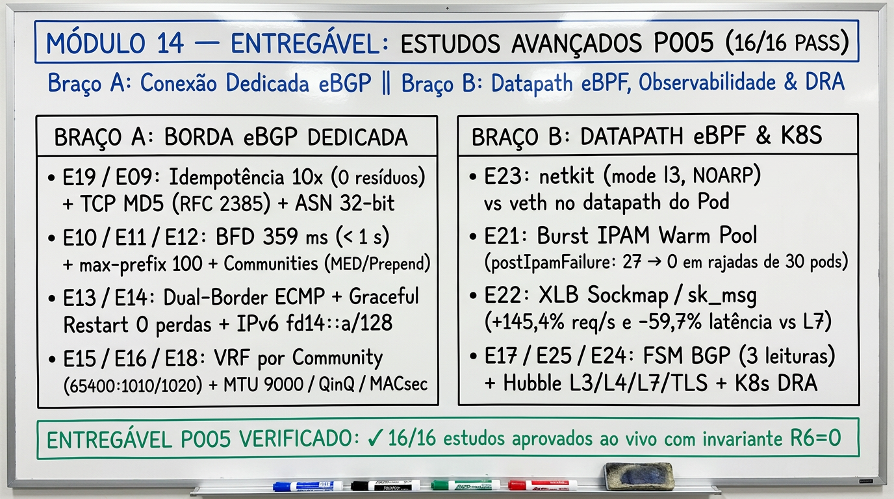

Fonte: elaborada pelo autor (2026).

### 14.1 Onda 1 — idempotência, TCP MD5, netkit e IPAM

As medições desta onda estão no Quadro 15.

**Borda eBGP** ([dossiê de idempotência e TCP MD5](estudos/19-bgp-idempotency-md5-asn32.md))

- **Idempotência BGP e reuso de VIP (E19):** reaplicar recursos sem drift mantém a RIB estável e permite reutilizar a VIP sem respostas antigas.
- **Sessão eBGP com TCP MD5 (E09):** a autenticação da sessão protege também peers com ASN de 32 bits (Heffernan, 1998).

**Datapath eBPF e alocação de IPs** ([dossiê de netkit e burst IPAM](estudos/21-netkit-vs-veth-ipam-burst.md))

- **netkit contra veth (E23):** trocar o tipo de interface exige recriar pods; a política Cilium continua valendo depois da troca.
- **Pool de IP pré-aquecido (E21):** reservar blocos antes da rajada evita falhas enquanto o operador cria novos blocos.

**Quadro 15 – Resultados de idempotência, netkit e IPAM**

| Estudo | Medida | Resultado |
|---|---|---|
| Idempotência e reuso de VIP | Reaplicações e estado BGP | 10 aplicações; 0 diferenças em políticas, rotas anunciadas e RIB do `border1` |
| Idempotência e reuso de VIP | Retirada e reuso | 100% das rotas removidas em 11 s; outra aplicação da VIP respondeu 30/30 HTTP 200, sem resposta antiga; `R6=0` |
| Sessão eBGP com TCP MD5 | Autenticação | ASN remoto 4200000001; sessão convergiu em 3 s; `tcpdump` mostrou a opção TCP 19 (MD5) |
| Sessão eBGP com TCP MD5 | Controles de credencial | Senha errada isolou o peer inválido; 3/3 sessões mantidas. `Secret` ausente falhou fechado; nova senha recuperou em 9,39 s |
| netkit contra veth | Troca e retransmissões TCP | Cilium 1.20.2/kernel 6.8: troca recusada com pods `veth`; após recriação em `netkit`, 47→0 no mesmo nó e 11→0 entre nós |
| netkit contra veth | Softirqs e política | `NET_RX`: -8,9% no mesmo nó e -20,5% entre nós; a `CiliumNetworkPolicy` continuou bloqueando tráfego proibido |
| Pool de IP pré-aquecido | Rajada de pods | 16 pods em três configurações: `kubernetes`, 5,40 s sem falhas; `multi-pool` sem reserva, 27 falhas; pool pré-aquecido, 0 (-100%) |
| Pool de IP pré-aquecido | Controle de capacidade insuficiente | Pool `/29`, seis IPs para dez pods: 6 `Running` e 4 `Pending`; outros pools não foram afetados |

Fonte: elaborado pelo autor (2026).

### 14.2 Onda 2 — prefixos, communities, BFD e XLB

Communities (Chandra; Traina; Li, 1996) selecionam rotas; BFD (Katz; Ward, 2010) acelera a detecção de falhas. Os demais resultados estão no Quadro 16.

**Limite de prefixos, communities e BFD** ([dossiê da borda PE/CE](estudos/11-bgp-maxprefix-communities-bfd.md))

- **Limite de prefixos e filtro de import (E11):** o Cilium mantém a sessão BGP, mas a borda precisa controlar o que entra e o volume anunciado; a CFP `#34841` de Dswaffordcw (2024) registra a limitação de aprendizado.
- **Communities, prepend e MED (E12):** traduzir communities em política de borda direciona o tráfego sem mudar a configuração do roteador.
- **Falha silenciosa com BFD (E10):** BFD encurta a retirada de rota quando os pacotes somem sem derrubar a sessão TCP.

**Balanceamento L7 no eBPF** ([dossiê do XLB](estudos/22-xlb-ebpf-socket-lb-vs-envoy.md))

- **XLB, SocketLB e Envoy (E22):** decidir no kernel reduz latência em relação ao proxy L7 e ainda permite bloquear uma chamada antes da aplicação.

**Quadro 16 – Resultados de prefixos, BFD e XLB**

| Estudo | Medida | Resultado |
|---|---|---|
| Limite de prefixos e filtro de import | Cilium ao receber prefixos | Enviados 50, 200 e 300; sessão `established`, sem rota `proto bgp` no kernel (`R6=0`) |
| Limite de prefixos e filtro de import | Filtro de borda com limite 100 | 50 declarados aceitos; um não declarado bloqueado; 200 e 300 derrubaram a sessão (`Maximum-prefix exceeded`) |
| Communities, prepend e MED | Seleção de rack | Sem política, ECMP; com `route-map`, 10/10 no rack 1; communities invertidas, 10/10 no rack 2 em 4 s |
| Falha silenciosa com BFD | Convergência BGP | Timers 3/9 s: 8901 ms; menor timer aceito, 1/3 s: 3045 ms |
| Falha silenciosa com BFD | Retirada por BFD | FRR–FRR com `100 ms × 3`: rota retirada em 359 ms, abaixo do requisito de 1000 ms (`RNF05`) |
| XLB, SocketLB e Envoy | Latência em 100 requisições HTTP | Envoy L7: 1,014 ms; SocketLB L4: 0,392 ms (-61,3%); XLB: 0,413 ms (-59,3% ante Envoy) |
| XLB, SocketLB e Envoy | Throughput em 100 requisições HTTP | Envoy L7: 985,9 req/s; SocketLB L4: 2550,9 req/s; XLB: 2418,9 req/s (+145,4% ante Envoy) |
| XLB, SocketLB e Envoy | CPU e bloqueio | `NET_RX`: -27,9% ante Envoy e -6,8% ante SocketLB; XLB bloqueou `GET /deny` em `sendmsg()` |

Fonte: elaborado pelo autor (2026).

### 14.3 Onda 3 — redundância, IPv6 e observabilidade

A comparação de Graceful Restart segue Sangli et al. (2007). As medições de failover e visibilidade estão no Quadro 17.

**Dual-border, Graceful Restart e eBGP IPv6** ([dossiê de redundância e IPv6](estudos/13-bgp-dual-border-gr-ipv6.md))

- **Failover de borda e reinício do agente (E13):** Graceful Restart mantém o datapath útil durante a reinicialização do agente; a rota ainda precisa desaparecer quando o restart não é protegido.
- **Sessão eBGP IPv6 (E14):** uma sessão nativa IPv6 fornece next hop IPv6 para a VIP e evita o next hop IPv4 mapeado que não encaminha IPv6.

**Observabilidade BGP e Hubble** ([dossiê de observabilidade](estudos/17-bgp-hubble-observability.md))

- **Estado BGP por leituras consecutivas (E17):** exigir leituras estáveis evita alarmes por flaps curtos, e falhas de coleta permanecem explicitamente desconhecidas.
- **Fluxos e política no Hubble (E25):** observar L3/L4 e L7 relaciona tráfego, identidade e drops sem revelar conteúdo de TLS.

**Quadro 17 – Resultados de failover e observabilidade**

| Estudo | Medida | Resultado |
|---|---|---|
| Failover de borda e reinício do agente | Falha de uma borda | 71/71 HTTP 200, `max_gap_ms=115 ms`; ECMP retornou após religar a borda |
| Failover de borda e reinício do agente | Reinício com e sem Graceful Restart | Com GR, 139/139 HTTP 200 sem perdas; sem GR, 78 falhas e `max_gap_ms=8879 ms` |
| Sessão eBGP IPv6 | VIP IPv6 `fd14::a/128` | Next hop IPv6 nativo; 30/30 requisições HTTP IPv6; withdraw bloqueou o acesso em 2 s (5/5); restauração respondeu 5/5 HTTP 200 |
| Estado BGP por leituras consecutivas | Amostragem e flap curto | Leituras a cada 3 s; estado mudou após 3 leituras consecutivas; flap de duas leituras sem alarme; falha de coleta gerou `UNKNOWN` |
| Estado BGP por leituras consecutivas | Falha sustentada e recuperação | `DOWN` em 7596 ms; voltou em 11166 ms |
| Estado BGP por leituras consecutivas | Origem dos atributos | `AS_PATH` completo e communities só ficaram visíveis na RIB do roteador de borda |
| Fluxos e política no Hubble | L3/L4, L7 e TLS | 10 drops por política; IP externo preservado com `externalTrafficPolicy: Local`; proxy L7 registrou 200, 403 e DNS; TLS na porta 8443 teve 0 vazamentos de URL |
| Fluxos e política no Hubble | Métricas e buffer | Métricas Prometheus coerentes; buffer local continuou registrando fluxos com o Relay fora do ar |

Fonte: elaborado pelo autor (2026).

### 14.4 Onda 4 — VRF, retorno, enlace L2 e DRA

`QinQ` (Institute of Electrical and Electronics Engineers, 2006) e `MACsec` (Institute of Electrical and Electronics Engineers, 2018) são contrastados com WireGuard; a API DRA estável é documentada por Kubernetes Authors (2026c). Os resultados estão no Quadro 18.

**VRF por tenant, retorno e enlace L2** ([dossiê de VRF, retorno e enlace](estudos/15-bgp-vrf-return-paths-l2-mtu-qinq-macsec.md))

- **VRF por tenant via communities (E15):** communities podem encaminhar VIPs a VRFs no roteador de borda, embora o Cilium anuncie por uma única sessão.
- **Três rotas de retorno (E16):** o pacote só volta ao pod quando a rota aparece na FIB do nó ou sai por um gateway que conhece o retorno.
- **MTU, QinQ e MACsec (E18):** os três mecanismos resolvem problemas distintos de tamanho de pacote, segmentação L2 e proteção do enlace.

**Dynamic Resource Allocation** ([dossiê de DRA para dispositivos de rede](estudos/24-cilium-dra-network-device.md))

- **Interfaces secundárias por DRA (E24):** DRA anexa dispositivos adicionais ao workload sem substituir a política e o BGP da interface primária.

**Quadro 18 – Resultados de VRF, enlace e DRA**

| Estudo | Medida | Resultado |
|---|---|---|
| VRF por tenant via communities | Três VIPs e tráfego por tenant | 30/30 HTTP 200 dentro de cada tenant; tentativas entre tenants e community não autorizada em 0/5; `R6=0` |
| Três rotas de retorno | Rota estática no nó | Sem rota, 0/3 apesar da rota visível no BGP; com rota, 30/30 HTTP 200 e `R6=0` |
| Três rotas de retorno | FRR auxiliar e Egress Gateway | FRR com `prefix-list`: 30/30; ao encerrar FRR, `R6=0`; pod selecionado pelo Egress Gateway: 30/30; outro bloqueado, 0/5 |
| MTU, QinQ e MACsec | MTU 9000 e enlace MTU 1500 | Com DF, 30/30 pings de 9000 B passaram em MTU 9000; em MTU 1500, 0/5 e ICMP `need to frag` |
| MTU, QinQ e MACsec | QinQ | Sessão eBGP estabelecida e 10/10 pings com dupla etiqueta; etiqueta interna errada, 0/5 |
| MTU, QinQ e MACsec | MACsec | Sessão eBGP estabelecida e 10/10 pings; 100% dos quadros cifrados, 0 pacotes TCP/179 ou ICMP em claro; chave divergente, 0/5 |
| Interfaces secundárias por DRA | API e preparação | Chart Cilium 1.20.2 sem driver DRA; Kubernetes v1.35.0 com `resource.k8s.io/v1`; 2 interfaces alocadas; preparação idempotente em 3 execuções, sem IP duplicado |
| Interfaces secundárias por DRA | Tráfego nas interfaces | `net1`: 10/10 HTTP 200; `eth0`: 10/10 permitidos, 5/5 negados e VIP BGP ativa |
| Interfaces secundárias por DRA | Controles e teardown | Seletor CEL inválido rejeitado; claims excedentes `Pending`; teardown liberou o dispositivo |

Fonte: elaborado pelo autor (2026).

### 14.5 Exercícios de interpretação

1. Como o Cilium e o roteador de borda dividem o controle de importação e do limite de prefixos?
2. Que comportamento muda quando Graceful Restart preserva o datapath durante a reinicialização do agente?
3. Quando uma rota BGP precisa também aparecer na FIB para o pod responder?
4. Como MACsec e WireGuard diferem em camada, escopo e proteção do tráfego?
5. Que garantias o DRA oferece às interfaces secundárias sem substituir a política da `eth0`?

## Módulo 15 — Datapath, multicluster, SRv6 e mobilidade

Este módulo compara balanceamento eBPF, redes multicluster, VRFs com SRv6 e mobilidade de VMs. A Figura 20 aproxima datapath, comunicação multicluster e mobilidade.

**Figura 20 – Datapath, multicluster e mobilidade**

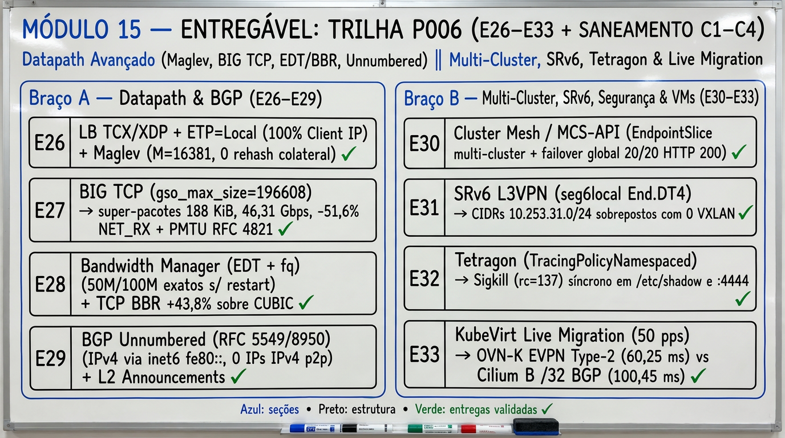

Fonte: elaborada pelo autor (2026).

### 15.1 Onda 1 — LoadBalancer TCX/XDP, Maglev e Cluster Mesh

Maglev usa hashing consistente (Eisenbud et al., 2016). As medições dos dois estudos estão no Quadro 19.

**LoadBalancer e Maglev** ([dossiê de LB e Cluster Mesh](estudos/26-lb-xdp-dsr-maglev-clustermesh.md))

- **Anúncio seletivo e Maglev (E26):** `externalTrafficPolicy: Local` anuncia a VIP no nó com backend local e preserva o IP do cliente; `Cluster` distribui os anúncios em ECMP.
- **Serviço global entre clusters (E30):** Cluster Mesh combina backends locais e remotos; BGP mantém o serviço alcançável quando o deployment local some.

**Quadro 19 – Resultados de LoadBalancer e Cluster Mesh**

| Estudo | Medida | Resultado |
|---|---|---|
| Anúncio seletivo e Maglev | Anúncio das três VIPs | Duas VIPs `Cluster` anunciadas pelos dois workers em ECMP; a VIP `Local`, só pelo worker com backend |
| Anúncio seletivo e Maglev | Caminho e IP do cliente | Na VIP `Local`, IP real preservado em 10/10; sem salto intermediário |
| Anúncio seletivo e Maglev | Remoção de backend | Anel `M=16381`: só os slots do backend removido foram realocados; 0 rehash colateral nos demais; serviço respondeu 20/20 HTTP 200 |
| Serviço global entre clusters | Tráfego com dois clusters | 20/20 leste-oeste e 20/20 norte-sul via BGP |
| Serviço global entre clusters | Failover | Deployment local em 0: cluster remoto serviu 20/20 |
| Serviço global entre clusters | Controles negativos | `egressDeny` bloqueou 5/5; sem exportação remota e local em 0, mapa BPF esvaziou e 5/5 foram recusadas |

Fonte: elaborado pelo autor (2026).

### 15.2 Onda 2 — BIG TCP, netkit e SRv6 L3VPN

A descoberta de PMTU segue a RFC 4821 (Mathis; Heffner, 2007); `End.DT4` segue o SRv6 Network Programming (Filsfils et al., 2021). Os resultados estão no Quadro 20.

**BIG TCP e netkit** ([dossiê de BIG TCP e netkit](estudos/27-big-tcp-netkit-srv6-l3vpn.md))

- **Três regimes de datapath (E27):** BIG TCP aumenta os pacotes agregados; a descoberta de PMTU recupera conexões quando um enlace menor filtra ICMP.
- **Isolamento SRv6 com `End.DT4` (E31):** VRFs mantêm sub-redes iguais separadas sem interfaces VXLAN, desde que a rota local use a tabela correta.

**Quadro 20 – Resultados de BIG TCP e SRv6**

| Estudo | Medida | Resultado |
|---|---|---|
| Três regimes de datapath | Throughput IPv4 — fluxo TCP único de 512 MiB | `veth` MTU 1500/GSO 64k: 39,20 Gbps; `veth` MTU 9000/BIG TCP 192k: 46,31 Gbps (+18,1%); `netkit` L3: 46,08 Gbps (+17,6%) |
| Três regimes de datapath | Throughput IPv6 — fluxo TCP único de 512 MiB | `veth` MTU 1500: 41,61 Gbps; `veth` MTU 9000: 46,60 Gbps (+12,0%); `netkit`: 45,73 Gbps (+9,9%) |
| Três regimes de datapath | Pacotes e interrupções | Pacotes no fio: -59,6% a -60,8%; `NET_RX`: -51,0% a -51,6% |
| Três regimes de datapath | Super-pacotes | Máximo de 187.974 B em IPv4 e 187.582 B em IPv6 |
| Três regimes de datapath | Controle de PMTU | MTU `9000 -> 1500 -> 9000`: 5/5 com ICMP Frag-Needed; ICMP filtrado e `tcp_mtu_probing=0`: 0/5; com `=2`, transferência recuperada |
| Isolamento SRv6 com `End.DT4` | CIDR e tráfego entre VRFs | Dois tenants no mesmo `10.253.31.0/24`: 30/30 HTTP 200 dentro de cada VRF, 0 interfaces VXLAN e 0/5 entre VRFs |
| Isolamento SRv6 com `End.DT4` | Revogação e kernel | Revogar SID B: 0/5 respostas para B e 5/5 para A; `net.vrf.strict_mode=1`; `seg6local dev eth0`; clientes na mesma `/24` precisam de rota `/32` |

Fonte: elaborado pelo autor (2026).

### 15.3 Onda 3 — Bandwidth Manager, BBR e Tetragon

BBR e CUBIC são comparados por Cardwell et al. (2016) e Xu et al. (2023); Tetragon é documentado por Tetragon Authors (c2024). Os resultados estão no Quadro 21.

**Bandwidth Manager e Tetragon** ([dossiê de EDT, BBR e Tetragon](estudos/28-bandwidth-edt-bbr-tetragon.md))

- **Limite de banda por pod (E28):** o Bandwidth Manager aplica pacing no datapath; remover a anotação devolve vazão sem reiniciar o pod.
- **Observação e bloqueio em runtime (E32):** a simulação local controlada do wrapper Python `e32-sensor-exec` representa eventos JSON no estilo Tetragon e encerra a ação por `os.kill`; os `rc=137` descrevem essa simulação, não a ação de um agente Tetragon/eBPF no kernel.

**Quadro 21 – Resultados de pacing e runtime security**

| Estudo | Medida | Resultado |
|---|---|---|
| Limite de banda por pod | Anotação `50M` e `100M` | Cilium 1.20.2 com `qdisc fq`: 49,70 e 49,62 Mbps (99,2%–99,4%); 97,34 e 97,70 Mbps (97,3%–97,7%) |
| Limite de banda por pod | Sem limite e remoção dinâmica | Sem limite: 8,49 e 8,94 Gbps; remover anotação restaurou 8,40 e 9,00 Gbps sem reinício; anotação inválida não derrubou `cilium-agent` |
| Limite de banda por pod | BBR versus CUBIC | Enlace WAN `delay 10ms loss 0.5% rate 500mbit`: 163,20 contra 118,71 Mbps (+37,5%) e 237,36 contra 165,01 Mbps (+43,8%) para BBR |
| Observação e bloqueio em runtime | Tentativas bloqueadas | Simulação local controlada de eventos no estilo Tetragon encerrou a ação com `os.kill` (`rc=137`); a fixture registrou 0 bytes vazados; não comprova bloqueio por agente no kernel |
| Observação e bloqueio em runtime | Tráfego legítimo | HTTP legítimo completou 10/10 (100%) `HTTP 200 OK` |

Fonte: elaborado pelo autor (2026).

A seção 3.1 do dossiê vinculado relata ausência do DaemonSet do agente; este estudo não comprova versão instalada do Tetragon, agente upstream ativo ou política eBPF aplicada no kernel. A medição histórica de HTTP legítimo 10/10 permanece registrada, sem comprovar agente ativo.

### 15.4 Onda 4 — BGP unnumbered, L2 Announcements e live migration

O next hop IPv6 para NLRI IPv4 segue as RFCs 5549 e 8950 (Le Faucheur; Rosen, 2009; Litkowski et al., 2020). Os resultados estão no Quadro 22.

**BGP unnumbered e live migration** ([dossiê de unnumbered e live migration](estudos/29-bgp-unnumbered-l2-live-migration.md))

- **eBGP unnumbered e L2 Announcements (E29):** vizinhança IPv6 link-local pode carregar rotas IPv4; eleição por `Lease` controla qual nó anuncia no segmento L2.
- **Live migration sob tráfego contínuo (E33):** EVPN Type 2 atualiza o caminho L2 da VM; o anúncio BGP `/32` exige convergência de rota durante o corte.

**Quadro 22 – Resultados de unnumbered, L2 e migração**

| Estudo | Medida | Resultado |
|---|---|---|
| eBGP unnumbered e L2 Announcements | Next hop IPv6 e rota IPv4 | 0 IPv4 nas interfaces ponto a ponto; kernel instalou rota `via inet6 fe80::...`; 10/10 pings; `RTT avg = 0,060 ms` |
| eBGP unnumbered e L2 Announcements | Anúncio L2 | Cilium 1.20.2; líder eleito por `Lease`; mapa `cilium_l2_responder_v4`; 10/10 HTTP 200 |
| eBGP unnumbered e L2 Announcements | Controles negativos | Desativar família IPv4 retirou rota da FIB; remover label do Service esvaziou o mapa BPF |
| Live migration sob tráfego contínuo | Método e cutover Cilium B | 50 pps, 20 ms entre pacotes, 150 pacotes UDP; rota `/32` perdeu 5/150 (3,3%), blackout 100,45 ms |
| Live migration sob tráfego contínuo | OVN-Kubernetes | EVPN Type 2 preservou MAC/IP e atualizou FDB VXLAN; 3/150 perdas (2,0%), blackout de 60,25 ms (-40,0%) |
| Live migration sob tráfego contínuo | Controle negativo | Rota antiga: 0/10 entregues; atualização BGP restaurou 10/10 |

Fonte: elaborado pelo autor (2026).

### 15.5 Exercícios de interpretação

1. Como `externalTrafficPolicy` altera o anúncio da VIP e a preservação do IP do cliente quando um backend sai?
2. Que papel tem a descoberta de PMTU quando uma rota atravessa enlaces de MTU diferente?
3. Como o pool pré-aquecido e o pacing afetam falhas de alocação e vazão?
4. O que distingue o caminho de BGP unnumbered do anúncio L2 por `Lease`?
5. Que diferenças observáveis aparecem na migração entre EVPN Type 2 e rota BGP `/32`?

## Módulo 16 — BGP sem perda, SPIFFE, WireGuard e Multus

Duas ondas comparam a retirada gradual de rotas, identidade autenticada, redirecionamento local e interfaces secundárias. A Figura 21 situa o dreno BGP ao lado da identidade SPIFFE e das interfaces secundárias.

**Figura 21 – BGP, identidade e rede local**

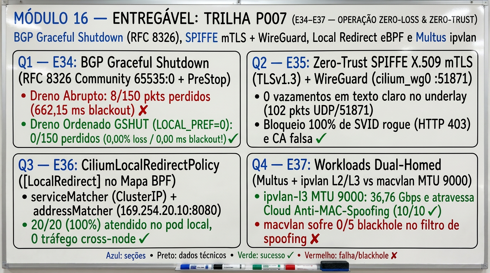

Fonte: elaborada pelo autor (2026).

### 16.1 Onda 1 — Graceful Shutdown e identidade SPIFFE

Graceful Shutdown segue a RFC 8326 (Francois et al., 2018). SPIFFE (SPIFFE, [2026]) e WireGuard (Donenfeld, 2017) atuam em camadas diferentes. As medições estão no Quadro 23.

**Dreno de nó com BGP** ([dossiê de Graceful Shutdown e SPIFFE](estudos/30-bgp-gshut-spiffe-mtls-wireguard.md))

- **Dreno com Graceful Shutdown (E34):** anunciar a community `graceful-shutdown` permite ao ToR desviar tráfego antes de encerrar o pod.
- **Autenticação mútua SPIFFE com WireGuard (E35):** WireGuard protege o underlay; mTLS identifica o cliente autorizado na política do Cilium.

**Quadro 23 – Resultados de dreno e autenticação**

| Estudo | Medida | Resultado |
|---|---|---|
| Dreno com Graceful Shutdown | Dreno abrupto | Fluxo de 50 pps e 150 pacotes: 8/150 perdidos (5,33%); blackout de 662,15 ms |
| Dreno com Graceful Shutdown | Dreno ordenado | `65535:0` e `PreStop` de 0,80 s; 0/150 perdas e 0,00 ms de blackout; 100% dos novos pacotes foram ao outro nó |
| Dreno com Graceful Shutdown | Anúncio e último recurso | Cilium 1.20.2 aplicou `localPreference: 0` sem configuração manual; controle `3A`: 10/10 no último recurso |
| Dreno com Graceful Shutdown | Retirada e restauração | Controle `3B`: 0/5 com ambos os nós sem rota; `3C`: retirar `65535:0` restaurou 10/10 em ECMP, `R6=0` |
| Autenticação mútua SPIFFE com WireGuard | WireGuard | Sem túnel, 20 pacotes HTTP em claro; com `cilium_wg0` (`UDP :51871`), 10/10 HTTP 200, 102 datagramas cifrados, 0 vazamentos |
| Autenticação mútua SPIFFE com WireGuard | mTLS | Com `authentication.mode: "required"`, autenticação mútua respondeu 10/10 HTTP 200 em `TLSv1.3` |
| Autenticação mútua SPIFFE com WireGuard | Controles de identidade | SPIFFE ID não autorizado: `3A`, 5/5 HTTP 403; CA externa: `3B`, 0/5 e `SSLV3_ALERT_BAD_CERTIFICATE` |
| Autenticação mútua SPIFFE com WireGuard | Controle de política | `ingressDeny`: `3C`, 0/5 conexões permitidas; remoção da regra restaurou 10/10, `R6=0` |

Fonte: elaborado pelo autor (2026).

### 16.2 Onda 2 — Local Redirect e workloads dual-homed

As medições de encaminhamento local e interfaces Multus estão no Quadro 24.

**Local Redirect e Multus** ([dossiê de Local Redirect e workloads dual-homed](estudos/31-local-redirect-multus-ipvlan-dualhomed.md))

- **Redirecionamento local de Service (E36):** `serviceMatcher` mantém chamadas no nó com cache local; `addressMatcher` permite interceptar um endereço sem criar um Service.
- **Interfaces secundárias com Multus (E37):** `ipvlan` compartilha o MAC do host, enquanto `macvlan` usa MAC próprio e pode ser bloqueado por anti-spoofing.

**Quadro 24 – Resultados de encaminhamento e Multus**

| Estudo | Medida | Resultado |
|---|---|---|
| Redirecionamento local de Service | `serviceMatcher` | Sem política, 40%–60% das chamadas ao `ClusterIP` cruzavam de nó; com Local Redirect, 20/20 ficaram locais, 0 pacotes entre nós |
| Redirecionamento local de Service | `addressMatcher` | Endereço `169.254.20.10:8080/TCP` entregue ao pod local em 10/10 conexões por nó |
| Redirecionamento local de Service | Controle de seleção | `3A`: nó sem label, 0/5; outro nó, 10/10 |
| Redirecionamento local de Service | Controle de teardown | `3B`: 100% das entradas `[LocalRedirect]` removidas, 0 resíduos; balanceamento restaurado, 20/20, `R6=0` |
| Interfaces secundárias com Multus | Tráfego e MTU | `net1` `ipvlan L2` com MTU 9000: 10/10 HTTP 200 e 10/10 pings de 8972 B com DF, 0% de perda e `RTT avg = 0,069 ms`; `eth0` com política Cilium, 10/10 |
| Interfaces secundárias com Multus | Throughput em fluxo TCP único de 512 MiB | `veth 1500`: 33,01 Gbps; `macvlan`: 32,49 Gbps; `ipvlan L2`: 30,63 Gbps; `ipvlan L3` `NOARP`: 36,76 Gbps (+11,4% vs. `veth`, +20,0% vs. `ipvlan L2`) |
| Interfaces secundárias com Multus | Anti-spoofing e interface independente | Controle `3A`: `macvlan`, 0/5; `ipvlan L2`, 10/10; controle `3B`: desligar `net1` manteve `eth0` em 10/10 |

Fonte: elaborado pelo autor (2026).

### 16.3 Exercícios de interpretação

1. Como o ToR e o pod participam do dreno ordenado de uma VIP anycast?
2. Que propriedades diferentes WireGuard e SPIFFE mTLS demonstraram no mesmo serviço?
3. Como os dois modos de Local Redirect alteram o caminho de uma chamada?
4. O que mudou entre `macvlan` e `ipvlan` no teste de anti-spoofing?

## Módulo 17 — Host Firewall, Envoy, Route Reflector e WireGuard

Duas ondas medem proteção do nó, resiliência L7, reflexão de rotas e custo de criptografia. A Figura 22 conecta proteção do host, tráfego L7 e transporte SRv6.

**Figura 22 – Segurança, tráfego L7 e SRv6**

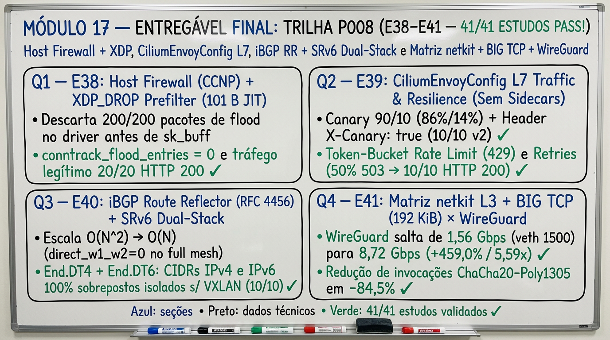

Fonte: elaborada pelo autor (2026).

### 17.1 Onda 1 — Host Firewall, XDP e resiliência L7

As medições de proteção do nó e gestão de tráfego estão no Quadro 25.

**Host Firewall e XDP** ([dossiê de Host Firewall e XDP](estudos/32-host-firewall-xdp-envoy-l7-resilience.md))

- **Host Firewall e prefiltro XDP (E38):** a política protege portas do host e XDP descarta pacotes antes da alocação de `sk_buff`.
- **Gestão L7 com Envoy (E39):** `CiliumEnvoyConfig` oferece canário, limite de taxa e retry sem sidecar na aplicação.

**Quadro 25 – Resultados de segurança do nó e tráfego L7**

| Estudo | Medida | Resultado |
|---|---|---|
| Host Firewall e prefiltro XDP | Host Firewall | Sem política, cliente administrativo e host não autorizado alcançaram `:19100` em 10/10; com política, cliente e kubelet em `:10250` mantiveram 10/10 HTTP 200, host não autorizado caiu a 0/5 e `tc_host_fw_drops=5`; portas protegidas `:10250`, `:6443`, `:4240`, `:179`, `:19100` |
| Host Firewall e prefiltro XDP | XDP e fallback | Programa `BPF_PROG_TYPE_XDP` de 101 B JIT descartou 200/200 (100%) em `XDP_DROP`; 0 entradas de conntrack e cliente legítimo 20/20; sem XDP, TC manteve 0/5 entregues; nós 3/3 `Ready`; rollback restaurou 10/10, `R6=0` |
| Canário e resiliência com Envoy | Canário ponderado e cabeçalho | `cilium-envoy` 1.37.6, sem sidecars; 100 requisições 90/10 resultaram em `v1=86`, `v2=14`, todas HTTP 200; `X-Canary: true` enviou 10/10 a `v2` |
| Canário e resiliência com Envoy | Limite de taxa | Token bucket `max_tokens: 5`: 5/15 passaram, 10/15 retornaram HTTP 429; `rl_hits=5` no backend |
| Canário e resiliência com Envoy | Retry de upstream | Upstream com falha HTTP 503 em 50%: sem retry, 5/10 HTTP 200; com três retries, 10/10 HTTP 200 |

Fonte: elaborado pelo autor (2026).

### 17.2 Onda 2 — Route Reflector, SRv6 e matriz netkit

A reflexão de rotas segue a RFC 4456 (Bates; Chen; Chandra, 2006); `End.DT4` e `End.DT6` seguem Filsfils et al. (2021). As medições estão no Quadro 26.

**Route Reflector e SRv6 dual-stack** ([dossiê de Route Reflector e SRv6](estudos/33-bgp-rr-srv6-dualstack-netkit-wg-matrix.md))

- **Route Reflector e VPN L3 SRv6 (E40):** um refletor evita sessões full-mesh; SRv6 transporta IPv4 e IPv6 sem VXLAN e separa VRFs com CIDRs sobrepostos.
- **Matriz netkit, BIG TCP e WireGuard (E41):** pacotes maiores reduzem chamadas de criptografia, mas o driver WireGuard mantém limite próprio de segmentação.

**Quadro 26 – Resultados de Route Reflector, SRv6 e WireGuard**

| Estudo | Medida | Resultado |
|---|---|---|
| Route Reflector e VPN L3 SRv6 | Sessões e encaminhamento | Malha iBGP `O(N^2)` substituída por Route Reflector `O(N)`; `direct_w1_w2=0`; tráfego direto 10/10 IPv4 e 10/10 IPv6; next hop preservado; rotas marcadas com `ORIGINATOR_ID` e `CLUSTER_LIST` |
| Route Reflector e VPN L3 SRv6 | CIDRs sobrepostos | Dois tenants com CIDRs IPv4/IPv6 iguais: 10/10 HTTP 200 nas quatro combinações, 0 vazamentos e 0 interfaces VXLAN |
| Route Reflector e VPN L3 SRv6 | Controles de loop e SID | `self_paths=0`; revogar `End.DT6` do Tenant A produziu 0/5 IPv6 e manteve IPv4 em 10/10 |
| Matriz netkit, BIG TCP e WireGuard | Vazão em fluxo TCP único de 2 GiB | `R1` `veth` MTU 1500 sem cifra: 34,55 Gbps; `R2` com WireGuard: 1,56 Gbps; `R3` `netkit` L3 MTU 9000/BIG TCP: 43,91 Gbps (+27,1%); `R4` com WireGuard: 8,72 Gbps |
| Matriz netkit, BIG TCP e WireGuard | Custo de cifra e limite do driver | Invocações ChaCha20-Poly1305 caíram 84,5%; vazão cifrada subiu 459,0% (5,59x) de `R2` a `R4`; Linux 6.8 limita `tso_max_size` a 65536, então BIG TCP não se aplica à `cilium_wg0` |
| Matriz netkit, BIG TCP e WireGuard | Overhead e confidencialidade | Túnel WireGuard IPv4 acrescentou 80 B; com underlay MTU 9000, 8920 B passaram e 8921 B falharam; 0 vazamentos em claro no underlay |

Fonte: elaborado pelo autor (2026).

### 17.3 Exercícios de interpretação

1. Como o Host Firewall limita o nó quando o XDP não está ligado?
2. Que diferenças de escopo surgem entre balanceamento L7 no Envoy e no kernel?
3. Como o Route Reflector evita sessões diretas entre workers sem perder o next hop?
4. Por que `netkit` e BIG TCP alteram o custo relativo do WireGuard?

## Considerações finais

### Limites do que foi demonstrado

- O fabric roda em contêineres com simulação em espaço de usuário; use relações entre medidas, não valores absolutos de throughput ou latência.
- A VIP IPv6 e o tráfego pod→pod IPv6 entre nós ficaram limitados pela topologia IPv4 do underlay externo.
- O ExternalAuth é experimental no Cilium 1.20.2 e tem os defeitos listados no Módulo 7; a fixture não é um IdP.
- Cilium A isola políticas por identidade eBPF, mas não cria VRFs nem aceita CIDRs sobrepostos na `eth0` primária. Cilium B usa VRFs Linux auxiliares com FRR e EVPN Type 5; isso não isola CIDRs iguais na interface primária. Não extrapole resultados de A para B.
- OVN-Kubernetes isolou CIDRs sobrepostos em redes primárias e mediu EVPN Type 2/5; a live migration testada preservou IP e sessão TCP. Essas observações valem para os casos descritos no Módulo 13.
- A migração no Cilium A mudou o IP do `virt-launcher`; o ensaio do Cilium B mediu um corte de rota `/32`. São caminhos distintos da mobilidade L2 testada no OVN-Kubernetes.
- A sincronização entre identidade Kubernetes e Security Group Neutron não foi implementada; a trilha híbrida depende de sequenciamento manual.
- Nós reais na nuvem provaram overlay e BGP; native routing e VIP anycast dependem da postura de antispoofing da porta.
- Os estudos dos Módulos 14 a 17 herdam as mesmas ressalvas: laboratório em contêineres, kernel Linux `6.8` e fabric simulado. Os Quadros 15 a 26 resumem medidas e controles, com links para os dossiês no Apêndice B.

### Próximos estudos

As propostas anteriores estão preservadas no [planejamento histórico de estudos](historico/proximos-estudos.md), junto à [revisão técnica histórica de 26/09/2026](historico/revisao-projeto-2026-09-26.md). Esses arquivos são registros históricos; o [índice atual dos estudos](../studies/README.md) reúne a navegação vigente. Os dossiês estão reunidos no Apêndice B.

A preparação, os gates e a limpeza do laboratório próprio estão no **Apêndice A**.

## Referências

BATES, T.; CHEN, E.; CHANDRA, R. **BGP Route Reflection: An Alternative to Full Mesh Internal BGP (IBGP)**. [S. l.]: IETF, abr. 2006. (Request for Comments, 4456). DOI: 10.17487/RFC4456. Disponível em: https://www.rfc-editor.org/rfc/rfc4456. Acesso em: 27 out. 2026.

CARDWELL, N. et al. BBR: Congestion-Based Congestion Control. **Queue**, New York, v. 14, n. 5, p. 20-53, set./out. 2016. DOI: 10.1145/3012426.3022184. Disponível em: https://queue.acm.org/detail.cfm?id=3022184. Acesso em: 27 out. 2026.

CHANDRA, R.; TRAINA, P.; LI, T. **BGP Communities Attribute**. [S. l.]: IETF, ago. 1996. (Request for Comments, 1997). DOI: 10.17487/RFC1997. Disponível em: https://www.rfc-editor.org/rfc/rfc1997. Acesso em: 27 out. 2026.

CILIUM. **Troubleshooting Kubernetes Networking**. [S. l.], 16 ago. 2026. Disponível em: https://cilium.io/blog/2026/08/16/troubleshooting-kubernetes-networking/. Acesso em: 3 nov. 2026.

CILIUM AUTHORS. **BGP Control Plane Resources**. Versão 1.20. [S. l.]: Cilium Project, 2026a. Disponível em: https://docs.cilium.io/en/v1.20/network/bgp-control-plane/bgp-control-plane-configuration/. Acesso em: 27 out. 2026.

CILIUM AUTHORS. **Cilium BGP Control Plane**. Versão 1.20. [S. l.]: Cilium Project, 2026b. Disponível em: https://docs.cilium.io/en/v1.20/network/bgp-control-plane/bgp-control-plane/. Acesso em: 27 out. 2026.

CILIUM AUTHORS. **Gateway API Support**. Versão 1.20. [S. l.]: Cilium Project, 2026c. Disponível em: https://docs.cilium.io/en/v1.20/network/servicemesh/gateway-api/gateway-api/. Acesso em: 27 out. 2026.

CILIUM AUTHORS. **Introduction to Cilium & Hubble**. Versão 1.20. [S. l.]: Cilium Project, 2026d. Disponível em: https://docs.cilium.io/en/v1.20/overview/intro/. Acesso em: 27 out. 2026.

CILIUM AUTHORS. **Multi-Pool**. Versão 1.20. [S. l.]: Cilium Project, 2026e. Disponível em: https://docs.cilium.io/en/v1.20/network/concepts/ipam/multi-pool/. Acesso em: 27 out. 2026.

CILIUM AUTHORS. **Routing**. Versão 1.20. [S. l.]: Cilium Project, 2026f. Disponível em: https://docs.cilium.io/en/v1.20/network/concepts/routing/. Acesso em: 27 out. 2026.

CILIUM AUTHORS. **System Requirements**. Versão 1.20. [S. l.]: Cilium Project, 2026g. Disponível em: https://docs.cilium.io/en/v1.20/operations/system_requirements/. Acesso em: 27 out. 2026.

CILIUM AUTHORS. **Troubleshooting**. Versão 1.20. [S. l.]: Cilium Project, 2026j. Disponível em: https://docs.cilium.io/en/stable/operations/troubleshooting/. Acesso em: 3 nov. 2026.

CILIUM AUTHORS. **Using Kubernetes Constructs In Policy**. Versão 1.20. [S. l.]: Cilium Project, 2026h. Disponível em: https://docs.cilium.io/en/v1.20/security/policy/kubernetes/. Acesso em: 27 out. 2026.

CILIUM AUTHORS. **WireGuard Transparent Encryption**. Versão 1.20. [S. l.]: Cilium Project, 2026i. Disponível em: https://docs.cilium.io/en/v1.20/security/network/encryption-wireguard/. Acesso em: 27 out. 2026.

CLOUD NATIVE COMPUTING FOUNDATION. **Cloud Native Computing Foundation Announces Cilium Graduation**. San Francisco, 11 out. 2023. Disponível em: https://www.cncf.io/announcements/2023/10/11/cloud-native-computing-foundation-announces-cilium-graduation/. Acesso em: 27 out. 2026.

DEVANTLER. **Gateway API ExternalAuth: cross-node ext_authz request to the backend pod gets no response (WireGuard, tunnel mode)**. [S. l.]: GitHub, 27 jun. 2026. Issue 46768 do repositório cilium/cilium. Disponível em: https://github.com/cilium/cilium/issues/46768. Acesso em: 27 out. 2026.

DONENFELD, J. A. WireGuard: Next Generation Kernel Network Tunnel. In: NETWORK AND DISTRIBUTED SYSTEM SECURITY SYMPOSIUM, 2017, San Diego. **Proceedings** [...]. Reston: Internet Society, 2017. DOI: 10.14722/ndss.2017.23160. Disponível em: https://www.ndss-symposium.org/ndss2017/ndss-2017-programme/wireguard-next-generation-kernel-network-tunnel/. Acesso em: 27 out. 2026.

DSWAFFORDCW. **CFP: BGP Route Learning**. [S. l.]: GitHub, 12 set. 2024. Issue 34841 do repositório cilium/cilium. Disponível em: https://github.com/cilium/cilium/issues/34841. Acesso em: 27 out. 2026.

EBPF FOUNDATION. **What is eBPF?** An Introduction and Deep Dive into the eBPF Technology. [S. l.], [2026]. Disponível em: https://ebpf.io/what-is-ebpf/. Acesso em: 27 out. 2026.

EISENBUD, D. E. et al. Maglev: A Fast and Reliable Software Network Load Balancer. In: USENIX SYMPOSIUM ON NETWORKED SYSTEMS DESIGN AND IMPLEMENTATION, 13., 2016, Santa Clara. **Proceedings** [...]. Berkeley: USENIX Association, 2016. p. 523-535. Disponível em: https://www.usenix.org/conference/nsdi16/technical-sessions/presentation/eisenbud. Acesso em: 27 out. 2026.

FILSFILS, C. (ed.) et al. **Segment Routing over IPv6 (SRv6) Network Programming**. [S. l.]: IETF, fev. 2021. (Request for Comments, 8986). DOI: 10.17487/RFC8986. Disponível em: https://www.rfc-editor.org/rfc/rfc8986. Acesso em: 27 out. 2026.

FRANCOIS, P. (ed.) et al. **Graceful BGP Session Shutdown**. [S. l.]: IETF, mar. 2018. (Request for Comments, 8326). DOI: 10.17487/RFC8326. Disponível em: https://www.rfc-editor.org/rfc/rfc8326. Acesso em: 27 out. 2026.

HEFFERNAN, A. **Protection of BGP Sessions via the TCP MD5 Signature Option**. [S. l.]: IETF, ago. 1998. (Request for Comments, 2385). DOI: 10.17487/RFC2385. Disponível em: https://www.rfc-editor.org/rfc/rfc2385. Acesso em: 27 out. 2026.

INSTITUTE OF ELECTRICAL AND ELECTRONICS ENGINEERS. **IEEE Std 802.1ad-2005**: IEEE Standard for Local and Metropolitan Area Networks: Virtual Bridged Local Area Networks: Amendment 4: Provider Bridges. New York: IEEE, 2006. DOI: 10.1109/IEEESTD.2006.6044678.

INSTITUTE OF ELECTRICAL AND ELECTRONICS ENGINEERS. **IEEE Std 802.1AE-2018**: IEEE Standard for Local and Metropolitan Area Networks: Media Access Control (MAC) Security. New York: IEEE, 2018. DOI: 10.1109/IEEESTD.2018.8585421.

ISOVALENT. **Cisco Completes Acquisition of Cloud Native Networking & Security Leader Isovalent**. [S. l.], 13 abr. 2024. Disponível em: https://isovalent.com/blog/post/cisco-acquires-isovalent. Acesso em: 27 out. 2026. Publicado originalmente em 21 dez. 2023.

ISOVALENT. **Isovalent Networking for Virtualization**: Enterprise-Grade Network Segmentation and Multi-Tenancy for VMs in Kubernetes. [S. l.], 2 jun. 2026. Disponível em: https://isovalent.com/blog/post/isovalent-networking-for-virtualization/. Acesso em: 27 out. 2026.

KATZ, D.; WARD, D. **Bidirectional Forwarding Detection (BFD)**. [S. l.]: IETF, jun. 2010. (Request for Comments, 5880). DOI: 10.17487/RFC5880. Disponível em: https://www.rfc-editor.org/rfc/rfc5880. Acesso em: 27 out. 2026.

KUBERNETES AUTHORS. **Debugging DNS Resolution**. [S. l.]: The Linux Foundation, 2026a. Disponível em: https://kubernetes.io/docs/tasks/administer-cluster/dns-debugging-resolution/. Acesso em: 3 nov. 2026.

KUBERNETES AUTHORS. **Debugging Services**. [S. l.]: The Linux Foundation, 2026b. Disponível em: https://kubernetes.io/docs/tasks/debug/debug-application/debug-service/. Acesso em: 3 nov. 2026.

KUBERNETES AUTHORS. **Dynamic Resource Allocation**. [S. l.]: The Linux Foundation, 2026c. Disponível em: https://kubernetes.io/docs/concepts/resource-management/dynamic-resource-allocation/. Acesso em: 27 out. 2026.

KUBERNETES SIG NETWORK. **Gateway API**. [S. l.]: The Linux Foundation, 2026. Disponível em: https://gateway-api.sigs.k8s.io/. Acesso em: 27 out. 2026.

KUBEVIRT. **KubeVirt user guide**. [S. l.], [2026]. Disponível em: https://kubevirt.io/user-guide/. Acesso em: 27 out. 2026.

LAPUKHOV, P.; PREMJI, A.; MITCHELL, J. (ed.). **Use of BGP for Routing in Large-Scale Data Centers**. [S. l.]: IETF, ago. 2016. (Request for Comments, 7938). DOI: 10.17487/RFC7938. Disponível em: https://www.rfc-editor.org/rfc/rfc7938. Acesso em: 27 out. 2026.

LE FAUCHEUR, F.; ROSEN, E. **Advertising IPv4 Network Layer Reachability Information with an IPv6 Next Hop**. [S. l.]: IETF, maio 2009. (Request for Comments, 5549). DOI: 10.17487/RFC5549. Disponível em: https://www.rfc-editor.org/rfc/rfc5549. Acesso em: 27 out. 2026.

LITKOWSKI, S. et al. **Advertising IPv4 Network Layer Reachability Information (NLRI) with an IPv6 Next Hop**. [S. l.]: IETF, nov. 2020. (Request for Comments, 8950). DOI: 10.17487/RFC8950. Disponível em: https://www.rfc-editor.org/rfc/rfc8950. Acesso em: 27 out. 2026.

MATHIS, M.; HEFFNER, J. **Packetization Layer Path MTU Discovery**. [S. l.]: IETF, mar. 2007. (Request for Comments, 4821). DOI: 10.17487/RFC4821. Disponível em: https://www.rfc-editor.org/rfc/rfc4821. Acesso em: 27 out. 2026.

OPENSTACK. **BGP Dynamic Routing**: Neutron documentation. [S. l.], [2026]. Disponível em: https://docs.openstack.org/neutron/latest/admin/config-bgp-dynamic-routing.html. Acesso em: 27 out. 2026.

OVN-KUBERNETES. **OVN-Kubernetes**: documentation. [S. l.], [2026]. Disponível em: https://ovn-kubernetes.io/. Acesso em: 27 out. 2026.

RABADAN, J. (ed.) et al. **IP Prefix Advertisement in Ethernet VPN (EVPN)**. [S. l.]: IETF, out. 2021. (Request for Comments, 9136). DOI: 10.17487/RFC9136. Disponível em: https://www.rfc-editor.org/rfc/rfc9136. Acesso em: 27 out. 2026.

REKHTER, Y.; LI, T.; HARES, S. (ed.). **A Border Gateway Protocol 4 (BGP-4)**. [S. l.]: IETF, jan. 2006. (Request for Comments, 4271). DOI: 10.17487/RFC4271. Disponível em: https://www.rfc-editor.org/rfc/rfc4271. Acesso em: 27 out. 2026.

SAJASSI, A. (ed.) et al. **BGP MPLS-Based Ethernet VPN**. [S. l.]: IETF, fev. 2015. (Request for Comments, 7432). DOI: 10.17487/RFC7432. Disponível em: https://www.rfc-editor.org/rfc/rfc7432. Acesso em: 27 out. 2026.

SANGLI, S. et al. **Graceful Restart Mechanism for BGP**. [S. l.]: IETF, jan. 2007. (Request for Comments, 4724). DOI: 10.17487/RFC4724. Disponível em: https://www.rfc-editor.org/rfc/rfc4724. Acesso em: 27 out. 2026.

SPIFFE. **SPIFFE Overview**. [S. l.], [2026]. Disponível em: https://spiffe.io/docs/latest/spiffe-about/overview/. Acesso em: 27 out. 2026.

TETRAGON AUTHORS. **Welcome to Tetragon documentation**. [S. l.], c2024. Disponível em: https://tetragon.io/docs/. Acesso em: 27 out. 2026.

XU, L. et al. **CUBIC for Fast and Long-Distance Networks**. [S. l.]: IETF, ago. 2023. (Request for Comments, 9438). DOI: 10.17487/RFC9438. Disponível em: https://www.rfc-editor.org/rfc/rfc9438. Acesso em: 27 out. 2026.

## Apêndice A – Preparar, verificar e encerrar o laboratório próprio

Esta sequência usa os alvos Make do clone do repositório, que traz o livro, os
Makefiles e `automation/student-lab` da mesma árvore. Ela não reconstrói os
ambientes históricos `k01` ou `p003-gw`. Use Ubuntu 24.04 amd64, uma conta
não-root com sudo, acesso à Internet e espaço para o perfil escolhido; o
Quadro 4A, na seção "Preparar uma rodada própria", traz os requisitos de cada
perfil. Abra o Terminal A, instale somente os pré-requisitos do sistema e clone
o repositório público (passo 0):

~~~bash
sudo apt-get update && sudo apt-get install -y git make
git clone --branch docs/p010-s001-20261028 https://github.com/reinaldosaraiva/learn-cilium.git
cd learn-cilium
pwd
test -f Makefile && test -f poc-k8s-fabric/Makefile
~~~

A cópia precisa ser um clone Git: `lab-env` lê o `HEAD` com `git rev-parse` e
falha sem `.git`. Registre o `HEAD` do clone; se alterar arquivos, registre
também os hashes dos arquivos alterados, pois o campo `LAB_GUIDE_REVISION`
sozinho não identifica alterações locais. Não passe credenciais do kubeconfig
para argumentos, variáveis adicionais ou recibos.

### Fundamentos: iniciar e confirmar o perfil

Para M1–M5, rode os comandos abaixo na ordem e preserve a saída de cada um. O
preflight verifica capacidade, dependências e colisões antes da criação. Um
erro, consulta inconclusiva ou recusa de capacidade encerra a sequência; não
desabilite o gate nem remova recursos manualmente.

~~~bash
make --no-print-directory lab-preflight LAB=fundamentos
make --no-print-directory lab-up LAB=fundamentos
make --no-print-directory lab-status LAB=fundamentos
make --no-print-directory lab-verify LAB=fundamentos
lab_env="$(make --no-print-directory lab-env LAB=fundamentos)" \
  && eval "$lab_env" \
  || { echo "lab-env falhou; veja a mensagem acima"; false; }
unset lab_env
k01() { kubectl --kubeconfig "$LAB_KUBECONFIG" --context "$LAB_CONTEXT" "$@"; }
C1="sudo docker exec clab-poc-k8s-kind-client-ext"
~~~

As duas últimas linhas definem os atalhos usados de M1 a M5: `k01` chama
`kubectl` com o kubeconfig e o contexto do perfil, e `$C1` executa comandos no
cliente do fabric. Sem elas os comandos dos módulos falham com
`command not found`.

`lab-status` informa o estado persistido; `lab-verify` consulta as identidades
e condições implementadas para o perfil. Uma execução histórica não substitui
essas consultas. Capture `lab-env` antes de definir aliases ou usar as
ferramentas do perfil. Não chame `lab-session` em `fundamentos`. O gate de
`fundamentos` exige 8 vCPU, 40 GiB de disco livre e `MemAvailable` de pelo menos
10240 MiB. A única execução em VM limpa usou 8 vCPU, 24 GiB de RAM e 80 GiB de
disco; é uma observação, não uma garantia. O caso F06, com 16 GiB de RAM total,
foi recusado pelo gate por memória disponível abaixo de 10240 MiB; veja o
registro em "Fundamentos M1–M5: execução F07 observada" e o Quadro 4A.

### Plataforma: selecionar um cenário antes da subida

M6–M10 usam um cenário por execução. `EXERCISE` e `WG` só se aplicam a
`lab-preflight` e `lab-up`; `lab-status`, `lab-verify`, `lab-env` e `lab-down`
recebem somente `LAB=plataforma`. Para trocar o cenário, primeiro use
`lab-down LAB=plataforma` e confirme o estado final com `lab-status`.

- **M6:** `LAB=plataforma EXERCISE=baseline`.
- **M7:** `LAB=plataforma EXERCISE=auth`.
- **M8:** `LAB=plataforma EXERCISE=wireguard-native` ou `wireguard-vxlan`; selecione somente um valor `WG=W0`, `WG=W1` ou `WG=W2`.
- **M9:** `LAB=plataforma EXERCISE=tenants`.
- **M10:** `LAB=plataforma EXERCISE=ipam24` ou `ipam32`.

~~~bash
make --no-print-directory lab-preflight LAB=plataforma EXERCISE=baseline
make --no-print-directory lab-up LAB=plataforma EXERCISE=baseline
make --no-print-directory lab-status LAB=plataforma
make --no-print-directory lab-verify LAB=plataforma
lab_env="$(make --no-print-directory lab-env LAB=plataforma)" \
  && eval "$lab_env" \
  || { echo "lab-env falhou; veja a mensagem acima"; false; }
unset lab_env
~~~

Para `wireguard-native` e `wireguard-vxlan`, forneça também um único `WG=W0`,
`WG=W1` ou `WG=W2` às chamadas de preflight e up. Depois de carregar o
ambiente, os exemplos de plataforma usam as variáveis `LAB_KUBECONFIG`,
`LAB_CONTEXT` e `STUDY_*` geradas para o cenário salvo. Não chame
`lab-session` nesse perfil.

O preflight apenas inspeciona dependências, capacidade e colisões. A instalação
dos pacotes e ferramentas do perfil acontece em `lab-up`. Para trocar entre
`fundamentos` e `plataforma`, encerre primeiro o perfil ativo, confirme
`lab-status` e inicie o próximo com seu próprio preflight e up. Se o cluster
continua ativo no mesmo perfil, consulte status/verify e capture `lab-env` no
novo shell; não rode preflight sobre a infraestrutura ativa.

O gate de `plataforma` exige 8 vCPU, 40 GiB de disco livre e `MemAvailable` de
pelo menos 10240 MiB (pico estimado de 6144 MiB mais a reserva de 4096 MiB).
F07 avaliou somente `fundamentos`; o perfil `plataforma` ainda não foi
validado em VM limpa e não há RAM total comprovada para ele (Quadro 4A).

### Iniciantes: preparar a rodada e carregar o ambiente

O perfil `iniciantes` foi validado em 10/11/2026 em uma VM Ubuntu 24.04 limpa
com 4 vCPU, 8 GiB de RAM e 40 GiB de disco. O gate exige 4 vCPU, 25 GiB de disco
livre e `MemAvailable` de pelo menos 6656 MiB (pico estimado de 2560 MiB mais a
reserva de 4096 MiB); a VM validada tinha 7228 MiB disponíveis. Isso não
estabelece um piso de memória menor que 8 GiB. Depois de preflight/up/status/verify bem-sucedidos,
crie a identidade de sessão e capture somente as atribuições do alvo. A sessão
não cria a namespace de prática; E01 faz essa operação explícita.

~~~bash
make --no-print-directory lab-preflight LAB=iniciantes
make --no-print-directory lab-up LAB=iniciantes
make --no-print-directory lab-status LAB=iniciantes
make --no-print-directory lab-verify LAB=iniciantes
make --no-print-directory lab-session LAB=iniciantes
lab_env="$(make --no-print-directory lab-env LAB=iniciantes)" \
  && eval "$lab_env" \
  || { echo "lab-env falhou; veja a mensagem acima"; false; }
unset lab_env
~~~

Use essa invocação na raiz do projeto, sem `make -w`: o stdout de
`lab-env` contém somente atribuições destinadas a `eval`. Mantenha o Terminal A
aberto durante a rodada. `LAB_RUN_ID` identifica a prática; o identificador da
infraestrutura e o UID do cluster são distintos. Não edite o estado privado nem
crie uma namespace por nome sem seguir E01.

No Terminal B, abra outro shell na mesma VM, entre na raiz do clone (`cd learn-cilium`,
a partir de onde você clonou) e recapture as atribuições da mesma sessão; não
execute `lab-session` outra vez:

~~~bash
pwd
test -f Makefile && test -f poc-k8s-fabric/Makefile
lab_env="$(make --no-print-directory lab-env LAB=iniciantes)" \
  && eval "$lab_env" \
  || { echo "lab-env falhou; veja a mensagem acima"; false; }
unset lab_env
kubectl --kubeconfig "$LAB_KUBECONFIG" --context "$LAB_CONTEXT" \
  -n "$LAB_CILIUM_NS" port-forward svc/hubble-relay 4245:80 \
  --address 127.0.0.1
~~~

Mantenha o encaminhamento somente em loopback durante E03–E05 e finalize com
Ctrl-C ao terminar a janela. No Terminal A, `HUBBLE_MODE=loopback-plaintext`
se aplica apenas a essa conexão local. Se o endereço de bind não for
127.0.0.1, pare. O port-forward não habilita Hubble e não altera o cluster.

### Observações das execuções de referência do perfil iniciante

As observações abaixo pertencem a execuções distintas e não substituem os
gates, comandos ou recibos da sua própria prática. Uma observação anterior,
feita em um Ubuntu 24.04 já equipado com as ferramentas, foi descartada deste
texto por não valer como validação de instalação em VM limpa.

**10/11/2026 — Ubuntu 24.04.5 limpo, 4 vCPU, 8 GiB de RAM e 40 GiB de disco:**
somente `git` e `make` foram instalados à mão (`sudo apt-get update && sudo
apt-get install -y git make`) e o repositório foi obtido por `git clone` anônimo
da branch indicada no passo 0. O preflight imprimiu `PRECHECK_OK`, e
`lab-up LAB=iniciantes` terminou `rc=0` em 4 min 20 s, com cluster
`kind-p010-student`, um nó `p010-student-control-plane`, kubectl v1.35.0 e
Cilium/Hubble 1.20.2. `lab-status`, `lab-verify`, `lab-session` e `lab-env`
terminaram `rc=0`. Os exercícios E01–E06 não são relatados nesta observação.

**31/10/2026 — Ubuntu 24.04 amd64, 4 vCPU, 8 GiB de RAM e 48 GiB de disco:**
o bootstrap agregado apt update + instalação de git/make + fluxo Make público
terminou `rc=0` entre 04:25:17 e 04:32:10 UTC. A segunda chamada pública
`make --no-print-directory lab-up LAB=iniciantes` terminou `rc=0` entre
04:32:12 e 04:33:42 UTC, com recap
`ok=109 changed=4 unreachable=0 failed=0 skipped=40 rescued=0 ignored=0`.
As identidades de state, nó/volume Docker e release/revisão Helm permaneceram
estáveis; `changed=4` não é `changed=0`. Essa única observação com 8 GiB não mede
um piso de memória.

A coleta inicial dos comandos do exercício terminou `rc=0` entre 04:33:43 e 04:37:35 UTC e reteve
estes nove códigos de curl: E02 API/direto 0/0; E03 API/direto 0/0; E04
API/direto 0/28; E05 selector defeituoso/API restaurada/direto 22/0/28.
O export não reteve os status HTTP exatos dessa execução; não atribua ao curl 22
um `HTTP 502`. A verificação posterior da evidência falhou ao
localizar essas linhas de rc e ao interpretar a parada normal do port-forward
(`rc=143`). O recibo original não ficou preservado separadamente; não o
reconstrua. O fechamento da VM não demonstra execução do alvo público
`lab-down`: a etapa seguinte e o down/repetição de down ficaram `NOT_RUN`, portanto essa
coleta é evidência limitada, não aceite integral. Fundamentos, plataforma e
híbrido não foram testados por essas execuções; o gate de memória de
fundamentos/plataforma (10240 MiB disponíveis) não tem piso de RAM total medido
além dos 24 GiB de F07. O alvo público para `LAB=hibrido`
continua bloqueado enquanto os controles desse perfil não forem implementados
e validados.

**Mais tarde em 31/10/2026 — outra VM Ubuntu 24.04 fresca:** a rodada completa
do perfil iniciante durou de 05:19:01 a 05:34:29 UTC e terminou `rc=0`.
O bootstrap público agregado terminou `rc=0` entre 05:19:50 e 05:26:37;
a segunda chamada `make --no-print-directory lab-up LAB=iniciantes`
terminou `rc=0` entre 05:26:39 e 05:28:08, recap
`ok=109 changed=4 failed=0 skipped=40`. O state e as identidades de
nó/volume Docker e release/revisão Helm permaneceram estáveis; `changed=4`
não é `changed=0`. A VM observada tinha 4 vCPU, 8 GiB de RAM e 48 GiB de
disco, uma observação que não estabelece piso de memória nem capacidade para
outros perfis.

As duas sequências completas dos exercícios terminaram `rc=0`: a primeira
entre 05:28:10 e 05:32:02 UTC e a segunda, que incluiu down, entre 05:32:04 e
05:34:17. Em cada sequência, as nove linhas de saída selecionadas foram:

~~~text
E02 curl via API rc=0
E02 curl direto rc=0
E03 request via API rc=0
E03 request direto rc=0
E04 curl via API rc=0
E04 curl direto rc=28
E05 request com defeito rc=22
E05 request API restaurado rc=0
E05 request direto rc=28
~~~

O export não reteve status HTTP exatos nem uma amostra Hubble para essa VM:
não chame curl 22 de HTTP 502 nem atribua a essa VM uma amostra de fluxo.
Timeout sozinho não prova policy. Nas duas
sequências, o encaminhamento de porta foi encerrado por TERM
(`rc=143`), em estado `STOPPED` e sem processos próprios restantes;
isso não é um resultado de Hubble. O segundo lab-down público terminou
`rc=0` entre 05:34:19 e 05:34:28, com
`ok=25 changed=0 failed=0 skipped=33`, e deixou o state byte-idêntico.
Esta rodada concluiu o perfil iniciante; não valida fundamentos, plataforma,
híbrido ou a edição documental executada.

### Fundamentos M1–M5: execução F07 observada

F07 foi uma execução limpa e única do perfil `fundamentos` em uma VM Ubuntu
24.04 amd64. O harness começou às 08:19:19.138 UTC e terminou às 08:31:49.152
UTC (`rc=0`, 750,013 s). A VM do teste tinha 8 vCPU, 24 GiB de RAM e disco
virtual de 80 GiB. Isso descreve um caso observado, não o menor tamanho
suportado nem um SLA. A configuração documentada de `fundamentos` e
`plataforma` continua exigindo 8 vCPU, 40 GiB de disco e `MemAvailable` de
10240 MiB; esses parâmetros não foram validados como mínimos. O perfil `plataforma`
não foi medido nesta execução.

Depois dos controles M1–M5 e antes da segunda subida, uma leitura do guest
registrou às 08:28:54.979–08:28:55.713 UTC:

```text
MemAvailable=14.243.912 KiB
root free=68.031.463.424 B
```

Esta foi a última leitura de capacidade do guest e ocorreu **antes da segunda
subida**, não depois do encerramento. O monitor do
host registrou mínimos de `7.491.324 KiB` disponíveis e `78.018.117.632 B`
livres em 11.453 amostras; não confunda essas medidas do host com as do guest.

O caso F06 de 16 GiB permanece como falha. Após os controles, a memória
disponível medida ficou abaixo do gate:

```text
MemAvailable=6.326.628 KiB
gate=10.485.760 KiB
```

A execução F07 com 24 GiB não apaga nem converte esse resultado em um mínimo
validado.

A sequência observada foi:

- Primeira subida pública de `fundamentos`: 08:20:33.493–08:27:19.103 UTC,
  `rc=0`; recap `ok=253 changed=29 unreachable=0 failed=0 skipped=81 rescued=0 ignored=0`.
- Verificação após a primeira subida: 08:27:41.033–08:28:21.122 UTC, `rc=0`;
  `ok=76 changed=0 unreachable=0 failed=0 skipped=28 rescued=0 ignored=0`.
- Segunda subida pública, com os mesmos seletores: 08:28:56.941–08:29:40.825
  UTC, `rc=0`; `ok=92 changed=0 unreachable=0 failed=0 skipped=22 rescued=0 ignored=0`.
  As identidades de state, nós/volumes Docker e release/revisão Helm foram
  preservadas.
- Verificação após a segunda subida: 08:30:02.934–08:30:43.193 UTC, `rc=0`;
  `ok=76 changed=0 unreachable=0 failed=0 skipped=28 rescued=0 ignored=0`.
- Primeiro `make lab-down LAB=fundamentos`: 08:30:44.403–08:31:23.428 UTC,
  `rc=0`; `ok=76 changed=6 unreachable=0 failed=0 skipped=19 rescued=0 ignored=0`.
- `lab-status` após a primeira descida: 08:31:23.428–08:31:30.738 UTC, `rc=0`;
  `ok=23 changed=0 unreachable=0 failed=0 skipped=20 rescued=0 ignored=0`.
- Segundo `make lab-down LAB=fundamentos`: 08:31:31.478–08:31:40.882 UTC,
  `rc=0`; `ok=25 changed=0 unreachable=0 failed=0 skipped=33 rescued=0 ignored=0`.
- `lab-status` após a segunda descida: 08:31:40.882–08:31:47.773 UTC, `rc=0`;
  `ok=23 changed=0 unreachable=0 failed=0 skipped=20 rescued=0 ignored=0`.

As duas descidas públicas deixaram o mesmo estado final de 1.629 bytes,
SHA-256 `813c3ab31da3`, e zero volumes Docker. A limpeza da VM foi registrada
separadamente: QEMU encerrou por QMP, seed/key/base/overlay foram removidos e
o lock foi removido pela identidade exata; `cleanup_complete=true`. O encerramento
QMP não substitui os dois resultados públicos de `lab-down`.

Os controles de M1–M5 foram somente leitura: 34 passos em 15 IDs passaram e
20 pedidos curl foram repetidos, com 42.823 bytes retidos. A execução não
reproduziu as mutações históricas de falha, failover ou escala dos módulos 4–5.
O sucesso desses controles sustenta somente este caso de `fundamentos`.

A fonte transferida foi verificada por manifesto de 342 membros
(`8981e39652a9`). O arquivo TAR produzido durante a execução
(`46e64aeb668f`) difere do TAR original (`16da757da9d7`); a verificação por
membros não é uma alegação de identidade byte a byte entre os dois arquivos.
O SHA-256 `99eafe638026` identifica o recibo original remoto de 28.586 bytes,
registrado como metadado. `receipt-export01.json` é uma projeção allowlisted e
não tem esse hash nem reconstrói os bytes do recibo original. O novo texto deste
livro e seus arquivos TeX/PDF não foram os bytes usados na execução F07.

A revisão independente aceitou o caso único de `fundamentos`; E05/G05 integral, plataforma, C1 real, C3 e híbrido continuam pendentes. Os recibos e manifestos dessa execução ficam no pacote interno de evidências do projeto e não fazem parte do que você recebe ao clonar o repositório.

### Encerrar em ordem e preservar o estado

No perfil iniciante, E06 confirma API/contexto, UID do cluster, UID da namespace
e `LAB_RUN_ID`; remove somente a namespace de prática criada nesta rodada e
aguarda sua ausência. Depois, escolha manter o cluster ativo para outra rodada
ou encerrar a infraestrutura. Para encerrar, pare o port-forward e execute
`lab-down LAB=iniciantes`. Em outros perfis, `lab-down` recebe somente `LAB` e não recebe
`EXERCISE` nem `WG`; por exemplo, `make --no-print-directory lab-down LAB=plataforma`.
A automação consulta o cenário salvo. Repita `make --no-print-directory lab-status LAB=plataforma`
para conferir o estado final. A automação remove somente recursos
de identidade persistida e recusa consulta ou ownership inconclusivos. Não use
`docker stop`, `kind delete`, `clab destroy`, limpeza por nome ou alterações
globais de host como atalho.

~~~bash
make --no-print-directory lab-status LAB=iniciantes
make --no-print-directory lab-down LAB=iniciantes
make --no-print-directory lab-status LAB=iniciantes
~~~

Depois de remover a namespace, uma nova rodada pode reutilizar o cluster apenas
se `lab-status` e `lab-verify` confirmarem que ele continua ativo; então chame
`lab-session` e capture `lab-env` novamente. Se a infraestrutura foi encerrada,
execute preflight/up/status/verify antes de criar outra sessão. Se uma identidade
divergir, uma consulta falhar ou a limpeza ficar parcial, pare e preserve o
estado para diagnóstico; não tente reaproveitar contexto, namespace, token ou
estado manualmente.

**Lições das execuções históricas.** O apêndice operacional antigo foi retirado
como procedimento executável porque alterava rede global do host ou limpava
recursos por nome. As medições dos Módulos 1–10 e dos estudos P003/P004
continuam como história; não repita falhas de links, upgrades de Helm,
rebuilds, `sysctl`, `clab destroy` ou scripts antigos nesta edição.

## Apêndice B – Documentos complementares do repositório

Os documentos abaixo detalham os estudos sintetizados neste guia e acompanham o repositório.


> **Nota histórica.** As sessões de P004 foram registradas entre 27/09 e 25/10/2026 como concluídas com PASS. As edições internas associaram v2.5.0 a P006, v2.6.0 a P007 e v2.7.0 a P008; P006 também reuniu o saneamento dos Blocos C1–C4, relacionado à revisão técnica de 26/09/2026. Esses marcos registram a evolução do projeto, não resultados experimentais; os dossiês abaixo detalham as medições e seus limites.

- Resultados resumidos do laboratório: [`poc-k8s-fabric/docs/lab-results.md`](lab-results.md)
- DCI, OVN-K e Cilium + KubeVirt em P004: consolidação completa de S001–S008: [`poc-k8s-fabric/docs/estudos/20-dci-estado-parcial.md`](estudos/20-dci-estado-parcial.md)
- P005 Onda 1 — Braço A (`E19` + `E09`): Idempotência BGP e TCP MD5 com ASN 32 bits: [`poc-k8s-fabric/docs/estudos/19-bgp-idempotency-md5-asn32.md`](estudos/19-bgp-idempotency-md5-asn32.md)
- P005 Onda 1 — Braço B (`E23` + `E21`): `netkit` vs `veth` e Burst IPAM com Warm Pool: [`poc-k8s-fabric/docs/estudos/21-netkit-vs-veth-ipam-burst.md`](estudos/21-netkit-vs-veth-ipam-burst.md)
- P005 Onda 2 — Braço A (`E11` + `E12` + `E10`): Limite de Prefixos, Communities/Prepend/MED e BFD `< 1 s`: [`poc-k8s-fabric/docs/estudos/11-bgp-maxprefix-communities-bfd.md`](estudos/11-bgp-maxprefix-communities-bfd.md)
- P005 Onda 2 — Braço B (`E22`): XLB Balanceamento L7 eBPF (`sockmap`/`sk_msg`) vs `SocketLB L4` e `Envoy L7`: [`poc-k8s-fabric/docs/estudos/22-xlb-ebpf-socket-lb-vs-envoy.md`](estudos/22-xlb-ebpf-socket-lb-vs-envoy.md)
- P005 Onda 3 — Braço A (`E13` + `E14`): Redundância Dual-Border, Failover com/sem Graceful Restart e eBGP IPv6 Nativo (`fd14::a/128`): [`poc-k8s-fabric/docs/estudos/13-bgp-dual-border-gr-ipv6.md`](estudos/13-bgp-dual-border-gr-ipv6.md)
- P005 Onda 3 — Braço B (`E17` + `E25`): Observabilidade Contínua BGP (`ACTIVE`/`DOWN`/`UNKNOWN`) e Microsserviços com Hubble: [`poc-k8s-fabric/docs/estudos/17-bgp-hubble-observability.md`](estudos/17-bgp-hubble-observability.md)
- P005 Onda 4 — Braço A (`E15` + `E16` + `E18`): VRF por Tenant via Community, 3 Modos de Retorno PE/CE & Egress Gateway e Enlace L2 (MTU 9000, QinQ `802.1ad` e MACsec `802.1AE` vs WireGuard): [`poc-k8s-fabric/docs/estudos/15-bgp-vrf-return-paths-l2-mtu-qinq-macsec.md`](estudos/15-bgp-vrf-return-paths-l2-mtu-qinq-macsec.md)
- P005 Onda 4 — Braço B (`E24`): Dynamic Resource Allocation (DRA `resource.k8s.io/v1`) para Dispositivos de Rede no Cilium (`NetworkDeviceData`): [`poc-k8s-fabric/docs/estudos/24-cilium-dra-network-device.md`](estudos/24-cilium-dra-network-device.md)
- P006 Onda 1 (`E26` + `E30` + `Bloco C1`): LoadBalancer TCX/XDP + DSR & Maglev e Cilium Cluster Mesh / MCS-API sobre BGP: [`poc-k8s-fabric/docs/estudos/26-lb-xdp-dsr-maglev-clustermesh.md`](estudos/26-lb-xdp-dsr-maglev-clustermesh.md)
- P006 Onda 2 (`E27` + `E31` + `Bloco C2`): BIG TCP (`gso_max_size=196608`) + `netkit` + MTU 9000 e SRv6 L3VPN (`End.DT4`) sem VXLAN: [`poc-k8s-fabric/docs/estudos/27-big-tcp-netkit-srv6-l3vpn.md`](estudos/27-big-tcp-netkit-srv6-l3vpn.md)
- P006 Onda 3 (`E28` + `E32` + `Bloco C3`): Bandwidth Manager (EDT + `fq`), Pacing eBPF & `TCP BBR` vs `CUBIC` e Tetragon Runtime eBPF Security (`TracingPolicyNamespaced`): [`poc-k8s-fabric/docs/estudos/28-bandwidth-edt-bbr-tetragon.md`](estudos/28-bandwidth-edt-bbr-tetragon.md)
- P006 Onda 4 (`E29` + `E33` + `Bloco C4`): BGP Unnumbered (`RFC 5549`/`8950`) & L2 Announcements e KubeVirt Live Migration sob Tráfego Contínuo (`Cilium B /32` vs `OVN-K EVPN Type-2`): [`poc-k8s-fabric/docs/estudos/29-bgp-unnumbered-l2-live-migration.md`](estudos/29-bgp-unnumbered-l2-live-migration.md)
- P007 Onda 1 (`E34` + `E35`): BGP Graceful Shutdown (`RFC 8326` `65535:0`) & Dreno Zero-Loss e Cilium Mutual Authentication (`SPIFFE` X.509 mTLS) + `WireGuard`: [`poc-k8s-fabric/docs/estudos/30-bgp-gshut-spiffe-mtls-wireguard.md`](estudos/30-bgp-gshut-spiffe-mtls-wireguard.md)
- P007 Onda 2 (`E36` + `E37`): Cilium Local Redirect Policy (`CiliumLocalRedirectPolicy`) e Workloads Dual-Homed com Multus + `ipvlan L2/L3` vs `macvlan` (`MTU 9000`): [`poc-k8s-fabric/docs/estudos/31-local-redirect-multus-ipvlan-dualhomed.md`](estudos/31-local-redirect-multus-ipvlan-dualhomed.md)
- P008 Onda 1 (`E38` + `E39`): Cilium Host Firewall + XDP Early DDoS Prefilter (`XDP_DROP`) e `CiliumEnvoyConfig` L7 Traffic Management & Resilience: [`poc-k8s-fabric/docs/estudos/32-host-firewall-xdp-envoy-l7-resilience.md`](estudos/32-host-firewall-xdp-envoy-l7-resilience.md)
- P008 Onda 2 (`E40` + `E41`): iBGP Route Reflector (`RFC 4456`) + SRv6 L3VPN Dual-Stack (`End.DT4`/`End.DT6`) e Matriz 2×2 `netkit` + BIG TCP + `WireGuard`: [`poc-k8s-fabric/docs/estudos/33-bgp-rr-srv6-dualstack-netkit-wg-matrix.md`](estudos/33-bgp-rr-srv6-dualstack-netkit-wg-matrix.md)
- Índice dos estudos P003, P004, P005, P006, P007 e P008: [`poc-k8s-fabric/docs/estudos/README.md`](estudos/README.md)
- Síntese E08: [`poc-k8s-fabric/docs/estudos/08-lifecycle-synthesis.md`](estudos/08-lifecycle-synthesis.md)
- Caso C5: [`poc-k8s-fabric/docs/estudos/09-vm-outside-container.md`](estudos/09-vm-outside-container.md)

## Apêndice C – Diagnóstico curto de conectividade no laboratório próprio

**Estado.** Roteiro proposto, não executado, para perfil próprio ativo; não altera gates. Cilium recomenda diagnóstico por camadas (Cilium, 2026); sua documentação cobre estado do agente e mapas locais (Cilium Authors, 2026j).

### Preparação

Terminal A da VM Ubuntu 24.04 do perfil verificado, após `lab-status`, `lab-verify` e `lab-env`; preserve identidade/kubeconfig/contexto. Confirme GNU `timeout` e `kubectl --request-timeout`; se faltarem ou falharem nos checks, pare e anote “não medido”, sem instalar. `labread` limita cliente a 8 s (+2 s KILL) e request a 5 s. Use nomes desta rodada; não exponha credenciais/logs integrais.

~~~bash
timeout --version
timeout --signal=TERM --kill-after=1s 4s kubectl --request-timeout=5s version --client
: "${LAB_KUBECONFIG:?lab-env do perfil verificado}"
: "${LAB_CONTEXT:?lab-env do perfil verificado}"
: "${DEST_NS:?namespace observado}"
: "${DEST_POD:?Pod de destino observado}"
: "${SRC_NS:?namespace do cliente existente}"
: "${SRC_POD:?Pod cliente existente}"
: "${SVC:?Service observado}"
: "${DNS_NAME:?nome DNS observado}"
: "${DEST_PORT:?porta observada}"
: "${DEST_URL:?URL HTTP observada}"
labread() { timeout --signal=TERM --kill-after=2s 8s kubectl --request-timeout=5s --kubeconfig "$LAB_KUBECONFIG" --context "$LAB_CONTEXT" "$@"; }
labread get pod -n "$SRC_NS" "$SRC_POD" -o wide
labread get pod -n "$DEST_NS" "$DEST_POD" -o jsonpath='{.metadata.labels}{"\n"}{range .status.conditions[*]}{.type}={.status}:{.reason}{" "}{end}{"\n"}{.spec.nodeName}{"\n"}'
labread get svc -n "$DEST_NS" "$SVC" -o yaml
labread get endpointslices -n "$DEST_NS" -l "kubernetes.io/service-name=$SVC" -o yaml
~~~

### Leituras por camada

Quadro 27: `status.conditions` informa `PodReady`; `READY` conta containers e pode divergir com readiness gates. Compare labels/selector e `ready` nos EndpointSlices; diferença é hipótese, não causa (Kubernetes Authors, 2026b).

No Pod de origem, leia `/etc/resolv.conf` e estado do CoreDNS; qualquer log deve ser curto e redigido. Consulte DNS só se `timeout` compatível e `nslookup` já estiverem instalados; senão, “não medido”. Configuração do Pod e resolvedor são distintas (Kubernetes Authors, 2026a). Não instale nem crie Pod.

~~~bash
labread exec -n "$SRC_NS" "$SRC_POD" -- cat /etc/resolv.conf
# Requer timeout e nslookup compatíveis já instalados no Pod:
labread exec -n "$SRC_NS" "$SRC_POD" -- timeout 4s nslookup "$DNS_NAME"
labread exec -n "$SRC_NS" "$SRC_POD" -- nc -vz -w 3 "$DNS_NAME" "$DEST_PORT"  # se nc existir; senão, não medido
~~~

Timeout de `curl`/`nc` limita operação no Pod; `labread` limita cliente local, sem provar término remoto. Timeout é inconclusivo, não negação de rede. Registre código/destino/porta; `ping` não prova TCP/HTTP.

**Quadro 27 – Sintoma, inspeção e limite da evidência**

| Sintoma | Inspeção somente de leitura | Evidência e limite |
|---|---|---|
| Pod não pronto | labels/conditions/nó | `READY` não substitui `PodReady` |
| Service sem destino | svc/EndpointSlices; selector/`ready` | Correspondência, não entrega |
| Nome não resolve | cliente/CoreDNS | Configuração, não TCP |
| Requisição falha | HTTP/TCP na origem | Tupla e instante |
| Suspeita de política | Política e fluxo Hubble | Verdict observado; silêncio não é `allow` |
| Suspeita no agente | Status/Hubble local | Não prova cobertura |

Fonte: elaborado pelo autor (2026).

### Agente e parada

Selecione agente no nó do Pod de destino; não use `ds/cilium`. `--last 20` limita contagem, não tempo/Pod. Atribua verdict só com UTC da requisição, timestamp do flow em UTC verificável, tupla real coincidente (origem/destino/protocolo/porta) e relógios comparáveis. Sem match, não há evidência; não combine `--since`/`--last` sem validar semântica.

~~~bash
: "${NODE:?nó observado do Pod de destino}"
labread get pods -n kube-system -l k8s-app=cilium --field-selector "spec.nodeName=$NODE" -o wide
: "${AGENT_POD:?agente existente selecionado nesse nó}"
labread exec -n kube-system "$AGENT_POD" -- cilium-dbg status --brief
date -u +'%Y-%m-%dT%H:%M:%SZ'
# Somente se curl já existir no Pod; senão, não medido.
labread exec -n "$SRC_NS" "$SRC_POD" -- curl --connect-timeout 3 --max-time 5 -sS -o /dev/null -w '%{http_code}\n' "$DEST_URL"
date -u +'%Y-%m-%dT%H:%M:%SZ'
# Se Hubble e a CLI existirem; senão, não medido:
labread exec -n kube-system "$AGENT_POD" -- hubble observe --last 20
# Egress: selecione o agente do nó real do cliente, somente em perfil próprio:
: "${SRC_NODE:?nó observado do Pod cliente}"
labread get pods -n kube-system -l k8s-app=cilium --field-selector "spec.nodeName=$SRC_NODE" -o wide
: "${SRC_AGENT_POD:?agente existente selecionado no nó de origem}"
labread exec -n kube-system "$SRC_AGENT_POD" -- hubble observe --last 20
~~~

A amostra do agente de destino pode omitir egress no nó de origem. Consulte o agente de origem só se Pod/nó forem próprios e verificados, sob os mesmos limites; sem flow correlacionado, preserve a hipótese. Silêncio não é `allow`. Registre tupla, código, verdict, nó e contraevidência; remova identificadores. Se incerto, pare. `cilium connectivity test` cria recursos e exige outra rodada; não mude políticas, agentes, Helm ou `sysctl`, nem limpe por nome.
